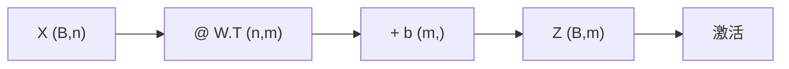

# DL-012 线性变换的矩阵形式

## 1. 本节学习目标

1. 说清"逐样本算"与"矩阵一次算"**完全等价**（本课最大差 0.0）。
2. 会推导 `(B,n) @ W.T + b` 的形状与含义。
3. 用实测数据理解**为什么要批量**：2000 条逐条 7.1 ms vs 批量 0.12 ms（约 59 倍）。
4. 掌握 `W` 的存储约定（`(out, in)`）与三种常见写法。

## 2. 为什么需要这个知识

因为**GPU 的速度来自矩阵运算**，不是来自"更快的循环"。

把"对每个样本做一次线性变换"写成矩阵乘，是从"能算"到"算得快"的关键一步——这也是为什么深度学习必须用张量库而不能纯 Python 循环。

## 3. 直观解释

**逐样本**（循环）：

```text
对 i = 1..B：
    out[i] = W @ x[i] + b
```

**矩阵形式**（一次）：

```text
out = X @ W.T + b
```

**为什么等价**：矩阵乘的定义就是"对每一行做一次内积"——它把循环**搬进了高度优化的底层实现**（BLAS/cuBLAS），并且能并行。

## 4. 正式定义

**单样本**

$$
\mathbf{z}=W\mathbf{x}+\mathbf{b},\qquad \mathbf{x}\in\mathbb{R}^{n},\ W\in\mathbb{R}^{m\times n}
$$

**批量**

$$
Z=XW^\top+\mathbf{b},\qquad X\in\mathbb{R}^{B\times n},\ Z\in\mathbb{R}^{B\times m}
$$

**形状表**

| 量 | 形状 |
|---|---|
| $X$ | `(B, n)` |
| $W$ | `(m, n)` |
| $W^\top$ | `(n, m)` |
| $XW^\top$ | `(B, m)` |
| $\mathbf{b}$ | `(m,)`，广播到 `(B, m)` |

## 5. 核心原理

**为什么 PyTorch 把 $W$ 存成 `(out, in)`**：

1. 一行 = 一个输出神经元的所有权重，便于按输出维度取用。
2. 前向写成 `x @ W.T`；底层仍可优化（无需真的转置，BLAS 支持转置标志）。
3. 与 `nn.Linear(in_features, out_features)` 的命名顺序一致（先 in 后 out，但存储反过来）。

**广播的规则**：$\mathbf{b}$ 形状 `(m,)` 会自动扩展成 `(B, m)`，**每一行加同一个偏置**。

## 6. 数学表达式

**展开矩阵乘**

$$
Z_{ij}=\sum_{k=1}^{n}X_{ik}W_{jk}+b_j
$$

**注意下标**：$W_{jk}$ 是"第 $j$ 个输出、第 $k$ 个输入"的权重（因为用了 $W^\top$）。

**本课的例子**

$$
X\in\mathbb{R}^{3\times2},\quad W_1\in\mathbb{R}^{2\times2}
\ \Rightarrow\ Z=XW_1^\top+\mathbf{b}_1\in\mathbb{R}^{3\times2}
$$

## 7. 数学推导

**逐样本与矩阵形式等价性证明**

逐样本第 $i$ 行：$\mathbf{z}_i=W\mathbf{x}_i+\mathbf{b}=W(X_{i,:})^\top+\mathbf{b}$。

矩阵形式第 $i$ 行：$(XW^\top)_{i,:}=X_{i,:}W^\top$，再加 $\mathbf{b}$。

由于 $(XW^\top)_{i,:}=X_{i,:}W^\top=(W X_{i,:}^\top)^\top$，两者逐元素相等 ⇒ **完全等价**。

**实测**：`np.allclose` 级差异 = **0.0**（数值完全相同）。

## 8. 结构示意图



## 9. 具体计算示例

**$B=3$、$n=2$、$m=2$**

```text
X 形状: (3, 2)
W1.T 形状: (2, 2)
输出: (3, 2)
逐样本 vs 矩阵 最大差: 0.0
```

**速度对比（2000 条）**

| 方式 | 耗时 |
|---|---|
| 逐条循环 | **7.1 ms** |
| 批量矩阵 | **0.12 ms** |
| 倍数 | **约 59×** |

**注意**：这只是 CPU 上 2000 条的小规模对比，GPU 上差距更悬殊。

## 10. Python 实现

```python
import time

import torch

torch.manual_seed(0)
W1 = torch.tensor([[0.5, -0.3], [0.2, 0.8]])
b1 = torch.tensor([0.1, -0.2])
X = torch.randn(3, 2)

out_loop = torch.stack([W1 @ X[i] + b1 for i in range(3)])
out_mat = X @ W1.T + b1
print("逐样本 vs 矩阵 最大差:", float((out_loop - out_mat).abs().max()))
print("X 形状:", tuple(X.shape), " W1.T:", tuple(W1.T.shape), " 输出:", tuple(out_mat.shape))
```

## 11. PyTorch 实现（速度对比）

```python
import time

import torch

W1 = torch.tensor([[0.5, -0.3], [0.2, 0.8]])
b1 = torch.tensor([0.1, -0.2])
big = torch.randn(20000, 2)

t0 = time.time()
_ = [W1 @ big[i] + b1 for i in range(2000)]
t1 = time.time()
_ = big[:2000] @ W1.T + b1
t2 = time.time()

print(f"2000 条逐条: {round((t1 - t0) * 1000, 1)} ms")
print(f"批量        : {round((t2 - t1) * 1000, 2)} ms")
```

## 12. 代码逐行解释

| 代码 | 作用 |
|---|---|
| `[W1 @ X[i] + b1 for i in range(3)]` | 逐样本循环（教学写法，实际不用） |
| `torch.stack(...)` | 把 3 个 `(2,)` 叠成 `(3,2)` |
| `X @ W1.T + b1` | 矩阵形式，一次算完 |
| `big[i]` | 取第 i 行 |
| `big[:2000]` | 取前 2000 行，批量算 |

**为什么 `W1 @ X[i]` 而矩阵形式用 `X @ W1.T`**：前者算的是 $W\mathbf{x}$（`(2,2)@(2,)`），后者是 $XW^\top$（`(B,2)@(2,2)`）——同一个结果的两种写法。

## 13. 实际运行结果

```text
X:
 [[ 1.541 -0.293]
 [-2.179  0.568]
 [-1.085 -1.399]]
逐样本 vs 矩阵 最大差: 0.0
X 形状: (3, 2)  W1.T 形状: (2, 2)  输出: (3, 2)
2000 条逐条: 7.1 ms; 批量: 0.12 ms
```

## 14. 应用场景

| 场景 | 说明 |
|---|---|
| 全连接层 | 一次算出整批 |
| 卷积（im2col） | 把卷积转成矩阵乘 |
| Attention | $QK^\top$ 就是矩阵乘 |
| 推理服务 | 批量推理显著提速 |

## 15. 优点与缺点

| 优点 | 缺点 |
|---|---|
| 快（底层 BLAS/cuBLAS） | 批量大时显存占用高 |
| 代码简洁、无显式循环 | 形状错误更难定位 |
| 天然并行（GPU） | 小批量时固定开销占比高 |

## 16. 常见错误

| 错误 | 现象 | 纠正 |
|---|---|---|
| 写成 `X @ W` | 形状不匹配 | 用 `X @ W.T` 或 `nn.Linear` |
| 忘记 $\mathbf{b}$ 广播 | 少加偏置 | `(m,)` 自动广播 |
| 混淆 `(B,n)` 与 `(n,B)` | 结果维度错 | 第一维永远是 batch |
| 小批量硬做"批量优化" | 反而更慢（见 ML-061） | 按规模实测 |
| 在循环里 `.item()` | 拖慢训练 | 累积后再转标量 |

## 17. 本节总结

- 批量前向：$Z=XW^\top+\mathbf{b}$，形状 `(B,n)→(B,m)`。
- 逐样本与矩阵形式**数值完全等价**（差 0.0），但速度差 **约 59 倍**。
- PyTorch 权重存 `(out,in)`，所以写作 `x @ W.T`。

## 18. 前置与后续

- 前置：[[DL-011 神经网络前向传播]]
- 后续：[[DL-013 输出层设计与输出维度]]、[[DL-015 均方误差 MSE]]
- 相关数学：[[MATH-217 矩阵运算与维度]]
- 相关 Python：[[PY-066 矩阵运算]]

---

## 练习与参考答案

**基础 1**：批量前向 `X @ W.T + b` 中，`X`、`W`、`b`、输出各是什么形状？

**基础 2**：本课逐样本与矩阵形式的最大差是多少？速度差多少倍？

**进阶 1**：为什么说"矩阵形式不是另一种算法，而是同一种算法的高效实现"？

**综合**：有一个 `(64, 100)` 的输入，要接到 `Linear(100, 10)`，请写出三种等价写法并说明哪一种最快。

> [!success]- 参考答案

> **基础 1**
> $X$：`(B, n)`；$W$：`(m, n)`；$W^\top$：`(n, m)`；$\mathbf{b}$：`(m,)` 广播为 `(B, m)`；输出：`(B, m)`。
> 本课 $B=3,n=2,m=2$ ⇒ 输出 `(3,2)`。

> **基础 2**
> 最大差 **0.0**（完全相同）；速度：逐条 **7.1 ms** vs 批量 **0.12 ms**，约 **59 倍**。

> **进阶 1**
> 因为矩阵乘的数学定义就是"对每一行做内积"——与循环做的事**逐元素相同**：
> $$Z_{ij}=\sum_k X_{ik}W_{jk}+b_j$$
> 差别只在**执行方式**：循环是 Python 逐次调用（有解释器开销），矩阵乘交给 BLAS/cuBLAS 的优化内核（向量化、多线程、GPU 并行）。
> 所以它是"同一算法的不同实现"，不是"不同算法"。

> **综合（参考）**
> 三种写法：
> 1. `nn.Linear(100, 10)(x)`
> 2. `x @ W.T + b`（$W$ 形状 `(10,100)`）
> 3. `x @ W2 + b`，其中 `W2 = W.T` 预先转置好（形状 `(100,10)`）
> **最快的是 1 或 3**：都避免了每次前向做转置。实际中 `nn.Linear` 已由底层处理（BLAS 支持转置标志，不一定真拷贝），所以**直接用 `nn.Linear` 最好**。
> 形状链：`(64,100) @ (100,10) + (10,)` → `(64,10)`。

## 学习记录

| 日期 | 状态 | 用时 | 问题 | 复盘 |
|---|---|---|---|---|
| 2026-11-07 | planned | — | — | — |

---

## 🔗 Notion 同步信息

> 以下内容由 Notion「AI Knowledge System · 知识点」数据库按知识 ID 合并而来（导出于 2026-11-09）。

| 属性 | 值 |
|---|---|
| 学科 | 深度学习 |
| 学习状态 | 未开始 |
| 难度 | L2 应用 |
| 知识类型 | Concept |

- **所属模块**：[M-DL-02 前向传播、损失函数与反向传播](../%E8%AF%BE%E7%A8%8B%E6%A8%A1%E5%9D%97/M-DL-02%20%E5%89%8D%E5%90%91%E4%BC%A0%E6%92%AD%E3%80%81%E6%8D%9F%E5%A4%B1%E5%87%BD%E6%95%B0%E4%B8%8E%E5%8F%8D%E5%90%91%E4%BC%A0%E6%92%AD.md)
- **前置知识**：[DL-011 神经网络前向传播](DL-011%20%E7%A5%9E%E7%BB%8F%E7%BD%91%E7%BB%9C%E5%89%8D%E5%90%91%E4%BC%A0%E6%92%AD.md)
- **后继知识**：[DL-013 输出层设计与输出维度](DL-013%20%E8%BE%93%E5%87%BA%E5%B1%82%E8%AE%BE%E8%AE%A1%E4%B8%8E%E8%BE%93%E5%87%BA%E7%BB%B4%E5%BA%A6.md)
- **关联Python**：[PY-066 矩阵运算](../../01_Python%E5%9F%BA%E7%A1%80/08%20NumPy/PY-066%20%E7%9F%A9%E9%98%B5%E8%BF%90%E7%AE%97.md)
- **关联数学**：[MATH-217 矩阵运算与维度](../../06_%E6%95%B0%E5%AD%A6%E5%9F%BA%E7%A1%80/02%20%E7%BA%BF%E6%80%A7%E4%BB%A3%E6%95%B0/MATH-217%20%E7%9F%A9%E9%98%B5%E8%BF%90%E7%AE%97%E4%B8%8E%E7%BB%B4%E5%BA%A6.md)
