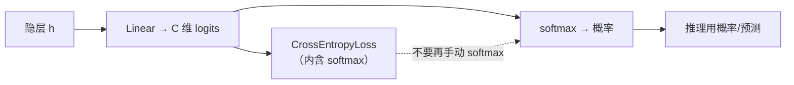

# DL-013 输出层设计与输出维度

## 1. 本节学习目标

1. 按**任务类型**决定输出维度与激活（回归 1、二分类 1、多分类 $C$）。
2. 理解 `CrossEntropyLoss` 为什么**自带 Softmax**，以及"重复 Softmax"造成的数值错误（本课 **1.3433 vs 1.0941**）。
3. 会用 logit 与概率两种口径，不混用。
4. 掌握"输出层不加激活 + 损失吃 logit"的工程规范。

## 2. 为什么需要这个知识

因为**输出层是唯一直接对应业务语义的层**：

- 输出维度错了 ⇒ 与标签形状不匹配，报错或静默错位。
- 激活用错 ⇒ 概率解释失效、损失数值异常。

本课用一个真实对比证明：**多套一层 Softmax，loss 从 1.3433 变成 1.0941**（看起来"更小"，其实完全错了）。

## 3. 直观解释

| 任务 | 输出层 | 激活 | 损失 |
|---|---|---|---|
| 回归 | 1 | 无 | MSE |
| 二分类 | 1 | 无（logit） | `BCEWithLogitsLoss` |
| 多分类 $C$ | $C$ | 无（logit） | `CrossEntropyLoss` |
| 多标签 | $C$ | 每维 Sigmoid | `BCEWithLogitsLoss` |

**一句话规则**：**输出层只做线性变换，归一化交给损失函数。**

## 4. 正式定义

**回归**

$$
\hat y=W\mathbf{h}+b\in\mathbb{R}
$$

**二分类**

$$
z=W\mathbf{h}+b\in\mathbb{R},\qquad \hat p=\sigma(z)
$$

**多分类**

$$
\mathbf{z}=W\mathbf{h}+\mathbf{b}\in\mathbb{R}^{C},\qquad
\hat{\mathbf{p}}=\mathrm{softmax}(\mathbf{z})
$$

**交叉熵损失（吃 logit）**

$$
L=-\log\frac{\exp(z_y)}{\sum_{j}\exp(z_j)}
$$

## 5. 核心原理

**为什么 `CrossEntropyLoss` 要自己带 Softmax**：

1. **数值稳定**：内部用 log-sum-exp，避免 $\exp$ 溢出与 $\log 0$。
2. **梯度简洁**：$\partial L/\partial z_j=\hat p_j-\mathbb{1}[j=y]$，非常干净。
3. **避免重复归一化**：你自己再做一次 Softmax，等于让 logits 先被压缩到 (0,1) 再算 CE ⇒ **概率被平方级压扁**，loss 失真。

**本课实测（同一批 logits）**

| 写法 | loss |
|---|---|
| `cross_entropy(logits, y)` | **1.3433** ✅ |
| `cross_entropy(softmax(logits), y)` | 1.0941 ❌ |
| 差值 | **0.2492** |

**错在哪**：第二种把已经是概率的输入又当成 logit 做了一次 softmax ⇒ 分布更平 ⇒ 交叉熵偏小。**看起来"更好"，其实是错的。**

## 6. 数学表达式

**Softmax**

$$
\hat p_j=\frac{e^{z_j}}{\sum_{k=1}^{C}e^{z_k}},\qquad \sum_j\hat p_j=1
$$

**交叉熵**

$$
L=-\sum_{j=1}^{C}y_j\log\hat p_j
$$

**本课（$C=3$，5 个样本）**：softmax 每行和 = `[1.0, 1.0, 1.0, 1.0, 1.0]` ✅。

## 7. 数学推导

**为什么重复 Softmax 会改变 loss**

设原始 logits 经 softmax 得 $p$，重复 softmax 得 $q$：

$$
q_j=\frac{e^{p_j}}{\sum_k e^{p_k}}
$$

因为 $p_j\in(0,1)$，$e^{p_j}\in(1,e)$，所以 $q$ 比 $p$ **更接近均匀分布**（差距被指数压缩）。

而交叉熵 $-\log q_y$ 对"更平的分布"给出**更小的损失**——这解释了 1.0941 < 1.3433。

**但它对应的模型是错的**：推理时用 softmax 概率、训练时用双 softmax 的 logit，**训练与推理口径不一致**。

**正确做法**：输出层给 logit，损失函数做唯一一次归一化。

## 8. 结构示意图



## 9. 具体计算示例

**三分类输出**

```text
回归输出: (5, 1)
二分类 logit: (5, 1) → sigmoid: (5, 1)
三分类 logits: (5, 3)
softmax 每行和: [1.0, 1.0, 1.0, 1.0, 1.0]
CrossEntropy(logits): 1.3433
CrossEntropy(softmax(logits)): 1.0941   ← 错误写法
差值: 0.2492
```

## 10. Python 实现

```python
import torch
import torch.nn as nn
import torch.nn.functional as F

reg = nn.Linear(4, 1)
bin_ = nn.Linear(4, 1)
multi = nn.Linear(4, 3)
x = torch.randn(5, 4)

print("回归输出:", tuple(reg(x).shape))
print("二分类 logit:", tuple(bin_(x).shape))
print("三分类 logits:", tuple(multi(x).shape))
```

## 11. PyTorch 实现（正确 vs 错误写法）

```python
import torch
import torch.nn.functional as F

logits = torch.tensor([
    [2.0, 0.5, -1.0],
    [-0.5, 1.5, 0.2],
    [0.1, 0.2, 2.5],
])
y = torch.tensor([0, 1, 2])

ce_direct = F.cross_entropy(logits, y)
ce_double = F.cross_entropy(torch.softmax(logits, dim=1), y)

print("CrossEntropy(logits):", round(float(ce_direct), 4))
print("CrossEntropy(softmax):", round(float(ce_double), 4))
print("差值:", round(abs(float(ce_direct) - float(ce_double)), 4))
```

## 12. 代码逐行解释

| 代码 | 作用 |
|---|---|
| `nn.Linear(4, 1)` | 回归/二分类输出（1 维） |
| `nn.Linear(4, 3)` | 三分类输出（3 维 logits） |
| `torch.softmax(logits, dim=1)` | 沿类别维（dim=1）归一化 |
| `F.cross_entropy(logits, y)` | **正确**：内部做 log-softmax |
| `F.cross_entropy(softmax, y)` | **错误**：二次归一化 |
| `round(..., 4)` | 只看 4 位，便于对比 |

**关键点**：`dim=1` 不能写错——对 `(B,C)` 的张量，类别维是第 1 维；写成 `dim=0` 会把不同样本混在一起归一化。

## 13. 实际运行结果

```text
回归输出: (5, 1)
二分类 logit: (5, 1) sigmoid: (5, 1)
三分类 logits: (5, 3)
softmax 每行和: [1.0, 1.0, 1.0, 1.0, 1.0]
CrossEntropy(logits): 1.3433
CrossEntropy(softmax(logits)) 重复归一化: 1.0941
差值: 0.2492
```

## 14. 应用场景

| 场景 | 输出设计 |
|---|---|
| 回归（价格/温度） | 1 维，无激活 |
| 二分类（是否流失） | 1 维 logit + BCEWithLogits |
| 多分类（MNIST 10 类） | 10 维 logit + CrossEntropy |
| 多标签（一张图多个物体） | $C$ 维 + 每维 sigmoid + BCE |
| 序列标注 | `(B,T,C)` + CrossEntropy（需 reshape） |

## 15. 优点与缺点

| 方案 | 优点 | 缺点 |
|---|---|---|
| logit + 带 logits 的损失 | 数值稳、梯度干净 | 需记住"不要再 softmax" |
| softmax + NLLLoss | 等价（手动两步） | 多一步、易出错 |
| 输出层加激活 | 直观 | 与损失冲突（本课 0.2492 的错） |

## 16. 常见错误

| 错误 | 现象 | 纠正 |
|---|---|---|
| 输出层加 Softmax 又用 CrossEntropy | loss 偏小但模型错 | 只留 logit |
| `dim` 写错 | 概率和不为 1 | `dim=1` |
| 多分类用 Sigmoid | 各类概率不互斥 | Softmax/CrossEntropy |
| 二分类用 Softmax(2) | 与标签形状不符 | 1 维 + BCE |
| 推理时忘加 softmax | 输出不是概率 | 推理时手动 softmax（训练不加） |
| 标签是 one-hot 却用 CE | 形状报错 | one-hot 用 `BCELoss` 或先转索引 |

## 17. 本节总结

- 输出维度由**任务**定：回归 1、二分类 1、多分类 $C$。
- **输出层不加激活**，让 `CrossEntropyLoss`/`BCEWithLogitsLoss` 内部归一化。
- 重复 Softmax 会让 loss 从 **1.3433** 变 **1.0941** —— 数值更小但**完全错误**。

## 18. 前置与后续

- 前置：[[DL-012 线性变换的矩阵形式]]
- 后续：[[DL-014 损失函数总览与选择]]、`DL-017 多分类交叉熵与 Softmax`（待建）
- 相关数学：[[MATH-805 Softmax 与交叉熵]]
- 相关机器学习：[[ML-024 分类任务基本概念]]、[[ML-025 逻辑回归]]

---

## 练习与参考答案

**基础 1**：回归、二分类、多分类（$C$ 类）的输出维度各是多少？分别用什么激活与损失？

**基础 2**：本课两种写法的 loss 各是多少？差多少？

**进阶 1**：为什么"重复 Softmax"会让 loss 变小？这算不算模型变好了？

**综合**：一个 5 类分类任务，训练 loss 正常下降，但上线后发现预测概率全部集中在 0.2 附近。请诊断原因。

> [!success]- 参考答案

> **基础 1**
> - 回归：1 维，**无激活**，MSE。
> - 二分类：1 维，**无激活（logit）**，`BCEWithLogitsLoss`。
> - 多分类 $C$：$C$ 维，**无激活（logit）**，`CrossEntropyLoss`。
> （推理时再手动 sigmoid/softmax 转概率。）

> **基础 2**
> `CrossEntropy(logits)` = **1.3433**；`CrossEntropy(softmax)` = **1.0941**；差 **0.2492**。

> **进阶 1**
> 因为 softmax 会把输入压缩到 (0,1)，再做一次 softmax 相当于把分布**进一步推向均匀**。
> 交叉熵对均匀分布给出更小的值（$-\log(1/C)$ 附近），所以 loss 变小。
> **但这不是模型变好**：它意味着"训练时的目标函数"和"推理时的概率语义"不一致，模型学到的是被扭曲的分布。
> 判断依据：看**测试集准确率与校准**（如 ECE），而不是只看 loss 数值。

> **综合（参考）**
> **诊断**：概率集中在 $1/5=0.2$ 附近 ⇒ 模型**几乎没有区分度**，输出接近均匀分布。常见原因：
> 1. **重复 Softmax**：训练时 CE 吃的是 softmax 结果 ⇒ 梯度被压平，模型学不到尖锐分布；
> 2. **标签错误**：所有标签被写成同一类或未正确对齐；
> 3. **输出层维度错**：5 类但输出维度写成别的数（如 1 维）⇒ 广播/错位；
> 4. **训练不足或学习率过小**：loss 虽降但主要靠偏置项。
> **排查顺序**：
> 1. 打印 `logits` 与 `softmax(logits)` 的方差/最大值（是否过于平坦）；
> 2. 检查损失调用是否 `F.cross_entropy(logits, y)`（**不是** softmax 后）；
> 3. 检查 `y` 的取值集合与 `num_classes` 是否一致；
> 4. 用一批数据过拟合测试（能否把 20 条训到 100% 准确）——不能则说明模型/流程有硬 bug。

## 学习记录

| 日期 | 状态 | 用时 | 问题 | 复盘 |
|---|---|---|---|---|
| 2026-11-07 | planned | — | — | — |

---

## 🔗 Notion 同步信息

> 以下内容由 Notion「AI Knowledge System · 知识点」数据库按知识 ID 合并而来（导出于 2026-11-09）。

| 属性 | 值 |
|---|---|
| 学科 | 深度学习 |
| 学习状态 | 未开始 |
| 难度 | L2 应用 |
| 知识类型 | Concept |

- **所属模块**：[M-DL-02 前向传播、损失函数与反向传播](../%E8%AF%BE%E7%A8%8B%E6%A8%A1%E5%9D%97/M-DL-02%20%E5%89%8D%E5%90%91%E4%BC%A0%E6%92%AD%E3%80%81%E6%8D%9F%E5%A4%B1%E5%87%BD%E6%95%B0%E4%B8%8E%E5%8F%8D%E5%90%91%E4%BC%A0%E6%92%AD.md)
- **前置知识**：[DL-012 线性变换的矩阵形式](DL-012%20%E7%BA%BF%E6%80%A7%E5%8F%98%E6%8D%A2%E7%9A%84%E7%9F%A9%E9%98%B5%E5%BD%A2%E5%BC%8F.md)
- **后继知识**：[DL-014 损失函数总览与选择](DL-014%20%E6%8D%9F%E5%A4%B1%E5%87%BD%E6%95%B0%E6%80%BB%E8%A7%88%E4%B8%8E%E9%80%89%E6%8B%A9.md)
- **关联Python**：[PY-066 矩阵运算](../../01_Python%E5%9F%BA%E7%A1%80/08%20NumPy/PY-066%20%E7%9F%A9%E9%98%B5%E8%BF%90%E7%AE%97.md)
- **关联数学**：[MATH-805 Softmax 与交叉熵](../../06_%E6%95%B0%E5%AD%A6%E5%9F%BA%E7%A1%80/08%20%E6%9C%BA%E5%99%A8%E5%AD%A6%E4%B9%A0%E6%95%B0%E5%AD%A6%E5%BA%94%E7%94%A8/MATH-805%20Softmax%20%E4%B8%8E%E4%BA%A4%E5%8F%89%E7%86%B5.md)
