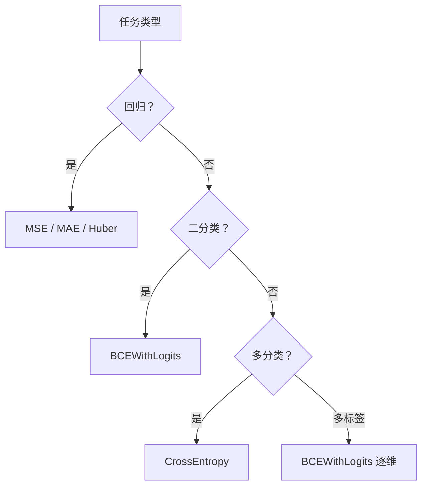

# DL-014 损失函数总览与选择

## 1. 本节学习目标

1. 说清 MSE / BCE / CE 各自衡量什么、配什么输出层。
2. **用数值证明"分类任务用 MSE 会梯度消失"**（logit=5 时 MSE 梯度 0.0132 vs BCE **0.9933**）。
3. 会按任务选损失，而不是默认用 MSE。
4. 知道"损失 = 优化目标"，改损失等于改任务。

## 2. 为什么需要这个知识

因为**损失函数决定了模型在优化什么**。

用错损失不会报错，只会让模型"学得很努力但学错方向"——本课实测：分类任务用 MSE 时，越自信的错误预测，**梯度越小**（趋近 0），模型反而学不动。

## 3. 直观解释

| 损失 | 衡量 | 典型配 |
|---|---|---|
| **MSE** | 预测值与目标差多少（平方） | 回归 |
| **MAE** | 差的绝对值 | 回归（抗异常值） |
| **BCE** | 二分类概率错多少 | 二分类 |
| **CE** | 多分类概率错多少 | 多分类 |

**核心区别**：MSE 惩罚"**数值差**"，BCE/CE 惩罚"**概率分配的错**"。

## 4. 正式定义

**MSE**

$$
L_{\text{MSE}}=\frac1n\sum_{i=1}^{n}(\hat y_i-y_i)^2
$$

**BCE（二分类交叉熵）**

$$
L_{\text{BCE}}=-\frac1n\sum_{i=1}^n\big[y_i\log\hat p_i+(1-y_i)\log(1-\hat p_i)\big]
$$

**CE（多分类）**

$$
L_{\text{CE}}=-\frac1n\sum_{i=1}^n\log \hat p_{i,y_i}
$$

**带 logits 版本**

$$
L_{\text{BCE-with-logits}}=\frac1n\sum_i\big[\max(z_i,0)-z_iy_i+\log(1+e^{-|z_i|})\big]
$$

## 5. 核心原理

**本课最关键的一组数（同一 logit，标签为 0）**

| logit $z$ | sigmoid | MSE 对 $z$ 的梯度 | BCE 对 $z$ 的梯度 |
|---|---|---|---|
| 0.0 | 0.5000 | 0.250000 | 0.5000 |
| 2.0 | 0.8808 | 0.184956 | 0.8808 |
| **5.0** | **0.9933** | **0.013207** | **0.9933** |

**读法**：

- 模型**非常自信地判错**（logit=5 ⇒ 概率 0.9933，但标签是 0）。
- **BCE 的梯度 0.9933**（几乎满格）⇒ 强力纠正。
- **MSE 的梯度只有 0.0132**（差 75 倍）⇒ 几乎学不动。

**这就是"分类必须用交叉熵"的定量理由**：sigmoid 饱和区让 MSE 梯度消失，而 BCE 恰好抵消了 sigmoid 的导数。

## 6. 数学表达式

**BCE 对 logit 的梯度推导**

$$
\hat p=\sigma(z),\qquad
\frac{\partial L}{\partial z}=\hat p-y
$$

**验证**：$z=5,y=0$ ⇒ $\hat p=0.9933$ ⇒ 梯度 $0.9933$ ✅（与实测一致）。

**MSE 对 logit 的梯度**

$$
L=(\hat p-y)^2,\qquad
\frac{\partial L}{\partial z}=2(\hat p-y)\,\sigma'(z)
$$

$z=5$ 时：$\sigma'=0.9933\times0.0067=0.00665$ ⇒ $2\times0.9933\times0.00665=0.0132$ ✅。

## 7. 数学推导

**为什么 BCE 的梯度这么干净**

$$
\frac{\partial}{\partial z}\big[-\log\sigma(z)\big]=-(1-\sigma(z))=-\,(1-\hat p)
$$

$$
\frac{\partial}{\partial z}\big[-\log(1-\sigma(z))\big]=\sigma(z)=\hat p
$$

合并：$\partial L/\partial z=\hat p-y$。

**关键**：sigmoid 的导数 $\sigma'(z)$ 被**约掉**了 ⇒ 无论 $z$ 多大，梯度都等于"预测与真实的差"。

**MSE 没这个好运**：$\sigma'$ 留在式子里，饱和时 $\sigma'\to0$ ⇒ 梯度消失。

## 8. 结构示意图



## 9. 具体计算示例

**同一预测 0.99，标签不同**

```text
MSE(0.99 vs 1) = 0.0001
MSE(0.99 vs 0) = 0.9801
BCE(0.99 vs 0) = 4.6052
BCEWithLogits(4.6 vs 0) = 4.61
```

**读法**：模型把"该是 0"的样本判成 0.99，MSE 只罚 0.98，**BCE 罚 4.61**（约 4.7 倍）——交叉熵对"自信的错误"惩罚更重。

## 10. Python 实现

```python
import torch
import torch.nn.functional as F

p_bad = torch.tensor([0.99])
y0 = torch.tensor([0.0])
y1 = torch.tensor([1.0])

print("MSE(0.99 vs 1):", round(float(F.mse_loss(p_bad, y1)), 6))
print("MSE(0.99 vs 0):", round(float(F.mse_loss(p_bad, y0)), 6))
print("BCE(0.99 vs 0):", round(float(F.binary_cross_entropy(p_bad, y0)), 4))
logit = torch.tensor([4.6])
print("BCEWithLogits(4.6 vs 0):",
      round(float(F.binary_cross_entropy_with_logits(logit, torch.tensor([0.0]))), 4))
```

## 11. PyTorch 实现（梯度对比）

```python
import torch
import torch.nn.functional as F

for z in (0.0, 2.0, 5.0):
    zt = torch.tensor([z], requires_grad=True)
    l_mse = F.mse_loss(torch.sigmoid(zt), torch.tensor([0.0]))
    l_mse.backward()
    g_mse = float(zt.grad)

    zt2 = torch.tensor([z], requires_grad=True)
    l_bce = F.binary_cross_entropy_with_logits(zt2, torch.tensor([0.0]))
    l_bce.backward()
    g_bce = float(zt2.grad)

    print(f"logit={z}: MSE梯度={g_mse:.6f} BCE梯度={g_bce:.4f}")
```

## 12. 代码逐行解释

| 代码 | 作用 |
|---|---|
| `F.mse_loss(pred, target)` | 均方误差，输入是**概率** |
| `F.binary_cross_entropy(p, y)` | BCE，输入必须是 (0,1) 概率，越界会 NaN |
| `F.binary_cross_entropy_with_logits(z, y)` | BCE，输入 logit，内部 sigmoid，数值稳 |
| `requires_grad=True` | 让 logit 参与求导，便于看梯度 |
| `zt.grad` | 读梯度，单位是"每单位 logit 的损失变化" |

**为什么用 `_with_logits`**：直接吃概率的 BCE 在 $p=0$ 或 $1$ 时会 $\log 0$ ⇒ `inf`/NaN；带 logits 版本用数值稳定公式。

## 13. 实际运行结果

```text
MSE(0.99 vs 1): 0.0001  MSE(0.99 vs 0): 0.9801
BCE(0.99 vs 0): 4.6052
BCEWithLogits(4.6 vs 0): 4.61
logit=0.0: sigmoid=0.5000 MSE梯度=0.250000 BCE梯度=0.5000
logit=2.0: sigmoid=0.8808 MSE梯度=0.184956 BCE梯度=0.8808
logit=5.0: sigmoid=0.9933 MSE梯度=0.013207 BCE梯度=0.9933
```

## 14. 应用场景

| 任务 | 推荐损失 | 备注 |
|---|---|---|
| 回归（一般） | MSE | 对异常值敏感 |
| 回归（有离群） | MAE / Huber | Huber 兼顾两者 |
| 二分类 | BCEWithLogits | 概率解释 |
| 多分类 | CrossEntropy | 内含 softmax |
| 多标签 | BCEWithLogits 逐维 | 概率不互斥 |
| 类别不平衡 | 加权 CE / Focal Loss | 见 ML-032 |

## 15. 优点与缺点

| 损失 | 优点 | 缺点 |
|---|---|---|
| MSE | 可微、凸（线性时） | 对异常值敏感、分类时梯度消失 |
| MAE | 抗异常值 | 0 点不可导 |
| BCE/CE | 梯度干净、概率校准 | 对标签噪声敏感 |
| Huber | 兼顾 | 多一个超参 |

## 16. 常见错误

| 错误 | 现象 | 纠正 |
|---|---|---|
| 分类任务用 MSE | 训练慢、准确率低 | 换 BCE/CE |
| BCE 输入 logit | NaN/报错 | 用 `_with_logits` |
| 输出层加 sigmoid 又用 `_with_logits` | 双重压缩 | 只留 logit |
| 多分类标签用 one-hot 传给 CE | 形状错误 | 传类别索引 |
| 回归用 MSE 但数据有极端值 | 被拉偏 | 改 Huber/MAE 或处理异常 |
| 只看 loss 不看指标 | loss 降但准确率不升 | 同时监控任务指标 |

## 17. 本节总结

- **损失 = 优化目标**；选错等于解错题。
- 分类用 BCE/CE 的核心理由：梯度 $\hat p-y$，**不会被 sigmoid 饱和压掉**。
- 实测：logit=5 判错时，MSE 梯度 **0.0132** vs BCE **0.9933**（差 75 倍）。

## 18. 前置与后续

- 前置：[[DL-013 输出层设计与输出维度]]
- 后续：[[DL-015 均方误差 MSE]]、`DL-017 多分类交叉熵与 Softmax`（待建）
- 相关数学：[[MATH-805 Softmax 与交叉熵]]
- 相关机器学习：[[ML-023 回归评价指标与残差诊断]]、[[ML-043 混淆矩阵与分类指标]]

---

## 练习与参考答案

**基础 1**：MSE、BCE、CE 各衡量什么？分别配什么输出层？

**基础 2**：本课 logit=5（标签 0）时，MSE 与 BCE 对 logit 的梯度各是多少？

**进阶 1**：为什么 BCE 的梯度能写成简洁的 $\hat p-y$？

**综合**：一个二分类模型训练 loss 一直降，但验证集 AUC 只有 0.55。检查后发现用的是 MSE + Sigmoid 输出。请改方案并说明预期改善。

> [!success]- 参考答案

> **基础 1**
> - **MSE**：预测数值与目标差的平方和 ⇒ 回归（输出 1 维，无激活）。
> - **BCE**：二分类概率与 0/1 标签的交叉熵 ⇒ 二分类（1 维 logit）。
> - **CE**：多分类概率与类别索引的交叉熵 ⇒ 多分类（$C$ 维 logit）。

> **基础 2**
> MSE 梯度 **0.013207**，BCE 梯度 **0.9933**（约 75 倍差距）。
> 原因：MSE 梯度含 $\sigma'(z)=\hat p(1-\hat p)$，在 $z=5$ 时只有 0.00665；BCE 把 $\sigma'$ 约掉了。

> **进阶 1**
> 因为 sigmoid 与 log 互为逆运算：
> $$\frac{\partial}{\partial z}\big[-\log\sigma(z)\big]=-(1-\sigma(z))$$
> $$\frac{\partial}{\partial z}\big[-\log(1-\sigma(z))\big]=\sigma(z)$$
> 合起来正好是 $\hat p-y$。**sigmoid 的导数被分母约掉**，所以梯度只反映"预测与真实的差"，不随饱和衰减。

> **综合（参考）**
> **改方案**：
> 1. 损失换成 `F.binary_cross_entropy_with_logits(logits, y)`；
> 2. 输出层去掉 sigmoid（只保留 1 维 Linear）；
> 3. 指标改看 **AUC / PR-AUC**（不平衡时），而不是 loss。
> **预期改善**：梯度从"被 $\sigma'$ 压扁"变成 $\hat p-y$，模型能有效纠正自信错误 ⇒ AUC 应明显上升；训练初期 loss 可能"看起来降得更慢"，但**判别能力更强**。
> **验证**：对比改前/改后同一划分的 AUC 与校准曲线；若 AUC 仍低，再查特征与标签质量。

## 学习记录

| 日期 | 状态 | 用时 | 问题 | 复盘 |
|---|---|---|---|---|
| 2026-11-07 | planned | — | — | — |

---

## 🔗 Notion 同步信息

> 以下内容由 Notion「AI Knowledge System · 知识点」数据库按知识 ID 合并而来（导出于 2026-11-09）。

| 属性 | 值 |
|---|---|
| 学科 | 深度学习 |
| 学习状态 | 未开始 |
| 难度 | L2 应用 |
| 知识类型 | Concept |

- **所属模块**：[M-DL-02 前向传播、损失函数与反向传播](../%E8%AF%BE%E7%A8%8B%E6%A8%A1%E5%9D%97/M-DL-02%20%E5%89%8D%E5%90%91%E4%BC%A0%E6%92%AD%E3%80%81%E6%8D%9F%E5%A4%B1%E5%87%BD%E6%95%B0%E4%B8%8E%E5%8F%8D%E5%90%91%E4%BC%A0%E6%92%AD.md)
- **前置知识**：[DL-013 输出层设计与输出维度](DL-013%20%E8%BE%93%E5%87%BA%E5%B1%82%E8%AE%BE%E8%AE%A1%E4%B8%8E%E8%BE%93%E5%87%BA%E7%BB%B4%E5%BA%A6.md)
- **后继知识**：[DL-015 均方误差 MSE](DL-015%20%E5%9D%87%E6%96%B9%E8%AF%AF%E5%B7%AE%20MSE.md)
- **关联数学**：[MATH-805 Softmax 与交叉熵](../../06_%E6%95%B0%E5%AD%A6%E5%9F%BA%E7%A1%80/08%20%E6%9C%BA%E5%99%A8%E5%AD%A6%E4%B9%A0%E6%95%B0%E5%AD%A6%E5%BA%94%E7%94%A8/MATH-805%20Softmax%20%E4%B8%8E%E4%BA%A4%E5%8F%89%E7%86%B5.md)
