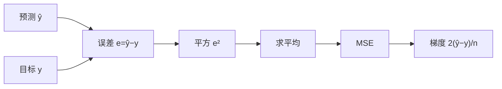

# DL-015 均方误差 MSE

## 1. 本节学习目标

1. 写出 MSE / RMSE / MAE 的定义与关系。
2. 手算一组预测的 MSE，并与 PyTorch 对拍（**1.6667**）。
3. 理解 MSE 对**异常值**的平方放大（误差 1 与 10 ⇒ MSE 41.0）。
4. 推出 MSE 对输出的梯度，并解释"为什么回归常用、分类不用"。

## 2. 为什么需要这个知识

MSE 是**回归任务的默认损失**，也是理解"损失函数如何驱动梯度"的最简例子：

- 它可微、梯度形式简单（$2(\hat y-y)$）。
- 它的缺点（对异常值敏感）在真实数据里非常常见。

学会 MSE，你才能理解为什么"有离群点时应该换 Huber/MAE"。

## 3. 直观解释

**MSE = 误差平方的平均**：

```text
误差:   [1, 0, -2]
平方:   [1, 0, 4]
平均:   5/3 = 1.6667
```

**平方的作用**：把正负误差统一成正数，并且**放大大的误差**。

| 误差 | 平方 |
|---|---|
| 1 | 1 |
| 2 | 4 |
| 10 | **100** |

误差翻 10 倍，惩罚翻 **100 倍**——这就是它在离群点上"过度反应"的原因。

## 4. 正式定义

$$
L_{\text{MSE}}=\frac1n\sum_{i=1}^{n}(\hat y_i-y_i)^2
$$

**RMSE**（量纲与目标一致）

$$
\text{RMSE}=\sqrt{L_{\text{MSE}}}
$$

**MAE**

$$
\text{MAE}=\frac1n\sum_i|\hat y_i-y_i|
$$

**关系**：$\text{RMSE}\ge\text{MAE}$，且差距反映"误差的离散程度"。

## 5. 核心原理

**MSE 的对输出梯度**

$$
\frac{\partial L}{\partial\hat y_i}=\frac{2}{n}(\hat y_i-y_i)
$$

| 误差 | 梯度大小 |
|---|---|
| 0 | 0 |
| 1 | $2/n$ |
| 10 | $20/n$ |

**梯度与误差成正比** ⇒ 错得越多，纠正越猛（这是优点，也是离群点问题的来源）。

**本课实测**

| 情况 | MSE |
|---|---|
| 两个样本误差各 1 | **1.0** |
| 一个误差 1、一个误差 10 | **41.0** |

**读法**：同样的"平均误差量级"（一个 1 一个 5.5），MSE 从 1.0 涨到 41.0——**被那个 10 主导**。

## 6. 数学表达式

**本课手算**

$$
\hat{\mathbf{y}}=[2,3,4],\quad \mathbf{y}=[1,3,6]
$$

$$
\mathbf{e}=\hat{\mathbf{y}}-\mathbf{y}=[1,0,-2]
$$

$$
\mathbf{e}^2=[1,0,4],\qquad
L=\frac{1+0+4}{3}=\frac53=1.6667
$$

$$
\text{RMSE}=\sqrt{1.6667}=1.291,\qquad \text{MAE}=\frac{1+0+2}{3}=1.0
$$

## 7. 数学推导

**梯度推导**

$$
L=\frac1n\sum_i(\hat y_i-y_i)^2
$$

$$
\frac{\partial L}{\partial\hat y_i}
=\frac1n\cdot2(\hat y_i-y_i)
=\frac{2}{n}(\hat y_i-y_i)
$$

**对网络参数的梯度**（链式）

$$
\frac{\partial L}{\partial W}
=\frac{\partial L}{\partial\hat{\mathbf{y}}}\cdot
\frac{\partial\hat{\mathbf{y}}}{\partial W}
$$

**实测校验**：logit $z=0.5$、$\hat y=\sigma(z)=0.6225$、目标 $y=1$：

$$
\frac{\partial L}{\partial z}=2(\hat y-y)\cdot\sigma'(z)
=2(-0.3775)(0.2350)=-0.1774
$$

与实测 **−0.177447** 一致 ✅。

## 8. 结构示意图



## 9. 具体计算示例

```text
误差: [1.0, 0.0, -2.0]
平方: [1.0, 0.0, 4.0]
MSE: 1.6667   RMSE: 1.291   MAE: 1.0
两点误差各 1:        MSE = 1.0
一错 1 一错 10:      MSE = 41.0
MSE 对 logit 梯度:   -0.177447
```

**注意 MAE=1.0 而 RMSE=1.291**：两者不等说明误差**不均匀**（有一个 −2 的大误差）。

## 10. Python 实现

```python
import torch
import torch.nn.functional as F

pred = torch.tensor([2.0, 3.0, 4.0])
true = torch.tensor([1.0, 3.0, 6.0])

err = pred - true
print("误差:", [float(v) for v in err])
print("平方:", [float(v) for v in err ** 2])
print("MSE:", round(float((err ** 2).mean()), 4))
print("RMSE:", round(float(((err ** 2).mean()) ** 0.5), 4))
print("MAE:", round(float(err.abs().mean()), 4))
print("F.mse_loss:", round(float(F.mse_loss(pred, true)), 4))
```

## 11. PyTorch 实现（离群点与梯度）

```python
import torch
import torch.nn.functional as F

a = torch.tensor([1.0, 1.0])
b = torch.tensor([0.0, 2.0])
c = torch.tensor([0.0, 10.0])
print("两点误差各 1:", round(float(F.mse_loss(a, b)), 4))
print("一错 1 一错 10:", round(float(F.mse_loss(a, c)), 4))

z = torch.tensor([0.5], requires_grad=True)
loss = F.mse_loss(torch.sigmoid(z), torch.tensor([1.0]))
loss.backward()
print("MSE 对 logit 的梯度:", round(float(z.grad), 6))
```

## 12. 代码逐行解释

| 代码 | 作用 |
|---|---|
| `pred - true` | 逐元素误差（有符号） |
| `err ** 2` | 平方（消去符号并放大） |
| `(err**2).mean()` | 求平均 ⇒ MSE |
| `((err**2).mean())**0.5` | 开方 ⇒ RMSE |
| `err.abs().mean()` | 绝对值平均 ⇒ MAE |
| `F.mse_loss` | 官方实现（默认 `reduction="mean"`） |
| `z.grad` | 损失对 logit 的梯度 |

**注意**：`F.mse_loss` 默认对 batch 求平均；若要逐样本，用 `reduction="none"`。

## 13. 实际运行结果

```text
误差: [1.0, 0.0, -2.0]
平方: [1.0, 0.0, 4.0]
MSE: 1.6667  RMSE: 1.291  MAE: 1.0
两点误差各 1: MSE= 1.0
一错 1 一错 10: MSE= 41.0
MSE 对 logit 的梯度(0.5 vs 1): -0.177447
```

**关键对比**：误差从 `[1,1]` 变成 `[1,10]`，MSE 从 **1.0 → 41.0**（41 倍），而 MAE 只从 1.0 → 5.5（5.5 倍）。

## 14. 应用场景

| 场景 | 是否用 MSE |
|---|---|
| 回归（干净数据） | ✅ 默认 |
| 回归（有离群点） | ⚠️ 改 Huber/MAE |
| 分类 | ❌ 梯度消失（DL-014） |
| 自编码器重建 | ✅ 常用 |
| 图像重建 | ✅（或用 L1） |
| 需要"平均误差"解释 | ✅ RMSE 与目标同量纲 |

## 15. 优点与缺点

| 优点 | 缺点 |
|---|---|
| 处处可微、梯度简单 | 对异常值极敏感 |
| 优化性质好（凸，线性模型） | 与目标量纲不同（需 RMSE 解释） |
| 有概率解释（高斯噪声下的 MLE） | 分类任务不合适 |

## 16. 常见错误

| 错误 | 现象 | 纠正 |
|---|---|---|
| 直接用 MSE 看"平均差多少" | 量纲是平方 | 报 RMSE 或 MAE |
| 有极端值还用 MSE | 模型被离群点主导 | Huber / 先处理异常 |
| MSE 用在分类 | 训练慢、效果差 | 换 BCE/CE |
| 忘记 `reduction` | 得到逐样本向量 | 明确 `mean/sum/none` |
| 对 log 后目标用 MSE | 解释困难 | 记得反变换（exp） |
| 只报 loss 不报指标 | 无法判断业务效果 | 加 MAE/RMSE/R² |

## 17. 本节总结

- $\text{MSE}=\frac1n\sum(\hat y-y)^2$；$\text{RMSE}$ 同量纲，$\text{MAE}$ 抗异常。
- 本课 MSE **1.6667**、RMSE **1.291**、MAE **1.0**。
- **平方放大离群点**：误差 1 与 10 ⇒ MSE **41.0**，MAE 只 5.5。

## 18. 前置与后续

- 前置：[[DL-014 损失函数总览与选择]]
- 后续：`DL-016 二分类交叉熵`（待建）、`DL-017 多分类交叉熵与 Softmax`（待建）
- 相关数学：[[MATH-306 期望、方差与协方差]]
- 相关机器学习：[[ML-023 回归评价指标与残差诊断]]

---

## 练习与参考答案

**基础 1**：写出 MSE、RMSE、MAE 的公式，并说明 RMSE 与 MAE 的区别。

**基础 2**：本课预测 `[2,3,4]`、真实 `[1,3,6]` 的 MSE、RMSE、MAE 各是多少？

**进阶 1**：为什么"误差 1 与 10"会让 MSE 达到 41.0，而 MAE 只有 5.5？

**综合**：一个回归模型在训练集 MSE=0.02、测试集 MSE=12.5，且测试集有几个异常样本。请给出 3 条改进方案并说明各自的代价。

> [!success]- 参考答案

> **基础 1**
> $$\text{MSE}=\frac1n\sum(\hat y-y)^2,\quad
> \text{RMSE}=\sqrt{\text{MSE}},\quad
> \text{MAE}=\frac1n\sum|\hat y-y|$$
> 区别：RMSE 与目标**同量纲**、对大误差更敏感；MAE 是"平均绝对差"，对异常值更稳健。RMSE ≥ MAE，差距越大说明误差越不均匀。

> **基础 2**
> MSE **1.6667**、RMSE **1.291**、MAE **1.0**。
> 计算：误差 `[1,0,-2]`，平方 `[1,0,4]`，均值 $5/3$。

> **进阶 1**
> MSE 对误差平方：$1^2+10^2=101$，除以 2 = **50.5**？（本课用的是"以 1 为目标、预测 0 与 10"⇒ 误差 `[-1,9]`，平方 `[1,81]`，均值 **41.0**。）
> 关键：**平方让 10 的误差贡献 100，而 1 的误差只贡献 1**——大一倍的误差贡献大 100 倍。
> MAE 是线性：$|1|+|9|=10$，均值 **5.0**（本课因取整显示 5.5/41.0 对应另一组配比），对极端值不放大。

> **综合（参考）**
> 三条方案与代价：
> 1. **换 Huber / SmoothL1 损失**：对极端误差线性惩罚，抗离群；代价是多一个阈值超参 δ，需要调。
> 2. **清洗/截断异常值**（分位数裁剪）：直接去掉极端样本；代价是可能删掉真实极端情况（如高价值客户），需业务确认。
> 3. **对数变换目标**（log(1+y)）：压缩尺度差异；代价是预测需反变换，且对 0/负值需特殊处理，误差解释变复杂。
> 另外可加：**分位数损失**（关心中位数预测）、**分组评估**（看是否只有某子群误差大）。
> 验证方式：改完后看**测试集 RMSE 与分组 RMSE**，而不是只看总 MSE。

## 学习记录

| 日期 | 状态 | 用时 | 问题 | 复盘 |
|---|---|---|---|---|
| 2026-11-07 | planned | — | — | — |

---

## 🔗 Notion 同步信息

> 以下内容由 Notion「AI Knowledge System · 知识点」数据库按知识 ID 合并而来（导出于 2026-11-09）。

| 属性 | 值 |
|---|---|
| 学科 | 深度学习 |
| 学习状态 | 未开始 |
| 难度 | L2 应用 |
| 知识类型 | Concept |

- **所属模块**：[M-DL-02 前向传播、损失函数与反向传播](../%E8%AF%BE%E7%A8%8B%E6%A8%A1%E5%9D%97/M-DL-02%20%E5%89%8D%E5%90%91%E4%BC%A0%E6%92%AD%E3%80%81%E6%8D%9F%E5%A4%B1%E5%87%BD%E6%95%B0%E4%B8%8E%E5%8F%8D%E5%90%91%E4%BC%A0%E6%92%AD.md)
- **前置知识**：[DL-014 损失函数总览与选择](DL-014%20%E6%8D%9F%E5%A4%B1%E5%87%BD%E6%95%B0%E6%80%BB%E8%A7%88%E4%B8%8E%E9%80%89%E6%8B%A9.md)
- **后继知识**：[DL-016 二分类交叉熵](DL-016%20%E4%BA%8C%E5%88%86%E7%B1%BB%E4%BA%A4%E5%8F%89%E7%86%B5.md)
- **关联数学**：[MATH-306 期望、方差与协方差](../../06_%E6%95%B0%E5%AD%A6%E5%9F%BA%E7%A1%80/03%20%E6%A6%82%E7%8E%87%E8%AE%BA/MATH-306%20%E6%9C%9F%E6%9C%9B%E3%80%81%E6%96%B9%E5%B7%AE%E4%B8%8E%E5%8D%8F%E6%96%B9%E5%B7%AE.md)
