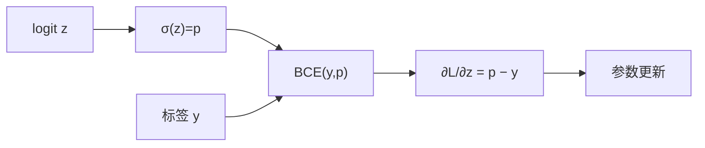

# DL-016 二分类交叉熵

## 1. 本节学习目标

1. 写出 BCE 公式并手算（本课 4 个组合：0.2231 / 1.6094 / 4.6052 / 0.6931）。
2. 推出 BCE 对 logit 的梯度 $\hat p-y$（实测 −0.2）。
3. 会用 `BCEWithLogitsLoss` 与 `weight`/`pos_weight` 处理不平衡。
4. 理解"为什么要把 $p$ 换成 logit 再算"（数值稳定性）。

## 2. 为什么需要这个知识

因为二分类是**最常见的业务任务**（流失、违约、点击、欺诈），而 BCE 是它的标准损失。

同时，BCE 是**唯一的"梯度不会饱和"的分类损失**——这一点直接决定了深度学习能不能训深。上一节已经用数字对比过 MSE（DL-014）。

## 3. 直观解释

**BCE 惩罚的是"概率分配错"**：

| 真实 | 预测概率 | BCE | 直白说 |
|---|---|---|---|
| 1 | 0.8 | **0.2231** | 还行，罚一点 |
| 0 | 0.8 | **1.6094** | 错得明显，重罚 |
| 0 | 0.99 | **4.6052** | 自信地错，狠罚 |
| 1 | 0.5 | **0.6931** | 完全不确定，罚 ln2 |

**关键**：$-\ln p$ 在 $p\to0$ 时趋于 $+\infty$ ⇒ **对"自信的错误"给予无限大的惩罚**。

## 4. 正式定义

$$
L_{\text{BCE}}=-\frac1n\sum_{i=1}^{n}\big[y_i\ln\hat p_i+(1-y_i)\ln(1-\hat p_i)\big]
$$

**逐样本形式**

$$
\ell(y,\hat p)=\begin{cases}-\ln\hat p,&y=1\\-\ln(1-\hat p),&y=0\end{cases}
$$

**带 logits 的稳定形式**（PyTorch 的 `BCEWithLogitsLoss`）

$$
\ell(z,y)=\max(z,0)-zy+\ln\big(1+e^{-|z|}\big)
$$

## 5. 核心原理

**BCE 对 logit 的梯度**

$$
\frac{\partial \ell}{\partial z}=\hat p-y
$$

**实测**：$z=1.3863$（⇒ $\hat p=0.8$）、$y=1$ ⇒ 梯度 $0.8-1=-0.2$ ✅。

**为什么这个形式这么好**：

| $z$ | $\hat p$ | $y$ | 梯度 $\hat p-y$ |
|---|---|---|---|
| 大正 | ≈1 | 1 | ≈0（对得好，不用改） |
| 大正 | ≈1 | 0 | **≈1（错得狠，猛改）** |
| 0 | 0.5 | 1 | −0.5 |

**梯度 = 误差本身**，不随饱和衰减。这是它优于 MSE 的根本原因。

## 6. 数学表达式

**本课四个组合**

$$
-\ln 0.8=0.2231,\quad
-\ln(1-0.8)=-\ln 0.2=1.6094
$$

$$
-\ln(1-0.99)=-\ln 0.01=4.6052,\quad
-\ln 0.5=0.6931
$$

**logit 与概率的换算**

$$
z=\ln\frac{p}{1-p},\qquad p=\sigma(z)
$$

$p=0.8$ ⇒ $z=\ln 4=1.3863$ ✅。

## 7. 数学推导

**从极大似然到 BCE**

设 $y\sim\text{Bernoulli}(p)$，似然 $\mathcal{L}=\prod p^{y}(1-p)^{1-y}$。

取负对数：

$$
-\ln\mathcal{L}=-\sum\big[y\ln p+(1-y)\ln(1-p)\big]
$$

**这就是 BCE**——它不是一个"随便定的损失"，而是**伯努利分布的负对数似然**。

**梯度推导**

设 $p=\sigma(z)$，则 $\frac{dp}{dz}=p(1-p)$。

$$
\frac{\partial \ell}{\partial z}
=\frac{\partial \ell}{\partial p}\cdot\frac{dp}{dz}
=\left(-\frac{y}{p}+\frac{1-y}{1-p}\right)p(1-p)
$$

展开：

$$
=-y(1-p)+(1-y)p=p-y
$$

**关键**：$p(1-p)$ 被分母约掉了 ⇒ 梯度不含饱和项。

## 8. 结构示意图



## 9. 具体计算示例

```text
p=0.8, y=1: BCE = 0.2231
p=0.8, y=0: BCE = 1.6094
p=0.99,y=0: BCE = 4.6052
p=0.5, y=1: BCE = 0.6931

batch [[0.8],[0.8]] 与 [[1],[0]]: 均值 0.9163，逐样本 [0.2231, 1.6094]
logit=1.3863 的 BCEWithLogits: 0.2231
logit=1.3863, y=1 的梯度: -0.2
正类加权 5 倍: 1.3626
```

## 10. Python 实现

```python
import math
import torch
import torch.nn.functional as F

for p, y in ((0.8, 1.0), (0.8, 0.0), (0.99, 0.0), (0.5, 1.0)):
    bce = -(y * math.log(p) + (1 - y) * math.log(1 - p))
    print(f"p={p} y={y}: 手算 BCE={bce:.4f}")

pt = torch.tensor([[0.8], [0.8]])
yt = torch.tensor([[1.0], [0.0]])
print("BCE 均值:", round(float(F.binary_cross_entropy(pt, yt)), 4))
print("逐样本:", [round(float(v), 4)
                 for v in F.binary_cross_entropy(pt, yt, reduction="none")])
```

## 11. PyTorch 实现（logits 与加权）

```python
import torch
import torch.nn.functional as F

z = torch.tensor([1.3863], requires_grad=True)
loss = F.binary_cross_entropy_with_logits(z, torch.tensor([1.0]))
loss.backward()
print("BCEWithLogits:", round(float(loss), 4))
print("sigmoid:", round(float(torch.sigmoid(z.detach())), 4))
print("梯度 p-y:", round(float(z.grad), 4))

pw = torch.tensor([[0.8], [0.8]])
yw = torch.tensor([[1.0], [0.0]])
w = torch.tensor([[5.0], [1.0]])   # 正类样本权重 5
print("加权 BCE:", round(float(F.binary_cross_entropy(pw, yw, weight=w)), 4))
```

## 12. 代码逐行解释

| 代码 | 作用 |
|---|---|
| `-(y*log p + (1-y)*log(1-p))` | 手算 BCE（注意 $y$ 只有 0/1） |
| `F.binary_cross_entropy` | 输入必须是**概率** (0,1) |
| `reduction="none"` | 返回逐样本损失（默认 `mean`） |
| `F.binary_cross_entropy_with_logits` | 输入 **logit**，内部 sigmoid + 稳定公式 |
| `weight=torch.tensor([[5.],[1.]])` | 按样本加权（正类 5 倍） |
| `z.grad` | 损失对 logit 的梯度 |

**为什么加权后是 1.3626**：$\frac{5\times0.2231+1\times1.6094}{2}=1.3626$ ✅（分母仍是 2，权重不改变样本数）。

## 13. 实际运行结果

```text
p=0.8 y=1.0: 手算 BCE=0.2231
p=0.8 y=0.0: 手算 BCE=1.6094
p=0.99 y=0.0: 手算 BCE=4.6052
p=0.5 y=1.0: 手算 BCE=0.6931
torch BCE 均值: 0.9163  逐样本: [0.2231, 1.6094]
logit: 1.3863  BCEWithLogits: 0.2231
logit=1.3863,y=1: sigmoid= 0.8  梯度 p-y = -0.2
pos_weight=5: 1.3626
```

## 14. 应用场景

| 场景 | 用法 |
|---|---|
| 二分类 | 1 维 logit + `BCEWithLogitsLoss` |
| 多标签 | $C$ 维 + 逐维 sigmoid + BCE |
| 不平衡 | 加 `pos_weight`（正类加权） |
| 难样本挖掘 | Focal Loss（BCE 的变体） |
| 概率校准 | BCE 训练出的概率通常较校准 |

## 15. 优点与缺点

| 优点 | 缺点 |
|---|---|
| 梯度不饱和（$p-y$） | 对标签噪声敏感（错标样本罚很重） |
| 有似然解释 | 极端不平衡需加权 |
| 数值稳定（with logits） | 概率极端时仍需注意 |

## 16. 常见错误

| 错误 | 现象 | 纠正 |
|---|---|---|
| 把 logit 传给 `binary_cross_entropy` | 报错或 NaN | 用 `_with_logits` |
| 先 sigmoid 再 `_with_logits` | 双重压缩 | 只留 logit |
| 标签不是 0/1 | 结果无意义 | 先转 0/1 |
| 不平衡不加权 | 全判负类 | `pos_weight` |
| 用 `weight` 当 `pos_weight` | 概念混淆 | 前者按样本、后者按类别 |
| 标签 -1/1 | NaN | 转成 0/1 或换 softplus 形式 |

## 17. 本节总结

- BCE = **伯努利负对数似然**，惩罚"自信的错误"（0.99 判错 ⇒ **4.6052**）。
- **梯度 $\hat p-y$**，不饱和（实测 −0.2）——这是分类用它的根本原因。
- 工程规范：**logit 进 `BCEWithLogitsLoss`**，不手动 sigmoid。

## 18. 前置与后续

- 前置：[[DL-015 均方误差 MSE]]
- 后续：[[DL-017 多分类交叉熵与 Softmax]]、[[DL-018 计算图]]
- 相关数学：[[MATH-805 Softmax 与交叉熵]]
- 相关机器学习：[[ML-025 逻辑回归]]、[[ML-043 混淆矩阵与分类指标]]

---

## 练习与参考答案

**基础 1**：写出 BCE 公式，并手算 $p=0.9,y=1$ 与 $p=0.9,y=0$ 的值。

**基础 2**：本课 $z=1.3863$、$y=1$ 时，$\hat p$、loss、梯度各是多少？

**进阶 1**：为什么 BCE 的梯度能简化成 $\hat p-y$？这个性质对训练有什么好处？

**综合**：数据正类占 3%，模型训练后全部预测接近 0，loss 停在 0.1 左右。请诊断并给出加权的具体写法。

> [!success]- 参考答案

> **基础 1**
> $$L=-[y\ln p+(1-y)\ln(1-p)]$$
> $p=0.9,y=1$：$-\ln 0.9=0.1054$；
> $p=0.9,y=0$：$-\ln 0.1=2.3026$。
> 同样"差 0.1"，错在正类上罚得重得多——这正是 BCE 的设计意图。

> **基础 2**
> $\hat p=\sigma(1.3863)=0.8$；loss $=0.2231$；梯度 $=\hat p-y=0.8-1=\mathbf{-0.2}$。

> **进阶 1**
> 因为 $p=\sigma(z)$ 的导数 $p(1-p)$ 正好被 $-\frac{y}{p}+\frac{1-y}{1-p}$ 的分母约掉：
> $$\frac{\partial \ell}{\partial z}=\Big(-\frac{y}{p}+\frac{1-y}{1-p}\Big)p(1-p)=p-y$$
> **好处**：无论 $z$ 多大（概率多极端），梯度都等于"预测与真实的差"，不会饱和到 0 ⇒ 深层网络也能训。
> 对比 MSE：梯度里留着 $p(1-p)$，$z=5$ 时只剩 0.0132（DL-014）。

> **综合（参考）**
> **诊断**：3% 正类 ⇒ 全判负类即可得 0.97 准确率，模型"躺平"。loss 停在 0.1 附近 ≈ 负类平均损失，说明**几乎没有学到正类**。
> **加权写法**（可直接运行的最小示例）：
> ```python
> import torch
> import torch.nn.functional as F
>
> torch.manual_seed(0)
> logits = torch.randn(8, 1)
> targets = torch.tensor([[0.], [0.], [0.], [0.], [1.], [0.], [1.], [0.]])
>
> pos_weight = torch.tensor([97 / 3])          # ≈32.3，负正比
> loss_pos = F.binary_cross_entropy_with_logits(
>     logits, targets, pos_weight=pos_weight)
> print("pos_weight 加权:", round(float(loss_pos), 4))
>
> w = torch.where(targets == 1, 32.0, 1.0)
> per = F.binary_cross_entropy_with_logits(logits, targets, reduction="none")
> print("按样本加权:", round(float((per * w).mean()), 4))
> ```
> **配套动作**：① 指标改 PR-AUC/召回；② 阈值按业务代价选（PROJ-013 的教训）；③ 若仍不学，检查标签与特征是否有信号。

## 学习记录

| 日期 | 状态 | 用时 | 问题 | 复盘 |
|---|---|---|---|---|
| 2026-11-07 | planned | — | — | — |

---

## 🔗 Notion 同步信息

> 以下内容由 Notion「AI Knowledge System · 知识点」数据库按知识 ID 合并而来（导出于 2026-11-09）。

| 属性 | 值 |
|---|---|
| 学科 | 深度学习 |
| 学习状态 | 未开始 |
| 难度 | L3 推导 |
| 知识类型 | Concept |

- **所属模块**：[M-DL-02 前向传播、损失函数与反向传播](../%E8%AF%BE%E7%A8%8B%E6%A8%A1%E5%9D%97/M-DL-02%20%E5%89%8D%E5%90%91%E4%BC%A0%E6%92%AD%E3%80%81%E6%8D%9F%E5%A4%B1%E5%87%BD%E6%95%B0%E4%B8%8E%E5%8F%8D%E5%90%91%E4%BC%A0%E6%92%AD.md)
- **前置知识**：[DL-015 均方误差 MSE](DL-015%20%E5%9D%87%E6%96%B9%E8%AF%AF%E5%B7%AE%20MSE.md)
- **后继知识**：[DL-017 多分类交叉熵与 Softmax](DL-017%20%E5%A4%9A%E5%88%86%E7%B1%BB%E4%BA%A4%E5%8F%89%E7%86%B5%E4%B8%8E%20Softmax.md)
- **关联数学**：[MATH-805 Softmax 与交叉熵](../../06_%E6%95%B0%E5%AD%A6%E5%9F%BA%E7%A1%80/08%20%E6%9C%BA%E5%99%A8%E5%AD%A6%E4%B9%A0%E6%95%B0%E5%AD%A6%E5%BA%94%E7%94%A8/MATH-805%20Softmax%20%E4%B8%8E%E4%BA%A4%E5%8F%89%E7%86%B5.md)
