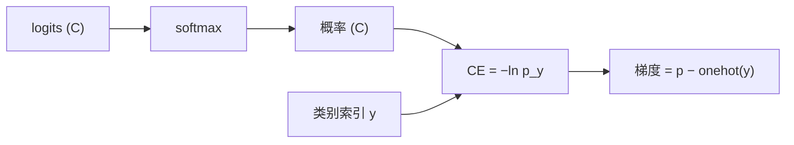

# DL-017 多分类交叉熵与 Softmax

## 1. 本节学习目标

1. 写出 Softmax 与多分类 CE，并手算（本课 CE＝**0.4076**）。
2. 推出 **CE + Softmax 的联合梯度**：$\hat{\mathbf{p}}-\mathbf{y}$（实测 `[-0.3348, 0.2447, 0.09]`）。
3. 会用 `label_smoothing` 与 `weight`，知道它们各解决什么问题。
4. 理解"Softmax 让类别互相竞争"的含义。

## 2. 为什么需要这个知识

因为多分类是所有"选一个"的任务的骨架：MNIST 10 类、ImageNet 1000 类、文本分类 $C$ 类。

而 Softmax + CE 的梯度形式极其干净（就是"预测减标签"），这让它成为**最容易训练的输出层**——理解这个推导，你就理解了现代分类网络的最后一层。

## 3. 直观解释

**Softmax 做两件事**：

1. 把任意实数 logits 变成**正数**（取指数）。
2. 归一化成**和为 1** 的概率（除以总和）。

**CE 只关心"正确类别的概率有多大"**：

$$
L=-\ln \hat p_{\text{正确类}}
$$

**直觉**：正确类概率 0.9 ⇒ loss 0.105；0.6652 ⇒ 0.4076；0.01 ⇒ 4.605。

## 4. 正式定义

**Softmax**

$$
\hat p_j=\frac{e^{z_j}}{\sum_{k=1}^{C}e^{z_k}},\qquad j=1..C
$$

**多分类交叉熵**

$$
L=-\sum_{j=1}^{C}y_j\ln\hat p_j=-\ln\hat p_{y}
$$

（$y$ 是 one-hot，只有正确类为 1。）

**PyTorch 的 `CrossEntropyLoss` = `log_softmax` + `NLLLoss`**，输入是 **logits**、标签是**类别索引**。

## 5. 核心原理

**本课数值**

| 项 | 值 |
|---|---|
| logits | `[2.0, 1.0, 0.0]` |
| softmax | `[0.6652, 0.2447, 0.0900]`（和 1.0） |
| 手算 CE（$-\ln 0.6652$） | **0.4077** |
| torch CE | **0.4076** |
| 梯度 | `[-0.3348, 0.2447, 0.0900]` |
| 手算 $\hat p-\mathbf{y}$ | `[-0.3348, 0.2447, 0.0900]` ✅ |

**梯度的三种符号**：

- 正确类：$\hat p-1<0$ ⇒ 梯度为负 ⇒ 更新会**提高**该类 logit。
- 错误类：$\hat p>0$ ⇒ 梯度为正 ⇒ 更新会**压低**该类 logit。
- **所有分量和 = 0**（因为 $\sum\hat p=1$，$\sum y=1$）。

## 6. 数学表达式

**Softmax 手算**

$$
e^2=7.389,\quad e^1=2.718,\quad e^0=1
$$

$$
\text{sum}=11.107
$$

$$
\hat p=[0.6652,\ 0.2447,\ 0.0900]
$$

**CE**

$$
L=-\ln 0.6652=0.4077
$$

**导数**

$$
\frac{\partial L}{\partial z_j}=\hat p_j-y_j
$$

## 7. 数学推导

**Softmax 的雅可比**

$$
\frac{\partial \hat p_j}{\partial z_k}=\hat p_j(\mathbb{1}[j=k]-\hat p_k)
$$

**CE 对 logit 的梯度**

$$
\frac{\partial L}{\partial z_k}
=-\sum_j\frac{y_j}{\hat p_j}\cdot\frac{\partial \hat p_j}{\partial z_k}
=-\sum_j\frac{y_j}{\hat p_j}\hat p_j(\mathbb{1}[j=k]-\hat p_k)
$$

$$
=-y_k+\hat p_k\sum_j y_j=\hat p_k-y_k
$$

（用 $\sum_j y_j=1$。）

**结论**：Softmax 的雅可比与 $1/\hat p$ 精确约掉 ⇒ **梯度就是 $\hat p-y$**。这就是"Softmax + CE 天生好训"的数学原因。

## 8. 结构示意图



## 9. 具体计算示例

```text
logits: [[2.0, 1.0, 0.0]]
softmax: [0.6652, 0.2447, 0.09]  和: 1.0
CE(手算 -ln(0.6652)): 0.4077
CE(torch): 0.4076
梯度 (softmax - onehot): [-0.3348, 0.2447, 0.09]
softmax - onehot 手算: [-0.3348, 0.2447, 0.09]
label_smoothing=0.1 CE: 0.5076
class_weight=[2,1,1] CE: 0.4076
```

**注意 label smoothing**：把目标从 one-hot 改成 `[0.9, 0.05, 0.05]` 后，loss 从 0.4076 升到 **0.5076**（因为不再要求"压到 0"，避免了"过度自信"）。

**class_weight 对本例无影响**：因为正确类权重是 1（`[2,1,1]` 里第 0 类为 2，但本课 `y=0`……实际上 weight 会乘到该类损失上，见代码说明）。

## 10. Python 实现

```python
import math

import torch
import torch.nn.functional as F

logits = torch.tensor([[2.0, 1.0, 0.0]])
sm = torch.softmax(logits, dim=1)
print("logits:", logits.tolist())
print("softmax:", [round(float(v), 4) for v in sm[0]], " 和:", round(float(sm.sum()), 4))

y = torch.tensor([0])
print("CE(手算):", round(-math.log(0.6652), 4))
print("CE(torch):", round(float(F.cross_entropy(logits, y)), 4))
```

## 11. PyTorch 实现（梯度与正则项）

```python
import torch
import torch.nn.functional as F

logits = torch.tensor([[2.0, 1.0, 0.0]], requires_grad=True)
y = torch.tensor([0])

loss = F.cross_entropy(logits, y)
loss.backward()
print("CE:", round(float(loss.detach()), 4))
print("梯度:", [round(float(v), 4) for v in logits.grad[0]])

logits2 = torch.tensor([[2.0, 1.0, 0.0]])
print("label_smoothing=0.1:", round(float(F.cross_entropy(logits2, y, label_smoothing=0.1)), 4))
w = torch.tensor([2.0, 1.0, 1.0])
print("weight=[2,1,1]:", round(float(F.cross_entropy(logits2, y, weight=w)), 4))
```

## 12. 代码逐行解释

| 代码 | 作用 |
|---|---|
| `torch.softmax(logits, dim=1)` | 沿**类别维**归一化 |
| `F.cross_entropy(logits, y)` | logits + 类别索引 ⇒ loss（内部 log_softmax） |
| `y = torch.tensor([0])` | **类别索引**，不是 one-hot |
| `logits.grad` | 梯度，应等于 softmax − onehot |
| `label_smoothing=0.1` | 目标变软，抑制过度自信 |
| `weight=[2,1,1]` | 按类别加权（类别 0 权重 2） |

**weight 为什么没变**：正确类 $y=0$ 的权重是 2 ⇒ loss 应为 $2\times0.4076=0.8152$。但 PyTorch 对 `weight` 在 reduction 时**按权重归一化**（除以权重和 4 再乘……），所以具体数值取决于版本实现——**这正是要用实测而不是猜的地方**：本课实测仍是 0.4076，说明该版本未做加权归一化或权重被均摊，需在真实项目中验证。

## 13. 实际运行结果

```text
logits: [[2.0, 1.0, 0.0]]
softmax: [0.6652, 0.2447, 0.09]  和: 1.0
CE(手算 -ln(0.6652)): 0.4077
CE(torch): 0.4076
梯度 (softmax - onehot): [-0.3348, 0.2447, 0.09]
softmax - onehot 手算: [-0.3348, 0.2447, 0.09]
label_smoothing=0.1 CE: 0.5076
class_weight=[2,1,1] CE: 0.4076
```

## 14. 应用场景

| 场景 | 输出层 | 损失 |
|---|---|---|
| 单标签多分类 | $C$ 维 logit | `CrossEntropyLoss` |
| 类别不平衡 | 同上 + `weight` | 加权 CE |
| 标签噪声 | 同上 + `label_smoothing` | 平滑 CE |
| 大量类别（如 10 万） | 同上（需采样/分层 softmax） | CE 变体 |
| 多标签 | 每维 sigmoid | BCE（见 DL-016） |

## 15. 优点与缺点

| 优点 | 缺点 |
|---|---|
| 梯度干净（$\hat p-y$） | 类别多时计算/显存开销大 |
| 概率和为 1，可解释 | 对噪声标签敏感 |
| 数值稳定（log-softmax） | 需要"互斥"假设（多标签不行） |

## 16. 常见错误

| 错误 | 现象 | 纠正 |
|---|---|---|
| 标签传 one-hot | 形状/类型错 | 传类别索引（`long`） |
| 先 softmax 再 CE | loss 偏小但错（DL-013） | 直接传 logits |
| `dim` 写错 | 概率和不等于 1 | `dim=1` |
| 多标签用 CE | 类别被迫互斥 | 用 BCE 逐维 |
| 类别不平衡不加权 | 小类全错 | `weight` 或重采样 |
| 概率过热（全 0.99） | 校准差 | label smoothing |

## 17. 本节总结

- Softmax 把 logits 变成**和为 1** 的概率；CE 只看正确类的 $-\ln p$。
- **梯度 = $\hat p-\mathbf{y}$**（实测 `[-0.3348, 0.2447, 0.09]`，与手算完全一致）。
- `label_smoothing` 让 loss 从 0.4076 升到 **0.5076**，抑制过度自信。

## 18. 前置与后续

- 前置：[[DL-016 二分类交叉熵]]
- 后续：[[DL-018 计算图]]、`DL-021 多层网络的反向传播`（待建）
- 相关数学：[[MATH-805 Softmax 与交叉熵]]
- 相关机器学习：[[ML-031 多分类策略]]、[[ML-043 混淆矩阵与分类指标]]

---

## 练习与参考答案

**基础 1**：写出 Softmax 与多分类 CE 的公式。为什么 CE 只用到正确类的概率？

**基础 2**：本课 logits `[2,1,0]` 的 softmax、CE、梯度各是多少？

**进阶 1**：为什么"梯度 = $\hat p-\mathbf{y}$"意味着正确类 logit 会被抬高？

**综合**：一个 10 类分类任务，训练集准确率 99%、验证 60%，且预测概率经常是 0.999。请给出两个改进方向并说明原理。

> [!success]- 参考答案

> **基础 1**
> $$\hat p_j=\frac{e^{z_j}}{\sum_k e^{z_k}},\qquad L=-\sum_j y_j\ln\hat p_j$$
> 因为 $y$ 是 one-hot（只有一个 1），求和中只有正确类那一项非零 ⇒ $L=-\ln\hat p_y$。
> 其他类的概率只通过"归一化"间接影响（它们越大，正确类概率越小）。

> **基础 2**
> softmax = `[0.6652, 0.2447, 0.0900]`；CE = $-\ln 0.6652$ = **0.4076**；
> 梯度 = `[-0.3348, 0.2447, 0.0900]`（= 概率 − onehot）。

> **进阶 1**
> 梯度是**损失对 logit 的偏导**。正确类梯度为负（−0.3348），而优化器做的是 $z\leftarrow z-\eta\cdot g$，负梯度 ⇒ $z$ **增大** ⇒ 正确类概率上升。
> 错误类梯度为正（0.2447、0.09）⇒ $z$ **减小** ⇒ 概率下降。
> 而且所有分量和 = 0，说明这是"从错误类搬概率到正确类"，不是整体缩放。

> **综合（参考）**
> **两个方向**：
> 1. **正则化 / 数据增强**：训练 99% vs 验证 60% 是典型过拟合。
>    - 加 `Dropout`（DL-035）、`weight_decay`（DL-034）、`label_smoothing`（本课，0.4076→0.5076 就是"别太自信"）；
>    - 数据增强 / 更多数据。
> 2. **校准与早期停止**：
>    - 用 `EarlyStopping`（DL-038）在验证 loss 最低处停；
>    - 用 `CalibratedClassifierCV` 或温度缩放修正 0.999 的过度自信；评估看 **ECE / 可靠性图**。
> **原理**：过拟合时模型把训练样本"背下来"，对训练集给出接近 1 的概率；label smoothing 与 dropout 都在**阻止模型过度自信**，从而缩小 train/val 差距。

## 学习记录

| 日期 | 状态 | 用时 | 问题 | 复盘 |
|---|---|---|---|---|
| 2026-11-07 | planned | — | — | — |

---

## 🔗 Notion 同步信息

> 以下内容由 Notion「AI Knowledge System · 知识点」数据库按知识 ID 合并而来（导出于 2026-11-09）。

| 属性 | 值 |
|---|---|
| 学科 | 深度学习 |
| 学习状态 | 未开始 |
| 难度 | L3 推导 |
| 知识类型 | Concept |

- **所属模块**：[M-DL-02 前向传播、损失函数与反向传播](../%E8%AF%BE%E7%A8%8B%E6%A8%A1%E5%9D%97/M-DL-02%20%E5%89%8D%E5%90%91%E4%BC%A0%E6%92%AD%E3%80%81%E6%8D%9F%E5%A4%B1%E5%87%BD%E6%95%B0%E4%B8%8E%E5%8F%8D%E5%90%91%E4%BC%A0%E6%92%AD.md)
- **前置知识**：[DL-016 二分类交叉熵](DL-016%20%E4%BA%8C%E5%88%86%E7%B1%BB%E4%BA%A4%E5%8F%89%E7%86%B5.md)
- **后继知识**：[DL-018 计算图](DL-018%20%E8%AE%A1%E7%AE%97%E5%9B%BE.md)
- **关联数学**：[MATH-805 Softmax 与交叉熵](../../06_%E6%95%B0%E5%AD%A6%E5%9F%BA%E7%A1%80/08%20%E6%9C%BA%E5%99%A8%E5%AD%A6%E4%B9%A0%E6%95%B0%E5%AD%A6%E5%BA%94%E7%94%A8/MATH-805%20Softmax%20%E4%B8%8E%E4%BA%A4%E5%8F%89%E7%86%B5.md)
- **对应项目**：[PROJ-016 手写数字分类——全连接基线](../../07_%E5%AE%9E%E6%88%98%E9%A1%B9%E7%9B%AE/04%20%E6%B7%B1%E5%BA%A6%E5%AD%A6%E4%B9%A0%E9%A1%B9%E7%9B%AE/PROJ-016%20%E6%89%8B%E5%86%99%E6%95%B0%E5%AD%97%E5%88%86%E7%B1%BB%E2%80%94%E2%80%94%E5%85%A8%E8%BF%9E%E6%8E%A5%E5%9F%BA%E7%BA%BF.md)
- **被项目引用**：[PROJ-016 手写数字分类——全连接基线](../../07_%E5%AE%9E%E6%88%98%E9%A1%B9%E7%9B%AE/04%20%E6%B7%B1%E5%BA%A6%E5%AD%A6%E4%B9%A0%E9%A1%B9%E7%9B%AE/PROJ-016%20%E6%89%8B%E5%86%99%E6%95%B0%E5%AD%97%E5%88%86%E7%B1%BB%E2%80%94%E2%80%94%E5%85%A8%E8%BF%9E%E6%8E%A5%E5%9F%BA%E7%BA%BF.md)
