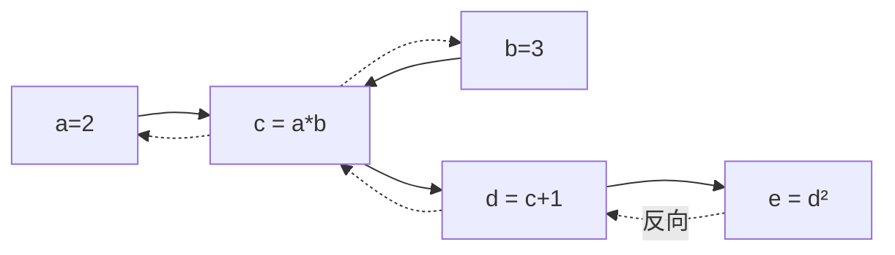

# DL-018 计算图

## 1. 本节学习目标

1. 说清计算图的两个要素：**节点（张量）**与**边（运算）**。
2. 会读 `grad_fn`，知道 PyTorch 是**动态图 + 反向自动求导**。
3. 理解反向传播为什么只需**一次图遍历**（实测 $de/da=42$、$de/db=28$）。
4. 会用 `no_grad()`、`retain_grad()`、`detach()` 控制图。

## 2. 为什么需要这个知识

因为**反向传播就是在计算图上做拓扑逆序的链式求导**。

不理解图，你只能"背" `loss.backward()`；理解了图，你就能回答：

- 为什么梯度会累加？（因为叶子节点被多条路径共享）
- 为什么 `no_grad()` 能省显存？（因为不建图）
- 为什么 `detach()` 能切断梯度？（因为把节点从图上摘下来）

## 3. 直观解释

**前向建图，反向用图**：

```text
前向:  a×b → c → c+1 → d → d² → e
       ↑ 每个操作都记下"我是怎么来的"

反向:  e → d → c → a, b
       ↑ 从 e 出发，沿边倒着走，把梯度乘回去
```

**类比**：前向是"记账"（记下每步运算），反向是"按账本倒推每一分钱从哪来"。

## 4. 正式定义

**计算图** $G=(V,E)$：

- $V$：张量节点（叶子 + 中间结果）。
- $E$：运算节点（`Add`、`Mul`、`Pow`…），连接输入到输出。

**叶子节点**：`requires_grad=True` 且由用户创建（不是运算结果），如权重 $W$、偏置 $b$。

**反向传播**：从标量损失出发，按**拓扑逆序**对每个节点求 $\partial L/\partial v$。

## 5. 核心原理

**本课的图与实测**

```text
a=2, b=3
c = a*b        = 6
d = c + 1      = 7
e = d**2       = 49
```

| 量 | 值 | 手算 |
|---|---|---|
| $e$ | 49.0 | $7^2$ |
| $de/da$ | **42.0** | $\frac{de}{dd}\frac{dd}{dc}\frac{dc}{da}=2d\cdot1\cdot b=2\times7\times3=42$ ✅ |
| $de/db$ | **28.0** | $2\times7\times2=28$ ✅ |

**`e.grad_fn` = `PowBackward0`** ⇒ 告诉你"e 是由幂运算产生的"，沿 `grad_fn` 链就能回溯整张图。

## 6. 数学表达式

**链式法则在图上的形式**

$$
\frac{\partial L}{\partial v}=\sum_{u\in\text{children}(v)}\frac{\partial L}{\partial u}\cdot\frac{\partial u}{\partial v}
$$

**求和的原因**：一个节点可能被多个下游节点使用（如图中 $c$ 只被 $d$ 用；但若 $c$ 同时进入两个分支，就要把两条路径的梯度相加）。

**本课**

$$
\frac{\partial e}{\partial a}=\frac{\partial e}{\partial d}\cdot\frac{\partial d}{\partial c}\cdot\frac{\partial c}{\partial a}
=2d\cdot1\cdot b=2\times7\times3=42
$$

## 7. 数学推导

**逐步反传**

1. $\frac{\partial e}{\partial e}=1$
2. $e=d^2$ ⇒ $\frac{\partial e}{\partial d}=2d=14$
3. $d=c+1$ ⇒ $\frac{\partial d}{\partial c}=1$
4. $c=ab$ ⇒ $\frac{\partial c}{\partial a}=b=3$，$\frac{\partial c}{\partial b}=a=2$
5. 连乘：$\frac{\partial e}{\partial a}=14\times1\times3=42$，$\frac{\partial e}{\partial b}=14\times1\times2=28$

**为什么中间节点默认不保存梯度**：只为叶子节点（参数）保留 `.grad` 以省内存；需要时用 `retain_grad()`。

**本课实测**：`y1.retain_grad()` 后 `y1.grad=8`，`x1.grad=16`。
验证：$y_1=2x_1=4$，$z_1=y_1^2=16$；$\partial z_1/\partial y_1=2y_1=8$ ✅；$\partial z_1/\partial x_1=8\times2=16$ ✅。

## 8. 结构示意图



## 9. 具体计算示例

```text
a= 2.0 b= 3.0 e= 49.0
e.grad_fn: PowBackward0
de/da: 42.0  de/db: 28.0   手算 2(ab+1)b= 42
d 是否保留图: True
中间节点 y1.grad: 8.0  x1.grad: 16.0
no_grad 下 requires_grad: False
```

## 10. Python 实现

```python
import torch

a = torch.tensor(2.0, requires_grad=True)
b = torch.tensor(3.0, requires_grad=True)
c = a * b
d = c + 1
e = d ** 2

print("a=", float(a.detach()), "b=", float(b.detach()), "e=", float(e.detach()))
print("e.grad_fn:", type(e.grad_fn).__name__)
e.backward()
print("de/da:", float(a.grad), " de/db:", float(b.grad))
```

## 11. PyTorch 实现（中间节点与 no_grad）

```python
import torch

x1 = torch.tensor(2.0, requires_grad=True)
y1 = x1 * 2
y1.retain_grad()          # 让中间节点也保存梯度
z1 = y1 ** 2
z1.backward()
print("中间节点 y1.grad:", float(y1.grad), " x1.grad:", float(x1.grad))

det = torch.tensor(2.0, requires_grad=True)
with torch.no_grad():
    out = det * 3
print("no_grad 下 requires_grad:", out.requires_grad)

w = torch.tensor(2.0, requires_grad=True)
v = w.detach() * 3
print("detach 后 requires_grad:", v.requires_grad)
```

## 12. 代码逐行解释

| 代码 | 作用 |
|---|---|
| `requires_grad=True` | 标记为**叶子节点**，需要梯度 |
| `e.grad_fn` | 该张量的"生成函数"，可沿链回溯 |
| `e.backward()` | 从标量 $e$ 反向传播 |
| `a.grad` | 叶子节点的梯度（累加值） |
| `y1.retain_grad()` | 让**非叶子**节点也保留 `.grad` |
| `torch.no_grad()` | 不建图（推理/评估必用） |
| `.detach()` | 从图上摘下一个张量（切断梯度） |

**注意**：`.grad` 是**累加**的，多轮反向不清零会叠加——这就是必须 `opt.zero_grad()` 的原因。

## 13. 实际运行结果

```text
a= 2.0 b= 3.0 e= 49.0
e.grad_fn: PowBackward0
de/da: 42.0  de/db: 28.0  手算 2(ab+1)b= 42
d 是否保留图: True
中间节点 y1.grad: 8.0  x1.grad: 16.0
no_grad 下 requires_grad: False
```

## 14. 应用场景

| 场景 | 用法 |
|---|---|
| 训练 | 正常建图 + `backward` |
| 推理/评估 | `with torch.no_grad()` |
| 只取特征 | `.detach()` 后当 numpy 用 |
| 可视化 | `torchviz` 画图（可选） |
| 调试梯度 | `retain_grad()` 看中间层 |

## 15. 优点与缺点

| 优点 | 缺点 |
|---|---|
| 自动求导，无需手推 | 建图占显存（与 batch 成正比） |
| 动态图：可随意 if/循环 | 图大时反向慢 |
| 支持任意可微运算 | 副作用操作会破坏图 |

## 16. 常见错误

| 错误 | 现象 | 纠正 |
|---|---|---|
| 忘 `zero_grad()` | 梯度累加、loss 爆炸 | 每步清零 |
| 推理忘 `no_grad()` | 显存持续增长 | 加 `with torch.no_grad()` |
| 对 `.item()`/numpy 反传 | `backward` 报错 | 保留张量到 `backward` 后 |
| 用 in-place 改张量 | 反向报版本错 | 避免 `+=` 改需要梯度的张量 |
| 以为中间节点有 `.grad` | 是 `None` | `retain_grad()` |
| 重复 `backward()` 不设 `retain_graph` | 报错 | 明确是否需要保留图 |

## 17. 本节总结

- 计算图 = **张量节点 + 运算边**；前向建图、反向用图。
- 反向 = **拓扑逆序 + 链式法则连乘**（$de/da=42$、$de/db=28$）。
- `.grad` 是**累加**的；`no_grad()` 省显存；`detach()` 切断梯度。

## 18. 前置与后续

- 前置：[[DL-017 多分类交叉熵与 Softmax]]
- 后续：[[DL-019 梯度的含义与链式法则]]、[[DL-020 反向传播——单神经元手算]]
- 相关数学：[[MATH-804 反向传播与链式法则]]

---

## 练习与参考答案

**基础 1**：计算图的节点与边各是什么？叶子节点指什么？

**基础 2**：本课 $de/da$ 与 $de/db$ 各是多少？请写出连乘过程。

**进阶 1**：为什么 `.grad` 是累加的？这带来什么工程后果？

**综合**：训练时发现第 2 个 epoch 的 loss 突然变成 NaN，且梯度越来越大。请用计算图的知识解释可能原因并给出 3 个修复。

> [!success]- 参考答案

> **基础 1**
> - **节点**：张量（输入、权重、中间结果、输出）。
> - **边**：运算（`Mul`、`Add`、`Pow`、`ReLU`…），连接输入到输出。
> - **叶子节点**：由用户创建、`requires_grad=True`、不是运算结果的张量（如权重与偏置）。

> **基础 2**
> $$\frac{\partial e}{\partial a}=2d\cdot1\cdot b=2\times7\times3=\mathbf{42}$$
> $$\frac{\partial e}{\partial b}=2d\cdot1\cdot a=2\times7\times2=\mathbf{28}$$

> **进阶 1**
> 因为一个张量可能被多条路径使用，链式法则要求**把所有路径的梯度相加**（$\partial L/\partial v=\sum_u \partial L/\partial u\cdot\partial u/\partial v$）。PyTorch 的实现就是"遇到一次就加一次"。
> **工程后果**：如果不清零，梯度会跨 batch/epoch 累积 ⇒ 等价于用了越来越大的学习率 ⇒ loss 爆炸。
> 所以训练循环里必须 `opt.zero_grad()`。

> **综合（参考）**
> **原因**：梯度是累加的。若某处**忘记 `zero_grad()`**，梯度会不断叠加 ⇒ 参数更新步长越来越大 ⇒ 数值溢出成 NaN。
> 其他可能：学习率过大、损失里含 `log(0)`、除零、`exp` 溢出。
> **三个修复**：
> 1. 训练循环确认 `opt.zero_grad()` 在 `backward()` **之前**；
> 2. 加**梯度裁剪** `torch.nn.utils.clip_grad_norm_(params, 1.0)`（DL-031）；
> 3. 打印每步 `grad.norm()` 与 loss，定位第一次变大的位置；必要时把 lr 降 10 倍。
> **验证**：修复后梯度范数应稳定在合理量级（如 0.1–10），不再单调增长。

## 学习记录

| 日期 | 状态 | 用时 | 问题 | 复盘 |
|---|---|---|---|---|
| 2026-11-07 | planned | — | — | — |

---

## 🔗 Notion 同步信息

> 以下内容由 Notion「AI Knowledge System · 知识点」数据库按知识 ID 合并而来（导出于 2026-11-09）。

| 属性 | 值 |
|---|---|
| 学科 | 深度学习 |
| 学习状态 | 未开始 |
| 难度 | L2 应用 |
| 知识类型 | Concept |

- **所属模块**：[M-DL-02 前向传播、损失函数与反向传播](../%E8%AF%BE%E7%A8%8B%E6%A8%A1%E5%9D%97/M-DL-02%20%E5%89%8D%E5%90%91%E4%BC%A0%E6%92%AD%E3%80%81%E6%8D%9F%E5%A4%B1%E5%87%BD%E6%95%B0%E4%B8%8E%E5%8F%8D%E5%90%91%E4%BC%A0%E6%92%AD.md)
- **前置知识**：[DL-017 多分类交叉熵与 Softmax](DL-017%20%E5%A4%9A%E5%88%86%E7%B1%BB%E4%BA%A4%E5%8F%89%E7%86%B5%E4%B8%8E%20Softmax.md)
- **后继知识**：[DL-019 梯度的含义与链式法则](DL-019%20%E6%A2%AF%E5%BA%A6%E7%9A%84%E5%90%AB%E4%B9%89%E4%B8%8E%E9%93%BE%E5%BC%8F%E6%B3%95%E5%88%99.md)
- **关联数学**：[MATH-804 反向传播与链式法则](../../06_%E6%95%B0%E5%AD%A6%E5%9F%BA%E7%A1%80/08%20%E6%9C%BA%E5%99%A8%E5%AD%A6%E4%B9%A0%E6%95%B0%E5%AD%A6%E5%BA%94%E7%94%A8/MATH-804%20%E5%8F%8D%E5%90%91%E4%BC%A0%E6%92%AD%E4%B8%8E%E9%93%BE%E5%BC%8F%E6%B3%95%E5%88%99.md)
