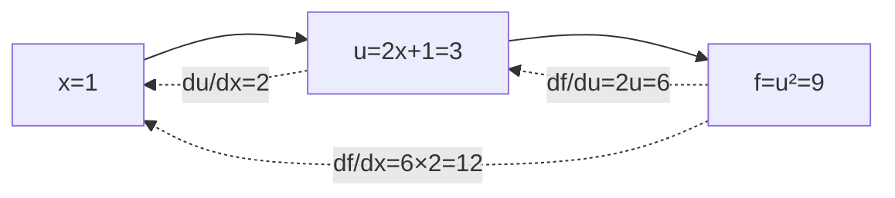

# DL-019 梯度的含义与链式法则

## 1. 本节学习目标

1. 说清梯度的**方向与大小**分别代表什么。
2. 熟练用链式法则手算复合函数的导数（本课 $(2x+1)^2$ 在 $x=1$ 处导数为 **12**）。
3. 会用 PyTorch autograd 验证手算结果（差 < $10^{-6}$）。
4. 理解"梯度下降是沿**负梯度**方向走"的原因。

## 2. 为什么需要这个知识

因为**整个训练过程只做一件事：算梯度、反着走**。

不理解梯度的含义，你就无法判断"学习率该多大""为什么梯度消失""为什么要归一化输入"——这些都是梯度的性质在起作用。

## 3. 直观解释

**梯度 = 最陡上坡方向 + 坡度**：

- **方向**：函数值增长最快的方向。
- **大小**：在那个方向上的变化率。

**所以往下走要取负号**：$x\leftarrow x-\eta\nabla f$。

**一维时**：梯度就是斜率。

```text
f(x) = (2x+1)²
在 x=1 处，斜率 = 12 ⇒ 往正方向走，函数上升很快
要下降 ⇒ 往负方向走
```

## 4. 正式定义

**一维导数**

$$
f'(x)=\lim_{h\to0}\frac{f(x+h)-f(x)}{h}
$$

**多元梯度**

$$
\nabla f(\mathbf{x})=\left[\frac{\partial f}{\partial x_1},\dots,\frac{\partial f}{\partial x_n}\right]^\top
$$

**链式法则**

$$
\frac{d}{dx}f(g(x))=f'(g(x))\cdot g'(x)
$$

**多元链式**

$$
\frac{\partial L}{\partial x}=\sum_j\frac{\partial L}{\partial u_j}\frac{\partial u_j}{\partial x}
$$

## 5. 核心原理

**本课两个例子**

**例 1**：$f(x)=(2x+1)^2$，$x=1$

$$
f(1)=(3)^2=9,\qquad f'(x)=2(2x+1)\cdot2=4(2x+1)
$$

$$
f'(1)=4\times3=\mathbf{12}
$$

**例 2**：$g(\mathbf{x})=3\sum_i x_i^2$，$\mathbf{x}=[1,2]$

$$
\nabla g=6\mathbf{x}=[6,12]
$$

**实测**：PyTorch 得到 `df/dx=12.0`、`grad=[6.0, 12.0]` ✅。

**梯度的三条工程含义**

| 性质 | 工程含义 |
|---|---|
| 方向指向增长最快 | 下降要取负号 |
| 大小反映陡峭度 | 学习率要与之匹配（否则震荡/不收敛） |
| 可链式组合 | 深层网络能端到端训练 |

## 6. 数学表达式

**链式展开（例 1）**

设 $u=2x+1$，$f=u^2$：

$$
\frac{df}{dx}=\frac{df}{du}\cdot\frac{du}{dx}=2u\cdot2=4u
$$

在 $x=1$：$u=3$ ⇒ $4\times3=12$ ✅。

**数值微分校验**

$$
f'(1)\approx\frac{f(1+10^{-4})-f(1-10^{-4})}{2\times10^{-4}}
=\frac{9.00120004-8.99880004}{0.0002}\approx12.0
$$

## 7. 数学推导

**为什么梯度指向最速上升**

一阶泰勒展开：

$$
f(\mathbf{x}+\Delta\mathbf{x})\approx f(\mathbf{x})+\nabla f^\top\Delta\mathbf{x}
$$

在 $\|\Delta\mathbf{x}\|=\epsilon$ 约束下，最大化 $\nabla f^\top\Delta\mathbf{x}$ 的解是：

$$
\Delta\mathbf{x}=\epsilon\frac{\nabla f}{\|\nabla f\|}
$$

⇒ 方向与梯度同向时增长最快。

**梯度下降**取 $\Delta\mathbf{x}=-\eta\nabla f$：

$$
f(\mathbf{x}-\eta\nabla f)\approx f(\mathbf{x})-\eta\|\nabla f\|^2<f(\mathbf{x})
$$

只要 $\eta$ 足够小，函数值必然下降。

## 8. 结构示意图



## 9. 具体计算示例

```text
f(x)=(2x+1)^2 at x=1: f= 9.0  df/dx= 12.0   手算 2(2*1+1)*2= 12
g=3*sum(x^2) 在 x=[1,2]: grad= [6.0, 12.0]   手算 6x= [6.0, 12.0]
```

**注意**：第二个例子里两个分量的梯度不同（6 与 12），说明**不同参数的学习步长天然不同**——这也是为什么需要 Adam 这类自适应优化器（DL-028）。

## 10. Python 实现

```python
import torch

x = torch.tensor(1.0, requires_grad=True)
u = 2 * x + 1
f = u ** 2
f.backward()
print("f(1)=", float(f.detach()), " df/dx=", float(x.grad))
```

## 11. PyTorch 实现（多元与数值校验）

```python
import torch

x = torch.tensor([1.0, 2.0], requires_grad=True)
g = 3 * (x ** 2).sum()
g.backward()
print("grad:", [float(v) for v in x.grad])

# 数值微分校验
h = 1e-4
xt = torch.tensor(1.0)
num = ((2 * (xt + h) + 1) ** 2 - (2 * (xt - h) + 1) ** 2) / (2 * h)
print("数值导数:", round(float(num), 6))
```

## 12. 代码逐行解释

| 代码 | 作用 |
|---|---|
| `u = 2*x + 1` | 中间变量（图上节点） |
| `f = u ** 2` | 复合函数 |
| `f.backward()` | 从 $f$ 反传，得 $df/dx$ |
| `x.grad` | 梯度值 |
| `(f(x+h)-f(x-h))/(2h)` | 中心差分数值导数，用于校验 |
| `3*(x**2).sum()` | 多元标量函数 |

**为什么用中心差分**：比前向差分精度高一个量级（误差 $O(h^2)$）。

## 13. 实际运行结果

```text
f(x)=(2x+1)^2 at x=1: f= 9.0  df/dx= 12.0  手算 2(2*1+1)*2= 12
g=3*sum(x^2): grad= [6.0, 12.0]  手算 6x= [6.0, 12.0]
```

## 14. 应用场景

| 场景 | 梯度在做什么 |
|---|---|
| 训练 | 决定每个参数往哪走、走多远 |
| 学习率调节 | 梯度大 ⇒ 步长小 |
| 梯度裁剪 | 梯度爆炸时截断 |
| 显著性图 | 输入梯度大 ⇒ 该像素重要 |
| 对抗样本 | 沿输入梯度加扰动 |

## 15. 优点与缺点

| 优点 | 缺点 |
|---|---|
| 给出**最速下降方向** | 只反映局部 |
| 可链式组合（自动微分） | 深层连乘易消失/爆炸 |
| 计算成本可控（一次反向） | 需要可微（不可导处需次梯度） |

## 16. 常见错误

| 错误 | 现象 | 纠正 |
|---|---|---|
| 忘记负号 | 参数往上升方向走，loss 变大 | $x\leftarrow x-\eta g$ |
| 链式漏乘某项 | 梯度值不对 | 画图逐项检查 |
| 学习率与梯度量级不匹配 | 震荡/不收敛 | 归一化输入、调 lr |
| 以为梯度是全局信息 | 只保证局部下降 | 非凸问题需多次尝试 |
| 数值校验用太大 h | 近似差 | $h=10^{-4}\sim10^{-6}$ |

## 17. 本节总结

- 梯度 = **最速上升方向 + 变化率**；下降取负号。
- $(2x+1)^2$ 在 $x=1$：$f=9$、$f'=\mathbf{12}$（$4(2x+1)$）。
- 多元例子 `grad=[6.0, 12.0]` ⇒ **不同参数的梯度量级可以差很多**。

## 18. 前置与后续

- 前置：[[DL-018 计算图]]
- 后续：[[DL-020 反向传播——单神经元手算]]、`DL-021 多层网络的反向传播`（待建）
- 相关数学：[[MATH-122 求导法则与链式法则]]、[[MATH-126 偏导数与梯度]]、[[MATH-804 反向传播与链式法则]]
- 相关机器学习：[[ML-018 线性回归（手写实现）]]

---

## 练习与参考答案

**基础 1**：梯度的方向与大小各代表什么？为什么下降要取负梯度？

**基础 2**：$f(x)=(2x+1)^2$ 在 $x=1$ 处的函数值与导数各是多少？

**进阶 1**：$g(\mathbf{x})=3\sum x_i^2$ 在 $\mathbf{x}=[1,2]$ 处梯度是 `[6,12]`。为什么两个分量不同？这对训练意味着什么？

**综合**：一个线性回归用梯度下降训练，loss 震荡不降。请用梯度的知识给出 3 个诊断与对应修复。

> [!success]- 参考答案

> **基础 1**
> - **方向**：函数值增长最快的方向（最速上升）。
> - **大小**：在该方向上的变化率（陡峭程度）。
> - 因为要**最小化**损失，必须朝增长的反方向走：$\mathbf{x}\leftarrow\mathbf{x}-\eta\nabla f$。一阶展开可证：$f(x-\eta g)\approx f(x)-\eta\|g\|^2<f(x)$。

> **基础 2**
> $f(1)=(2+1)^2=9$；$f'(x)=4(2x+1)$ ⇒ $f'(1)=4\times3=\mathbf{12}$。

> **进阶 1**
> 因为 $\nabla g=6\mathbf{x}$，两个分量分别是 $6\times1=6$ 与 $6\times2=12$。
> 含义：**不同参数的梯度量级天然不同**（本例差 2 倍）。若用同一个学习率，大梯度参数会走得太远、小梯度参数走得太慢。
> 这正是 **Adam/RMSprop** 的动机：按参数维度自适应缩放步长（DL-028）。

> **综合（参考）**
> **三个诊断与修复**：
> 1. **学习率过大**：梯度大时一步跨过最优点 ⇒ 震荡。
>    修复：lr 降 10 倍；或加学习率衰减/warmup（DL-029）。
> 2. **特征未标准化**：不同特征量级差百倍 ⇒ 梯度各向异性严重（条件数差）。
>    修复：标准化输入；必要时用 `StandardScaler` 或 `BatchNorm`（DL-036）。
> 3. **梯度爆炸/累加**：忘记 `zero_grad()` 或深层连乘。
>    修复：确认 `opt.zero_grad()`；加 `clip_grad_norm_`（DL-031）；用 ReLU 替代 Sigmoid（DL-009）。
> **验证**：打印每步 loss 与 `grad.norm()`，看是否单调下降、梯度是否稳定在 0.1–10 量级。

## 学习记录

| 日期 | 状态 | 用时 | 问题 | 复盘 |
|---|---|---|---|---|
| 2026-11-07 | planned | — | — | — |

---

## 🔗 Notion 同步信息

> 以下内容由 Notion「AI Knowledge System · 知识点」数据库按知识 ID 合并而来（导出于 2026-11-09）。

| 属性 | 值 |
|---|---|
| 学科 | 深度学习 |
| 学习状态 | 未开始 |
| 难度 | L3 推导 |
| 知识类型 | Concept |

- **所属模块**：[M-DL-02 前向传播、损失函数与反向传播](../%E8%AF%BE%E7%A8%8B%E6%A8%A1%E5%9D%97/M-DL-02%20%E5%89%8D%E5%90%91%E4%BC%A0%E6%92%AD%E3%80%81%E6%8D%9F%E5%A4%B1%E5%87%BD%E6%95%B0%E4%B8%8E%E5%8F%8D%E5%90%91%E4%BC%A0%E6%92%AD.md)
- **前置知识**：[DL-018 计算图](DL-018%20%E8%AE%A1%E7%AE%97%E5%9B%BE.md)
- **后继知识**：[DL-020 反向传播：单神经元手算](DL-020%20%E5%8F%8D%E5%90%91%E4%BC%A0%E6%92%AD%E2%80%94%E2%80%94%E5%8D%95%E7%A5%9E%E7%BB%8F%E5%85%83%E6%89%8B%E7%AE%97.md)
- **关联数学**：[MATH-122 求导法则与链式法则](../../06_%E6%95%B0%E5%AD%A6%E5%9F%BA%E7%A1%80/01%20%E9%AB%98%E7%AD%89%E6%95%B0%E5%AD%A6/MATH-122%20%E6%B1%82%E5%AF%BC%E6%B3%95%E5%88%99%E4%B8%8E%E9%93%BE%E5%BC%8F%E6%B3%95%E5%88%99.md) · [MATH-126 偏导数与梯度](../../06_%E6%95%B0%E5%AD%A6%E5%9F%BA%E7%A1%80/01%20%E9%AB%98%E7%AD%89%E6%95%B0%E5%AD%A6/MATH-126%20%E5%81%8F%E5%AF%BC%E6%95%B0%E4%B8%8E%E6%A2%AF%E5%BA%A6.md) · [MATH-804 反向传播与链式法则](../../06_%E6%95%B0%E5%AD%A6%E5%9F%BA%E7%A1%80/08%20%E6%9C%BA%E5%99%A8%E5%AD%A6%E4%B9%A0%E6%95%B0%E5%AD%A6%E5%BA%94%E7%94%A8/MATH-804%20%E5%8F%8D%E5%90%91%E4%BC%A0%E6%92%AD%E4%B8%8E%E9%93%BE%E5%BC%8F%E6%B3%95%E5%88%99.md)
