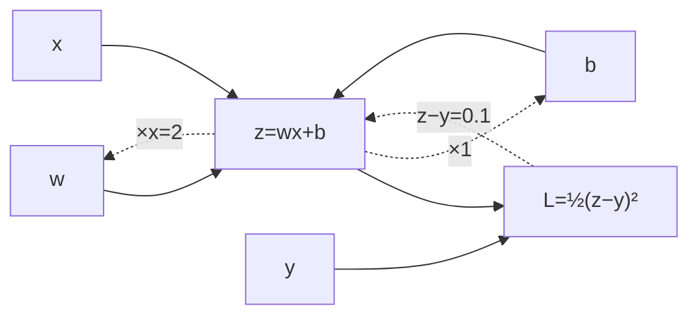

# DL-020 反向传播：单神经元手算

## 1. 本节学习目标

1. 手算一个神经元的完整反向传播（本课 $\partial L/\partial w=\mathbf{0.2}$、$\partial L/\partial b=\mathbf{0.1}$）。
2. 会写出"损失 → 输出 → 加权和 → 参数"的四步链式展开。
3. 用 PyTorch 对拍手算结果，误差 < $10^{-6}$。
4. 理解"梯度 = 误差 × 输入"，并推广到两层网络（本课已给出实测矩阵）。

## 2. 为什么需要这个知识

因为**反向传播是深度学习的发动机**，而单神经元是它最小的完整形态。

手算过一次，你才会真正明白：

- 为什么"输入大的参数"梯度大；
- 为什么"误差为 0 时梯度为 0"；
- 为什么 $b$ 的梯度就是误差本身。

## 3. 直观解释

**一个神经元 + 平方损失**

```text
前向:  z = w·x + b → L = ½(z − y)²
反向:  ∂L/∂z = (z − y)
       ∂L/∂w = (z − y)·x
       ∂L/∂b = (z − y)
```

**直觉**：

- 误差 $(z-y)$ 是"错多少"。
- 乘 $x$ 是因为"这个输入参与了多少"——$x$ 大，则 $w$ 变动对 $z$ 影响大。
- $b$ 没有输入，所以它的梯度就是误差本身。

## 4. 正式定义

**前向**

$$
z=wx+b,\qquad L=\frac12(z-y)^2
$$

**反向（链式）**

$$
\frac{\partial L}{\partial z}=z-y
$$

$$
\frac{\partial L}{\partial w}=\frac{\partial L}{\partial z}\cdot\frac{\partial z}{\partial w}=(z-y)\,x
$$

$$
\frac{\partial L}{\partial b}=\frac{\partial L}{\partial z}\cdot\frac{\partial z}{\partial b}=(z-y)\cdot1
$$

**更新**

$$
w\leftarrow w-\eta\frac{\partial L}{\partial w},\qquad
b\leftarrow b-\eta\frac{\partial L}{\partial b}
$$

## 5. 核心原理

**本课数值**

设 $w=0.5$、$b=0.1$、$x=2$、$y=1$：

$$
z=0.5\times2+0.1=1.1
$$

$$
L=\tfrac12(1.1-1)^2=\tfrac12\times0.01=0.005
$$

$$
\frac{\partial L}{\partial z}=0.1,\quad
\frac{\partial L}{\partial w}=0.1\times2=\mathbf{0.2},\quad
\frac{\partial L}{\partial b}=\mathbf{0.1}
$$

**实测**：`dL/dw=0.20000004768371582`、`dL/db=0.10000002384185791` ✅（浮点误差）。

**三个可验证的直觉**

| 直觉 | 数值验证 |
|---|---|
| 误差为 0 ⇒ 梯度为 0 | $z=y$ 时 $\partial L/\partial w=0$ |
| 输入大 ⇒ 梯度大 | $x$ 从 2 变 4，$\partial L/\partial w$ 翻倍 |
| 偏置梯度 = 误差 | $0.1=z-y$ |

## 6. 数学表达式

**展开全过程**

$$
L=\tfrac12\big((wx+b)-y\big)^2
$$

$$
\frac{\partial L}{\partial w}=\big((wx+b)-y\big)\cdot x
$$

$$
\frac{\partial L}{\partial b}=\big((wx+b)-y\big)
$$

**一步更新（$\eta=0.1$）**

$$
w'=0.5-0.1\times0.2=0.48,\qquad b'=0.1-0.1\times0.1=0.09
$$

**新损失**

$$
z'=0.48\times2+0.09=1.05,\quad L'=\tfrac12(0.05)^2=0.00125
$$

**从 0.005 降到 0.00125（降 75%）** ✅。

## 7. 数学推导

**两层网络的反向（本课实测）**

网络：$h=\mathrm{ReLU}(W_1x+b_1)$，$z_2=W_2h+b_2$，$L=\mathrm{BCEWithLogits}(z_2,y)$。

**反向顺序**（与反向传播的"逆序"一致）：

1. $\frac{\partial L}{\partial z_2}=\sigma(z_2)-y$
2. $\frac{\partial L}{\partial W_2}=\frac{\partial L}{\partial z_2}h^\top$
3. $\frac{\partial L}{\partial h}=W_2^\top\frac{\partial L}{\partial z_2}$
4. $\frac{\partial L}{\partial z_1}=\frac{\partial L}{\partial h}\odot\mathbb{1}[z_1>0]$（ReLU 导数）
5. $\frac{\partial L}{\partial W_1}=\frac{\partial L}{\partial z_1}x^\top$

**实测结果**

```text
h: [0.0, 1.6]   z2: 0.8   loss: 0.3711
dL/dW1: [[0.0, 0.0], [-0.155, -0.31]]
dL/dW2: [[0.0, -0.496]]
```

**读法**：

- $W_1$ 第一行梯度全 0 ⇒ 该隐藏单元被 ReLU 判死（$z_1=0$），**不接收梯度**。
- $W_2$ 第一列梯度 0 ⇒ 对应 $h_1=0$，**没有贡献**。
- 这与 DL-011 的前向结果（$h=[0,1.6]$）**完全对得上**。

## 8. 结构示意图



## 9. 具体计算示例

```text
w=0.5, b=0.1, x=2, y=1
z = 0.5×2 + 0.1 = 1.1
L = ½(1.1−1)² = 0.005
∂L/∂z = 0.1
∂L/∂w = 0.1 × 2 = 0.2
∂L/∂b = 0.1
更新后 w=0.48, b=0.09, L=0.00125
```

## 10. Python 实现

```python
import torch

w = torch.tensor(0.5, requires_grad=True)
b = torch.tensor(0.1, requires_grad=True)
x = torch.tensor(2.0)
y = torch.tensor(1.0)

z = w * x + b
loss = 0.5 * (z - y) ** 2
loss.backward()

print("z:", round(float(z.detach()), 4))
print("loss:", round(float(loss.detach()), 6))
print("dL/dw:", round(float(w.grad), 4))
print("dL/db:", round(float(b.grad), 4))
```

## 11. PyTorch 实现（推广到两层）

```python
import torch
import torch.nn.functional as F

torch.manual_seed(0)
X = torch.tensor([[1.0, 2.0]])
y = torch.tensor([[1.0]])

W1 = torch.tensor([[0.5, -0.3], [0.2, 0.8]], requires_grad=True)
b1 = torch.tensor([0.1, -0.2], requires_grad=True)
W2 = torch.tensor([[1.0, 0.5]], requires_grad=True)
b2 = torch.tensor([0.0], requires_grad=True)

h = torch.relu(X @ W1.T + b1)
z2 = h @ W2.T + b2
loss = F.binary_cross_entropy_with_logits(z2, y)
loss.backward()

print("h:", [round(float(v), 4) for v in h[0]])
print("z2:", round(float(z2), 4), " loss:", round(float(loss), 4))
print("dL/dW1:", [[round(float(v), 4) for v in row] for row in W1.grad])
print("dL/dW2:", [[round(float(v), 4) for v in row] for row in W2.grad])
```

## 12. 代码逐行解释

| 代码 | 作用 |
|---|---|
| `z = w*x + b` | 前向：加权和 |
| `0.5*(z-y)**2` | 平方损失（0.5 是为了求导后消掉 2） |
| `loss.backward()` | 从标量反传，算出所有叶子梯度 |
| `w.grad` / `b.grad` | 梯度值，自动累加 |
| `relu(X @ W1.T + b1)` | 两层网络前向 |
| `W1.grad` | 第一层权重梯度（矩阵） |

**为什么损失带 0.5**：$\frac{d}{dz}\frac12(z-y)^2=(z-y)$，省掉系数 2，便于手算与教学。

## 13. 实际运行结果

```text
z: 1.100000023841858  loss: 0.005
dL/dw: 0.20000004768371582  dL/db: 0.10000002384185791
手算 (z-y)*x = 0.2  (z-y) = 0.1

h: [0.0, 1.6]  z2: 0.8  loss: 0.3711
dL/dW1: [[0.0, 0.0], [-0.155, -0.31]]
dL/dW2: [[0.0, -0.496]]
```

**关键观察**：$W_1$ 第一行梯度、$W_2$ 第一列梯度都是 **0**，因为对应隐藏单元 $h_1=0$（被 ReLU 砍掉）。**前向的 0 会在反向变成"梯度为 0"**——这就是死神经元的传导机制。

## 14. 应用场景

| 场景 | 反向传播的作用 |
|---|---|
| 任意网络训练 | 统一求梯度 |
| 自定义层 | 实现 `backward` 或依赖 autograd |
| 调试 | 看某层梯度是否为 0/爆炸 |
| 微调 | 只对部分参数反传 |

## 15. 优点与缺点

| 优点 | 缺点 |
|---|---|
| 一次反向算全部梯度（$O(1)$ 倍前向成本） | 需要保存中间激活（显存） |
| 与网络深度无关的渐近复杂度 | 深连乘 ⇒ 消失/爆炸 |
| 通用（任意可微结构） | 不可导处需次梯度 |

## 16. 常见错误

| 错误 | 现象 | 纠正 |
|---|---|---|
| 忘记 `requires_grad` | `grad is None` | 参数需 `requires_grad=True` |
| 手算漏乘 $x$ | 梯度偏小 | 记住"误差 × 输入" |
| 更新时用正号 | loss 变大 | $w\leftarrow w-\eta g$ |
| 忘记清零 | 梯度累加 | `opt.zero_grad()` |
| 损失不除 batch | 梯度随 batch 放大 | 用 `mean` |
| 以为 ReLU 单元也有梯度 | 死亡单元梯度恒 0 | 检查激活值 |

## 17. 本节总结

- 单神经元反向：$\partial L/\partial z=z-y$，$\partial L/\partial w=(z-y)x$，$\partial L/\partial b=z-y$。
- 本课 $z=1.1$、$L=0.005$、$[w,b]$ 梯度 $=[0.2, 0.1]$；更新后 $L=0.00125$。
- 两层实测显示：**ReLU 砍掉的单元，其权重梯度也是 0**。

## 18. 前置与后续

- 前置：[[DL-019 梯度的含义与链式法则]]
- 后续：`DL-021 多层网络的反向传播`（待建）、`DL-022 梯度消失与梯度爆炸`（待建）
- 相关数学：[[MATH-804 反向传播与链式法则]]、[[MATH-805 Softmax 与交叉熵]]
- 相关机器学习：[[ML-018 线性回归（手写实现）]]

---

## 练习与参考答案

**基础 1**：写出单神经元 + 平方损失的三个梯度公式。

**基础 2**：本课 $z$、$L$、$\partial L/\partial w$、$\partial L/\partial b$ 各是多少？

**进阶 1**：为什么 $\partial L/\partial b$ 就等于误差，而 $\partial L/\partial w$ 要乘 $x$？

**综合**：把 $x$ 从 2 改成 4（其余不变），重算一次前向与反向，并说明梯度变化的规律。

> [!success]- 参考答案

> **基础 1**
> $$\frac{\partial L}{\partial z}=z-y,\qquad
> \frac{\partial L}{\partial w}=(z-y)x,\qquad
> \frac{\partial L}{\partial b}=(z-y)$$

> **基础 2**
> $z=0.5\times2+0.1=\mathbf{1.1}$；$L=\frac12(0.1)^2=\mathbf{0.005}$；
> $\partial L/\partial w=0.1\times2=\mathbf{0.2}$；$\partial L/\partial b=\mathbf{0.1}$。

> **进阶 1**
> 因为 $b$ 对 $z$ 的偏导是 $\frac{\partial z}{\partial b}=1$，所以 $\partial L/\partial b=\partial L/\partial z$。
> 而 $w$ 对 $z$ 的偏导是 $\frac{\partial z}{\partial w}=x$，所以 $\partial L/\partial w=\partial L/\partial z\cdot x$。
> **直觉**：$x$ 是这个输入"参与的程度"——$x$ 越大，同样的 $w$ 变动对 $z$ 影响越大，所以梯度越大。

> **综合（参考）**
> $x=4$：
> - $z=0.5\times4+0.1=2.1$；
> - $L=\frac12(2.1-1)^2=\frac12\times1.21=\mathbf{0.605}$；
> - $\partial L/\partial z=1.1$；
> - $\partial L/\partial w=1.1\times4=\mathbf{4.4}$；
> - $\partial L/\partial b=\mathbf{1.1}$。
> **规律**：$\partial L/\partial w$ 从 0.2 → 4.4（**22 倍**），$\partial L/\partial b$ 从 0.1 → 1.1（11 倍）。
> 原因：误差本身变大（0.1→1.1，11 倍），同时 $x$ 翻倍 ⇒ $11\times2=22$ 倍。
> **工程含义**：输入量级会直接放大梯度 ⇒ **输入必须标准化**，否则不同特征的梯度量级差很多，训练不稳。

## 学习记录

| 日期 | 状态 | 用时 | 问题 | 复盘 |
|---|---|---|---|---|
| 2026-11-07 | planned | — | — | — |

---

## 🔗 Notion 同步信息

> 以下内容由 Notion「AI Knowledge System · 知识点」数据库按知识 ID 合并而来（导出于 2026-11-09）。

| 属性 | 值 |
|---|---|
| 学科 | 深度学习 |
| 学习状态 | 未开始 |
| 难度 | L3 推导 |
| 知识类型 | Algorithm |

- **所属模块**：[M-DL-02 前向传播、损失函数与反向传播](../%E8%AF%BE%E7%A8%8B%E6%A8%A1%E5%9D%97/M-DL-02%20%E5%89%8D%E5%90%91%E4%BC%A0%E6%92%AD%E3%80%81%E6%8D%9F%E5%A4%B1%E5%87%BD%E6%95%B0%E4%B8%8E%E5%8F%8D%E5%90%91%E4%BC%A0%E6%92%AD.md)
- **前置知识**：[DL-019 梯度的含义与链式法则](DL-019%20%E6%A2%AF%E5%BA%A6%E7%9A%84%E5%90%AB%E4%B9%89%E4%B8%8E%E9%93%BE%E5%BC%8F%E6%B3%95%E5%88%99.md)
- **后继知识**：[DL-021 多层网络的反向传播](DL-021%20%E5%A4%9A%E5%B1%82%E7%BD%91%E7%BB%9C%E7%9A%84%E5%8F%8D%E5%90%91%E4%BC%A0%E6%92%AD.md)
- **关联数学**：[MATH-804 反向传播与链式法则](../../06_%E6%95%B0%E5%AD%A6%E5%9F%BA%E7%A1%80/08%20%E6%9C%BA%E5%99%A8%E5%AD%A6%E4%B9%A0%E6%95%B0%E5%AD%A6%E5%BA%94%E7%94%A8/MATH-804%20%E5%8F%8D%E5%90%91%E4%BC%A0%E6%92%AD%E4%B8%8E%E9%93%BE%E5%BC%8F%E6%B3%95%E5%88%99.md) · [MATH-805 Softmax 与交叉熵](../../06_%E6%95%B0%E5%AD%A6%E5%9F%BA%E7%A1%80/08%20%E6%9C%BA%E5%99%A8%E5%AD%A6%E4%B9%A0%E6%95%B0%E5%AD%A6%E5%BA%94%E7%94%A8/MATH-805%20Softmax%20%E4%B8%8E%E4%BA%A4%E5%8F%89%E7%86%B5.md)
