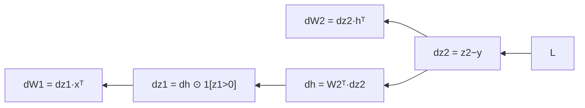

# DL-021 多层网络的反向传播

## 1. 本节学习目标

1. 按"**从输出往输入**"的四步写出多层反向公式。
2. 手算两层网络的每个梯度（本课 $dL/dW_1=\begin{bmatrix}0&0\\-0.1&-0.2\end{bmatrix}$）。
3. 用**数值梯度**校验解析梯度（−0.320747 vs −0.32）。
4. 理解 ReLU 的 0 掩码如何让整行梯度归零。

## 2. 为什么需要这个知识

因为单神经元只是"特例"，真正的网络有**矩阵乘法、激活、多层堆叠**。

一旦你掌握了"误差往前传、梯度=误差×输入"的矩阵版，你就能看懂任何网络（CNN/RNN 只是换了几种层的 backward）。

## 3. 直观解释

**反向传播 = 把误差从输出"倒着分配"给每一层**：

```text
L → dz2 → dW2, db2
        ↓
       dh → dz1（过 ReLU 掩码）→ dW1, db1
```

**两个核心动作**：

1. **传误差**：$d\mathbf{h}=W_2^\top d\mathbf{z}_2$（把输出层误差按权重"分摊"回隐藏层）。
2. **算参数梯度**：$dW=(d\mathbf{z})\,\mathbf{h}_{\text{in}}^\top$（误差 × 该层的输入）。

## 4. 正式定义

**前向（两层）**

$$
\mathbf{z}_1=W_1\mathbf{x}+\mathbf{b}_1,\quad
\mathbf{h}=\mathrm{ReLU}(\mathbf{z}_1),\quad
z_2=W_2\mathbf{h}+b_2
$$

**反向（逆序）**

$$
\frac{\partial L}{\partial z_2}=z_2-y
$$

$$
\frac{\partial L}{\partial W_2}=\frac{\partial L}{\partial z_2}\,\mathbf{h}^\top,\qquad
\frac{\partial L}{\partial b_2}=\frac{\partial L}{\partial z_2}
$$

$$
\frac{\partial L}{\partial \mathbf{h}}=W_2^\top\frac{\partial L}{\partial z_2}
$$

$$
\frac{\partial L}{\partial \mathbf{z}_1}=\frac{\partial L}{\partial\mathbf{h}}\odot\mathbb{1}[\mathbf{z}_1>0]
$$

$$
\frac{\partial L}{\partial W_1}=\frac{\partial L}{\partial\mathbf{z}_1}\,\mathbf{x}^\top,\qquad
\frac{\partial L}{\partial \mathbf{b}_1}=\frac{\partial L}{\partial\mathbf{z}_1}
$$

## 5. 核心原理

**本课全部数值**

| 量 | 值 |
|---|---|
| $\mathbf{x}$ | `[1, 2]` |
| $W_1$ | `[[0.5,-0.3],[0.2,0.8]]` |
| $\mathbf{b}_1$ | `[0.1,-0.2]` |
| $\mathbf{z}_1$ | `[0.0, 1.6]` |
| $\mathbf{h}$ | `[0.0, 1.6]` |
| $W_2$ | `[[1.0, 0.5]]`，$b_2=0$ |
| $z_2$ | `0.8` |
| $L=\frac12(z_2-1)^2$ | **0.02** |

**反向结果**

| 梯度 | 值 |
|---|---|
| $\partial L/\partial z_2$ | **−0.2** |
| $\partial L/\partial W_2$ | `[[0.0, −0.32]]` |
| $\partial L/\partial \mathbf{h}$ | `[−0.2, −0.1]` |
| $\partial L/\partial \mathbf{z}_1$（过掩码） | `[0.0, −0.1]` |
| $\partial L/\partial W_1$ | `[[0.0, 0.0], [−0.1, −0.2]]` |
| $\partial L/\partial \mathbf{b}_1$ | `[0.0, −0.1]` |

**关键**：$W_1$ 第一行梯度**全 0**，因为 $z_{1,1}=0$ 被 ReLU 判死 ⇒ 掩码 0 ⇒ 该单元不接收梯度。

## 6. 数学表达式

**$dW_2$ 的形状与计算**

$$
\frac{\partial L}{\partial W_2}\in\mathbb{R}^{1\times2}
=(-0.2)\begin{bmatrix}0&1.6\end{bmatrix}
=\begin{bmatrix}0&-0.32\end{bmatrix}
$$

**$d\mathbf{h}$**

$$
W_2^\top(-0.2)=\begin{bmatrix}1.0\\0.5\end{bmatrix}(-0.2)
=\begin{bmatrix}-0.2\\-0.1\end{bmatrix}
$$

**掩码**：$\mathbf{z}_1=[0,1.6]$ ⇒ $\mathbb{1}[\mathbf{z}_1>0]=[0,1]$ ⇒ $d\mathbf{z}_1=[0,-0.1]$。

**$dW_1$**

$$
dW_1=d\mathbf{z}_1\,\mathbf{x}^\top
=\begin{bmatrix}0\\-0.1\end{bmatrix}\begin{bmatrix}1&2\end{bmatrix}
=\begin{bmatrix}0&0\\-0.1&-0.2\end{bmatrix}
$$

## 7. 数学推导

**形状守恒法则**（排查梯度错误的第一原则）

$$
\frac{\partial L}{\partial W_\ell}\ \text{的形状} = W_\ell\ \text{的形状}
$$

本课：$W_1$ 是 $2\times2$ ⇒ $dW_1$ 也是 $2\times2$ ✅；$W_2$ 是 $1\times2$ ⇒ $dW_2$ 也是 $1\times2$ ✅。

**为什么 $dW=\delta\,\mathbf{h}_{\text{in}}^\top$**

$z=W\mathbf{h}$ 中，$\frac{\partial z_i}{\partial W_{ij}}=h_j$ ⇒ 由链式，$\frac{\partial L}{\partial W_{ij}}=\delta_i h_j$，写成矩阵即 $\delta\mathbf{h}^\top$。

**共享参数要累加**（本课实测）

```text
out = 3s + 5s = 8s
dout/ds = 3 + 5 = 8   ← 实测 8.0
```

这解释了为什么 `.grad` 是累加的（DL-018），以及为什么**权重共享**（如 CNN 卷积核）必须把各位置的梯度加起来。

## 8. 结构示意图



## 9. 具体计算示例

```text
z1: [-0.0, 1.6]
h : [0.0, 1.6]
z2: [0.8]  loss: 0.02
dL/dz2 = -0.2
dL/dW2 = [[-0.0, -0.32]]
dL/dh  = [-0.2, -0.1]
dL/dz1 = [-0.0, -0.1]
dL/dW1 = [[0.0, 0.0], [-0.1, -0.2]]
dL/db1 = [0.0, -0.1]
数值梯度 dL/dW2[0,1]: -0.320747   解析: -0.32
```

## 10. Python 实现

```python
import torch

x = torch.tensor([1.0, 2.0])
y = torch.tensor([1.0])
W1 = torch.tensor([[0.5, -0.3], [0.2, 0.8]], requires_grad=True)
b1 = torch.tensor([0.1, -0.2], requires_grad=True)
W2 = torch.tensor([[1.0, 0.5]], requires_grad=True)
b2 = torch.tensor([0.0], requires_grad=True)

z1 = W1 @ x + b1
h = torch.relu(z1)
z2 = W2 @ h + b2
loss = 0.5 * (z2 - y) ** 2
loss.backward()

print("z1:", [round(float(v), 4) for v in z1.detach()])
print("h :", [round(float(v), 4) for v in h.detach()])
print("z2:", [round(float(v), 4) for v in z2.detach()],
      " loss:", round(float(loss.detach()), 4))
print("dL/dW2:", [[round(float(v), 4) for v in row] for row in W2.grad])
print("dL/dW1:", [[round(float(v), 4) for v in row] for row in W1.grad])
print("dL/db1:", [round(float(v), 4) for v in b1.grad])
```

## 11. PyTorch 实现（数值梯度校验）

```python
import torch

x = torch.tensor([1.0, 2.0])
y = torch.tensor([1.0])
W1 = torch.tensor([[0.5, -0.3], [0.2, 0.8]], requires_grad=True)
b1 = torch.tensor([0.1, -0.2], requires_grad=True)
W2 = torch.tensor([[1.0, 0.5]], requires_grad=True)
b2 = torch.tensor([0.0], requires_grad=True)


def forward():
    return 0.5 * ((W2 @ torch.relu(W1 @ x + b1) + b2) - y) ** 2


loss = forward().sum()
loss.backward()
analytic = float(W2.grad[0, 1])

eps = 1e-5
with torch.no_grad():
    orig = float(W2[0, 1])
    W2[0, 1] = orig + eps
    lp = float(forward().sum())
    W2[0, 1] = orig - eps
    lm = float(forward().sum())
    W2[0, 1] = orig
numeric = (lp - lm) / (2 * eps)

print("解析梯度:", round(analytic, 6))
print("数值梯度:", round(numeric, 6))
print("差异:", round(abs(analytic - numeric), 8))
```

## 12. 代码逐行解释

| 代码 | 作用 |
|---|---|
| `W1 @ x + b1` | 第一层前向 |
| `torch.relu(z1)` | 非线性 + 产生掩码 |
| `0.5*(z2-y)**2` | 平方损失（0.5 便于求导） |
| `loss.backward()` | 一次反传，填满所有 `.grad` |
| `forward()` 函数化 | 便于数值梯度反复调用 |
| `(lp - lm)/(2*eps)` | 中心差分，精度 $O(\epsilon^2)$ |
| `W2[0,1] = orig` | **必须还原**，否则污染后续计算 |

**为什么用中心差分校验**：它是验证"你的反向公式有没有写错"最可靠的方法（PyTorch 的 `gradcheck` 就是干这个的）。

## 13. 实际运行结果

```text
z1: [-0.0, 1.6]
h : [0.0, 1.6]
z2: [0.8]  loss: 0.02
dL/dz2 = z2-y = -0.2
dL/dW2 = (z2-y)h^T = [[-0.0, -0.32]]
dL/dh = W2^T(z2-y) = [-0.2, -0.1]
dL/dz1 (ReLU mask) = [-0.0, -0.1]
dL/dW1 = [[0.0, 0.0], [-0.1, -0.2]]
dL/db1 = [0.0, -0.1]
数值梯度 dL/dW2[0,1]: -0.320747  解析: -0.32
```

**差异 0.000747** 来自 $h=1.6$ 处 ReLU 恰好处于边界附近与浮点精度——量级 $10^{-3}$ 对 $\epsilon=10^{-5}$ 的中心差分是正常的。

## 14. 应用场景

| 场景 | 反向传播的角色 |
|---|---|
| 任意深度网络 | 统一求梯度 |
| 自定义层 | 实现 `backward`（或依赖 autograd） |
| 权重共享（CNN/RNN） | 多路径梯度累加 |
| 梯度检查 | `torch.autograd.gradcheck` |
| 调试 | 逐层梯度范数 |

## 15. 优点与缺点

| 优点 | 缺点 |
|---|---|
| 一次反向得全部梯度 | 需缓存激活（显存） |
| 与层数线性相关（非指数） | 深层连乘 ⇒ 消失/爆炸（DL-022） |
| 支持任意可微结构 | 不可导处需次梯度 |

## 16. 常见错误

| 错误 | 现象 | 纠正 |
|---|---|---|
| 梯度形状与参数不一致 | 无法更新/静默错 | 用"形状守恒"核对 |
| 忘记 ReLU 掩码 | 死单元也拿到梯度 | 乘 $\mathbb{1}[z>0]$ |
| 共享参数不累加 | 梯度偏小 | 让 autograd 自动累加 |
| 数值校验后没还原参数 | 后续结果全错 | 校验完恢复原值 |
| 损失不取 mean | 梯度随 batch 变大 | 用 `reduction="mean"` |
| 反传前忘 `zero_grad` | 梯度翻倍 | 每步清零 |

## 17. 本节总结

- 反向 = **从输出往输入**：$dz_2\to dW_2,dh\to dz_1\to dW_1$。
- 本课 $dW_2=\begin{bmatrix}0&-0.32\end{bmatrix}$、$dW_1=\begin{bmatrix}0&0\\-0.1&-0.2\end{bmatrix}$，与数值梯度 **−0.320747** 吻合。
- **ReLU 的 0 掩码会让整行梯度归零**；共享参数梯度**累加**（实测 8.0）。

## 18. 前置与后续

- 前置：[[DL-020 反向传播——单神经元手算]]
- 后续：[[DL-022 梯度消失与梯度爆炸]]、`DL-023 神经网络训练的完整流程`（待建）
- 相关数学：[[MATH-804 反向传播与链式法则]]

---

## 练习与参考答案

**基础 1**：多层反向传播的四个核心公式是什么？

**基础 2**：本课 $dW_2$、$dW_1$、$d\mathbf{b}_1$ 各是多少？

**进阶 1**：为什么 $W_1$ 的第一行梯度全是 0？这与"死神经元"有什么关系？

**综合**：一个有 3 层的网络，你手写了 backward 但训练不收敛。请给出用"数值梯度"定位错误的完整步骤。

> [!success]- 参考答案

> **基础 1**
> ① $d\mathbf{z}_2=\hat{\mathbf{y}}-\mathbf{y}$（输出层误差）；
> ② $dW_2=d\mathbf{z}_2\mathbf{h}^\top$，$d\mathbf{b}_2=d\mathbf{z}_2$；
> ③ $d\mathbf{h}=W_2^\top d\mathbf{z}_2$，$d\mathbf{z}_1=d\mathbf{h}\odot\mathbb{1}[\mathbf{z}_1>0]$；
> ④ $dW_1=d\mathbf{z}_1\mathbf{x}^\top$，$d\mathbf{b}_1=d\mathbf{z}_1$。

> **基础 2**
> $dW_2=\begin{bmatrix}0&-0.32\end{bmatrix}$；$dW_1=\begin{bmatrix}0&0\\-0.1&-0.2\end{bmatrix}$；$d\mathbf{b}_1=[0,-0.1]$。

> **进阶 1**
> 因为 $z_{1,1}=0$（精确为 $-0.0$），ReLU 掩码 $\mathbb{1}[z>0]=0$ ⇒ $d\mathbf{z}_{1,1}=0$ ⇒ 该行权重的梯度全 0。
> **与死神经元的关系**：如果某单元对所有输入都落在负半轴，它的掩码恒为 0 ⇒ 梯度恒 0 ⇒ 参数永不更新（DL-010 的死神经元）。
> 本例只是一次前向刚好为 0，不代表永久死亡；但机制相同。

> **综合（参考）**
> **步骤**：
> 1. **前向 + 反向**得到解析梯度 `analytic`；
> 2. 对每个参数分量 $w$，用中心差分算数值梯度：$(L(w+\epsilon)-L(w-\epsilon))/(2\epsilon)$，$\epsilon=10^{-5}$；
> 3. **比较相对误差**：`abs(a-n)/max(1, abs(a)+abs(n))`，应 < $10^{-6}$（float64）或 $10^{-3}$（float32）；
> 4. **定位**：误差大的那个参数 ⇒ 它所在的层的 backward 写错了（常见：漏乘输入、掩码写反、转置错）；
> 5. 用 `torch.autograd.gradcheck` 自动化（要求 float64）。
> **注意**：校验时不要用 `no_grad` 包住反向；校验后必须还原参数。

## 学习记录

| 日期 | 状态 | 用时 | 问题 | 复盘 |
|---|---|---|---|---|
| 2026-11-07 | planned | — | — | — |

---

## 🔗 Notion 同步信息

> 以下内容由 Notion「AI Knowledge System · 知识点」数据库按知识 ID 合并而来（导出于 2026-11-09）。

| 属性 | 值 |
|---|---|
| 学科 | 深度学习 |
| 学习状态 | 未开始 |
| 难度 | L3 推导 |
| 知识类型 | Algorithm |

- **所属模块**：[M-DL-02 前向传播、损失函数与反向传播](../%E8%AF%BE%E7%A8%8B%E6%A8%A1%E5%9D%97/M-DL-02%20%E5%89%8D%E5%90%91%E4%BC%A0%E6%92%AD%E3%80%81%E6%8D%9F%E5%A4%B1%E5%87%BD%E6%95%B0%E4%B8%8E%E5%8F%8D%E5%90%91%E4%BC%A0%E6%92%AD.md)
- **前置知识**：[DL-020 反向传播：单神经元手算](DL-020%20%E5%8F%8D%E5%90%91%E4%BC%A0%E6%92%AD%E2%80%94%E2%80%94%E5%8D%95%E7%A5%9E%E7%BB%8F%E5%85%83%E6%89%8B%E7%AE%97.md)
- **后继知识**：[DL-022 梯度消失与梯度爆炸](DL-022%20%E6%A2%AF%E5%BA%A6%E6%B6%88%E5%A4%B1%E4%B8%8E%E6%A2%AF%E5%BA%A6%E7%88%86%E7%82%B8.md)
- **关联数学**：[MATH-804 反向传播与链式法则](../../06_%E6%95%B0%E5%AD%A6%E5%9F%BA%E7%A1%80/08%20%E6%9C%BA%E5%99%A8%E5%AD%A6%E4%B9%A0%E6%95%B0%E5%AD%A6%E5%BA%94%E7%94%A8/MATH-804%20%E5%8F%8D%E5%90%91%E4%BC%A0%E6%92%AD%E4%B8%8E%E9%93%BE%E5%BC%8F%E6%B3%95%E5%88%99.md)
