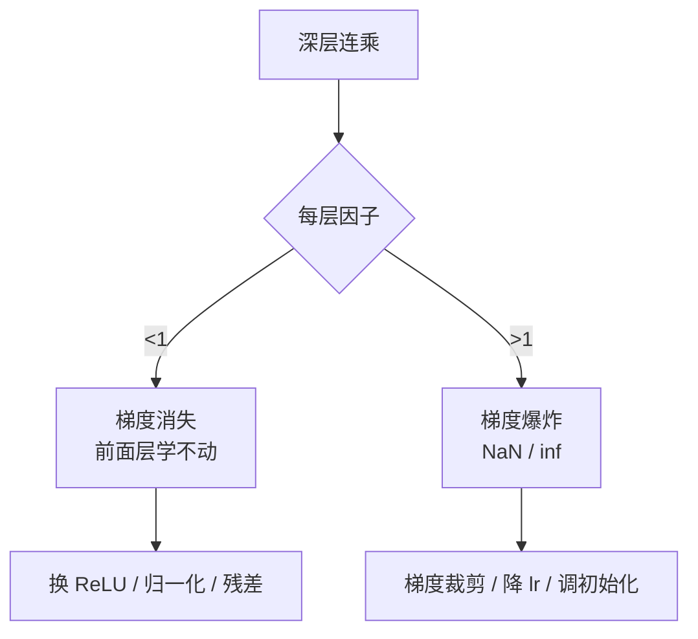

# DL-022 梯度消失与梯度爆炸

## 1. 本节学习目标

1. 用**实测数字**看清梯度随深度衰减/爆炸（Sigmoid 10 层第一层梯度 = **0.000e+00**）。
2. 说出两类问题的成因：**连乘** + **激活饱和/权重过大**。
3. 对比 Sigmoid / Tanh / ReLU / Xavier 初始化 / 大权重的梯度范数。
4. 掌握 5 种缓解手段：换激活、合适初始化、归一化、残差、梯度裁剪。

## 2. 为什么需要这个知识

因为**深层网络训不动的首要原因就是它**。

如果你不知道梯度会随深度指数衰减，就会在"加层数 → 效果不变甚至更差"时误以为是数据问题；如果你不知道梯度会爆炸，遇到 loss 变 NaN 就只能盲目调小学习率。

## 3. 直观解释

**反向传播是连乘**：

$$
\frac{\partial L}{\partial W_1}\ \propto\ \prod_{\ell=2}^{L}\Big(\sigma'_\ell\cdot W_\ell\Big)
$$

- 每层因子 **< 1** ⇒ 越乘越小 ⇒ **消失**（前面层学不动）。
- 每层因子 **> 1** ⇒ 越乘越大 ⇒ **爆炸**（数值溢出成 NaN）。

**一句话**：深度把"每层的小误差"放大成"指数级差异"。

## 4. 正式定义

**梯度消失**：$\big\|\partial L/\partial W_1\big\|\ll\big\|\partial L/\partial W_L\big\|$，前面层几乎不更新。

**梯度爆炸**：梯度范数随层数指数增长，导致参数更新过大、loss 变 NaN/inf。

**本课度量**

$$
\text{比值}=\frac{\|\partial L/\partial W_{\text{第一层}}\|}{\|\partial L/\partial W_{\text{最后一层}}\|}
$$

比值 $\ll1$ ⇒ 消失；$\gg1$ ⇒ 爆炸。

## 5. 核心原理

**本课实测（10 层，16 宽，ReLU/Sigmoid 等）**

| 配置 | 第一层梯度范数 | 最后一层 | 比值 |
|---|---|---|---|
| **Sigmoid×10** | **0.000e+00**（下溢） | 4.432e-02 | 0.000 |
| Tanh×10 | 1.538e-03 | 5.004e-02 | 3.073e-02 |
| ReLU×10（默认初始化） | 3.369e-05 | 7.155e-03 | 4.709e-03 |
| **ReLU×10 + Xavier** | **2.186e-03** | 6.779e-03 | **3.224e-01** |
| ReLU×10 + 权重×3 | 9.636e-01 | 6.553e+00 | 1.470e-01 |

**深度扫描（Sigmoid）**

| 深度 | 第一层梯度 |
|---|---|
| 3 | 7.665e-04 |
| 5 | 3.121e-05 |
| 10 | **0.000e+00** |
| 20 | **0.000e+00** |

**读法**：深度从 3 到 5，梯度掉了 **24 倍**；到 10 层直接下溢为 0。**这就是"深层 Sigmoid 训不动"的实测证据。**

**梯度爆炸实测（权重 ×5 / ×8）**

| 深度 | 权重倍数 | logit 最大绝对值 | loss | 第一层梯度 |
|---|---|---|---|---|
| 10 | ×5 | 7.584e+02 | 1.794e+02 | 1.007e+02 |
| 20 | ×5 | 1.046e+05 | 1.946e+04 | 2.040e+04 |
| **20** | **×8** | **1.292e+09** | **2.342e+08** | **1.393e+08** |

**读法**：权重偏大 + 20 层 ⇒ 梯度到 **1.39 亿**。再大一步就是 inf/NaN。

## 6. 数学表达式

**连乘的形式**

设每层 $W_\ell$ 的谱范数为 $s_\ell$、激活导数上界 $c_\ell$，则

$$
\Big\|\frac{\partial L}{\partial W_1}\Big\|\ \lesssim\ \Big(\prod_{\ell=2}^{L}s_\ell c_\ell\Big)\cdot\Big\|\frac{\partial L}{\partial W_L}\Big\|
$$

- 若 $s_\ell c_\ell<1$ ∀ℓ ⇒ 指数衰减。
- 若 $s_\ell c_\ell>1$ ∀ℓ ⇒ 指数增长。

**Sigmoid 的 $c\le0.25$**、**Tanh 的 $c\le1$**、**ReLU 正区间 $c=1$**。

**本课的估算**：Sigmoid 10 层 ⇒ $0.25^{10}\approx9.5\times10^{-7}$，与"下溢为 0"方向一致。

## 7. 数学推导

**为什么 Xavier 有效**

Xavier 初始化让每层输出方差保持稳定：

$$
\mathrm{Var}(W)=\frac{2}{n_{in}+n_{out}}
$$

推导思路：$\mathrm{Var}(z)=\sum_{i}\mathrm{Var}(w_i x_i)=n_{in}\mathrm{Var}(w)\mathrm{Var}(x)$。要让 $\mathrm{Var}(z)=\mathrm{Var}(x)$，需 $n_{in}\mathrm{Var}(w)=1$。Xavier 取输入与输出的调和平均，兼顾前向与反向。

**本课实测对比**：

- ReLU 默认初始化：第一层 **3.369e-05**（衰减）
- ReLU + Xavier：第一层 **2.186e-03**，比值从 $4.7\times10^{-3}$ 升到 **0.322**（改善 68 倍）

**He 初始化**（ReLU 专用）：$\mathrm{Var}(W)=\frac{2}{n_{in}}$（DL-030 详述）。

## 8. 结构示意图



## 9. 具体计算示例

```text
Sigmoid×10             第一层梯度范数=0.000e+00  最后一层=4.432e-02  比值=0.000e+00
Tanh×10                第一层梯度范数=1.538e-03  最后一层=5.004e-02  比值=3.073e-02
ReLU×10                第一层梯度范数=3.369e-05  最后一层=7.155e-03  比值=4.709e-03
ReLU×10 + Xavier       第一层梯度范数=2.186e-03  最后一层=6.779e-03  比值=3.224e-01
ReLU×10 + 权重大×3       第一层梯度范数=9.636e-01  最后一层=6.553e+00  比值=1.470e-01

depth= 3: 第一层=7.665e-04
depth= 5: 第一层=3.121e-05
depth=10: 第一层=0.000e+00
depth=20: 第一层=0.000e+00
```

## 10. Python 实现

```python
import torch
import torch.nn as nn
import torch.nn.functional as F


def build(depth: int, act) -> nn.Sequential:
    layers = []
    for _ in range(depth):
        layers += [nn.Linear(16, 16), act()]
    layers.append(nn.Linear(16, 1))
    return nn.Sequential(*layers)


def first_layer_grad(model: nn.Module) -> float:
    x = torch.randn(32, 16)
    y = torch.randint(0, 2, (32, 1)).float()
    loss = F.binary_cross_entropy_with_logits(model(x), y)
    loss.backward()
    for name, p in model.named_parameters():
        if p.dim() == 2 and p.grad is not None:
            return float(p.grad.norm())
    return float("nan")


for depth in (3, 5, 10):
    torch.manual_seed(0)
    model = build(depth, nn.Sigmoid)
    print(f"depth={depth}: 第一层梯度={first_layer_grad(model):.3e}")
```

## 11. PyTorch 实现（Xavier 与裁剪）

```python
import torch
import torch.nn as nn
import torch.nn.functional as F

torch.manual_seed(0)
layers = []
for _ in range(10):
    lin = nn.Linear(16, 16)
    nn.init.xavier_uniform_(lin.weight)
    nn.init.zeros_(lin.bias)
    layers += [lin, nn.ReLU()]
model = nn.Sequential(*layers, nn.Linear(16, 1))

x = torch.randn(32, 16)
y = torch.randint(0, 2, (32, 1)).float()
loss = F.binary_cross_entropy_with_logits(model(x), y)
loss.backward()

first = next(p for p in model.parameters() if p.dim() == 2)
print("Xavier 后第一层梯度范数:", f"{float(first.grad.norm()):.3e}")

# 梯度裁剪（防爆炸）
torch.nn.utils.clip_grad_norm_(model.parameters(), max_norm=1.0)
print("裁剪后范数:", f"{float(first.grad.norm()):.3e}")
```

## 12. 代码逐行解释

| 代码 | 作用 |
|---|---|
| `build(depth, act)` | 造指定深度的网络 |
| `first_layer_grad` | 反向一次，取**第一个二维参数**（权重）的梯度范数 |
| `nn.init.xavier_uniform_` | Xavier 初始化 |
| `clip_grad_norm_` | 按总范数裁剪（防爆炸） |
| `p.dim()==2` | 只取权重矩阵（排除偏置） |

**为什么用梯度范数**：单看某个元素会被符号抵消；范数反映"整体有多大"。

## 13. 实际运行结果

```text
Sigmoid×10             第一层梯度范数=0.000e+00  最后一层=4.432e-02  比值=0.000e+00
Tanh×10                第一层梯度范数=1.538e-03  最后一层=5.004e-02  比值=3.073e-02
ReLU×10                第一层梯度范数=3.369e-05  最后一层=7.155e-03  比值=4.709e-03
ReLU×10 + Xavier       第一层梯度范数=2.186e-03  最后一层=6.779e-03  比值=3.224e-01
ReLU×10 + 权重大×3       第一层梯度范数=9.636e-01  最后一层=6.553e+00  比值=1.470e-01

depth=10 scale=5.0: logit_abs_max=7.584e+02 loss=1.794e+02 第一层梯度=1.007e+02
depth=20 scale=5.0: logit_abs_max=1.046e+05 loss=1.946e+04 第一层梯度=2.040e+04
depth=20 scale=8.0: logit_abs_max=1.292e+09 loss=2.342e+08 第一层梯度=1.393e+08
```

## 14. 应用场景

| 现象 | 判断 | 处理 |
|---|---|---|
| 前面层权重几乎不变 | 梯度消失 | 换 ReLU / 残差 / BN |
| loss 变 NaN | 梯度爆炸 | 裁剪 + 降 lr + 查初始化 |
| 深层不如浅层 | 优化问题（非容量） | 残差连接、归一化 |
| RNN 长序列学不到 | 长程梯度消失 | LSTM/GRU 门控（DL-053/054） |

## 15. 优点与缺点

（本节讲问题，此处列"缓解手段"的取舍）

| 手段 | 优点 | 代价 |
|---|---|---|
| 换 ReLU/GELU | 简单有效 | 死神经元 |
| Xavier/He 初始化 | 从源头稳住方差 | 需按激活选公式 |
| BatchNorm/LayerNorm | 每层输入稳定 | 增加计算、BN 对小 batch 不稳 |
| 残差连接 | 给梯度开"高速公路" | 结构变复杂 |
| 梯度裁剪 | 直接防 NaN | 治标，可能掩盖根因 |

## 16. 常见错误

| 错误 | 现象 | 纠正 |
|---|---|---|
| 20 层全 Sigmoid | 前层梯度 0 | 换 ReLU |
| 初始化全零 | 对称性无法打破 | 随机/ Xavier |
| 权重初始化过大 | logit 爆炸、loss NaN | 合理初始化 |
| 不裁剪就上大 lr | NaN | `clip_grad_norm_` |
| 只看总 loss | 不知道哪层坏了 | 逐层打印梯度范数 |
| 把"梯度小"当"收敛" | 其实没学 | 看参数更新量 |

## 17. 本节总结

- **反向是连乘**：因子 <1 消失，>1 爆炸。
- 实测：Sigmoid 10 层第一层梯度 **0.000e+00**；权重 ×8、20 层梯度到 **1.39e+08**。
- **Xavier 把比值从 4.7e-03 提到 0.322**（68 倍改善）。

## 18. 前置与后续

- 前置：[[DL-021 多层网络的反向传播]]
- 后续：`DL-023 神经网络训练的完整流程`（待建）、`DL-030 权重初始化：Xavier 与 He`（待建）、`DL-031 梯度裁剪与训练稳定性`（待建）
- 相关数学：[[MATH-804 反向传播与链式法则]]
- 相关机器学习：[[ML-047 偏差-方差权衡与学习曲线]]

---

## 练习与参考答案

**基础 1**：梯度消失与梯度爆炸的成因各是什么？

**基础 2**：本课 Sigmoid 深度 3/5/10 的第一层梯度各是多少？

**进阶 1**：为什么 Xavier 初始化能把梯度改善 68 倍？

**综合**：一个 30 层网络训练时 loss 在第 3 个 epoch 变成 NaN。请给出排查顺序与 5 个具体措施。

> [!success]- 参考答案

> **基础 1**
> 两者都源自**反向传播的连乘**：$\partial L/\partial W_1\propto\prod_\ell(\sigma'_\ell s_\ell)$。
> - **消失**：每层因子 <1（如 Sigmoid 导数 ≤0.25、权重偏小）⇒ 指数衰减。
> - **爆炸**：每层因子 >1（权重过大、初始化不当）⇒ 指数增长，最终 inf/NaN。

> **基础 2**
> depth=3：**7.665e-04**；depth=5：**3.121e-05**；depth=10：**0.000e+00**（下溢）。
> 从 3 到 5 掉了约 24 倍，到 10 层已经无法表示。

> **进阶 1**
> 因为 Xavier 让**每层输出的方差保持稳定**：$\mathrm{Var}(W)=2/(n_{in}+n_{out})$，使前向时 $\mathrm{Var}(z)\approx\mathrm{Var}(x)$，反向时梯度也不被系统性放大/缩小。
> 本课默认初始化下比值 4.709e-03，Xavier 后 **3.224e-01**，改善约 68 倍，正是因为消除了逐层方差的累积漂移。

> **综合（参考）**
> **排查顺序**：
> 1. 打印每步 loss 与 `grad.norm()`，定位第一次异常的位置；
> 2. 检查是否有 `log(0)`/除零/`exp` 溢出；
> 3. 检查是否忘了 `zero_grad()`；
> 4. 检查初始化与学习率。
> **5 个措施**：
> 1. **梯度裁剪**：`clip_grad_norm_(params, 1.0)`；
> 2. **降学习率** + **warmup**（DL-029）；
> 3. **换初始化**：ReLU 用 He、Tanh 用 Xavier（DL-030）；
> 4. **加归一化**：BatchNorm/LayerNorm（DL-036/037）；
> 5. **加残差连接**：给梯度一条直通路径（DL-048）。
> **验证**：修复后梯度范数应稳定在 0.1–10 量级、loss 单调下降。

## 学习记录

| 日期 | 状态 | 用时 | 问题 | 复盘 |
|---|---|---|---|---|
| 2026-11-07 | planned | — | — | — |

---

## 🔗 Notion 同步信息

> 以下内容由 Notion「AI Knowledge System · 知识点」数据库按知识 ID 合并而来（导出于 2026-11-09）。

| 属性 | 值 |
|---|---|
| 学科 | 深度学习 |
| 学习状态 | 未开始 |
| 难度 | L3 推导 |
| 知识类型 | Concept |

- **所属模块**：[M-DL-02 前向传播、损失函数与反向传播](../%E8%AF%BE%E7%A8%8B%E6%A8%A1%E5%9D%97/M-DL-02%20%E5%89%8D%E5%90%91%E4%BC%A0%E6%92%AD%E3%80%81%E6%8D%9F%E5%A4%B1%E5%87%BD%E6%95%B0%E4%B8%8E%E5%8F%8D%E5%90%91%E4%BC%A0%E6%92%AD.md)
- **前置知识**：[DL-021 多层网络的反向传播](DL-021%20%E5%A4%9A%E5%B1%82%E7%BD%91%E7%BB%9C%E7%9A%84%E5%8F%8D%E5%90%91%E4%BC%A0%E6%92%AD.md)
- **后继知识**：[DL-023 神经网络训练的完整流程](../05%20%E8%AE%AD%E7%BB%83%E6%8A%80%E5%B7%A7/DL-023%20%E7%A5%9E%E7%BB%8F%E7%BD%91%E7%BB%9C%E8%AE%AD%E7%BB%83%E7%9A%84%E5%AE%8C%E6%95%B4%E6%B5%81%E7%A8%8B.md)
- **关联数学**：[MATH-804 反向传播与链式法则](../../06_%E6%95%B0%E5%AD%A6%E5%9F%BA%E7%A1%80/08%20%E6%9C%BA%E5%99%A8%E5%AD%A6%E4%B9%A0%E6%95%B0%E5%AD%A6%E5%BA%94%E7%94%A8/MATH-804%20%E5%8F%8D%E5%90%91%E4%BC%A0%E6%92%AD%E4%B8%8E%E9%93%BE%E5%BC%8F%E6%B3%95%E5%88%99.md)
