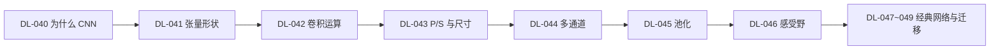

# 🖼 CNN · 分支索引

> 段位：`DL-040` ~ `DL-049`（M-DL-05）
> 上位：[[04_深度学习/00 模块索引\|深度学习模块索引]]
> 定位：**用局部连接 + 权重共享把图像的空间结构利用起来**。

---

## 一、这一段装什么

| 号段 | 内容 |
|---|---|
| DL-040 ~ 044 | 卷积基础：为什么用 CNN、张量形状、卷积运算、尺寸公式、多通道 |
| DL-045 ~ 049 | 池化、感受野、经典网络（LeNet/VGG/ResNet）、迁移学习 |

## 二、学习顺序

## 三、必须亲手算过的三件事

1. 手算一次 $5	imes5$ 与 $3	imes3$ 的卷积（DL-042）。
2. 手算一次输出尺寸，并用 `Conv2d` 验证（DL-043）。
3. 手算一次多通道参数量 $C_{out}C_{in}K^2+C_{out}$（DL-044）。

## 四、知识点登记（10 条）

| 知识 ID | 名称 | 难度 | 状态 | 笔记 |
|---|---|---|---|---|
| `DL-040` | CNN 基本思想与为什么图像适合 CNN | L2 | planned | [[DL-040 CNN 基本思想与为什么图像适合 CNN]] |
| `DL-041` | 图像张量、通道与批次维度 | L1 | planned | [[DL-041 图像张量、通道与批次维度]] |
| `DL-042` | 卷积运算 | L3 | planned | [[DL-042 卷积运算]] |
| `DL-043` | Padding、Stride 与输出尺寸 | L2 | planned | [[DL-043 Padding、Stride 与输出尺寸]] |
| `DL-044` | 多通道卷积与 Feature Map | L3 | planned | [[DL-044 多通道卷积与 Feature Map]] |
| `DL-045` | 池化：Max 与 Average | L2 | planned | [[DL-045 池化——Max 与 Average]] |
| `DL-046` | 感受野与参数共享 | L3 | planned | [[DL-046 感受野与参数共享]] |
| `DL-047` | LeNet、AlexNet 与 VGG | L2 | planned | [[DL-047 LeNet、AlexNet 与 VGG]] |
| `DL-048` | ResNet 与 Skip Connection | L3 | planned | [[DL-048 ResNet 与 Skip Connection]] |
| `DL-049` | 迁移学习与图像分类工作流 | L2 | planned | [[DL-049 迁移学习与图像分类工作流]] |

> 本目录计划 10 篇，**已全部完成**（DL-040 ~ DL-049，M-DL-05 收官）。

## 五、导航

- 上一级：[[04_深度学习/00 模块索引\|深度学习模块索引]]
- 知识索引：[[08_知识索引/04 深度学习知识索引\|深度学习知识索引]]
- 规则：[[08_知识索引/06 知识关联索引\|知识关联索引]]
