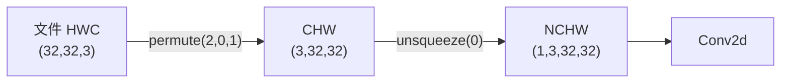

# DL-041 图像张量、通道与批次维度

## 1. 本节学习目标

1. 记住 PyTorch 的图像张量格式 **NCHW**，并能说出每一维含义。
2. 会做 **HWC ↔ CHW ↔ NCHW** 的转换（`permute` + `unsqueeze`）。
3. 理解"通道"的物理含义（RGB、灰度、特征通道）。
4. 知道为什么卷积层要求 4 维输入。

## 2. 为什么需要这个知识

因为 **80% 的 CNN 报错都是形状不对**：

```text
RuntimeError: Expected 4-dimensional input for 4-dimensional weight,
but got 3-dimensional input
```

读懂 NCHW，你就能一眼定位这类问题，而不用反复打印形状猜。

## 3. 直观解释

**一张 RGB 图 = 3 个 $H\times W$ 的矩阵叠在一起**：

```text
N：batch 里几张图
C：每张图几个通道（RGB=3，灰度=1）
H：高（像素行数）
W：宽（像素列数）
```

**PyTorch 的顺序是 N → C → H → W**（大维度到小维度，便于内存连续访问）。

## 4. 正式定义

**张量形状**

$$
\mathbf{X}\in\mathbb{R}^{N\times C\times H\times W}
$$

| 维 | 含义 | 典型值 |
|---|---|---|
| $N$ | batch size | 1–256 |
| $C$ | 通道数 | 1（灰度）/3（RGB）/64+（特征图） |
| $H$ | 高 | 32 / 224 |
| $W$ | 宽 | 32 / 224 |

**索引方式**：`x[0, 0]` 是"第一张图的第一个通道"，形状 `(H, W)`。

## 5. 核心原理

**本课实测形状**

```text
NCHW: (4, 3, 32, 32)      # 4 张 RGB 32×32
单图: (3, 32, 32)          # x[0]
单通道: (32, 32)           # x[0,0]

HWC permute→CHW: (3, 32, 32)
unsqueeze→NCHW: (1, 3, 32, 32)
```

**通道统计**

```text
通道均值(随机): [-0.0019, -0.0213, -0.0203]
每通道 std: [0.9907, 1.0041, 1.0162]
```

**读法**：三个通道的均值/标准差都接近 0/1，说明这是**随机生成**的"图像"；真实图像的三通道统计**差异明显**（如自然图像 R 通道均值偏高），这也是做归一化时要**按通道**计算均值方差的原因。

## 6. 数学表达式

**归一化（按通道）**

$$
\hat x_{c}=\frac{x_c-\mu_c}{\sigma_c}
$$

$\mu_c,\sigma_c$ 是训练集上第 $c$ 个通道的统计量（ImageNet 常用 `[0.485,0.456,0.406]` / `[0.229,0.224,0.225]`）。

**为什么不能按整图统一归一化**：三个通道的分布不同，统一减同一个均值会让某些通道偏移。

## 7. 数学推导

**内存布局与形状的关系**

PyTorch 张量是行优先存储。`(N,C,H,W)` 的连续内存顺序是：

$$
\text{idx}=((n\cdot C+c)\cdot H+h)\cdot W+w
$$

因此**最后两维（H,W）必须连续**，卷积核对它们做滑动窗口才能高效。

**这就是"回 CPU 转 numpy 时要 `permute(1,2,0)`"的原因**：numpy/OpenCV 习惯 HWC，而 PyTorch 是 CHW。

## 8. 结构示意图



## 9. 具体计算示例

```text
batch = torch.randn(4, 3, 32, 32)
batch.shape        → (4, 3, 32, 32)
batch[0].shape     → (3, 32, 32)
batch[0, 0].shape  → (32, 32)

hwc = torch.randn(32, 32, 3)
hwc.permute(2,0,1).shape          → (3, 32, 32)
hwc.permute(2,0,1).unsqueeze(0).shape → (1, 3, 32, 32)
```

## 10. Python 实现

```python
import torch

batch = torch.randn(4, 3, 32, 32)
print("NCHW:", tuple(batch.shape))
print("单图:", tuple(batch[0].shape))
print("单通道:", tuple(batch[0, 0].shape))
print("通道均值:", [round(float(batch[:, c].mean()), 4) for c in range(3)])
print("每通道 std:", [round(float(batch[:, c].std()), 4) for c in range(3)])
```

## 11. PyTorch 实现（格式转换）

```python
import torch

hwc = torch.randn(32, 32, 3)          # 模拟 OpenCV/PIL 读出的图像
chw = hwc.permute(2, 0, 1)            # HWC → CHW
nchw = chw.unsqueeze(0)               # CHW → NCHW
print("HWC:", tuple(hwc.shape))
print("CHW:", tuple(chw.shape))
print("NCHW:", tuple(nchw.shape))

back = nchw.squeeze(0).permute(1, 2, 0)
print("转回 HWC:", tuple(back.shape))
print("往返一致:", bool(torch.allclose(back, hwc)))
```

## 12. 代码逐行解释

| 代码 | 作用 |
|---|---|
| `permute(2,0,1)` | 把第 3 维（通道）提到最前 |
| `unsqueeze(0)` | 在最前面插入 batch 维 |
| `squeeze(0)` | 去掉 batch 维 |
| `permute(1,2,0)` | CHW → HWC（回 numpy 用） |
| `batch[:, c]` | 取所有样本的第 c 通道 |
| `allclose` | 验证往返无损 |

**注意**：`permute` 只改**步长（stride）**，不拷贝数据；后续 `.contiguous()` 才会真正重排内存。

## 13. 实际运行结果

```text
NCHW: (4, 3, 32, 32)
单图: (3, 32, 32)  单通道: (32, 32)
HWC permute→CHW: (3, 32, 32)
unsqueeze→NCHW: (1, 3, 32, 32)
通道均值(随机): [-0.0019, -0.0213, -0.0203]
每通道 std: [0.9907, 1.0041, 1.0162]
```

## 14. 应用场景

| 场景 | 形状 |
|---|---|
| 图像分类输入 | `(N, 3, H, W)` |
| 灰度图 | `(N, 1, H, W)` |
| 特征图（中间层） | `(N, C, H, W)`，C 可 64–2048 |
| 一维卷积（音频） | `(N, C, L)` |
| Transformer 视觉（ViT） | `(N, T, D)`（展平成 patch 序列） |

## 15. 优点与缺点

| 优点 | 缺点 |
|---|---|
| 维度语义清晰 | 与 OpenCV/PIL 的 HWC 不一致 |
| 便于按通道归一化 | 转换易出错（permute 顺序） |
| 支持批量并行 | 内存占用随 N 线性增长 |

## 16. 常见错误

| 错误 | 现象 | 纠正 |
|---|---|---|
| 直接把 `(3,32,32)` 喂 Conv2d | `Expected 4-dimensional input` | `unsqueeze(0)` |
| `permute(0,1,2)` 顺序错 | 形状对但内容错位 | 明确 HWC→CHW 是 `(2,0,1)` |
| 忘记 `.contiguous()` | 某些算子报 stride 错误 | 转换后 contiguous |
| 通道顺序 RGB/BGR 混用 | 颜色异常、精度掉 | 统一（OpenCV 是 BGR） |
| 按整图归一化 | 通道偏差 | 按通道统计 |

## 17. 本节总结

- PyTorch 图像张量是 **NCHW**：`(batch, 通道, 高, 宽)`。
- 转换链：`HWC --permute(2,0,1)--> CHW --unsqueeze(0)--> NCHW`。
- 本课实测 `(4,3,32,32)`、单图 `(3,32,32)`、单通道 `(32,32)`；随机数据三通道均值≈0、std≈1。

## 18. 前置与后续

- 前置：[[DL-040 CNN 基本思想与为什么图像适合 CNN]]
- 后续：[[DL-042 卷积运算]]、[[DL-043 Padding、Stride 与输出尺寸]]、[[DL-044 多通道卷积与 Feature Map]]
- 相关数学：[[MATH-217 矩阵运算与维度]]
- 相关 Python：[[PY-066 矩阵运算]]

---

## 练习与参考答案

**基础 1**：NCHW 四个字母各代表什么？PyTorch 为什么用这个顺序。

**基础 2**：把 `(32,32,3)` 的 HWC 图变成可送入 Conv2d 的形状，写出两步操作与结果形状。

**进阶 1**：`permute` 与 `.contiguous()` 有什么区别？什么时候必须用后者？

**综合**：你用 OpenCV 读了一张图（BGR、HWC、uint8），要送入 PyTorch 模型。请写出完整的预处理链，并指出两个易错点。

> [!success]- 参考答案

> **基础 1**
> - **N**：batch size（几张图）；**C**：通道数；**H**：高；**W**：宽。
> - 顺序从"大维度"到"小维度"，且 **H、W 连续**便于卷积做滑动窗口（内存局部性好）。

> **基础 2**
> ```python
> chw = hwc.permute(2, 0, 1)   # (3, 32, 32)
> nchw = chw.unsqueeze(0)      # (1, 3, 32, 32)
> ```

> **进阶 1**
> - `permute` 只改变**维度的步长（view）**，不复制数据，结果可能**非连续**；
> - `.contiguous()` 会真正**按新顺序重排内存**（复制一次）。
> 必须在以下情况用：① 后续算子要求连续内存（如 `view()`）；② 转 numpy（`numpy()` 要求连续）；③ 某些底层 kernel 报 stride 错误。

> **综合（参考）**
> **完整链**（本机未装 OpenCV，下面用 numpy 模拟一张 BGR/HWC/uint8 图像，代码可直接运行）：
> ```python
> import numpy as np
> import torch
>
> # 模拟 cv2.imread 的输出：BGR 顺序、HWC、uint8
> raw = np.random.randint(0, 256, (32, 32, 3), dtype=np.uint8)
>
> img = raw[:, :, ::-1].astype(np.float32) / 255.0      # BGR→RGB，并归一到 [0,1]
> mean = np.array([0.485, 0.456, 0.406], dtype=np.float32)
> std = np.array([0.229, 0.224, 0.225], dtype=np.float32)
> img = (img - mean) / std
>
> x = torch.from_numpy(img).permute(2, 0, 1).unsqueeze(0).float()
> print("原始 uint8 HWC:", raw.shape, raw.dtype)
> print("送入模型 NCHW:", tuple(x.shape), x.dtype)
> ```
> 若用 OpenCV 读真实文件，把前两行换成：
> ```text
> import cv2
> raw = cv2.imread(path)                 # BGR, HWC, uint8
> ```
> **两个易错点**：
> 1. **BGR/RGB 顺序**：OpenCV 读的是 BGR，不转会导致颜色与训练时不一致、精度明显下降；
> 2. **忘记 `/255` 或归一化**：像素 0–255 直接进网络会让激活爆炸。

## 学习记录

| 日期 | 状态 | 用时 | 问题 | 复盘 |
|---|---|---|---|---|
| 2026-11-07 | planned | — | — | — |

---

## 🔗 Notion 同步信息

> 以下内容由 Notion「AI Knowledge System · 知识点」数据库按知识 ID 合并而来（导出于 2026-11-09）。

| 属性 | 值 |
|---|---|
| 学科 | 深度学习 |
| 学习状态 | 未开始 |
| 难度 | L1 概念 |
| 知识类型 | Concept |

- **所属模块**：[M-DL-05 卷积神经网络 CNN](../%E8%AF%BE%E7%A8%8B%E6%A8%A1%E5%9D%97/M-DL-05%20%E5%8D%B7%E7%A7%AF%E7%A5%9E%E7%BB%8F%E7%BD%91%E7%BB%9C%20CNN.md)
- **前置知识**：[DL-040 CNN 基本思想与为什么图像适合 CNN](DL-040%20CNN%20%E5%9F%BA%E6%9C%AC%E6%80%9D%E6%83%B3%E4%B8%8E%E4%B8%BA%E4%BB%80%E4%B9%88%E5%9B%BE%E5%83%8F%E9%80%82%E5%90%88%20CNN.md)
- **后继知识**：[DL-042 卷积运算](DL-042%20%E5%8D%B7%E7%A7%AF%E8%BF%90%E7%AE%97.md)
- **关联Python**：[PY-066 矩阵运算](../../01_Python%E5%9F%BA%E7%A1%80/08%20NumPy/PY-066%20%E7%9F%A9%E9%98%B5%E8%BF%90%E7%AE%97.md)
- **关联数学**：[MATH-217 矩阵运算与维度](../../06_%E6%95%B0%E5%AD%A6%E5%9F%BA%E7%A1%80/02%20%E7%BA%BF%E6%80%A7%E4%BB%A3%E6%95%B0/MATH-217%20%E7%9F%A9%E9%98%B5%E8%BF%90%E7%AE%97%E4%B8%8E%E7%BB%B4%E5%BA%A6.md)
- **对应项目**：[PROJ-016 手写数字分类——全连接基线](../../07_%E5%AE%9E%E6%88%98%E9%A1%B9%E7%9B%AE/04%20%E6%B7%B1%E5%BA%A6%E5%AD%A6%E4%B9%A0%E9%A1%B9%E7%9B%AE/PROJ-016%20%E6%89%8B%E5%86%99%E6%95%B0%E5%AD%97%E5%88%86%E7%B1%BB%E2%80%94%E2%80%94%E5%85%A8%E8%BF%9E%E6%8E%A5%E5%9F%BA%E7%BA%BF.md)
