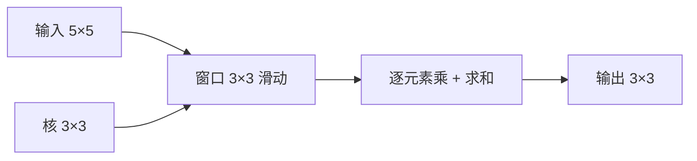

# DL-042 卷积运算

## 1. 本节学习目标

1. 手算一个 $5\times5$ 输入与 $3\times3$ 核的卷积（本课输出含 **−6**）。
2. 说清"滑动窗口 + 逐元素相乘再求和"的过程。
3. 理解深度学习里的"卷积"其实是**互相关**（不翻转核）。
4. 会用 `F.conv2d` 并核对形状。

## 2. 为什么需要这个知识

因为卷积是 CNN 的**唯一核心运算**。不理解它：

- 看不懂"边缘检测器"为什么长那样；
- 算不出输出尺寸；
- 调不动 kernel size / padding / stride。

而它本身其实很简单：**一个小窗口在全图上滑动，每停一次就做一次点积**。

## 3. 直观解释

```text
核（3×3）：          输入（5×5）：
 1  0 -1            1  2  3  0  1
 1  0 -1            4  5  6  1  2
 1  0 -1            7  8  9  2  3
                    1  2  3  4  5
                    0  1  2  3  4
```

**第一步**：核盖住左上角 $3\times3$：

$$
(1\cdot1+2\cdot0+3\cdot(-1))+(4\cdot1+5\cdot0+6\cdot(-1))+(7\cdot1+8\cdot0+9\cdot(-1))
$$

$$
=(1-3)+(4-6)+(7-9)=-2-2-2=\mathbf{-6}
$$

**然后**窗口右移一格，重复——直到覆盖全图。

## 4. 正式定义

**二维卷积（单通道）**

$$
y_{i,j}=\sum_{u=0}^{K-1}\sum_{v=0}^{K-1}w_{u,v}\,x_{i+u,\,j+v}+b
$$

**输出尺寸**

$$
H_{out}=\Big\lfloor\frac{H+2P-K}{S}\Big\rfloor+1
$$

**PyTorch**

```text
F.conv2d(x, weight, bias=None, stride=1, padding=0)
```

## 5. 核心原理

**本课实测**

```text
输入 5×5, 核 3×3 → 输出: (1, 1, 3, 3)
输出矩阵:
 [[-6. 12. 12.]
  [-6.  8.  8.]
  [-6.  2.  2.]]
手算左上角 = -6
```

**为什么第一列都是 −6**：核是"左列 +1、右列 −1"，对这份数据，每行的左右差恰好都是 2，三行相加 6，取负 **−6**。

**这个核在做什么**：它是一个**竖直边缘检测器**——响应大的地方，说明左右亮度差异大。

## 6. 数学表达式

**输出尺寸（$H=5,K=3,P=0,S=1$）**

$$
H_{out}=\frac{5+0-3}{1}+1=3
$$

**参数量（单通道）**：$K^2+1=9+1=10$。

**本课第二列计算（$i=0,j=1$）**

窗口：

```text
2  3  0
5  6  1
8  9  2
```

$$
(2-0)+(5-1)+(8-2)=2+4+6=\mathbf{12}
$$

## 7. 数学推导

**"深度学习卷积"其实是互相关**

数学上的卷积要**翻转核**：

$$
(f*g)(i,j)=\sum_{u,v}f(u,v)\,g(i-u,j-v)
$$

深度学习实现的是：

$$
y_{i,j}=\sum_{u,v}w_{u,v}\,x_{i+u,j+v}
$$

**不翻转** ⇒ 严格叫**互相关（cross-correlation）**。

**为什么无所谓**：核是**学出来的**，翻转与否只是参数化方式不同（学到的核会自动补偿）。所以工程上统一叫卷积。

**边界处理**：默认 $P=0$ 时，边缘像素参与次数少（本课输出 3×3 只用到了内部 3×3 区域）。

## 8. 结构示意图



## 9. 具体计算示例

**完整输出（3×3）**

| 位置 | 窗口和 | 值 |
|---|---|---|
| (0,0) | (1−3)+(4−6)+(7−9) | **−6** |
| (0,1) | (2−0)+(5−1)+(8−2) | 12 |
| (0,2) | (3−1)+(6−2)+(9−3) | 12 |
| (1,0) | (4−6)+(7−9)+(1−3) | −6 |
| (1,1) | (5−1)+(8−2)+(2−4) | 8 |
| (1,2) | (6−2)+(9−3)+(3−5) | 8 |
| (2,0) | (7−9)+(1−3)+(0−2) | −6 |
| (2,1) | (8−2)+(2−4)+(1−3) | 2 |
| (2,2) | (9−3)+(3−5)+(2−4) | 2 |

## 10. Python 实现

```python
import torch
import torch.nn.functional as F

inp = torch.tensor([[[[1., 2., 3., 0., 1.],
                      [4., 5., 6., 1., 2.],
                      [7., 8., 9., 2., 3.],
                      [1., 2., 3., 4., 5.],
                      [0., 1., 2., 3., 4.]]]])

ker = torch.tensor([[[[1., 0., -1.],
                      [1., 0., -1.],
                      [1., 0., -1.]]]])

out = F.conv2d(inp, ker)
print("输入:", tuple(inp.shape), " 核:", tuple(ker.shape))
print("输出:", tuple(out.shape))
print(out[0, 0].numpy())
```

## 11. PyTorch 实现（手算对拍）

```python
import torch

x = torch.tensor([[1., 2., 3., 0., 1.],
                  [4., 5., 6., 1., 2.],
                  [7., 8., 9., 2., 3.],
                  [1., 2., 3., 4., 5.],
                  [0., 1., 2., 3., 4.]])
k = torch.tensor([[1., 0., -1.],
                  [1., 0., -1.],
                  [1., 0., -1.]])

H, W, K = x.shape[0], x.shape[1], k.shape[0]
out = torch.zeros(H - K + 1, W - K + 1)
for i in range(out.shape[0]):
    for j in range(out.shape[1]):
        out[i, j] = (x[i:i + K, j:j + K] * k).sum()

print("手算输出:\n", out)
print("左上角:", float(out[0, 0]))
```

## 12. 代码逐行解释

| 代码 | 作用 |
|---|---|
| `inp` 形状 `(1,1,5,5)` | NCHW：1 张图、1 通道、5×5 |
| `ker` 形状 `(1,1,3,3)` | 1 个输出通道、1 个输入通道、3×3 |
| `F.conv2d(inp, ker)` | 无 padding、stride=1 |
| `x[i:i+K, j:j+K]` | 取出滑动窗口 |
| `(window * k).sum()` | 逐元素乘再求和 |
| `H-K+1` | 输出边长（P=0,S=1） |

**关键**：`F.conv2d` 的权重形状必须是 `(C_out, C_in, K, K)`，**不是** `(K, K)`。

## 13. 实际运行结果

```text
输入 5×5, 核 3×3 → 输出: (1, 1, 3, 3)
输出矩阵:
 [[-6. 12. 12.]
  [-6.  8.  8.]
  [-6.  2.  2.]]
手算左上角: (1*1+2*0+3*(-1)) + (4*1+5*0+6*(-1)) + (7*1+8*0+9*(-1)) = -6
```

## 14. 应用场景

| 核 | 作用 |
|---|---|
| 竖直边缘（本课） | 检测左右亮度跳变 |
| 水平边缘 | 检测上下跳变 |
| 高斯核 | 模糊/平滑 |
| 锐化核 | 增强细节 |
| **学出来的核** | CNN 自动决定要检测什么 |

## 15. 优点与缺点

| 优点 | 缺点 |
|---|---|
| 参数少、局部计算高效 | 单层感受野小 |
| 平移等变（响应跟着移动） | 对旋转/尺度不天然不变 |
| 可堆叠出层次特征 | 大核计算量大（可用分离卷积） |

## 16. 常见错误

| 错误 | 现象 | 纠正 |
|---|---|---|
| 权重形状写 `(K,K)` | `conv2d` 报错 | 用 `(C_out, C_in, K, K)` |
| 以为会翻转核 | 与数学卷积不一致 | DL 用互相关 |
| 忘记加 bias | 缺少平移项 | 需要时传 `bias` |
| 输出尺寸算错 | 形状对不上 | 用公式 $\lfloor(H+2P-K)/S\rfloor+1$ |
| 输入没转 float | 类型报错 | `.float()` |

## 17. 本节总结

- 卷积 = **窗口滑动 + 逐元素乘 + 求和**；本课输出上排 `[-6, 12, 12]`。
- 深度学习用的是**互相关**（不翻核），工程上仍叫卷积。
- 输出尺寸 $\lfloor(H+2P-K)/S\rfloor+1$，本课 $5\to3$。

## 18. 前置与后续

- 前置：[[DL-041 图像张量、通道与批次维度]]
- 后续：[[DL-043 Padding、Stride 与输出尺寸]]、[[DL-044 多通道卷积与 Feature Map]]
- 相关数学：[[MATH-217 矩阵运算与维度]]

---

## 练习与参考答案

**基础 1**：用一句话描述卷积运算的步骤。

**基础 2**：本课输出矩阵是什么？左上角为什么是 −6？

**进阶 1**：为什么深度学习的"卷积"不翻转核也能工作？

**综合**：给定 $7\times7$ 输入、$3\times3$ 核、padding=1、stride=2，求输出尺寸，并说明如何用代码验证。

> [!success]- 参考答案

> **基础 1**
> 一个 $K\times K$ 的核在输入上滑动，每停一次就把"窗口内元素 × 对应核元素"全部相乘再求和（加偏置），得到一个输出值。

> **基础 2**
> 输出为
> $$\begin{bmatrix}-6&12&12\\-6&8&8\\-6&2&2\end{bmatrix}$$
> 左上角：窗口是输入左上 $3\times3$
> $$(1\cdot1+2\cdot0+3\cdot(-1))+(4\cdot1+5\cdot0+6\cdot(-1))+(7\cdot1+8\cdot0+9\cdot(-1))$$
> 每行"左列减右列"都是 $-2$，三行合计 **−6**。

> **进阶 1**
> 因为核参数是**学习得到**的。若数学卷积需要翻转，模型学到的核会自动是"翻转后的版本"，最终函数等价。
> 所以实现上用互相关不影响表达能力，只影响"手工设计的核"的直觉（如边缘检测核要按互相关方式写）。

> **综合（参考）**
> $$H_{out}=\Big\lfloor\frac{7+2-3}{2}\Big\rfloor+1=\lfloor3\rfloor+1=4$$
> 输出 `(1, C_out, 4, 4)`。
> **验证**：
> ```python
> import torch, torch.nn as nn
> c = nn.Conv2d(1, 1, 3, stride=2, padding=1)
> print(c(torch.randn(1, 1, 7, 7)).shape)   # (1, 1, 4, 4)
> ```
> 注意 padding=1 时右侧/下侧若不足一个 stride，会被**丢弃**（floor 的作用）。

## 学习记录

| 日期 | 状态 | 用时 | 问题 | 复盘 |
|---|---|---|---|---|
| 2026-11-07 | planned | — | — | — |

---

## 🔗 Notion 同步信息

> 以下内容由 Notion「AI Knowledge System · 知识点」数据库按知识 ID 合并而来（导出于 2026-11-09）。

| 属性 | 值 |
|---|---|
| 学科 | 深度学习 |
| 学习状态 | 未开始 |
| 难度 | L3 推导 |
| 知识类型 | Algorithm |

- **所属模块**：[M-DL-05 卷积神经网络 CNN](../%E8%AF%BE%E7%A8%8B%E6%A8%A1%E5%9D%97/M-DL-05%20%E5%8D%B7%E7%A7%AF%E7%A5%9E%E7%BB%8F%E7%BD%91%E7%BB%9C%20CNN.md)
- **前置知识**：[DL-041 图像张量、通道与批次维度](DL-041%20%E5%9B%BE%E5%83%8F%E5%BC%A0%E9%87%8F%E3%80%81%E9%80%9A%E9%81%93%E4%B8%8E%E6%89%B9%E6%AC%A1%E7%BB%B4%E5%BA%A6.md)
- **后继知识**：[DL-043 Padding、Stride 与输出尺寸](DL-043%20Padding%E3%80%81Stride%20%E4%B8%8E%E8%BE%93%E5%87%BA%E5%B0%BA%E5%AF%B8.md)
- **关联Python**：[PY-066 矩阵运算](../../01_Python%E5%9F%BA%E7%A1%80/08%20NumPy/PY-066%20%E7%9F%A9%E9%98%B5%E8%BF%90%E7%AE%97.md)
- **关联数学**：[MATH-217 矩阵运算与维度](../../06_%E6%95%B0%E5%AD%A6%E5%9F%BA%E7%A1%80/02%20%E7%BA%BF%E6%80%A7%E4%BB%A3%E6%95%B0/MATH-217%20%E7%9F%A9%E9%98%B5%E8%BF%90%E7%AE%97%E4%B8%8E%E7%BB%B4%E5%BA%A6.md)
- **对应项目**：[PROJ-017 手写数字分类——CNN 改进](../../07_%E5%AE%9E%E6%88%98%E9%A1%B9%E7%9B%AE/04%20%E6%B7%B1%E5%BA%A6%E5%AD%A6%E4%B9%A0%E9%A1%B9%E7%9B%AE/PROJ-017%20%E6%89%8B%E5%86%99%E6%95%B0%E5%AD%97%E5%88%86%E7%B1%BB%E2%80%94%E2%80%94CNN%20%E6%94%B9%E8%BF%9B.md)
