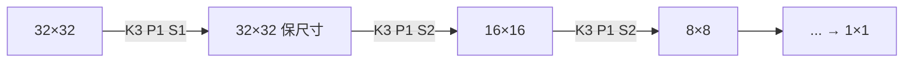

# DL-043 Padding、Stride 与输出尺寸

## 1. 本节学习目标

1. 记住输出尺寸公式，并用实测核对 6 组配置（**全部一致**）。
2. 说清 `padding` 与 `stride` 各自的作用（保尺寸 vs 下采样）。
3. 会用 `padding=K//2` 保留空间尺寸。
4. 算清"下采样多少次到 1×1"的层数。

## 2. 为什么需要这个知识

因为**每层尺寸都会变**，而残差连接、拼接（concat）、上采样都要求尺寸对齐。

尺寸算错的结果通常不是报错，而是 `RuntimeError: The size of tensor a (16) must match the size of tensor b (15)`——出现在几十行之后的某次相加，极难定位。

## 3. 直观解释

| 参数 | 作用 | 类比 |
|---|---|---|
| **padding** | 在边缘补 0，让输出不变小 | 给照片加边框 |
| **stride** | 每次滑动几格 | 隔几个像素采样 |

**直觉**：

- **$P$ 大** ⇒ 输出大（保留更多边缘信息）。
- **$S$ 大** ⇒ 输出小（下采样，减少计算）。

## 4. 正式定义

$$
H_{out}=\Big\lfloor\frac{H_{in}+2P-K}{S}\Big\rfloor+1
$$

$$
W_{out}=\Big\lfloor\frac{W_{in}+2P-K}{S}\Big\rfloor+1
$$

**保尺寸条件**（$S=1$）：

$$
2P=K-1\ \Longrightarrow\ P=\frac{K-1}{2}
$$

$K=3$ ⇒ $P=1$；$K=5$ ⇒ $P=2$；$K=7$ ⇒ $P=3$。

## 5. 核心原理

**本课实测（6 组配置全部一致）**

| $H$ | $K$ | $P$ | $S$ | 公式 | 实测 | 一致 |
|---|---|---|---|---|---|---|
| 32 | 3 | 1 | 1 | 32 | 32 | ✅ |
| 32 | 3 | 0 | 1 | 30 | 30 | ✅ |
| 32 | 5 | 2 | 1 | 32 | 32 | ✅ |
| 32 | 3 | 1 | 2 | 16 | 16 | ✅ |
| 32 | 7 | 0 | 3 | 9 | 9 | ✅ |
| 28 | 5 | 2 | 1 | 28 | 28 | ✅ |

**读法**：

1. $K=3,P=1$ 或 $K=5,P=2$ ⇒ **尺寸不变**（32→32、28→28）。
2. $K=3,P=0$ ⇒ 每层减 2（32→30）。
3. $S=2$ ⇒ 尺寸减半（32→16）。
4. $K=7,P=0,S=3$ ⇒ 32→9（不是整除，floor 后 $9$）。

## 6. 数学表达式

**多次下采样的总倍数**

$$
\text{总下采样}=\prod_{i} S_i
$$

**例**：4 次 stride=2 ⇒ $2^4=16$ ⇒ $224\to14$。

**到 1×1 需要几次**

从 $H$ 到 1（$K=3,P=1,S=2$）：

$$
H_{\text{after }n}=H/2^n\ \Rightarrow\ n=\log_2 H
$$

$32\to1$ 需 **5** 次（$32\to16\to8\to4\to2\to1$）。

## 7. 数学推导

**为什么 $S=1$ 时 $P=(K-1)/2$ 能保尺寸**

代入公式：

$$
H_{out}=\frac{H+2\cdot\frac{K-1}{2}-K}{1}+1=H+(K-1)-K+1=H
$$

✅ 恒等。

**为什么 floor 会丢信息**

若 $(H+2P-K)$ 不能被 $S$ 整除，最后不足一个窗口的部分被**丢弃**。
本课 $K=7,P=0,S=3$：$32-7=25$，$25/3=8.33$ ⇒ floor 8 ⇒ 输出 9，**右侧 2 列被丢掉**。

## 8. 结构示意图



## 9. 具体计算示例

```text
H=32 K=3 P=1 S=1: 公式=32 实测=32
H=32 K=3 P=0 S=1: 公式=30 实测=30
H=32 K=5 P=2 S=1: 公式=32 实测=32
H=32 K=3 P=1 S=2: 公式=16 实测=16
H=32 K=7 P=0 S=3: 公式=9  实测=9
H=28 K=5 P=2 S=1: 公式=28 实测=28
```

## 10. Python 实现

```python
import torch
import torch.nn as nn

for H, K, P, S in ((32, 3, 1, 1), (32, 3, 0, 1), (32, 5, 2, 1),
                   (32, 3, 1, 2), (32, 7, 0, 3), (28, 5, 2, 1)):
    out_formula = (H + 2 * P - K) // S + 1
    conv = nn.Conv2d(1, 1, K, stride=S, padding=P)
    real = conv(torch.randn(1, 1, H, H)).shape[-1]
    print(f"H={H} K={K} P={P} S={S}: 公式={out_formula} 实测={real} "
          f"一致={out_formula == real}")
```

## 11. PyTorch 实现（保尺寸与下采样）

```python
import torch
import torch.nn as nn

x = torch.randn(1, 3, 32, 32)

same = nn.Conv2d(3, 16, 3, stride=1, padding=1)      # 保尺寸
down = nn.Conv2d(16, 32, 3, stride=2, padding=1)     # 下采样
print("输入:", tuple(x.shape))
print("保尺寸后:", tuple(same(x).shape))
print("下采样后:", tuple(down(same(x)).shape))

# 逐步减半直到 1×1
h = 32
layers = []
while h > 1:
    layers.append(nn.Conv2d(1, 1, 3, stride=2, padding=1))
    h = (h + 2 * 1 - 3) // 2 + 1
print("到 1×1 需要层数:", len(layers), " 最终尺寸:", h)
```

## 12. 代码逐行解释

| 代码 | 作用 |
|---|---|
| `(H + 2*P - K)//S + 1` | 输出尺寸公式（整数除法=floor） |
| `nn.Conv2d(..., padding=P)` | 边缘补 0 的圈数 |
| `stride=S` | 滑动步长 |
| `shape[-1]` | 取最后一维（W）核对 |
| `while h > 1` | 逐步下采样到 1×1 |

**注意**：`//` 是向下取整，正好对应公式里的 floor。

## 13. 实际运行结果

```text
H=32 K=3 P=1 S=1: 公式=32 实测=32 一致=True
H=32 K=3 P=0 S=1: 公式=30 实测=30 一致=True
H=32 K=5 P=2 S=1: 公式=32 实测=32 一致=True
H=32 K=3 P=1 S=2: 公式=16 实测=16 一致=True
H=32 K=7 P=0 S=3: 公式=9 实测=9 一致=True
H=28 K=5 P=2 S=1: 公式=28 实测=28 一致=True
```

## 14. 应用场景

| 场景 | 配置 |
|---|---|
| 保尺寸（残差块内部） | $K=3,P=1,S=1$ |
| 下采样一半 | $K=3,P=1,S=2$ |
| 快速降维（ResNet 首层） | $K=7,P=3,S=2$ |
| 轻量模型 | 深度可分离卷积 + $S=2$ |
| 上采样 | `ConvTranspose2d` 或插值 |

## 15. 优点与缺点

| 参数 | 优点 | 缺点 |
|---|---|---|
| padding | 保尺寸、利用边缘信息 | 补 0 引入人为边界（可改 reflect） |
| stride | 降计算量、扩大感受野 | 丢信息、可能棋盘效应 |

## 16. 常见错误

| 错误 | 现象 | 纠正 |
|---|---|---|
| 尺寸算错 | 残差相加报错 | 用公式逐层核对 |
| `padding=K` | 输出变大 | 通常 $P=K//2$ |
| 以为 $S=2$ 总是整除 | 奇数尺寸 floor 丢边 | 检查 `H+2P-K` 能否被 $S$ 整除 |
| 用 `padding='same'` 不检查 | 某些版本不支持/行为不同 | 显式写数字 |
| 下采样太早 | 小目标丢失 | 前期用 $S=1$、后期 $S=2$ |

## 17. 本节总结

- 公式：$H_{out}=\lfloor(H+2P-K)/S\rfloor+1$；**6 组实测全部一致**。
- $S=1$ 时 $P=(K-1)/2$ 保尺寸；$S=2$ 尺寸减半。
- $32\to1$ 需 **5** 次 stride=2（$32/2^5=1$）。

## 18. 前置与后续

- 前置：[[DL-042 卷积运算]]
- 后续：[[DL-044 多通道卷积与 Feature Map]]、`DL-045 池化：Max 与 Average`（待建）
- 相关数学：[[MATH-217 矩阵运算与维度]]

---

## 练习与参考答案

**基础 1**：写出输出尺寸公式，并说明 padding 与 stride 各自的作用。

**基础 2**：本课 6 组配置中，哪些保尺寸？哪些下采样？

**进阶 1**：$K=3,S=1$ 时为什么 $P=1$ 能保尺寸？请推导。

**综合**：输入 $224\times224$，网络用 5 次 stride=2 的卷积（每次 $K=3,P=1$），最终特征图多大？如果目标要得到 $7\times7$，需要几次下采样？

> [!success]- 参考答案

> **基础 1**
> $$H_{out}=\Big\lfloor\frac{H+2P-K}{S}\Big\rfloor+1$$
> `padding` 在边缘补 0（让输出不变小、保留边缘信息）；`stride` 控制滑动步长（越大输出越小，起下采样作用）。

> **基础 2**
> 保尺寸：$(32,3,1,1)\to32$、$(32,5,2,1)\to32$、$(28,5,2,1)\to28$；
> 下采样：$(32,3,0,1)\to30$、$(32,3,1,2)\to16$、$(32,7,0,3)\to9$。

> **进阶 1**
> 代入公式：
> $$H_{out}=\frac{H+2\cdot1-3}{1}+1=H+2-3+1=H$$
> 一般地 $2P=K-1$ 时输出等于输入。

> **综合（参考）**
> **5 次 stride=2**：$224/2^5=224/32=7$ ⇒ 输出 **$7\times7$**（每次 $K=3,P=1,S=2$：$\lfloor(224+2-3)/2\rfloor+1=112$，依次 112→56→28→14→7）。
> **要到 $7\times7$**：恰好 **5 次**（$\log_2(224/7)=\log_2 32=5$）。
> 这也解释了 ResNet 的结构：首层 stride=2 + 4 个 stage 各一次下采样，最终 $7\times7$。

## 学习记录

| 日期 | 状态 | 用时 | 问题 | 复盘 |
|---|---|---|---|---|
| 2026-11-07 | planned | — | — | — |

---

## 🔗 Notion 同步信息

> 以下内容由 Notion「AI Knowledge System · 知识点」数据库按知识 ID 合并而来（导出于 2026-11-09）。

| 属性 | 值 |
|---|---|
| 学科 | 深度学习 |
| 学习状态 | 未开始 |
| 难度 | L2 应用 |
| 知识类型 | Technique |

- **所属模块**：[M-DL-05 卷积神经网络 CNN](../%E8%AF%BE%E7%A8%8B%E6%A8%A1%E5%9D%97/M-DL-05%20%E5%8D%B7%E7%A7%AF%E7%A5%9E%E7%BB%8F%E7%BD%91%E7%BB%9C%20CNN.md)
- **前置知识**：[DL-042 卷积运算](DL-042%20%E5%8D%B7%E7%A7%AF%E8%BF%90%E7%AE%97.md)
- **后继知识**：[DL-044 多通道卷积与 Feature Map](DL-044%20%E5%A4%9A%E9%80%9A%E9%81%93%E5%8D%B7%E7%A7%AF%E4%B8%8E%20Feature%20Map.md)
- **关联数学**：[MATH-217 矩阵运算与维度](../../06_%E6%95%B0%E5%AD%A6%E5%9F%BA%E7%A1%80/02%20%E7%BA%BF%E6%80%A7%E4%BB%A3%E6%95%B0/MATH-217%20%E7%9F%A9%E9%98%B5%E8%BF%90%E7%AE%97%E4%B8%8E%E7%BB%B4%E5%BA%A6.md)
- **对应项目**：[PROJ-017 手写数字分类——CNN 改进](../../07_%E5%AE%9E%E6%88%98%E9%A1%B9%E7%9B%AE/04%20%E6%B7%B1%E5%BA%A6%E5%AD%A6%E4%B9%A0%E9%A1%B9%E7%9B%AE/PROJ-017%20%E6%89%8B%E5%86%99%E6%95%B0%E5%AD%97%E5%88%86%E7%B1%BB%E2%80%94%E2%80%94CNN%20%E6%94%B9%E8%BF%9B.md)
