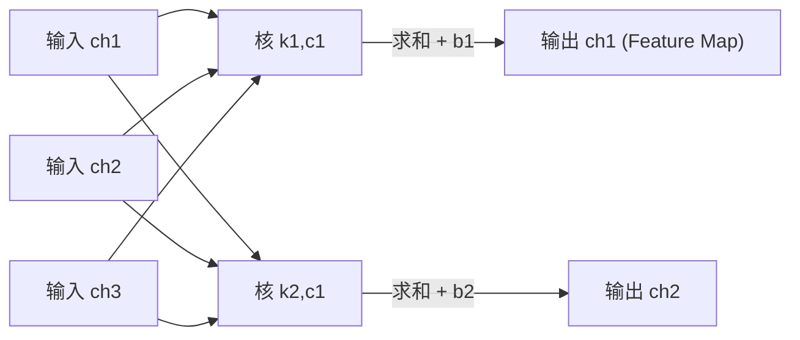

# DL-044 多通道卷积与 Feature Map

## 1. 本节学习目标

1. 说清"输入多通道"与"输出多通道"分别怎么处理。
2. 手算参数量（本课 `Conv2d(3→2, 3×3)` = **56**）。
3. 用实测验证"每个输出通道 = 各输入通道卷积之和 + bias"（差 $5.96\times10^{-8}$）。
4. 理解 Feature Map 的含义（每个输出通道是一张"特征图"）。

## 2. 为什么需要这个知识

因为真实网络的通道数动辄 64/128/256，**通道是 CNN 里变化最快的维度**。

不理解多通道卷积，就会困惑：

- 为什么 `Conv2d(3, 64, 3)` 的权重是 `(64, 3, 3, 3)`；
- 为什么参数量是 $3^2\times3\times64$ 而不是 $3^2\times64$；
- 拼接（concat）时通道数怎么算。

## 3. 直观解释

**输入 3 通道**：卷积核也必须是 3 通道，**逐通道卷积后相加**，得到 1 张输出图。

**输出 2 通道**：就用 **2 组**这样的核，得到 2 张输出图。

```text
输入 3 通道 ──┬─ 核1(3×3×3) ─→ 输出通道1
              └─ 核2(3×3×3) ─→ 输出通道2
```

**一句话**：**输入通道是"求和"的，输出通道是"并列"的。**

## 4. 正式定义

**多通道卷积**

$$
y_{k,i,j}=\sum_{c=1}^{C_{in}}\sum_{u,v}w_{k,c,u,v}\,x_{c,i+u,j+v}+b_k
$$

**参数量**

$$
\#\text{params}=C_{out}\times C_{in}\times K^2+C_{out}
$$

**权重形状**（PyTorch）

```text
(C_out, C_in, K, K)
```

## 5. 核心原理

**本课实测**

```text
Conv2d(3→2, 3×3) 权重形状: (2, 3, 3, 3)
bias 形状: (2,)
参数量: 56   手算 2*(3*3*3)+2 = 56

输入: (1, 3, 8, 8)  输出: (1, 2, 6, 6)
逐通道相加 vs 官方输出 最大差: 5.960464477539063e-08
```

**三个要点**：

1. **权重形状 `(2,3,3,3)`**：2 个输出通道 × 3 个输入通道 × 3×3。
2. **参数量 56**：$2\times3\times9+2=56$。
3. **逐通道求和等价性**：手动把 3 个单通道卷积结果相加 + bias，与官方输出差 **5.96e-08**（浮点误差）⇒ **多通道卷积就是"逐通道卷积再相加"**。

**输出尺寸**：$8\to6$（$K=3,P=0,S=1$）。

## 6. 数学表达式

**展开（$C_{in}=3,K=3$）**

$$
y_{k,i,j}=\sum_{c=1}^{3}\Big(\sum_{u=0}^{2}\sum_{v=0}^{2}w_{k,c,u,v}x_{c,i+u,j+v}\Big)+b_k
$$

**参数量对比**

| 配置 | 参数量 |
|---|---|
| $C_{in}=3\to C_{out}=1$ | $3\times9+1=28$ |
| $C_{in}=3\to C_{out}=2$ | $2\times3\times9+2=56$ |
| $C_{in}=64\to C_{out}=128$ | $128\times64\times9+128=73{,}856$ |
| $C_{in}=256\to C_{out}=256$ | $256\times256\times9+256=590{,}080$ |

## 7. 数学推导

**为什么必须逐通道求和**

输入有 3 个通道，每个通道在**同一空间位置**都有一个值。卷积核要在该位置输出一个标量，只能把 3 个通道的贡献**加起来**。

若对通道也做"滑动"，就变成 3D 卷积（视频/医学体数据用），参数量与形状都不同。

**Feature Map 的含义**：第 $k$ 个输出通道的 $H\times W$ 矩阵，表示"输入图像中**第 $k$ 种模式**在哪些位置出现"。

- 浅层：边缘、颜色斑块
- 中层：纹理、部件
- 深层：物体/语义

## 8. 结构示意图



## 9. 具体计算示例

**参数量手算**

```text
每个输出通道需要: 3(输入通道) × 3(高) × 3(宽) = 27 个权重
2 个输出通道: 27 × 2 = 54
加偏置: 54 + 2 = 56
```

**形状链**

```text
输入 (1, 3, 8, 8)
权重 (2, 3, 3, 3)
输出 (1, 2, 6, 6)
```

## 10. Python 实现

```python
import torch
import torch.nn as nn

conv = nn.Conv2d(3, 2, kernel_size=3)
print("权重形状:", tuple(conv.weight.shape))
print("bias 形状:", tuple(conv.bias.shape))
print("参数量:", sum(p.numel() for p in conv.parameters()))

x = torch.randn(1, 3, 8, 8)
y = conv(x)
print("输入:", tuple(x.shape), " 输出:", tuple(y.shape))
```

## 11. PyTorch 实现（逐通道相加验证）

```python
import torch
import torch.nn as nn
import torch.nn.functional as F

torch.manual_seed(0)
conv = nn.Conv2d(3, 2, kernel_size=3)
x = torch.randn(1, 3, 8, 8)

with torch.no_grad():
    y = conv(x)
    manual = (F.conv2d(x[:, :1], conv.weight[:1, :1])
              + F.conv2d(x[:, 1:2], conv.weight[:1, 1:2])
              + F.conv2d(x[:, 2:3], conv.weight[:1, 2:3])
              + conv.bias[0])

print("官方输出形状:", tuple(y.shape))
print("逐通道相加形状:", tuple(manual.shape))
print("最大差:", float((manual - y[:, :1]).abs().max()))

# 通道分组查看每个核
for k in range(2):
    print(f"输出通道 {k} 的核形状:", tuple(conv.weight[k].shape))
```

## 12. 代码逐行解释

| 代码 | 作用 |
|---|---|
| `nn.Conv2d(3, 2, 3)` | 3 输入通道、2 输出通道、3×3 核 |
| `conv.weight.shape` | `(2, 3, 3, 3)` |
| `conv.weight[:1, :1]` | 第 1 输出通道、第 1 输入通道的核 |
| `F.conv2d(x[:, :1], ...)` | 单通道卷积 |
| 三项相加 + bias | 手工复现多通道卷积 |
| `abs().max()` | 验证等价性 |

**关键**：`conv.weight[k]` 就是第 $k$ 个输出通道对应的**全部输入通道核**，形状 `(C_in, K, K)`。

## 13. 实际运行结果

```text
Conv2d(3→2, 3×3) 权重形状: (2, 3, 3, 3)
bias 形状: (2,)
参数量: 56  手算 2*(3*3*3)+2 = 56
输入: (1, 3, 8, 8)  输出: (1, 2, 6, 6)
逐通道相加 vs 官方输出 最大差: 5.960464477539063e-08
```

## 14. 应用场景

| 场景 | 通道设计 |
|---|---|
| RGB 输入 | 3 → 64 |
| 中间层 | 64 → 128 → 256 |
| 1×1 卷积降维 | 256 → 64（Bottleneck） |
| 分组卷积 | 通道分组，减少参数 |
| 深度可分离卷积 | 逐通道卷积 + 1×1 混合 |

## 15. 优点与缺点

| 优点 | 缺点 |
|---|---|
| 每个输出通道可检测不同模式 | 参数随 $C_{in}\times C_{out}$ 增长 |
| 通道可解释（可视化特征图） | 高通道计算量大 |
| 与 1×1 卷积配合可灵活调维 | 通道数需人工设计 |

## 16. 常见错误

| 错误 | 现象 | 纠正 |
|---|---|---|
| 权重形状写成 `(C_in, C_out, K, K)` | 输出通道数不对 | PyTorch 是 `(C_out, C_in, K, K)` |
| 以为输入通道不用求和 | 输出形状对但值错 | 必须逐通道相加 |
| 参数量漏乘 $C_{in}$ | 少算几十倍 | 用 $C_{out}C_{in}K^2+C_{out}$ |
| concat 时通道算错 | 拼接报错 | 通道相加：$C_1+C_2$ |
| 用 3D 卷积处理图像 | 形状/参数错 | 图像用 `Conv2d` |

## 17. 本节总结

- 多通道卷积：**输入通道求和、输出通道并列**。
- 参数量 $C_{out}C_{in}K^2+C_{out}$；本课 $2\times3\times9+2=\mathbf{56}$。
- 逐通道相加与官方输出差 **5.96e-08** ⇒ 机制已验证。

## 18. 前置与后续

- 前置：[[DL-043 Padding、Stride 与输出尺寸]]
- 后续：`DL-045 池化：Max 与 Average`（待建）、`DL-046 感受野与参数共享`（待建）
- 相关数学：[[MATH-217 矩阵运算与维度]]

---

## 练习与参考答案

**基础 1**：输入 3 通道、输出 2 通道的 $3\times3$ 卷积，权重形状与参数量各是多少？

**基础 2**：本课输入输出形状与"逐通道相加"的验证结果是什么？

**进阶 1**：为什么输入通道要"求和"而不是"拼接"？

**综合**：一个 Bottleneck 结构：$256\to64$（1×1）→ $64\to64$（3×3）→ $64\to256$（1×1）。请算三段参数量与合计。

> [!success]- 参考答案

> **基础 1**
> 权重形状 **`(2, 3, 3, 3)`**（C_out, C_in, K, K）；
> 参数量 $2\times3\times3\times3+2=\mathbf{56}$。

> **基础 2**
> 输入 `(1, 3, 8, 8)` → 输出 `(1, 2, 6, 6)`；
> 逐通道相加与官方输出最大差 **5.96e-08**（浮点误差）⇒ 完全等价。

> **进阶 1**
> 因为卷积要输出**一个标量**表示该位置的响应。三个输入通道在同一位置各有一个值，只能把它们乘以各自权重后**相加**成一个数。
> 若拼接，通道数会膨胀（3→3C），且参数量与计算量都变大；求和是"把多通道信息融合成一个响应"的标准做法。

> **综合（参考）**
> 1. $256\to64$，$1\times1$：$64\times256\times1+64=16{,}384+64=\mathbf{16{,}448}$
> 2. $64\to64$，$3\times3$：$64\times64\times9+64=36{,}864+64=\mathbf{36{,}928}$
> 3. $64\to256$，$1\times1$：$256\times64+256=16{,}384+256=\mathbf{16{,}640}$
> **合计 69, 016**（16,448+36,928+16,640）。
> 对比"直接 $256\to256$ 的 3×3"：$256\times256\times9+256=590{,}080$ ⇒ **Bottleneck 省约 8.5 倍**。

## 学习记录

| 日期 | 状态 | 用时 | 问题 | 复盘 |
|---|---|---|---|---|
| 2026-11-07 | planned | — | — | — |

---

## 🔗 Notion 同步信息

> 以下内容由 Notion「AI Knowledge System · 知识点」数据库按知识 ID 合并而来（导出于 2026-11-09）。

| 属性 | 值 |
|---|---|
| 学科 | 深度学习 |
| 学习状态 | 未开始 |
| 难度 | L3 推导 |
| 知识类型 | Algorithm |

- **所属模块**：[M-DL-05 卷积神经网络 CNN](../%E8%AF%BE%E7%A8%8B%E6%A8%A1%E5%9D%97/M-DL-05%20%E5%8D%B7%E7%A7%AF%E7%A5%9E%E7%BB%8F%E7%BD%91%E7%BB%9C%20CNN.md)
- **前置知识**：[DL-043 Padding、Stride 与输出尺寸](DL-043%20Padding%E3%80%81Stride%20%E4%B8%8E%E8%BE%93%E5%87%BA%E5%B0%BA%E5%AF%B8.md)
- **后继知识**：[DL-045 池化：Max 与 Average](DL-045%20%E6%B1%A0%E5%8C%96%E2%80%94%E2%80%94Max%20%E4%B8%8E%20Average.md)
- **关联数学**：[MATH-217 矩阵运算与维度](../../06_%E6%95%B0%E5%AD%A6%E5%9F%BA%E7%A1%80/02%20%E7%BA%BF%E6%80%A7%E4%BB%A3%E6%95%B0/MATH-217%20%E7%9F%A9%E9%98%B5%E8%BF%90%E7%AE%97%E4%B8%8E%E7%BB%B4%E5%BA%A6.md)
- **对应项目**：[PROJ-017 手写数字分类——CNN 改进](../../07_%E5%AE%9E%E6%88%98%E9%A1%B9%E7%9B%AE/04%20%E6%B7%B1%E5%BA%A6%E5%AD%A6%E4%B9%A0%E9%A1%B9%E7%9B%AE/PROJ-017%20%E6%89%8B%E5%86%99%E6%95%B0%E5%AD%97%E5%88%86%E7%B1%BB%E2%80%94%E2%80%94CNN%20%E6%94%B9%E8%BF%9B.md)
- **被项目引用**：[PROJ-017 手写数字分类——CNN 改进](../../07_%E5%AE%9E%E6%88%98%E9%A1%B9%E7%9B%AE/04%20%E6%B7%B1%E5%BA%A6%E5%AD%A6%E4%B9%A0%E9%A1%B9%E7%9B%AE/PROJ-017%20%E6%89%8B%E5%86%99%E6%95%B0%E5%AD%97%E5%88%86%E7%B1%BB%E2%80%94%E2%80%94CNN%20%E6%94%B9%E8%BF%9B.md)
