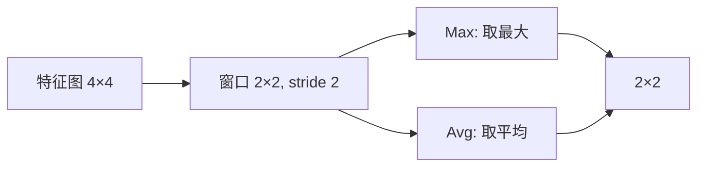

# DL-045 池化：Max 与 Average

## 1. 本节学习目标

1. 手算 Max 池化与 Average 池化（本课 4×4 → 2×2）。
2. 理解 **Max 池化的反向只把梯度给最大值位置**（实测梯度 `[[0,1],[0,0]]`）。
3. 会算池化后的尺寸，并知道它与卷积尺寸公式的关系。
4. 说清池化的作用与代价（下采样、平移鲁棒、丢细节）。

## 2. 为什么需要这个知识

因为池化是 CNN 里**负责"降维"的层**：它没有参数，却决定了特征图的尺寸与感受野增长速度。

不理解它，就会困惑：为什么分类网络最后要 `AdaptiveAvgPool2d(1)`？为什么 Max 池化反向时有些位置拿不到梯度？

## 3. 直观解释

**池化 = 在窗口内做一个统计（取最大 / 取平均）**：

```text
输入 4×4                 MaxPool 2×2          AvgPool 2×2
1  3 | 2  4              6   8                3.75  5.25
5  6 | 7  8     →        9   7                5.00  4.25
----+----
9  2 | 3  1
4  5 | 6  7
```

**Max 保留"最强响应"**（像"这里有没有这种特征"）。
**Avg 保留"平均强度"**（像"这块区域整体多强"）。

> **注意**：深度学习里的"池化"不翻核，就是取窗口统计量。

## 4. 正式定义

**Max 池化**

$$
y_{i,j}=\max_{u,v\in\text{window}}x_{i\cdot S+u,\ j\cdot S+v}
$$

**Average 池化**

$$
y_{i,j}=\frac{1}{K^2}\sum_{u,v\in\text{window}}x_{i\cdot S+u,\ j\cdot S+v}
$$

**输出尺寸**（与卷积同公式，$P=0$）

$$
H_{out}=\Big\lfloor\frac{H-K}{S}\Big\rfloor+1
$$

## 5. 核心原理

**本课实测**

```text
输入:
 [[1. 3. 2. 4.]
  [5. 6. 7. 8.]
  [9. 2. 3. 1.]
  [4. 5. 6. 7.]]

MaxPool 2×2:
 [[6. 8.]
  [9. 7.]]
AvgPool 2×2:
 [[3.75 5.25]
  [5.   4.25]]
```

**手算校验**：

- 左上窗口 $\{1,3,5,6\}$：Max **6**、Avg $(1+3+5+6)/4=3.75$ ✅
- 右下窗口 $\{3,1,6,7\}$：Max **7**、Avg $(3+1+6+7)/4=4.25$ ✅

**Max 池化的反向**

```text
梯度:
 [[0. 1.]
  [0. 0.]]
```

**读法**：输入 2×2 里最大值是 5（位置 (0,1)），所以**梯度全部给了它**，其余位置为 0。

## 6. 数学表达式

**Max 的梯度（子梯度）**

$$
\frac{\partial y}{\partial x_{i,j}}=\begin{cases}1,&(i,j)=\arg\max\\0,&\text{否则}\end{cases}
$$

**Avg 的梯度**

$$
\frac{\partial y}{\partial x_{i,j}}=\frac{1}{K^2}\quad(\text{窗口内每个位置都相同})
$$

**本课对比**：Max 只给 1 个位置（稀疏梯度），Avg 给全部 4 个位置（均匀梯度）。

## 7. 数学推导

**池化对感受野的影响**

池化本身让特征图变小，等效于**放大后续层的感受野**：

- 卷积层感受野按 $+(K-1)\cdot\text{jump}$ 增长；
- 池化（stride>1）会让 $\text{jump}$ 翻倍，**加速感受野扩张**。

**本课尺寸**：

| 输入 | $K$ | $S$ | 输出 |
|---|---|---|---|
| 32 | 2 | 2 | **16** |
| 32 | 3 | 2 | 15 |
| 28 | 2 | 2 | 14 |

**为什么 $K=3,S=2$ 会到 15**：$\lfloor(32-3)/2\rfloor+1=14+1=15$（重叠池化）。

## 8. 结构示意图



## 9. 具体计算示例

```text
MaxPool 左上 = max(1,3,5,6) = 6
MaxPool 右下 = max(3,1,6,7) = 7
AvgPool 左上 = (1+3+5+6)/4 = 3.75
AvgPool 右下 = (3+1+6+7)/4 = 4.25

Max 反向梯度 = [[0,1],[0,0]]   ← 只给最大值 5
```

## 10. Python 实现

```python
import torch
import torch.nn.functional as F

x = torch.tensor([[[[1., 3., 2., 4.],
                    [5., 6., 7., 8.],
                    [9., 2., 3., 1.],
                    [4., 5., 6., 7.]]]])

mp = F.max_pool2d(x, 2, 2)
ap = F.avg_pool2d(x, 2, 2)
print("MaxPool:\n", mp[0, 0].numpy())
print("AvgPool:\n", ap[0, 0].numpy())
print("输出形状:", tuple(mp.shape), tuple(ap.shape))
```

## 11. PyTorch 实现（反向梯度与尺寸）

```python
import torch
import torch.nn.functional as F

xs = torch.tensor([[[[1., 5.], [3., 2.]]]], requires_grad=True)
y = F.max_pool2d(xs, 2, 2)
y.backward()
print("输入:\n", xs.detach()[0, 0].numpy())
print("反向梯度:\n", xs.grad[0, 0].numpy())

for H, K, S in ((32, 2, 2), (32, 3, 2), (28, 2, 2)):
    print(f"H={H} K={K} S={S}: 输出 {(H - K)//S + 1}")
```

## 12. 代码逐行解释

| 代码 | 作用 |
|---|---|
| `F.max_pool2d(x, 2, 2)` | 2×2 窗口、步长 2 |
| `F.avg_pool2d(x, 2, 2)` | 平均池化 |
| `requires_grad=True` | 才能看反向 |
| `y.backward()` | 标量反传 |
| `xs.grad` | 梯度，验证"只给最大值" |
| `(H-K)//S + 1` | 池化输出尺寸 |

**注意**：池化**没有可学习参数**，但它改变形状，所以影响后续层。

## 13. 实际运行结果

```text
MaxPool 2×2:
 [[6. 8.]
  [9. 7.]]
AvgPool 2×2:
 [[3.75 5.25]
  [5.   4.25]]
手算 Max 左上: 6  Avg 左上: 3.75
手算 Max 右下: 7  Avg 右下: 4.25

MaxPool 反向梯度:
 [[0. 1.]
  [0. 0.]]

H=32 K=2 S=2: 输出 16
H=32 K=3 S=2: 输出 15
H=28 K=2 S=2: 输出 14
```

## 14. 应用场景

| 场景 | 选择 |
|---|---|
| 经典 CNN（LeNet/VGG） | MaxPool 2×2 |
| 需要保留整体强度 | AvgPool |
| 分类网络末端 | **Global Average Pooling**（可替代全连接） |
| 目标检测 | 常用 stride conv 替代池化 |
| 需要空间细节（分割） | 少用池化，用空洞卷积 |

## 15. 优点与缺点

| 优点 | 缺点 |
|---|---|
| 无参数、计算便宜 | 丢空间细节 |
| 降低分辨率、扩大感受野 | Max 反向梯度稀疏（部分位置永不更新） |
| 提供一定平移鲁棒性 | 小目标易被池化掉 |

## 16. 常见错误

| 错误 | 现象 | 纠正 |
|---|---|---|
| 以为池化有参数 | 算参数时搞错 | 池化无参数 |
| 用 `K=2,S=1` | 尺寸几乎不变 | 通常 `S=K` |
| Max 池化后接 BN？ | 顺序混乱 | 一般不作此组合 |
| 分类末端仍用大 FC | 参数爆炸 | 用 GAP |
| 池化过度 | 小目标消失 | 控制下采样倍数 |

## 17. 本节总结

- Max 保留最强响应、Avg 保留平均强度；本课输出 `[[6,8],[9,7]]` 与 `[[3.75,5.25],[5,4.25]]`。
- **Max 反向只把梯度给最大值位置**（实测 `[[0,1],[0,0]]`）。
- 池化**无参数**，作用是降分辨率、扩感受野。

## 18. 前置与后续

- 前置：[[DL-044 多通道卷积与 Feature Map]]
- 后续：[[DL-046 感受野与参数共享]]、[[DL-047 LeNet、AlexNet 与 VGG]]
- 相关数学：[[MATH-217 矩阵运算与维度]]

---

## 练习与参考答案

**基础 1**：Max 池化与 Average 池化各取什么统计量？分别适合什么场景？

**基础 2**：本课 Max/Avg 池化的输出矩阵各是什么？

**进阶 1**：为什么 Max 池化的反向梯度是稀疏的？这有什么影响？

**综合**：输入 $32\times32$，经过 3 次 `MaxPool2d(2,2)` 后尺寸是多少？若想保持 $32\times32$，池化该怎么设？

> [!success]- 参考答案

> **基础 1**
> - Max：取窗口**最大值**，强调"有没有该特征"，常用于经典 CNN。
> - Avg：取窗口**平均值**，强调"整体强度"，常用于末端或需要平滑的场景。
> 分类网络末端常用 **Global Average Pooling**（整图平均成一个数）。

> **基础 2**
> Max：$\begin{bmatrix}6&8\\9&7\end{bmatrix}$；Avg：$\begin{bmatrix}3.75&5.25\\5&4.25\end{bmatrix}$。

> **进阶 1**
> 因为 Max 的输出只依赖窗口中**最大那个元素**，其余元素的偏导为 0 ⇒ 反向只把梯度传给最大值位置（本课 `[[0,1],[0,0]]`）。
> 影响：①部分输入位置永远拿不到梯度；②梯度稀疏但集中，训练上通常没问题；③若某些神经元长期不成为最大值，相当于"失活"。

> **综合（参考）**
> 3 次 `MaxPool2d(2,2)`：$32\to16\to8\to4$ ⇒ **$4\times4$**。
> 若想保持 $32\times32$：池化会**必然降维**（除非 `K=1,S=1`，那就失去意义）。正确做法是**不池化**，改用 `stride=1` 的卷积保尺寸，或用 `MaxPool2d(2,2)` 后再 `Upsample` 恢复（分割网络的思路）。

## 学习记录

| 日期 | 状态 | 用时 | 问题 | 复盘 |
|---|---|---|---|---|
| 2026-11-07 | planned | — | — | — |

---

## 🔗 Notion 同步信息

> 以下内容由 Notion「AI Knowledge System · 知识点」数据库按知识 ID 合并而来（导出于 2026-11-09）。

| 属性 | 值 |
|---|---|
| 学科 | 深度学习 |
| 学习状态 | 未开始 |
| 难度 | L2 应用 |
| 知识类型 | Technique |

- **所属模块**：[M-DL-05 卷积神经网络 CNN](../%E8%AF%BE%E7%A8%8B%E6%A8%A1%E5%9D%97/M-DL-05%20%E5%8D%B7%E7%A7%AF%E7%A5%9E%E7%BB%8F%E7%BD%91%E7%BB%9C%20CNN.md)
- **前置知识**：[DL-044 多通道卷积与 Feature Map](DL-044%20%E5%A4%9A%E9%80%9A%E9%81%93%E5%8D%B7%E7%A7%AF%E4%B8%8E%20Feature%20Map.md)
- **后继知识**：[DL-046 感受野与参数共享](DL-046%20%E6%84%9F%E5%8F%97%E9%87%8E%E4%B8%8E%E5%8F%82%E6%95%B0%E5%85%B1%E4%BA%AB.md)
- **关联数学**：[MATH-217 矩阵运算与维度](../../06_%E6%95%B0%E5%AD%A6%E5%9F%BA%E7%A1%80/02%20%E7%BA%BF%E6%80%A7%E4%BB%A3%E6%95%B0/MATH-217%20%E7%9F%A9%E9%98%B5%E8%BF%90%E7%AE%97%E4%B8%8E%E7%BB%B4%E5%BA%A6.md)
- **对应项目**：[PROJ-017 手写数字分类——CNN 改进](../../07_%E5%AE%9E%E6%88%98%E9%A1%B9%E7%9B%AE/04%20%E6%B7%B1%E5%BA%A6%E5%AD%A6%E4%B9%A0%E9%A1%B9%E7%9B%AE/PROJ-017%20%E6%89%8B%E5%86%99%E6%95%B0%E5%AD%97%E5%88%86%E7%B1%BB%E2%80%94%E2%80%94CNN%20%E6%94%B9%E8%BF%9B.md)
- **被项目引用**：[PROJ-017 手写数字分类——CNN 改进](../../07_%E5%AE%9E%E6%88%98%E9%A1%B9%E7%9B%AE/04%20%E6%B7%B1%E5%BA%A6%E5%AD%A6%E4%B9%A0%E9%A1%B9%E7%9B%AE/PROJ-017%20%E6%89%8B%E5%86%99%E6%95%B0%E5%AD%97%E5%88%86%E7%B1%BB%E2%80%94%E2%80%94CNN%20%E6%94%B9%E8%BF%9B.md)
