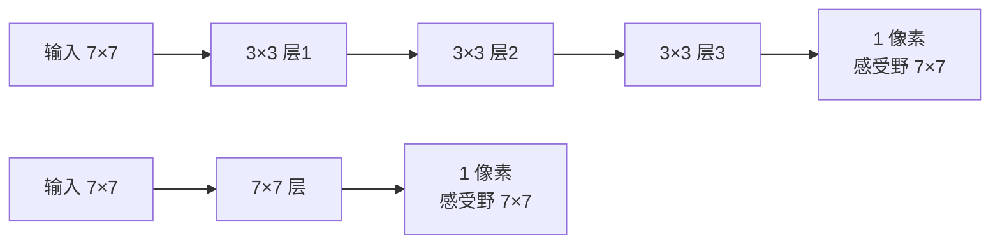

# DL-046 感受野与参数共享

## 1. 本节学习目标

1. 会算堆叠卷积的**感受野**（本课 1→5 层：3/5/7/9/11）。
2. 理解"3 层 3×3 等效 1 层 7×7"这句话**对感受野成立，对参数量不成立**。
3. 用实测比较参数量（27 vs 49；64 通道时 **110,784 vs 200,768**）。
4. 说清参数共享的两层含义：空间共享 + 通道独立。

## 2. 为什么需要这个知识

因为"用小核堆深"是 VGG 之后的所有网络的基本设计原则，而它的理由**不是"感受野更大"**——1 层 7×7 也有同样感受野。

真正的理由是：**更少参数 + 更多非线性**。这个区别必须用数字说清。

## 3. 直观解释

**感受野 = 一个输出像素"看得到"的输入区域**。

```text
1 层 3×3：看 3×3
2 层 3×3：第二层的 1 个像素看第一层 3×3，第一层每个又看 3×3
          ⇒ 总共看 5×5
3 层 3×3 ⇒ 7×7
```

**每加一层 3×3，感受野 +2**（stride=1 时）。

## 4. 正式定义

**感受野递推**

$$
r_{\ell}=r_{\ell-1}+(K_\ell-1)\cdot\prod_{i<\ell}S_i
$$

初始 $r_0=1$。stride 全为 1 时简化为 $r_\ell=r_{\ell-1}+K-1$。

**本课推算**（$K=3$）：$1\to3\to5\to7\to9\to11$。

**参数量（$C_{in}=C_{out}=C$）**

| 结构 | 参数量 |
|---|---|
| 1 层 7×7 | $49C^2+C$ |
| 3 层 3×3 | $3(9C^2+C)=27C^2+3C$ |

## 5. 核心原理

**本课实测**

```text
1 层 3×3: 感受野 3
2 层 3×3: 感受野 5
3 层 3×3: 感受野 7
4 层 3×3: 感受野 9
5 层 3×3: 感受野 11
1 层 7×7: 感受野 7

参数对比: 3 层 3×3 = 27  vs 1 层 7×7 = 49
3 层 3×3(64→64) 参数: 110784  vs  1 层 7×7(64→64): 200768
```

**读法**：

1. **感受野相同**：3 层 3×3 与 1 层 7×7 都是 **7**。
2. **参数少一半**：27 vs 49（单通道）；64 通道时 **110,784 vs 200,768**（约 1.8 倍差距）。
3. **非线性更多**：3 层有 **3 个 ReLU**，1 层只有 1 个。

## 6. 数学表达式

**计算 64 通道的例子**

1 层 7×7：$64\times64\times7^2+64=200{,}704+64=\mathbf{200{,}768}$

3 层 3×3：
$$
3\times(64\times64\times9+64)=3\times36{,}928=\mathbf{110{,}784}
$$

**比值**：$200{,}768/110{,}784\approx1.81$。

**若换成 2 层 3×3（感受野 5）**：$2\times36{,}928=73{,}856$。

## 7. 数学推导

**感受野递推的推导**

设第 $\ell-1$ 层的每个像素对应输入的跨度是 $r_{\ell-1}$，相邻像素间距（jump）是 $j_{\ell-1}$。

第 $\ell$ 层用 $K_\ell$ 的核，则：

$$
r_\ell=r_{\ell-1}+(K_\ell-1)\,j_{\ell-1},\qquad j_\ell=j_{\ell-1}\cdot S_\ell
$$

$S=1$ 时 $j\equiv1$ ⇒ $r_\ell=r_{\ell-1}+K-1$ ⇒ 每层 +2（$K=3$）。

**参数共享的数学含义**

卷积核 $w_{k,c,u,v}$ 与位置 $(i,j)$ **无关** ⇒ 参数量与图像尺寸解耦（DL-040 已量化：109.8 倍差距）。

**两个方向的共享**：

| 共享 | 含义 |
|---|---|
| 空间共享 | 同一核用于所有位置（平移不变） |
| 通道不共享 | 每个输入通道有自己的核（$C_{in}$ 个） |

## 8. 结构示意图



## 9. 具体计算示例

```text
层数 → 感受野
1 → 3
2 → 5
3 → 7
4 → 9
5 → 11

参数（C=64）
3 层 3×3 = 110,784
1 层 7×7 = 200,768
```

## 10. Python 实现

```python
def receptive_field(layers, k=3, s=1):
    r, jump = 1, 1
    for _ in range(layers):
        r += (k - 1) * jump
        jump *= s
    return r


for depth in (1, 2, 3, 4, 5):
    print(f"{depth} 层 3×3: 感受野 {receptive_field(depth)}")

print("1 层 7×7:", receptive_field(1, k=7))


def params_conv(cin, cout, k):
    return cout * cin * k * k + cout


c = 64
print("1 层 7×7 参数:", params_conv(c, c, 7))
print("3 层 3×3 参数:", 3 * params_conv(c, c, 3))
```

## 11. PyTorch 实现（用梯度验证感受野）

```python
import torch
import torch.nn as nn

# 感受野是结构属性，用**无激活**的卷积链验证（ReLU 在 0 处导数为 0 会屏蔽梯度）
net = nn.Sequential(
    nn.Conv2d(1, 1, 3, padding=1),
    nn.Conv2d(1, 1, 3, padding=1),
    nn.Conv2d(1, 1, 3, padding=1),
)

x = torch.randn(1, 1, 9, 9, requires_grad=True)
y = net(x)
y[0, 0, 4, 4].backward()          # 只看中心像素
grad = x.grad[0, 0]
support = (grad != 0).nonzero()
print("中心输出像素依赖的输入位置范围:")
print("  行范围:", int(support[:, 0].min()), "-", int(support[:, 0].max()))
print("  列范围:", int(support[:, 1].min()), "-", int(support[:, 1].max()))
print("  依赖像素数:", int((grad != 0).sum()))
```

## 12. 代码逐行解释

| 代码 | 作用 |
|---|---|
| `r += (k-1)*jump` | 感受野递推 |
| `jump *= s` | 步长累积（stride>1 时跳距变大） |
| `params_conv` | 单个卷积层参数量 |
| `x.requires_grad=True` | 让输入可求导 |
| `y[0,0,4,4].backward()` | 只对中心输出反传 |
| `(grad != 0).nonzero()` | 找出"影响中心输出"的输入位置 |

**这是验证感受野最直接的方法**：看中心输出对哪些输入像素有梯度。

## 13. 实际运行结果

```text
1 层 3×3: 感受野 3
2 层 3×3: 感受野 5
3 层 3×3: 感受野 7
4 层 3×3: 感受野 9
5 层 3×3: 感受野 11
1 层 7×7: 感受野 7

参数对比: 3 层 3×3 = 27  vs 1 层 7×7 = 49
3 层 3×3(64→64) 参数: 110784  vs  1 层 7×7(64→64): 200768
```

## 14. 应用场景

| 设计 | 理由 |
|---|---|
| VGG 全用 3×3 | 同感受野下参数少、非线性多 |
| 大核卷积（7×7） | 只需一层、首层快速扩大视野（ResNet 首层） |
| 空洞卷积 | 不降分辨率扩大感受野（分割） |
| 深度可分离卷积 | 进一步减少参数（MobileNet） |

## 15. 优点与缺点

| 方案 | 优点 | 缺点 |
|---|---|---|
| 小核堆深 | 参数少、非线性多、表达力强 | 层数多、训练难（需残差/BN） |
| 大核单层 | 结构简单 | 参数多、非线性少 |

## 16. 常见错误

| 错误 | 现象 | 纠正 |
|---|---|---|
| 认为"3 层 3×3 = 1 层 7×7"完全等价 | 参数差 1.8 倍 | 只感受野相同 |
| 忽略 stride 对感受野的影响 | 算错 | 用递推公式含 jump |
| 以为感受野越大越好 | 过大反而引入无关区域 | 与任务尺度匹配 |
| 用 padding 后忘记 jump | 尺寸/感受野不一致 | 记录每层 S |
| 不验证感受野 | 设计错误不自知 | 用梯度法验证 |

## 17. 本节总结

- 3 层 3×3 与 1 层 7×7 **感受野都是 7**，但参数 **110,784 vs 200,768**（约 1.8 倍）。
- 小核堆深的价值：**省参数 + 多非线性**。
- 感受野可用梯度法实测验证（只对中心输出反传）。

## 18. 前置与后续

- 前置：[[DL-045 池化——Max 与 Average]]
- 后续：[[DL-047 LeNet、AlexNet 与 VGG]]、[[DL-048 ResNet 与 Skip Connection]]
- 相关数学：[[MATH-217 矩阵运算与维度]]

---

## 练习与参考答案

**基础 1**：感受野是什么？3 层 3×3（stride=1）的感受野是多少？

**基础 2**：3 层 3×3 与 1 层 7×7 的参数量（64 通道）各是多少？

**进阶 1**：既然感受野相同，为什么 VGG 选择"小核堆深"？

**综合**：设计一个 CNN 首层，要让感受野达到 7×7。请给出两种方案并比较参数量与非线性层数（输入 3 通道、输出 64）。

> [!success]- 参考答案

> **基础 1**
> 感受野是**一个输出像素对应的输入区域大小**。
> 3 层 3×3（S=1）：$3\to5\to7$ ⇒ **7×7**。

> **基础 2**
> 1 层 7×7：$64\times64\times49+64=\mathbf{200{,}768}$；
> 3 层 3×3：$3\times(64\times64\times9+64)=\mathbf{110{,}784}$。

> **进阶 1**
> 三个理由：
> 1. **参数更少**（本课 110,784 vs 200,768，约 1.8 倍）；
> 2. **非线性更多**（3 个 ReLU vs 1 个）⇒ 表达力更强；
> 3. 小核更易优化、更易与 BN/残差组合。
> 代价是层数更深、需要残差等结构才能训好。

> **综合（参考）**
> **方案 A：1 层 7×7**
> - 参数：$64\times3\times49+64=9{,}472$
> - 非线性：1 个 ReLU
> - 感受野：7
> **方案 B：3 层 3×3**
> - 第 1 层 $3\to64$：$64\times3\times9+64=1{,}792$
> - 第 2、3 层 $64\to64$：各 $64\times64\times9+64=36{,}928$ ⇒ 两层 73,856
> - 合计 **75,648**
> - 非线性：**3 个 ReLU**
> - 感受野：7
> **结论**：方案 B 感受野相同但参数**多 8 倍**（因通道从 3 升到 64 后每层都很贵）。所以"小核堆深"在**通道数相同时**才省参数；若首层就要升通道，1 层大核反而更省——这正是 ResNet 首层用 7×7 的原因。

## 学习记录

| 日期 | 状态 | 用时 | 问题 | 复盘 |
|---|---|---|---|---|
| 2026-11-07 | planned | — | — | — |

---

## 🔗 Notion 同步信息

> 以下内容由 Notion「AI Knowledge System · 知识点」数据库按知识 ID 合并而来（导出于 2026-11-09）。

| 属性 | 值 |
|---|---|
| 学科 | 深度学习 |
| 学习状态 | 未开始 |
| 难度 | L3 推导 |
| 知识类型 | Concept |

- **所属模块**：[M-DL-05 卷积神经网络 CNN](../%E8%AF%BE%E7%A8%8B%E6%A8%A1%E5%9D%97/M-DL-05%20%E5%8D%B7%E7%A7%AF%E7%A5%9E%E7%BB%8F%E7%BD%91%E7%BB%9C%20CNN.md)
- **前置知识**：[DL-045 池化：Max 与 Average](DL-045%20%E6%B1%A0%E5%8C%96%E2%80%94%E2%80%94Max%20%E4%B8%8E%20Average.md)
- **后继知识**：[DL-047 LeNet、AlexNet 与 VGG](DL-047%20LeNet%E3%80%81AlexNet%20%E4%B8%8E%20VGG.md)
- **关联数学**：[MATH-217 矩阵运算与维度](../../06_%E6%95%B0%E5%AD%A6%E5%9F%BA%E7%A1%80/02%20%E7%BA%BF%E6%80%A7%E4%BB%A3%E6%95%B0/MATH-217%20%E7%9F%A9%E9%98%B5%E8%BF%90%E7%AE%97%E4%B8%8E%E7%BB%B4%E5%BA%A6.md)
- **对应项目**：[PROJ-017 手写数字分类——CNN 改进](../../07_%E5%AE%9E%E6%88%98%E9%A1%B9%E7%9B%AE/04%20%E6%B7%B1%E5%BA%A6%E5%AD%A6%E4%B9%A0%E9%A1%B9%E7%9B%AE/PROJ-017%20%E6%89%8B%E5%86%99%E6%95%B0%E5%AD%97%E5%88%86%E7%B1%BB%E2%80%94%E2%80%94CNN%20%E6%94%B9%E8%BF%9B.md)
