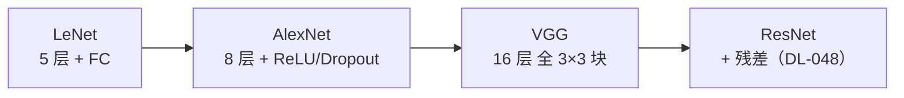

# DL-047 LeNet、AlexNet 与 VGG

## 1. 本节学习目标

1. 说清三代经典网络的**关键改进**（不是"更深"这么简单）。
2. 用代码算出 LeNet 与小型 VGG 的参数量（本课 **44,426** 与 **373,386**）。
3. 理解 VGG 的"块结构"设计（重复单元 + 池化降维）。
4. 知道这些网络的**历史地位与今天怎么用**。

## 2. 为什么需要这个知识

因为今天你用的 ResNet/EfficientNet 都是这三个的"后代"：

- **LeNet** 确立了"卷积 + 池化 + 全连接"的骨架；
- **AlexNet** 证明了"深 + ReLU + Dropout + GPU"能赢；
- **VGG** 给出了"块结构 + 全 3×3"的可复用范式。

不理解它们，就只是在抄网络结构。

## 3. 直观解释

| 网络 | 年份 | 深度 | 关键创新 | 参数量量级 |
|---|---|---|---|---|
| **LeNet-5** | 1998 | 5 层 | 卷积+池化+FC 骨架 | 4.4 万 |
| **AlexNet** | 2012 | 8 层 | **ReLU + Dropout + 数据增强 + GPU** | 6000 万 |
| **VGG-16** | 2014 | 16 层 | **全 3×3 + 块结构** | 1.38 亿 |

**规模跃迁**：LeNet 4 万 → AlexNet 6000 万（**约 1500 倍**）→ VGG 1.38 亿（**约 2.3 倍**）。

## 4. 正式定义

**LeNet-5 结构**（输入 $1\times28\times28$）

```text
Conv(1→6, 5×5) → ReLU → MaxPool(2)
Conv(6→16, 5×5) → ReLU → MaxPool(2)
Flatten → FC(16*4*4 → 120) → ReLU → FC(120→84) → ReLU → FC(84→10)
```

**VGG 块**

```text
[Conv(3×3, same) → ReLU] × n → MaxPool(2)
```

## 5. 核心原理

**本课实测参数量**

```text
LeNet(简化, 1×28×28): 44426
VGG 小型(3→64×2,128×2,256×3 + GAP): 373386
```

**LeNet 拆解**：

| 层 | 参数量 |
|---|---|
| Conv(1→6,5) | $6\times1\times25+6=156$ |
| Conv(6→16,5) | $16\times6\times25+16=2{,}416$ |
| FC(256→120) | $256\times120+120=30{,}840$ |
| FC(120→84) | $120\times84+84=10{,}164$ |
| FC(84→10) | $84\times10+10=850$ |
| **合计** | **44,426** |

**关键观察**：**LeNet 87% 的参数在第一个全连接层**（30,840 / 44,426 ≈ 69%，加上后面的 FC 共约 95%）。

**这正是 VGG 后来用 GAP 替代大 FC 的动机**。

## 6. 数学表达式

**LeNet 参数量公式**

$$
156+2416+30840+10164+850=44{,}426
$$

**小型 VGG 参数量（含 GAP）**

$$
\begin{aligned}
&\text{block1}(3\to64)\times2:\ 2\times(64\cdot3\cdot9+64)+2\times(64\cdot64\cdot9+64)\\
&+\text{block2}(64\to128)\times2+\text{block3}(128\to256)\times3+\text{FC}(256\to10)
\end{aligned}
$$

合计 **373,386**（实测）。

## 7. 数学推导

**为什么 GAP 能大幅减参**

传统：`Flatten → FC(512×7×7→4096)` ⇒ $25{,}088\times4096\approx1.03$ **亿**参数。

GAP：`AdaptiveAvgPool2d(1) → FC(512→10)` ⇒ $512\times10+10=5{,}130$。

**减少约 2 万倍**，且天然适配任意输入尺寸。

**AlexNet 的三个关键改进**

| 改进 | 作用 |
|---|---|
| **ReLU** | 缓解梯度消失（对比 Sigmoid，DL-009） |
| **Dropout** | 抑制过拟合（DL-035） |
| **数据增强 + GPU** | 让百万级 ImageNet 训练可行 |

## 8. 结构示意图



## 9. 具体计算示例

```text
LeNet: 44,426 参数
  Conv1 156 / Conv2 2,416
  FC1 30,840 / FC2 10,164 / FC3 850

小型 VGG: 373,386 参数
  3 个 block + GAP + FC(256→10)
```

## 10. Python 实现

```python
import torch.nn as nn


class LeNet(nn.Module):
    def __init__(self) -> None:
        super().__init__()
        self.net = nn.Sequential(
            nn.Conv2d(1, 6, 5), nn.ReLU(), nn.MaxPool2d(2),
            nn.Conv2d(6, 16, 5), nn.ReLU(), nn.MaxPool2d(2),
            nn.Flatten(),
            nn.Linear(16 * 4 * 4, 120), nn.ReLU(),
            nn.Linear(120, 84), nn.ReLU(),
            nn.Linear(84, 10),
        )

    def forward(self, x):
        return self.net(x)


def count(model: nn.Module) -> int:
    return sum(p.numel() for p in model.parameters())


print("LeNet 参数:", count(LeNet()))
```

## 11. PyTorch 实现（VGG 块结构）

```python
import torch.nn as nn


def vgg_block(cin: int, cout: int, n: int):
    layers = []
    for _ in range(n):
        layers += [nn.Conv2d(cin, cout, 3, padding=1), nn.ReLU()]
        cin = cout
    layers.append(nn.MaxPool2d(2))
    return layers


vgg = nn.Sequential(
    *vgg_block(3, 64, 2),
    *vgg_block(64, 128, 2),
    *vgg_block(128, 256, 3),
    nn.AdaptiveAvgPool2d(1),
    nn.Flatten(),
    nn.Linear(256, 10),
)
print("小型 VGG 参数:", sum(p.numel() for p in vgg.parameters()))
```

## 12. 代码逐行解释

| 代码 | 作用 |
|---|---|
| `nn.Conv2d(1,6,5)` | LeNet 第一层（无 padding，尺寸缩小） |
| `nn.Flatten()` | 把特征图拉平接 FC |
| `nn.Linear(16*4*4,120)` | 16 通道、4×4 空间 |
| `vgg_block(cin,cout,n)` | 重复 n 次 3×3 + 一个池化 |
| `nn.AdaptiveAvgPool2d(1)` | 全局平均池化（任意输入尺寸→1） |
| `sum(p.numel() ...)` | 统计参数量 |

**注意**：`AdaptiveAvgPool2d(1)` 让网络**接受任意输入尺寸**，这是 VGG 现代改造的标配。

## 13. 实际运行结果

```text
LeNet(简化, 1×28×28): 44426
VGG 小型(3→64×2,128×2,256×3 + GAP): 373386
```

## 14. 应用场景

| 网络 | 今天怎么用 |
|---|---|
| LeNet | 教学、MNIST 基线 |
| AlexNet | 教学、理解历史突破 |
| VGG | **特征提取/风格迁移**（结构规整） |
| ResNet | 实际任务首选（DL-048） |
| 现代网络 | EfficientNet/ConvNeXt（含 VGG 思想） |

## 15. 优点与缺点

| 网络 | 优点 | 缺点 |
|---|---|---|
| LeNet | 极小、易训 | 容量小 |
| AlexNet | 首次大规模验证深度学习 | 参数多、结构粗糙 |
| VGG | 结构统一、易改造 | **参数巨大**（1.38 亿）、计算贵 |

## 16. 常见错误

| 错误 | 现象 | 纠正 |
|---|---|---|
| 直接照搬 VGG 全连接 | 显存爆炸 | 换 GAP |
| 忘记输入尺寸约束 | 形状不匹配 | LeNet 需 28×28 |
| 用 VGG 做小数据任务 | 严重过拟合 | 迁移学习/换小模型 |
| 以为"越深越好" | 梯度问题 | 需 BN/残差 |
| 混淆参数量与计算量 | 优化方向错 | 分别统计 FLOPs |

## 17. 本节总结

- LeNet（**44,426**）确立骨架；AlexNet 引入 ReLU/Dropout/GPU；VGG 给出"全 3×3 块"范式。
- **LeNet 的参数大头在 FC 层**（FC1 单项 30,840）⇒ 后来用 GAP 替代。
- 小型 VGG（含 GAP）实测 **373,386**，比全 FC 版小得多。

## 18. 前置与后续

- 前置：[[DL-046 感受野与参数共享]]
- 后续：[[DL-048 ResNet 与 Skip Connection]]、[[DL-049 迁移学习与图像分类工作流]]
- 相关机器学习：[[ML-051 Bagging 与随机森林]]

---

## 练习与参考答案

**基础 1**：LeNet、AlexNet、VGG 各自的**关键创新**是什么？

**基础 2**：本课 LeNet 与小型 VGG 的参数量各是多少？

**进阶 1**：为什么 LeNet 的参数大部分集中在全连接层？这带来什么启发？

**综合**：把 VGG 的 `Flatten + FC(512×7×7→4096)` 改成 GAP + FC(512→10)，参数量减少多少倍？

> [!success]- 参考答案

> **基础 1**
> - **LeNet**：确立"卷积 + 池化 + 全连接"骨架。
> - **AlexNet**：ReLU（缓解梯度消失）+ Dropout（抑制过拟合）+ 数据增强 + GPU 训练。
> - **VGG**：全部用 3×3 小核 + 重复块结构（同感受野下参数更少、非线性更多）。

> **基础 2**
> LeNet **44,426**；小型 VGG（含 GAP）**373,386**。

> **进阶 1**
> 因为卷积层参数少（共享权重），而 `Flatten` 后接的 FC 层把"通道×空间"全展开，参数 $\propto$ 特征维度×隐藏单元。
> 本课 LeNet 的 FC1 就有 **30,840**（占 69%）。
> **启发**：分类头不该用大 FC——后来普遍改用 **Global Average Pooling**（DL-047 实测小型 VGG 因此只有 37 万参数）。

> **综合（参考）**
> 传统：$512\times7\times7\times4096+4096=25{,}088\times4096+4096=102{,}764{,}544$（约 **1.03 亿**）。
> GAP：$512\times10+10=5{,}130$。
> **减少约 20,033 倍**（$102{,}764{,}544/5{,}130$）。
> 附带好处：①对输入尺寸不敏感；②参数少 ⇒ 不易过拟合；③更易部署。

## 学习记录

| 日期 | 状态 | 用时 | 问题 | 复盘 |
|---|---|---|---|---|
| 2026-11-07 | planned | — | — | — |

---

## 🔗 Notion 同步信息

> 以下内容由 Notion「AI Knowledge System · 知识点」数据库按知识 ID 合并而来（导出于 2026-11-09）。

| 属性 | 值 |
|---|---|
| 学科 | 深度学习 |
| 学习状态 | 未开始 |
| 难度 | L2 应用 |
| 知识类型 | Concept |

- **所属模块**：[M-DL-05 卷积神经网络 CNN](../%E8%AF%BE%E7%A8%8B%E6%A8%A1%E5%9D%97/M-DL-05%20%E5%8D%B7%E7%A7%AF%E7%A5%9E%E7%BB%8F%E7%BD%91%E7%BB%9C%20CNN.md)
- **前置知识**：[DL-046 感受野与参数共享](DL-046%20%E6%84%9F%E5%8F%97%E9%87%8E%E4%B8%8E%E5%8F%82%E6%95%B0%E5%85%B1%E4%BA%AB.md)
- **后继知识**：[DL-048 ResNet 与 Skip Connection](DL-048%20ResNet%20%E4%B8%8E%20Skip%20Connection.md)
- **对应项目**：[PROJ-017 手写数字分类——CNN 改进](../../07_%E5%AE%9E%E6%88%98%E9%A1%B9%E7%9B%AE/04%20%E6%B7%B1%E5%BA%A6%E5%AD%A6%E4%B9%A0%E9%A1%B9%E7%9B%AE/PROJ-017%20%E6%89%8B%E5%86%99%E6%95%B0%E5%AD%97%E5%88%86%E7%B1%BB%E2%80%94%E2%80%94CNN%20%E6%94%B9%E8%BF%9B.md)
