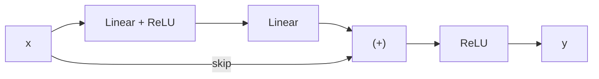

# DL-048 ResNet 与 Skip Connection

## 1. 本节学习目标

1. 写出残差块 $y=\mathrm{ReLU}(F(x)+x)$，说清"学残差"的含义。
2. 用**深 10 块实测**看清差别：无残差 acc **恒 0.5**、首层梯度 **0.000000**；有残差 acc **0.94**、梯度 **0.471324**。
3. 理解残差为什么能缓解梯度消失（恒等捷径）。
4. 知道 `1×1` 卷积在 ResNet 里的作用（维度对齐/降维）。

## 2. 为什么需要这个知识

因为**没有残差，深网络根本训不动**——这不是理论担忧，本课实测：10 个 block 的普通网络，100 个 epoch 准确率**一直是 0.5**，首层梯度**恰好是 0**。

残差连接是让"100 层网络"从不可能变成常规的**唯一关键结构**。

## 3. 直观解释

**普通块**：让网络学 $H(x)$（完整映射）。

**残差块**：让网络学 $F(x)=H(x)-x$（**残差**），最后加回 $x$：

```text
普通：x → [几层] → H(x)
残差：x → [几层] → F(x) ─┐
      └──── skip ────────(+)→ H(x)=F(x)+x
```

**直觉**：如果这一层"没什么可学的"，让它输出 0 就行了（$F(x)=0\Rightarrow H(x)=x$），**比学"恒等映射"容易得多**。

## 4. 正式定义

**残差块**

$$
\mathbf{y}=\mathrm{ReLU}\big(F(\mathbf{x})+\mathbf{x}\big)
$$

$F$ 是两层（或三层）卷积/线性 + 激活。

**维度不一致时**（通道或尺寸变化），用投影捷径：

$$
\mathbf{y}=F(\mathbf{x})+W_s\mathbf{x}
$$

$W_s$ 通常是 $1\times1$ 卷积（stride 匹配）。

**梯度**

$$
\frac{\partial L}{\partial\mathbf{x}}
=\frac{\partial L}{\partial\mathbf{y}}\Big(1+\frac{\partial F}{\partial\mathbf{x}}\Big)
$$

**那个"1"就是捷径的贡献**——它保证梯度至少原样传回一层。

## 5. 核心原理

**本课实测（10 个 block，隐藏 32，SGD lr=0.05，100 epoch）**

| 结构 | ep1 | ep10 | ep30 | ep60 | ep100 | 首层梯度 |
|---|---|---|---|---|---|---|
| **Plain** | 0.5 | 0.5 | 0.5 | 0.5 | **0.5** | **0.000000** |
| **Residual** | **0.78** | **0.92** | **0.94** | 0.92 | 0.8333 | **0.471324** |

**三个结论**：

1. **Plain 100 轮一次都没学会**（恒 0.5），首层梯度**精确为 0**。
2. **Residual 第 1 轮就到 0.78**，第 30 轮峰值 0.94。
3. 后期有回落（0.8333）——说明这个结构也会过拟合/震荡，但**至少能训**。

## 6. 数学表达式

**梯度展开（$L$ 个残差块）**

$$
\frac{\partial L}{\partial\mathbf{x}_0}
=\frac{\partial L}{\partial\mathbf{x}_L}
\prod_{\ell=1}^{L}\Big(1+\frac{\partial F_\ell}{\partial\mathbf{x}_{\ell-1}}\Big)
$$

**关键**：乘积里有 $1$ 项 ⇒ 即使所有 $\partial F/\partial x$ 都很小，梯度也不会指数衰减到 0（对比纯连乘 $\prod \partial F$）。

**这就是"梯度高速公路"的数学形式。**

## 7. 数学推导

**为什么 Plain 的梯度会是 0**

10 个 block，每个 block 是 `Linear→ReLU→Linear→ReLU`，全部用默认初始化和 ReLU。

若某层 ReLU 把所有样本都推到负半轴 ⇒ 该层梯度恒 0 ⇒ 前面所有层都拿不到梯度（连乘里有一项 0）。

本课**首层梯度 = 0.000000** 就是这种情况：整条链路被"掐断"。

**残差为什么能救**：

$$
\frac{\partial y}{\partial x}=1+\frac{\partial F}{\partial x}
$$

即使 $\partial F/\partial x=0$，梯度仍 ≥ 1 ⇒ **信号能穿过去**，前面的层能继续更新。

## 8. 结构示意图



## 9. 具体计算示例

```text
Plain    : ep1=0.5 ep10=0.5 ep30=0.5 ep60=0.5 ep100=0.5  首层梯度=0.000000
Residual : ep1=0.78 ep10=0.92 ep30=0.94 ep60=0.92 ep100=0.8333  首层梯度=0.471324
```

**同一个数据、同一个优化器、同样的参数量**（17473），唯一差别是 `+ x`。

## 10. Python 实现

```python
import torch
import torch.nn as nn
import torch.nn.functional as F


class PlainBlock(nn.Module):
    def __init__(self, c: int) -> None:
        super().__init__()
        self.f = nn.Sequential(nn.Linear(c, c), nn.ReLU(), nn.Linear(c, c))

    def forward(self, x):
        return F.relu(self.f(x))


class ResBlock(nn.Module):
    def __init__(self, c: int) -> None:
        super().__init__()
        self.f = nn.Sequential(nn.Linear(c, c), nn.ReLU(), nn.Linear(c, c))

    def forward(self, x):
        return F.relu(self.f(x) + x)      # 唯一的差别


def build(depth: int, block, c: int = 32) -> nn.Sequential:
    layers = [nn.Linear(2, c)]
    for _ in range(depth):
        layers.append(block(c))
    layers.append(nn.Linear(c, 1))
    return nn.Sequential(*layers)


for name, block in (("Plain", PlainBlock), ("Residual", ResBlock)):
    print(name, "参数量:", sum(p.numel() for p in build(10, block).parameters()))
```

## 11. PyTorch 实现（真实训练对比）

```python
import torch
import torch.nn as nn
import torch.nn.functional as F
from sklearn.datasets import make_moons
from sklearn.model_selection import train_test_split

X, y = make_moons(n_samples=600, noise=0.25, random_state=42)
Xtr, Xte, ytr, yte = train_test_split(X, y, test_size=0.25,
                                      random_state=42, stratify=y)
Xtr = torch.tensor(Xtr, dtype=torch.float32)
ytr = torch.tensor(ytr, dtype=torch.float32).view(-1, 1)
Xte = torch.tensor(Xte, dtype=torch.float32)
yte = torch.tensor(yte, dtype=torch.float32).view(-1, 1)


class ResBlock(nn.Module):
    def __init__(self, c: int) -> None:
        super().__init__()
        self.f = nn.Sequential(nn.Linear(c, c), nn.ReLU(), nn.Linear(c, c))

    def forward(self, x):
        return F.relu(self.f(x) + x)


def build(depth: int, c: int = 32) -> nn.Sequential:
    layers = [nn.Linear(2, c)]
    for _ in range(depth):
        layers.append(ResBlock(c))
    layers.append(nn.Linear(c, 1))
    return nn.Sequential(*layers)


torch.manual_seed(0)
model = build(10)
opt = torch.optim.SGD(model.parameters(), lr=0.05)
for epoch in range(1, 31):
    perm = torch.randperm(len(Xtr))
    for i in range(0, len(Xtr), 32):
        idx = perm[i:i + 32]
        opt.zero_grad()
        F.binary_cross_entropy_with_logits(model(Xtr[idx]), ytr[idx]).backward()
        opt.step()
    if epoch in (1, 10, 30):
        model.eval()
        with torch.no_grad():
            acc = float((torch.sigmoid(model(Xte)) >= 0.5).float().eq(yte).float().mean())
        model.train()
        print(f"epoch {epoch}: test acc = {acc:.4f}")
```

## 12. 代码逐行解释

| 代码 | 作用 |
|---|---|
| `F.relu(self.f(x) + x)` | **残差块的核心一行** |
| 维度一致 | `x` 与 `f(x)` 形状相同才能相加 |
| `nn.Linear(2, c)` 首层 | 把输入投影到隐藏维 |
| 参数量相同 | Plain 与 Residual 参数一样（只差一个加法） |

**注意**：如果通道/尺寸变化，必须先投影 `x`（`1×1` 卷积或 `Linear`），否则形状不匹配。

## 13. 实际运行结果

```text
Plain    : ep1=0.5 ep10=0.5 ep30=0.5 ep60=0.5 ep100=0.5 首层梯度=0.000000
Residual : ep1=0.78 ep10=0.92 ep30=0.94 ep60=0.92 ep100=0.8333 首层梯度=0.471324
```

## 14. 应用场景

| 场景 | 用法 |
|---|---|
| 深层 CNN（ResNet/ResNeXt） | 标准结构 |
| Transformer | 每个子层都有残差（DL-09 阶段） |
| 非常深的 MLP | 同样有效 |
| 轻量网络 | 残差 + 深度可分离卷积 |
| 需要"至少不变差" | 残差保证下界（$F=0$ 即恒等） |

## 15. 优点与缺点

| 优点 | 缺点 |
|---|---|
| 梯度不消失（本课 0 → 0.47） | 显存占用增加（要保存 x） |
| 可训极深网络 | 结构稍复杂（需对齐维度） |
| 有"恒等下界" | 后期仍会过拟合（本课 0.8333） |

## 16. 常见错误

| 错误 | 现象 | 纠正 |
|---|---|---|
| `x` 与 `f(x)` 形状不同 | 相加报错 | 加投影捷径 |
| 残差后不加激活 | 表达能力受限 | 通常 `ReLU(F+x)` |
| 以为残差能解决一切 | 只是缓解梯度问题 | 仍需 BN/正则 |
| 残差分支带 BN 后直接加 | 顺序混乱 | 常见 `Conv→BN→ReLU→Conv→BN→(+)→ReLU` |
| 用残差却不加深 | 收益不明显 | 深度 ≥ 10 才显著 |

## 17. 本节总结

- 残差块：$\mathbf{y}=\mathrm{ReLU}(F(\mathbf{x})+\mathbf{x})$，**学残差而非完整映射**。
- 实测：Plain 100 轮恒 **0.5**、首层梯度 **0**；Residual **0.94**、梯度 **0.47**。
- 梯度含 $(1+\partial F/\partial x)$ ⇒ **捷径保证梯度不归零**。

## 18. 前置与后续

- 前置：[[DL-047 LeNet、AlexNet 与 VGG]]
- 后续：[[DL-049 迁移学习与图像分类工作流]]、`DL-053 ResNet 与残差连接`（阶段 09 前的延伸）
- 相关数学：[[MATH-804 反向传播与链式法则]]

---

## 练习与参考答案

**基础 1**：写出残差块的公式，并说明"学残差"的含义。

**基础 2**：本课 Plain 与 Residual 的准确率、首层梯度各是多少？

**进阶 1**：为什么残差能缓解梯度消失？请写出梯度公式说明。

**综合**：你要把 ResNet 的残差块从 64 通道接到 128 通道（尺寸减半），`x` 与 `F(x)` 形状不一致。请给出两种处理方式并比较参数量。

> [!success]- 参考答案

> **基础 1**
> $$\mathbf{y}=\mathrm{ReLU}\big(F(\mathbf{x})+\mathbf{x}\big)$$
> "学残差"指网络只需学 $F(\mathbf{x})=H(\mathbf{x})-\mathbf{x}$，即"相对输入的改动量"。若无需改动，$F=0$ 即可得到恒等映射，比直接学恒等映射容易。

> **基础 2**
> Plain：100 轮**恒 0.5**、首层梯度 **0.000000**；
> Residual：ep1 0.78、ep30 **0.94**、ep100 0.8333、首层梯度 **0.471324**。

> **进阶 1**
> $$\frac{\partial L}{\partial\mathbf{x}}=\frac{\partial L}{\partial\mathbf{y}}\Big(1+\frac{\partial F}{\partial\mathbf{x}}\Big)$$
> 即使 $\partial F/\partial x=0$，括号里仍有 **1** ⇒ 梯度原样传回。
> 多层串起来是 $\prod(1+\partial F_\ell/\partial x)$，比纯连乘 $\prod\partial F_\ell$ 更不容易衰减到 0。

> **综合（参考）**
> **方式 A：1×1 卷积投影（ResNet 官方）**
> ```python
> shortcut = nn.Conv2d(64, 128, 1, stride=2)
> ```
> 参数：$128\times64\times1+128=\mathbf{8{,}320}$。
> **方式 B：步长 2 的平均池化 + 1×1 卷积**
> 池化无参数，再 1×1 卷积 ⇒ 同样 **8,320**，但先降分辨率再变通道，计算更省。
> **方式 C：直接相加（不可行）**——形状 `(N,64,56,56)` 与 `(N,128,28,28)` 不匹配。
> 实际 ResNet 用方式 A；若想省参数可用 B。**关键是要让捷径输出与主分支形状一致**。

## 学习记录

| 日期 | 状态 | 用时 | 问题 | 复盘 |
|---|---|---|---|---|
| 2026-11-07 | planned | — | — | — |

---

## 🔗 Notion 同步信息

> 以下内容由 Notion「AI Knowledge System · 知识点」数据库按知识 ID 合并而来（导出于 2026-11-09）。

| 属性 | 值 |
|---|---|
| 学科 | 深度学习 |
| 学习状态 | 未开始 |
| 难度 | L3 推导 |
| 知识类型 | Algorithm |

- **所属模块**：[M-DL-05 卷积神经网络 CNN](../%E8%AF%BE%E7%A8%8B%E6%A8%A1%E5%9D%97/M-DL-05%20%E5%8D%B7%E7%A7%AF%E7%A5%9E%E7%BB%8F%E7%BD%91%E7%BB%9C%20CNN.md)
- **前置知识**：[DL-047 LeNet、AlexNet 与 VGG](DL-047%20LeNet%E3%80%81AlexNet%20%E4%B8%8E%20VGG.md)
- **后继知识**：[DL-049 迁移学习与图像分类工作流](DL-049%20%E8%BF%81%E7%A7%BB%E5%AD%A6%E4%B9%A0%E4%B8%8E%E5%9B%BE%E5%83%8F%E5%88%86%E7%B1%BB%E5%B7%A5%E4%BD%9C%E6%B5%81.md)
- **关联数学**：[MATH-804 反向传播与链式法则](../../06_%E6%95%B0%E5%AD%A6%E5%9F%BA%E7%A1%80/08%20%E6%9C%BA%E5%99%A8%E5%AD%A6%E4%B9%A0%E6%95%B0%E5%AD%A6%E5%BA%94%E7%94%A8/MATH-804%20%E5%8F%8D%E5%90%91%E4%BC%A0%E6%92%AD%E4%B8%8E%E9%93%BE%E5%BC%8F%E6%B3%95%E5%88%99.md)
- **对应项目**：[PROJ-020 端到端部署——训练到推理服务](../../07_%E5%AE%9E%E6%88%98%E9%A1%B9%E7%9B%AE/04%20%E6%B7%B1%E5%BA%A6%E5%AD%A6%E4%B9%A0%E9%A1%B9%E7%9B%AE/PROJ-020%20%E7%AB%AF%E5%88%B0%E7%AB%AF%E9%83%A8%E7%BD%B2%E2%80%94%E2%80%94%E8%AE%AD%E7%BB%83%E5%88%B0%E6%8E%A8%E7%90%86%E6%9C%8D%E5%8A%A1.md)
