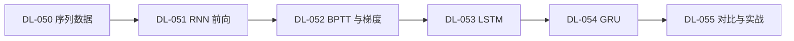

# 🔁 RNN 与序列模型 · 分支索引

> 段位：`DL-050` ~ `DL-055`（M-DL-06）
> 上位：[[04_深度学习/00 模块索引\|深度学习模块索引]]
> 定位：**处理有顺序的数据**。核心矛盾是"要记住历史"与"梯度传不远"。

---

## 一、这一段装什么

| 号段 | 内容 |
|---|---|
| DL-050 | 序列数据、变长处理、掩码 |
| DL-051 | RNN 结构与前向传播 |
| DL-052 | BPTT 与梯度消失/爆炸 |
| DL-053 | LSTM 三门与细胞状态 |
| DL-054 | GRU 两门 |
| DL-055 | 三者对比与序列任务实战 |

## 二、学习顺序

## 三、必须亲手算过的三件事

1. 手算 3 步 RNN 前向，与 `nn.RNN` 对拍（DL-051）。
2. 测 $dL/dh_0$ 随 $T$ 的衰减（DL-052，本课 $T=100$ 时为 0）。
3. 手算一步 LSTM 与 GRU 的门（DL-053/054，差 1.49e-08）。

## 四、知识点登记（6 条）

| 知识 ID | 名称 | 难度 | 状态 | 笔记 |
|---|---|---|---|---|
| `DL-050` | 序列数据与序列建模任务 | L1 | planned | [[DL-050 序列数据与序列建模任务]] |
| `DL-051` | RNN 结构与前向传播 | L3 | planned | [[DL-051 RNN 结构与前向传播]] |
| `DL-052` | BPTT 与梯度问题 | L3 | planned | [[DL-052 BPTT 与梯度问题]] |
| `DL-053` | LSTM 与门控机制 | L3 | planned | [[DL-053 LSTM 与门控机制]] |
| `DL-054` | GRU | L3 | planned | [[DL-054 GRU]] |
| `DL-055` | RNN/LSTM/GRU 对比与序列任务实战 | L3 | planned | [[DL-055 RNN、LSTM、GRU 对比与序列任务实战]] |

> 本目录计划 6 篇，**已全部完成**（DL-050 ~ DL-055，M-DL-06 收官）。

## 五、导航

- 上一级：[[04_深度学习/00 模块索引\|深度学习模块索引]]
- 知识索引：[[08_知识索引/04 深度学习知识索引\|深度学习知识索引]]
- 规则：[[08_知识索引/06 知识关联索引\|知识关联索引]]
