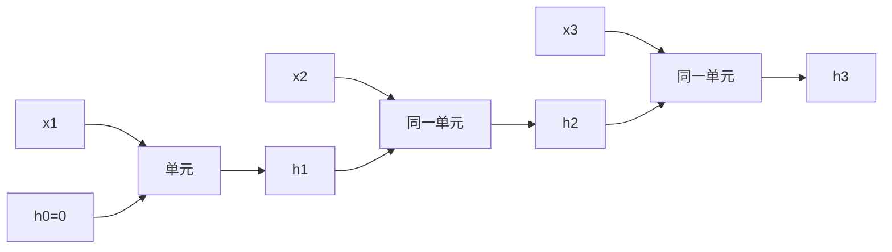

# DL-051 RNN 结构与前向传播

## 1. 本节学习目标

1. 写出 RNN 单元公式 $\mathbf{h}_t=\tanh(W_{ih}\mathbf{x}_t+W_{hh}\mathbf{h}_{t-1}+b)$。
2. **手算 3 步前向**并与 `nn.RNN` 对拍（本课最大差 **0.0**）。
3. 理解"隐状态携带历史"的含义与代价（无法并行）。
4. 会读 `nn.RNN` 的两个返回值（全部输出 vs 最终状态）。

## 2. 为什么需要这个知识

因为 RNN 是**序列建模的第一个可训练结构**，也是 LSTM/GRU 的母体。

理解"同一组权重在每个时间步反复使用"，你就同时理解了它的三个特性：**参数量与 T 无关、能处理变长、不能并行**。

## 3. 直观解释

**RNN 的一句话**：把上一步的隐状态**当作额外输入**，喂给当前步。

```text
h_0 ──┐
      ↓
x_1 → [单元] → h_1 ──┐
                     ↓
x_2 → [单元] → h_2 ──┐
                     ↓
x_3 → [单元] → h_3
```

**关键**：**同一个单元**（同一组 $W$）在每一步复用——这就是"循环"。

## 4. 正式定义

**RNN 单元**

$$
\mathbf{h}_t=\tanh\big(W_{ih}\mathbf{x}_t+W_{hh}\mathbf{h}_{t-1}+\mathbf{b}\big)
$$

**维度**

| 量 | 形状 |
|---|---|
| $\mathbf{x}_t$ | `(B, C_in)` |
| $\mathbf{h}_t$ | `(B, H)` |
| $W_{ih}$ | `(H, C_in)` |
| $W_{hh}$ | `(H, H)` |
| $\mathbf{b}$ | `(H,)`（PyTorch 里拆成两个 bias 相加） |

## 5. 核心原理

**本课实测**

```text
nn.RNN 输出形状: (1, 3, 3)  最终隐状态: (1, 1, 3)
手算输出形状: (1, 3, 3)
手算 vs nn.RNN 最大差: 0.0
第 1 步隐状态: [-0.3578, -0.4608, 0.3219]
第 3 步隐状态: [-0.2887, -0.7519, 0.5532]
```

**读法**：

1. `out` 是 `(1, 3, 3)`：**每个时间步**的隐状态（3 步 × 3 维）。
2. `hn` 是 `(1, 1, 3)`：**最后一步**的隐状态（只有 1 个）。
3. 手算与框架**完全一致**（差 0.0）⇒ 公式写对了。

**`bias_ih + bias_hh`**：PyTorch 把偏置拆成两份，加起来才是公式里的 $\mathbf{b}$。

## 6. 数学表达式

**展开两步**

$$
\mathbf{h}_1=\tanh(W_{ih}\mathbf{x}_1+W_{hh}\mathbf{h}_0+\mathbf{b})
$$

$$
\mathbf{h}_2=\tanh(W_{ih}\mathbf{x}_2+W_{hh}\mathbf{h}_1+\mathbf{b})
$$

**$\mathbf{h}_0$ 通常取 0**（也可学习）。

**参数量**

$$
\#\text{params}=H\cdot C_{in}+H^2+2H
$$

本课 $H=3,C_{in}=2$：$6+9+6=\mathbf{21}$。

## 7. 数学推导

**为什么参数与 T 无关**

$W_{ih},W_{hh},\mathbf{b}$ 在**所有时间步共享**。所以 $T=5$ 与 $T=500$ 的参数完全一样 —— 这与 CNN 的空间共享同源。

**代价：不能并行**

$\mathbf{h}_t$ 依赖 $\mathbf{h}_{t-1}$ ⇒ **必须串行计算**。这是 RNN 训练慢的根本原因（Transformer 的动机之一）。

**梯度流**

$$
\frac{\partial\mathbf{h}_t}{\partial\mathbf{h}_{t-1}}=\mathrm{diag}\big(1-\mathbf{h}_t^2\big)W_{hh}
$$

连乘 $T$ 次 ⇒ 若 $\|W_{hh}\|$ 或激活尺度小，梯度指数衰减（DL-052）。

## 8. 结构示意图



## 9. 具体计算示例

**手算第 1 步（示意）**

给定 $\mathbf{x}_1=[1,0]$、$\mathbf{h}_0=\mathbf{0}$：

$$
\mathbf{h}_1=\tanh(W_{ih}[1,0]^\top+\mathbf{b})
$$

本课实测 $\mathbf{h}_1=[-0.3578,-0.4608,0.3219]$，$\mathbf{h}_3=[-0.2887,-0.7519,0.5532]$。

**注意 $\mathbf{h}_3$ 与 $\mathbf{h}_1$ 不同**：历史信息被累积进来了。

## 10. Python 实现

```python
import torch
import torch.nn as nn

torch.manual_seed(0)
rnn = nn.RNN(input_size=2, hidden_size=3, batch_first=True)
x = torch.tensor([[[1., 0.], [0., 1.], [1., 1.]]])   # (1, 3, 2)

out, hn = rnn(x)
print("out 形状:", tuple(out.shape))     # (1, 3, 3)
print("hn 形状:", tuple(hn.shape))       # (1, 1, 3)
print("out 与 hn 是否一致:", bool(torch.allclose(out[:, -1], hn[0])))
```

## 11. PyTorch 实现（手算对拍）

```python
import torch
import torch.nn as nn

torch.manual_seed(0)
rnn = nn.RNN(input_size=2, hidden_size=3, batch_first=True)
x = torch.tensor([[[1., 0.], [0., 1.], [1., 1.]]])

out, hn = rnn(x)

W_ih = rnn.weight_ih_l0
W_hh = rnn.weight_hh_l0
b = rnn.bias_ih_l0 + rnn.bias_hh_l0       # PyTorch 把偏置拆成两份

h = torch.zeros(1, 3)
steps = []
for t in range(3):
    h = torch.tanh(x[:, t] @ W_ih.T + h @ W_hh.T + b)
    steps.append(h.clone())

manual = torch.stack(steps, dim=1)
print("手算 vs nn.RNN 最大差:", float((manual - out).abs().max()))
```

## 12. 代码逐行解释

| 代码 | 作用 |
|---|---|
| `nn.RNN(2, 3, batch_first=True)` | 输入 2 维、隐状态 3 维 |
| `out` | 每个时间步的输出 `(B,T,H)` |
| `hn` | 最后一步隐状态 `(num_layers, B, H)` |
| `weight_ih_l0` | 输入到隐状态的权重 |
| `weight_hh_l0` | 隐状态到隐状态的权重 |
| `bias_ih_l0 + bias_hh_l0` | 两个偏置相加才是公式的 $b$ |
| `torch.stack(steps, dim=1)` | 把 3 步拼成 `(1,3,3)` |

**注意**：`hn[0]` 而不是 `hn`，因为 `hn` 的第 0 维是层数。

## 13. 实际运行结果

```text
nn.RNN 输出形状: (1, 3, 3)  最终隐状态: (1, 1, 3)
手算输出形状: (1, 3, 3)
手算 vs nn.RNN 最大差: 0.0
第 1 步隐状态: [-0.3578, -0.4608, 0.3219]
第 3 步隐状态: [-0.2887, -0.7519, 0.5532]
```

## 14. 应用场景

| 任务 | 怎么用 RNN 输出 |
|---|---|
| 序列分类 | 取 `hn` 或对 `out` 做池化 |
| 序列回归 | 同上 |
| 序列标注 | 每个时间步的 `out` 接分类头 |
| 生成 | 用 `hn` 预测下一步，再喂回去 |
| 特征提取 | 用 `out` 当序列表示 |

## 15. 优点与缺点

| 优点 | 缺点 |
|---|---|
| 参数量与 T 无关 | 不能并行（训练慢） |
| 天然处理变长 | 长程依赖梯度衰减 |
| 结构简单 | 早期信息容易被覆盖 |

## 16. 常见错误

| 错误 | 现象 | 纠正 |
|---|---|---|
| 用 `hn` 而非 `hn[0]` | 形状多一维 | `hn` 是 `(层数,B,H)` |
| 忘 `batch_first=True` | `(T,B,C)` 与预期不符 | 显式设置 |
| 只加一个 bias | 结果对不上 | `bias_ih + bias_hh` |
| 忘记 h0 初始化 | 报错 | 传 `hx=torch.zeros(...)` |
| 直接对 padding 推进 | 状态被污染 | `pack_padded_sequence`（DL-050） |

## 17. 本节总结

- RNN：$\mathbf{h}_t=\tanh(W_{ih}\mathbf{x}_t+W_{hh}\mathbf{h}_{t-1}+b)$，**同一组权重跨时间共享**。
- 本课手算与 `nn.RNN` **完全一致（差 0.0）**；参数 **21**。
- `out` 是每步状态，`hn` 是最后一步；**不能并行**是它的根本瓶颈。

## 18. 前置与后续

- 前置：[[DL-050 序列数据与序列建模任务]]
- 后续：[[DL-052 BPTT 与梯度问题]]、[[DL-053 LSTM 与门控机制]]
- 相关数学：[[MATH-803 神经网络前向传播]]

---

## 练习与参考答案

**基础 1**：写出 RNN 单元公式，并说明 $W_{hh}$ 的作用。

**基础 2**：本课 `out` 与 `hn` 的形状各是什么？手算与框架差多少？

**进阶 1**：为什么 RNN 的参数量与序列长度无关？这带来什么代价？

**综合**：输入 `(B=4, T=10, C=8)`，隐状态 16 维。请算 RNN 参数量，并说明如果要取"整条序列的表示"，有哪两种做法。

> [!success]- 参考答案

> **基础 1**
> $$\mathbf{h}_t=\tanh(W_{ih}\mathbf{x}_t+W_{hh}\mathbf{h}_{t-1}+\mathbf{b})$$
> $W_{hh}$ 把**上一步的隐状态**映射到当前步，负责"传递历史信息"。

> **基础 2**
> `out`：`(1, 3, 3)`（每步状态）；`hn`：`(1, 1, 3)`（最后一步）。
> 手算与框架最大差 **0.0**（完全一致）。

> **进阶 1**
> 因为同一组 $W_{ih},W_{hh},b$ 在**所有时间步复用**（类似 CNN 的空间共享），参数只与 $C_{in},H$ 有关。
> 代价：$\mathbf{h}_t$ 依赖 $\mathbf{h}_{t-1}$ ⇒ **必须串行**，无法像 CNN/Transformer 那样并行，长序列训练慢。

> **综合（参考）**
> 参数量：$H\cdot C_{in}+H^2+2H=16\times8+16^2+2\times16=128+256+32=\mathbf{416}$。
> **两种取整条序列表示的方法**：
> 1. **取最后隐状态** `hn[-1]`：`(4,16)`，最简单，但早期信息可能被覆盖；
> 2. **对 `out` 做掩码池化**：`(4,10,16)` → 按 mask 求均值/最大值 → `(4,16)`，能利用全部时间步（需处理 padding，DL-050）。
> 实践中②通常更稳；若任务关心"结尾状态"（如生成），则用①。

## 学习记录

| 日期 | 状态 | 用时 | 问题 | 复盘 |
|---|---|---|---|---|
| 2026-11-07 | planned | — | — | — |

---

## 🔗 Notion 同步信息

> 以下内容由 Notion「AI Knowledge System · 知识点」数据库按知识 ID 合并而来（导出于 2026-11-09）。

| 属性 | 值 |
|---|---|
| 学科 | 深度学习 |
| 学习状态 | 未开始 |
| 难度 | L3 推导 |
| 知识类型 | Algorithm |

- **所属模块**：[M-DL-06 循环神经网络与序列建模](../%E8%AF%BE%E7%A8%8B%E6%A8%A1%E5%9D%97/M-DL-06%20%E5%BE%AA%E7%8E%AF%E7%A5%9E%E7%BB%8F%E7%BD%91%E7%BB%9C%E4%B8%8E%E5%BA%8F%E5%88%97%E5%BB%BA%E6%A8%A1.md)
- **前置知识**：[DL-050 序列数据与序列建模任务](DL-050%20%E5%BA%8F%E5%88%97%E6%95%B0%E6%8D%AE%E4%B8%8E%E5%BA%8F%E5%88%97%E5%BB%BA%E6%A8%A1%E4%BB%BB%E5%8A%A1.md)
- **后继知识**：[DL-052 BPTT 与梯度问题](DL-052%20BPTT%20%E4%B8%8E%E6%A2%AF%E5%BA%A6%E9%97%AE%E9%A2%98.md) · [LLM-003 神经语言模型：RNN 与 Seq2Seq](../../05_%E5%A4%A7%E8%AF%AD%E8%A8%80%E6%A8%A1%E5%9E%8B/01%20NLP%E5%9F%BA%E7%A1%80/LLM-003%20%E7%A5%9E%E7%BB%8F%E8%AF%AD%E8%A8%80%E6%A8%A1%E5%9E%8B%E2%80%94%E2%80%94RNN%20%E4%B8%8E%20Seq2Seq.md)
- **关联数学**：[MATH-803 神经网络前向传播](../../06_%E6%95%B0%E5%AD%A6%E5%9F%BA%E7%A1%80/08%20%E6%9C%BA%E5%99%A8%E5%AD%A6%E4%B9%A0%E6%95%B0%E5%AD%A6%E5%BA%94%E7%94%A8/MATH-803%20%E7%A5%9E%E7%BB%8F%E7%BD%91%E7%BB%9C%E5%89%8D%E5%90%91%E4%BC%A0%E6%92%AD.md)
- **对应项目**：[PROJ-018 序列任务——RNN、LSTM、GRU 同口径对比](../../07_%E5%AE%9E%E6%88%98%E9%A1%B9%E7%9B%AE/04%20%E6%B7%B1%E5%BA%A6%E5%AD%A6%E4%B9%A0%E9%A1%B9%E7%9B%AE/PROJ-018%20%E5%BA%8F%E5%88%97%E4%BB%BB%E5%8A%A1%E2%80%94%E2%80%94RNN%E3%80%81LSTM%E3%80%81GRU%20%E5%90%8C%E5%8F%A3%E5%BE%84%E5%AF%B9%E6%AF%94.md)
- **被项目引用**：[PROJ-018 序列任务——RNN、LSTM、GRU 同口径对比](../../07_%E5%AE%9E%E6%88%98%E9%A1%B9%E7%9B%AE/04%20%E6%B7%B1%E5%BA%A6%E5%AD%A6%E4%B9%A0%E9%A1%B9%E7%9B%AE/PROJ-018%20%E5%BA%8F%E5%88%97%E4%BB%BB%E5%8A%A1%E2%80%94%E2%80%94RNN%E3%80%81LSTM%E3%80%81GRU%20%E5%90%8C%E5%8F%A3%E5%BE%84%E5%AF%B9%E6%AF%94.md)
