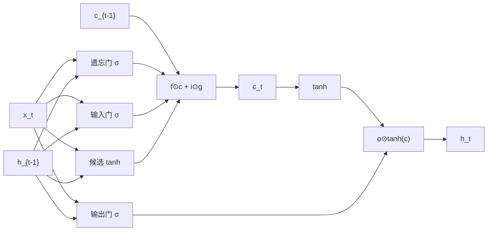

# DL-053 LSTM 与门控机制

## 1. 本节学习目标

1. 写出 LSTM 的三门一状态公式，理解各门的作用。
2. **手算一步 LSTM** 并与 `nn.LSTM` 对拍（本课最大差 **1.49e-08**）。
3. 理解"细胞状态是加法更新"为什么能缓解梯度消失。
4. 知道 LSTM 的参数量代价（本课 84 vs RNN 21）。

## 2. 为什么需要这个知识

因为朴素 RNN 在长序列上**梯度会归零**（DL-052 实测 $T=100$ 时为 0）。

LSTM 用三个门控制"记什么、忘什么、输出什么"，让梯度能沿细胞状态传很远——这是 2015–2018 年序列建模的主流方案，也是理解 GRU 的基础。

## 3. 直观解释

**LSTM = RNN + 一个"传送带"（细胞状态）+ 三个开关**：

| 门 | 作用 | 直觉 |
|---|---|---|
| **遗忘门** $f$ | 丢弃旧记忆的比例 | "这条信息还要吗？" |
| **输入门** $i$ | 写入新信息的比例 | "这条新信息重要吗？" |
| **输出门** $o$ | 暴露多少给下一步 | "这步要说出多少？" |

**关键设计**：细胞状态更新是 **$\mathbf{c}_t=f\odot\mathbf{c}_{t-1}+i\odot g$**——**加法**，不是连乘。

## 4. 正式定义

$$
\mathbf{f}_t=\sigma(W_f\mathbf{x}_t+U_f\mathbf{h}_{t-1}+\mathbf{b}_f)
$$

$$
\mathbf{i}_t=\sigma(W_i\mathbf{x}_t+U_i\mathbf{h}_{t-1}+\mathbf{b}_i)
$$

$$
\mathbf{g}_t=\tanh(W_g\mathbf{x}_t+U_g\mathbf{h}_{t-1}+\mathbf{b}_g)
$$

$$
\mathbf{o}_t=\sigma(W_o\mathbf{x}_t+U_o\mathbf{h}_{t-1}+\mathbf{b}_o)
$$

$$
\mathbf{c}_t=\mathbf{f}_t\odot\mathbf{c}_{t-1}+\mathbf{i}_t\odot\mathbf{g}_t
$$

$$
\mathbf{h}_t=\mathbf{o}_t\odot\tanh(\mathbf{c}_t)
$$

**PyTorch 的门顺序**：`input, forget, cell(g), output`（一次算出 4 组再 `chunk`）。

## 5. 核心原理

**本课实测（$H=3$，输入 `[0.5,-0.2]`，$h_0=c_0=0$）**

```text
i: [0.4073, 0.4248, 0.4152]
f: [0.4953, 0.6071, 0.5485]
g: [0.004, -0.576, 0.4583]
o: [0.5396, 0.4741, 0.6964]

手算 h1: [0.0009, -0.1137, 0.1309]
官方 h1: [0.0009, -0.1137, 0.1309]
最大差: 1.49e-08
```

**读法**：

1. **遗忘门 ≈ 0.5–0.6**：因为 $c_0=0$，第一步"忘"多少都无所谓。
2. **输入门 ≈ 0.41**：只写入约 41% 的新信息。
3. **$g$ 有正有负**：候选记忆可正可负（$\tanh$）。
4. 手算与框架差 **1.49e-08** ⇒ 公式与门顺序都对了。

## 6. 数学表达式

**梯度沿细胞状态流动**

$$
\frac{\partial\mathbf{c}_t}{\partial\mathbf{c}_{t-1}}=\mathbf{f}_t
$$

（逐元素，**没有 $W$ 连乘**。）

⇒ 若 $f_t\approx1$，梯度**近似无损**地传下去；若 $f_t\approx0$，就主动"忘掉"。

**这是 LSTM 与 RNN 的本质区别**：

| | 梯度路径 |
|---|---|
| RNN | $\prod \mathrm{diag}(1-h^2)W_{hh}$ |
| LSTM | $\prod \mathbf{f}_t$（逐元素乘，无矩阵） |

## 7. 数学推导

**为什么加法更新能保住梯度**

$$
\frac{\partial\mathbf{c}_t}{\partial\mathbf{c}_{t-1}}=\mathbf{f}_t+\underbrace{\frac{\partial(\mathbf{i}_t\odot\mathbf{g}_t)}{\partial\mathbf{c}_{t-1}}}_{\text{通过 }h_{t-1}\text{ 的路径}}
$$

**主路径**是 $\mathbf{f}_t$（直接、无矩阵乘）——这条路径上的梯度不会被反复乘以 $W_{hh}$ 而指数衰减。

**参数量**

每个门有 $H\cdot C_{in}+H^2+2H$ 参数，4 个门：

$$
\#\text{params}=4\big(H C_{in}+H^2+2H\big)
$$

本课 $H=3,C_{in}=2$：$4\times(6+9+6)=4\times21=\mathbf{84}$。

## 8. 结构示意图



## 9. 具体计算示例

```
i = [0.4073, 0.4248, 0.4152]
f = [0.4953, 0.6071, 0.5485]
g = [0.0040, -0.5760, 0.4583]
o = [0.5396, 0.4741, 0.6964]

c1 = f*c0 + i*g = i*g（c0=0）
   = [0.0016, -0.2446, 0.1903]
h1 = o*tanh(c1) = [0.0009, -0.1137, 0.1309]
```

**验证**：第 2 维 $i\cdot g=0.4248\times(-0.576)=-0.2446$，$\tanh(-0.2446)=-0.2397$，$0.4741\times(-0.2397)=-0.1137$ ✅

## 10. Python 实现

```python
import torch
import torch.nn as nn

torch.manual_seed(0)
lstm = nn.LSTM(input_size=2, hidden_size=3, batch_first=True)
x = torch.tensor([[[0.5, -0.2]]])
out, (hn, cn) = lstm(x)

print("out:", tuple(out.shape))
print("hn:", tuple(hn.shape), " cn:", tuple(cn.shape))
print("hn:", [round(float(v), 4) for v in hn[0, 0]])
```

## 11. PyTorch 实现（手算对拍）

```python
import torch
import torch.nn as nn

torch.manual_seed(0)
lstm = nn.LSTM(input_size=2, hidden_size=3, batch_first=True)
x = torch.tensor([[[0.5, -0.2]]])
out, (hn, cn) = lstm(x)

W = lstm.weight_ih_l0          # (4H, C_in)
U = lstm.weight_hh_l0          # (4H, H)
b = lstm.bias_ih_l0 + lstm.bias_hh_l0

h0 = torch.zeros(1, 3)
c0 = torch.zeros(1, 3)

gates = x[:, 0] @ W.T + h0 @ U.T + b
i, f, g, o = gates.chunk(4, dim=1)
i, f = torch.sigmoid(i), torch.sigmoid(f)
g, o = torch.tanh(g), torch.sigmoid(o)

c1 = f * c0 + i * g
h1 = o * torch.tanh(c1)

print("手算 h1:", [round(float(v), 4) for v in h1[0]])
print("官方 h1:", [round(float(v), 4) for v in hn[0, 0]])
print("最大差:", float((h1 - hn[0]).abs().max()))
```

## 12. 代码逐行解释

| 代码 | 作用 |
|---|---|
| `nn.LSTM(2, 3)` | 输入 2、隐状态 3 |
| `weight_ih_l0` 形状 `(4H, C_in)` | 4 个门的输入权重拼在一起 |
| `gates.chunk(4, dim=1)` | 按 **i, f, g, o** 顺序拆 |
| `i, f` 用 sigmoid | 门控在 (0,1) |
| `g` 用 tanh | 候选值在 (−1,1) |
| `c1 = f*c0 + i*g` | **加法更新**（核心） |
| `h1 = o*tanh(c1)` | 输出门控制暴露 |

**顺序坑**：PyTorch 是 **i, f, g, o**（不是 f, i, g, o）；写反了数值完全不对。

## 13. 实际运行结果

```text
i/f/g/o: [0.4073, 0.4248, 0.4152] [0.4953, 0.6071, 0.5485]
         [0.004, -0.576, 0.4583] [0.5396, 0.4741, 0.6964]
手算 h1: [0.0009, -0.1137, 0.1309]
官方 h1: [0.0009, -0.1137, 0.1309]
最大差: 1.4901161193847656e-08
```

**参数量**：RNN 21 / **LSTM 84** / GRU 63（$H=3$）。

## 14. 应用场景

| 场景 | 适合度 |
|---|---|
| 长文本分类 | ✅（历史主力） |
| 语音识别 | ✅ |
| 时间序列预测 | ✅ |
| 机器翻译 | ⚠️ 已被 Transformer 取代 |
| 超长序列（>1000） | ⚠️ 仍需 TBPTT |

## 15. 优点与缺点

| 优点 | 缺点 |
|---|---|
| 缓解梯度消失（加法路径） | 参数是 RNN 的 **4 倍**（本课 84 vs 21） |
| 三门可控、可解释 | 仍串行、仍慢 |
| 长程依赖优于朴素 RNN | 超长序列依然吃力 |

## 16. 常见错误

| 错误 | 现象 | 纠正 |
|---|---|---|
| 门顺序写错 | 数值完全不对 | PyTorch 是 i,f,g,o |
| 忘记 `cn` | 无法续接状态 | `nn.LSTM` 返回 (h, c) |
| 以为 LSTM 不会有梯度问题 | 超长仍会 | 配 TBPTT/裁剪 |
| 初始化 `forget_bias` 为 0 | 早期遗忘太多 | 常设 1.0（记住更多） |
| 用 LSTM 处理极短序列 | 收益不明显 | 简单任务用 RNN/CNN 即可 |

## 17. 本节总结

- LSTM = **三门 + 细胞状态**；更新是 $\mathbf{c}_t=\mathbf{f}_t\odot\mathbf{c}_{t-1}+\mathbf{i}_t\odot\mathbf{g}_t$。
- 手算与 `nn.LSTM` 差 **1.49e-08**；参数 **84**（RNN 的 4 倍）。
- 优势来自 **$\partial c_t/\partial c_{t-1}=f_t$**（无矩阵连乘）。

## 18. 前置与后续

- 前置：[[DL-052 BPTT 与梯度问题]]
- 后续：[[DL-054 GRU]]、`DL-055 RNN/LSTM/GRU 对比与序列任务实战`（待建）
- 相关数学：[[MATH-804 反向传播与链式法则]]

---

## 练习与参考答案

**基础 1**：LSTM 的三个门各控制什么？写出细胞状态更新公式。

**基础 2**：本课手算与 `nn.LSTM` 的差是多少？参数量多少？

**进阶 1**：为什么 LSTM 能缓解梯度消失？请写出梯度公式对比 RNN。

**综合**：你的 LSTM 在长文本分类上表现不如预期（F1 只有 0.6），请列出 5 个排查方向。

> [!success]- 参考答案

> **基础 1**
> - **遗忘门** $f$：控制保留多少旧细胞状态。
> - **输入门** $i$：控制写入多少新信息。
> - **输出门** $o$：控制暴露多少给隐状态。
> $$\mathbf{c}_t=\mathbf{f}_t\odot\mathbf{c}_{t-1}+\mathbf{i}_t\odot\mathbf{g}_t,\qquad
> \mathbf{h}_t=\mathbf{o}_t\odot\tanh(\mathbf{c}_t)$$

> **基础 2**
> 最大差 **1.49e-08**（浮点误差）；参数量 **84**（RNN 21、GRU 63）。

> **进阶 1**
> RNN：$\dfrac{\partial h_t}{\partial h_{t-1}}=\mathrm{diag}(1-h_t^2)W_{hh}$ ⇒ 连乘含 $W_{hh}$，指数衰减。
> LSTM：$\dfrac{\partial c_t}{\partial c_{t-1}}=\mathbf{f}_t$ ⇒ **逐元素乘、无矩阵**，若 $f\approx1$ 则近似无损。
> 这就是"常数误差传送带"（CEC）的数学来源。

> **综合（参考）**
> **5 个排查方向**：
> 1. **数据/标签**：标签噪声、类别不平衡（看混淆矩阵）；
> 2. **序列截断**：是否把关键信息截掉了（检查 max_len 与覆盖分布）；
> 3. **聚合方式**：只取 `hn` 还是做了池化/attention pooling；
> 4. **超参**：隐藏维度、层数、lr、`forget_bias`（常用 1.0）；
> 5. **结构选择**：长文本上 Transformer 通常更强，LSTM 可能容量不足。
> **快速验证**：先用小样本过拟合测试（20 条能否到 100%）；不行 ⇒ 流程有问题；能 ⇒ 泛化/容量问题。

## 学习记录

| 日期 | 状态 | 用时 | 问题 | 复盘 |
|---|---|---|---|---|
| 2026-11-07 | planned | — | — | — |

---

## 🔗 Notion 同步信息

> 以下内容由 Notion「AI Knowledge System · 知识点」数据库按知识 ID 合并而来（导出于 2026-11-09）。

| 属性 | 值 |
|---|---|
| 学科 | 深度学习 |
| 学习状态 | 未开始 |
| 难度 | L3 推导 |
| 知识类型 | Algorithm |

- **所属模块**：[M-DL-06 循环神经网络与序列建模](../%E8%AF%BE%E7%A8%8B%E6%A8%A1%E5%9D%97/M-DL-06%20%E5%BE%AA%E7%8E%AF%E7%A5%9E%E7%BB%8F%E7%BD%91%E7%BB%9C%E4%B8%8E%E5%BA%8F%E5%88%97%E5%BB%BA%E6%A8%A1.md)
- **前置知识**：[DL-052 BPTT 与梯度问题](DL-052%20BPTT%20%E4%B8%8E%E6%A2%AF%E5%BA%A6%E9%97%AE%E9%A2%98.md)
- **后继知识**：[DL-054 GRU](DL-054%20GRU.md)
- **关联数学**：[MATH-804 反向传播与链式法则](../../06_%E6%95%B0%E5%AD%A6%E5%9F%BA%E7%A1%80/08%20%E6%9C%BA%E5%99%A8%E5%AD%A6%E4%B9%A0%E6%95%B0%E5%AD%A6%E5%BA%94%E7%94%A8/MATH-804%20%E5%8F%8D%E5%90%91%E4%BC%A0%E6%92%AD%E4%B8%8E%E9%93%BE%E5%BC%8F%E6%B3%95%E5%88%99.md)
- **对应项目**：[PROJ-018 序列任务——RNN、LSTM、GRU 同口径对比](../../07_%E5%AE%9E%E6%88%98%E9%A1%B9%E7%9B%AE/04%20%E6%B7%B1%E5%BA%A6%E5%AD%A6%E4%B9%A0%E9%A1%B9%E7%9B%AE/PROJ-018%20%E5%BA%8F%E5%88%97%E4%BB%BB%E5%8A%A1%E2%80%94%E2%80%94RNN%E3%80%81LSTM%E3%80%81GRU%20%E5%90%8C%E5%8F%A3%E5%BE%84%E5%AF%B9%E6%AF%94.md)
- **被项目引用**：[PROJ-018 序列任务——RNN、LSTM、GRU 同口径对比](../../07_%E5%AE%9E%E6%88%98%E9%A1%B9%E7%9B%AE/04%20%E6%B7%B1%E5%BA%A6%E5%AD%A6%E4%B9%A0%E9%A1%B9%E7%9B%AE/PROJ-018%20%E5%BA%8F%E5%88%97%E4%BB%BB%E5%8A%A1%E2%80%94%E2%80%94RNN%E3%80%81LSTM%E3%80%81GRU%20%E5%90%8C%E5%8F%A3%E5%BE%84%E5%AF%B9%E6%AF%94.md)
