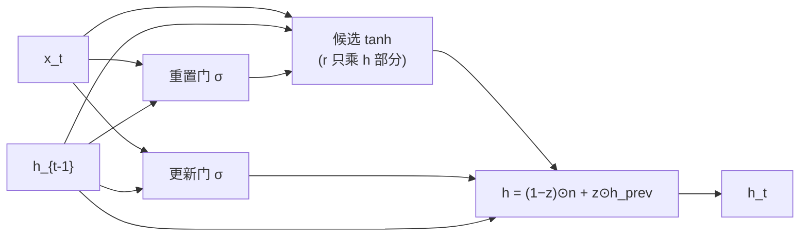

# DL-054 GRU

## 1. 本节学习目标

1. 写出 GRU 的两个门（重置、更新）与候选公式。
2. **手算一步 GRU** 并与 `nn.GRU` 对拍（本课最大差 **1.49e-08**）。
3. 对比 RNN/LSTM/GRU 的参数量（**21 / 84 / 63**）。
4. 理解"GRU 为什么比 LSTM 轻"，以及它是否"总是更好"。

## 2. 为什么需要这个知识

因为 GRU 是 LSTM 的**简化版**：把三门减到两门、把细胞状态和隐状态合并，**参数少 25%**，在很多任务上效果相当。

理解它的门公式，你就能判断"该用 LSTM 还是 GRU"，而不是盲目选一个。

## 3. 直观解释

| 结构 | 门 | 状态 |
|---|---|---|
| LSTM | 遗忘 / 输入 / 输出（3 个） | $h$ 与 $c$ 两个 |
| **GRU** | **重置 / 更新**（2 个） | **只有 $h$** |

**两个门的作用**：

- **重置门** $r$："看多少历史"（$r$ 小 ⇒ 忽略过去）。
- **更新门** $z$："新旧各占多少"（$z$ 大 ⇒ 保留旧状态）。

**一句话**：GRU 把 LSTM 的"遗忘+输入"合并成一个"更新"门。

## 4. 正式定义

$$
\mathbf{r}_t=\sigma\big(W_r\mathbf{x}_t+U_r\mathbf{h}_{t-1}+\mathbf{b}_r\big)
$$

$$
\mathbf{z}_t=\sigma\big(W_z\mathbf{x}_t+U_z\mathbf{h}_{t-1}+\mathbf{b}_z\big)
$$

$$
\mathbf{n}_t=\tanh\big(W_n\mathbf{x}_t+\mathbf{b}_{n} + \mathbf{r}_t\odot(U_n\mathbf{h}_{t-1}+\mathbf{b}'_{n})\big)
$$

$$
\mathbf{h}_t=(1-\mathbf{z}_t)\odot\mathbf{n}_t+\mathbf{z}_t\odot\mathbf{h}_{t-1}
$$

**注意**：$\mathbf{r}_t$ 只乘在**隐状态部分**，不乘输入部分。这是最常见的写错点。

## 5. 核心原理

**本课实测（$H=3$，输入 `[0.5,-0.2]`，$h_0=0$）**

```text
r: [0.4822, 0.4983, 0.3098]
z: [0.5935, 0.4511, 0.4589]
n: [0.3197, -0.2286, -0.4162]

手算 h1: [0.1299, -0.1255, -0.2252]
官方 h1: [0.1299, -0.1255, -0.2252]
最大差: 1.49e-08
```

**读法**：

1. 更新门 $z\approx0.45\text{–}0.59$ ⇒ 新旧大约各占一半。
2. 候选 $n$ 有正有负。
3. 手算与框架差 **1.49e-08** ⇒ 公式与"重置门只乘隐状态"这个细节都对了。

> 第一次尝试时我把 $r$ 乘在 $\tanh$ 外面，结果与官方差 **0.3 以上**（见批次记录）。**公式顺序必须精确。**

## 6. 数学表达式

**参数量**

$$
\#\text{params}=3\big(H C_{in}+H^2+2H\big)
$$

本课 $H=3,C_{in}=2$：$3\times(6+9+6)=3\times21=\mathbf{63}$。

**对比**：

| 结构 | 门数 | 参数（$H=3,C_{in}=2$） |
|---|---|---|
| RNN | 0 | **21** |
| LSTM | 4（i,f,g,o） | **84** |
| **GRU** | **3**（r,z,n） | **63** |

**GRU 比 LSTM 少 25%**（63/84 = 0.75）。

## 7. 数学推导

**为什么 GRU 的梯度路径更短**

$$
\mathbf{h}_t=(1-\mathbf{z}_t)\odot\mathbf{n}_t+\mathbf{z}_t\odot\mathbf{h}_{t-1}
$$

$$
\frac{\partial\mathbf{h}_t}{\partial\mathbf{h}_{t-1}}
=\mathbf{z}_t+\text{（通过 }n_t\text{ 的项）}
$$

主路径是 $\mathbf{z}_t$（逐元素，无矩阵）⇒ 与 LSTM 的 $f_t$ 同源：**加法/插值让梯度不必反复乘 $W$**。

**高 $z$ ⇒ 强保留**：相当于 LSTM 的"遗忘门接近 1"。

## 8. 结构示意图



## 9. 具体计算示例

```
r = [0.4822, 0.4983, 0.3098]
z = [0.5935, 0.4511, 0.4589]
n = [0.3197, -0.2286, -0.4162]

h1 = (1-z)*n + z*h0 = (1-z)*n（h0=0）
   = 0.4065*0.3197 = 0.1299
     0.5489*(-0.2286) = -0.1255
     0.5411*(-0.4162) = -0.2252
```

**验证** ✅ 与实测一致。

## 10. Python 实现

```python
import torch
import torch.nn as nn

torch.manual_seed(0)
gru = nn.GRU(input_size=2, hidden_size=3, batch_first=True)
x = torch.tensor([[[0.5, -0.2]]])
out, hn = gru(x)

print("out:", tuple(out.shape), " hn:", tuple(hn.shape))
print("hn:", [round(float(v), 4) for v in hn[0, 0]])
```

## 11. PyTorch 实现（手算对拍）

```python
import torch
import torch.nn as nn

torch.manual_seed(0)
gru = nn.GRU(input_size=2, hidden_size=3, batch_first=True)
x = torch.tensor([[[0.5, -0.2]]])
out, hn = gru(x)

W_ih, W_hh = gru.weight_ih_l0, gru.weight_hh_l0
b_ih, b_hh = gru.bias_ih_l0, gru.bias_hh_l0

h0 = torch.zeros(1, 3)
gi = x[:, 0] @ W_ih.T + b_ih        # (1, 3H)
gh = h0 @ W_hh.T + b_hh

i_r, i_z, i_n = gi.chunk(3, dim=1)
h_r, h_z, h_n = gh.chunk(3, dim=1)

r = torch.sigmoid(i_r + h_r)
z = torch.sigmoid(i_z + h_z)
n = torch.tanh(i_n + r * h_n)       # 重置门只乘隐状态部分
h1 = (1 - z) * n + z * h0

print("手算 h1:", [round(float(v), 4) for v in h1[0]])
print("官方 h1:", [round(float(v), 4) for v in hn[0, 0]])
print("最大差:", float((h1 - hn[0]).abs().max()))
```

## 12. 代码逐行解释

| 代码 | 作用 |
|---|---|
| `weight_ih_l0` 形状 `(3H, C_in)` | r、z、n 三组权重拼接 |
| `chunk(3, dim=1)` | 按 **r, z, n** 顺序拆 |
| `r * h_n` | **重置门只乘隐状态**，不乘输入 |
| `(1-z)*n + z*h0` | 更新门做插值 |
| `bias_ih + bias_hh` | 两组偏置相加 |

**最容易错的一步**：写成 `tanh(i_n + r*(h_n + i_n))` 或 `r*tanh(...)` 都会错——正确形式是 $r$ 只乘 $U_n h_{t-1}+b'_n$。

## 13. 实际运行结果

```text
r: [0.4822, 0.4983, 0.3098]
z: [0.5935, 0.4511, 0.4589]
n: [0.3197, -0.2286, -0.4162]
手算 h1: [0.1299, -0.1255, -0.2252]
官方 h1: [0.1299, -0.1255, -0.2252]
最大差: 1.4901161193847656e-08

参数量（input=2, hidden=3）
  RNN: 21
  LSTM: 84
  GRU: 63
```

## 14. 应用场景

| 场景 | 推荐 |
|---|---|
| 需要轻量 RNN | **GRU**（参数少 25%） |
| 长程依赖、可调参 | LSTM（三门更灵活） |
| 短序列/小数据 | GRU 更不易过拟合 |
| 语音/音乐建模 | 两者都常用 |
| 现代 NLP | Transformer 为主 |

## 15. 优点与缺点

| 优点 | 缺点 |
|---|---|
| 参数少 25%（本课 63 vs 84） | 表达略弱于 LSTM（少一个门） |
| 训练更快、更省显存 | 超长序列仍会衰减 |
| 小数据上常更稳 | 门顺序/公式易写错 |

## 16. 常见错误

| 错误 | 现象 | 纠正 |
|---|---|---|
| 重置门乘在 $\tanh$ 外 | 与官方差 0.3+ | $r$ 只乘隐状态部分 |
| 门顺序写错 | 数值不对 | PyTorch 是 r, z, n |
| 以为 GRU 一定优于 LSTM | 任务相关 | 用验证集比较 |
| 忘记 `(1-z)` | 公式反了 | $h=(1-z)n+zh_{prev}$ |
| 不做梯度裁剪 | 长序列 NaN | 仍建议裁剪 |

## 17. 本节总结

- GRU = **重置门 + 更新门**，只有 $h$ 一个状态；$h_t=(1-z)\odot n+z\odot h_{t-1}$。
- 手算与 `nn.GRU` 差 **1.49e-08**；参数 **63**（LSTM 84、RNN 21）。
- 比 LSTM 轻 25%，**是否更好取决于任务**。

## 18. 前置与后续

- 前置：[[DL-053 LSTM 与门控机制]]
- 后续：`DL-055 RNN/LSTM/GRU 对比与序列任务实战`（待建）
- 相关数学：[[MATH-804 反向传播与链式法则]]

---

## 练习与参考答案

**基础 1**：GRU 的两个门各是什么？与 LSTM 的三门如何对应？

**基础 2**：本课手算与 `nn.GRU` 的差是多少？参数量多少？

**进阶 1**：为什么 GRU 的参数比 LSTM 少 25%？

**综合**：你在两个任务上分别试了 LSTM 与 GRU：任务 A（短序列 20 步）GRU 略好；任务 B（长序列 200 步）LSTM 明显更好。请解释原因并给出选择建议。

> [!success]- 参考答案

> **基础 1**
> - **重置门** $r$：控制"看多少历史"（越小越忽略过去）。
> - **更新门** $z$：控制"新旧各占多少"（越大越保留旧状态）。
> 对应关系：LSTM 的"遗忘门 + 输入门"被合并成 GRU 的"更新门"；LSTM 的"输出门"在 GRU 中没有（因为 $h$ 与 $c$ 合并）。

> **基础 2**
> 最大差 **1.49e-08**；参数量 **63**（RNN 21、LSTM 84）。

> **进阶 1**
> 因为 LSTM 有 4 组参数（i, f, g, o），GRU 只有 3 组（r, z, n）。
> 每组参数量都是 $H C_{in}+H^2+2H$，所以 GRU/LSTM = 3/4 = **75%**，即少 25%。

> **综合（参考）**
> **解释**：
> - 任务 A（短序列）：依赖跨度小，梯度衰减不严重 ⇒ 结构差异不关键；GRU 参数少、更不易过拟合，所以略好。
> - 任务 B（长序列 200 步）：需要长期保存信息。LSTM 有**独立的细胞状态 + 遗忘门**，能更精细地"长期保留、选择性遗忘"；GRU 的更新门是插值，保留与写入耦合更紧 ⇒ 长依赖上略吃亏。
> **建议**：
> 1. 先用 **GRU**（快、参数少）作基线；
> 2. 若长依赖任务表现不足，换 **LSTM** 并调 `forget_bias`；
> 3. 若序列 >500 步，直接考虑 **Transformer/1D 卷积**；
> 4. 两者都用 **梯度裁剪 + TBPTT**。

## 学习记录

| 日期 | 状态 | 用时 | 问题 | 复盘 |
|---|---|---|---|---|
| 2026-11-07 | planned | — | — | — |

---

## 🔗 Notion 同步信息

> 以下内容由 Notion「AI Knowledge System · 知识点」数据库按知识 ID 合并而来（导出于 2026-11-09）。

| 属性 | 值 |
|---|---|
| 学科 | 深度学习 |
| 学习状态 | 未开始 |
| 难度 | L3 推导 |
| 知识类型 | Algorithm |

- **所属模块**：[M-DL-06 循环神经网络与序列建模](../%E8%AF%BE%E7%A8%8B%E6%A8%A1%E5%9D%97/M-DL-06%20%E5%BE%AA%E7%8E%AF%E7%A5%9E%E7%BB%8F%E7%BD%91%E7%BB%9C%E4%B8%8E%E5%BA%8F%E5%88%97%E5%BB%BA%E6%A8%A1.md)
- **前置知识**：[DL-053 LSTM 与门控机制](DL-053%20LSTM%20%E4%B8%8E%E9%97%A8%E6%8E%A7%E6%9C%BA%E5%88%B6.md)
- **后继知识**：[DL-055 RNN/LSTM/GRU 对比与序列任务实战](DL-055%20RNN%E3%80%81LSTM%E3%80%81GRU%20%E5%AF%B9%E6%AF%94%E4%B8%8E%E5%BA%8F%E5%88%97%E4%BB%BB%E5%8A%A1%E5%AE%9E%E6%88%98.md)
- **关联数学**：[MATH-804 反向传播与链式法则](../../06_%E6%95%B0%E5%AD%A6%E5%9F%BA%E7%A1%80/08%20%E6%9C%BA%E5%99%A8%E5%AD%A6%E4%B9%A0%E6%95%B0%E5%AD%A6%E5%BA%94%E7%94%A8/MATH-804%20%E5%8F%8D%E5%90%91%E4%BC%A0%E6%92%AD%E4%B8%8E%E9%93%BE%E5%BC%8F%E6%B3%95%E5%88%99.md)
- **对应项目**：[PROJ-018 序列任务——RNN、LSTM、GRU 同口径对比](../../07_%E5%AE%9E%E6%88%98%E9%A1%B9%E7%9B%AE/04%20%E6%B7%B1%E5%BA%A6%E5%AD%A6%E4%B9%A0%E9%A1%B9%E7%9B%AE/PROJ-018%20%E5%BA%8F%E5%88%97%E4%BB%BB%E5%8A%A1%E2%80%94%E2%80%94RNN%E3%80%81LSTM%E3%80%81GRU%20%E5%90%8C%E5%8F%A3%E5%BE%84%E5%AF%B9%E6%AF%94.md)
- **被项目引用**：[PROJ-018 序列任务——RNN、LSTM、GRU 同口径对比](../../07_%E5%AE%9E%E6%88%98%E9%A1%B9%E7%9B%AE/04%20%E6%B7%B1%E5%BA%A6%E5%AD%A6%E4%B9%A0%E9%A1%B9%E7%9B%AE/PROJ-018%20%E5%BA%8F%E5%88%97%E4%BB%BB%E5%8A%A1%E2%80%94%E2%80%94RNN%E3%80%81LSTM%E3%80%81GRU%20%E5%90%8C%E5%8F%A3%E5%BE%84%E5%AF%B9%E6%AF%94.md)
