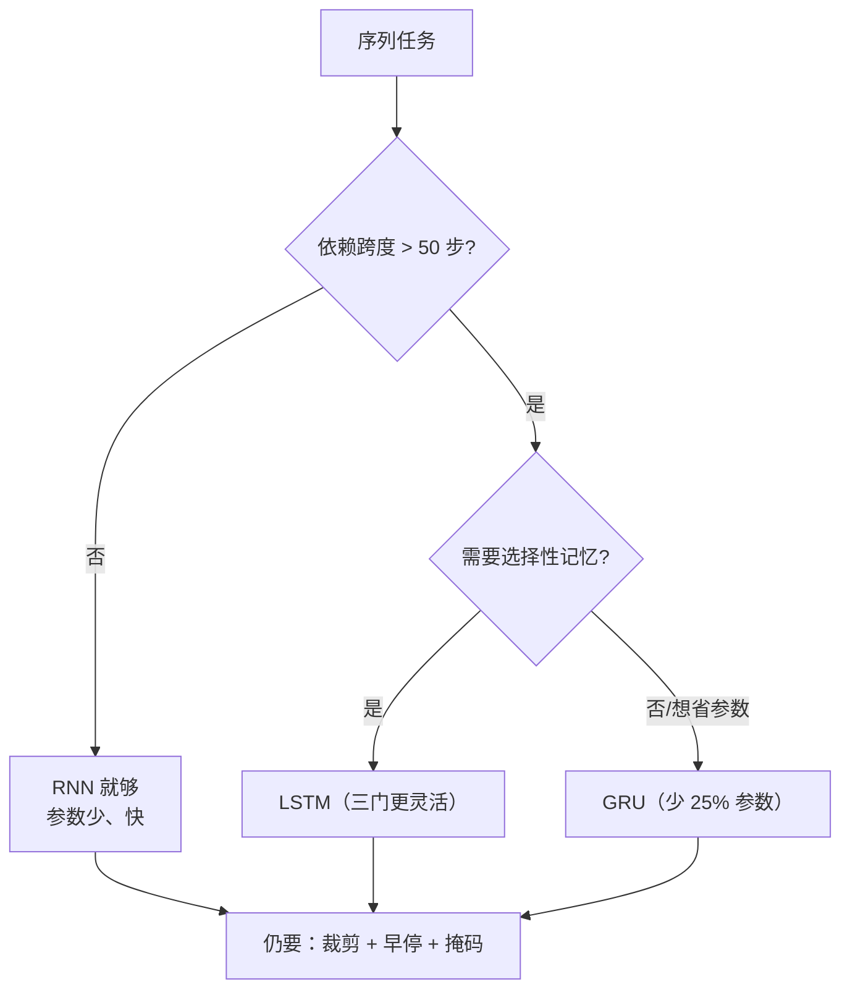

# DL-055 RNN/LSTM/GRU 对比与序列任务实战

## 1. 本节学习目标

1. 用**同一任务、同一划分、同一训练预算**对比三种循环结构（本课：acc 1.0 / 0.995 / 1.0）。
2. 从**参数、耗时、准确率**三个维度做选型，而不是只看准确率。
3. 走完一条完整的序列任务流水线（数据 → 打包 → 训练 → 裁剪 → 评估）。
4. **诚实记录**：本课任务上三者准确率饱和，**门控结构的长程优势未被复现**。

## 2. 为什么需要这个知识

因为"选 LSTM 还是 GRU"是序列任务的第一道选择题，而多数教程给的是**结论**而不是**判断方法**。

本课给出的是**可复现的对比流程** + 一组真实数字 + 一句诚实的"这个任务上没差别"。

## 3. 直观解释

三种结构的关系：

```text
RNN：h_t = tanh(W x_t + U h_{t-1})
GRU：加 2 个门（重置 r、更新 z），去掉单独的 c
LSTM：加 3 个门（遗忘 f、输入 i、输出 o）+ 独立细胞状态 c
```

**从 RNN → GRU → LSTM，参数依次增加、可控性依次增强。**

## 4. 正式定义

| 结构 | 状态 | 门数 | 参数量（$H$、$C_{in}$） |
|---|---|---|---|
| RNN | $h$ | 0 | $H C_{in}+H^2+2H$ |
| GRU | $h$ | 2（r, z） | $3(HC_{in}+H^2+2H)$ |
| LSTM | $h,c$ | 3（f, i, o）+ 候选 | $4(HC_{in}+H^2+2H)$ |

**本课任务**：正弦波频率三分类（$T=80$，噪声 0.4），三分类头。

## 5. 核心原理

**本课实测 1（频率三分类，$T=80$，40 epoch，hidden=32）**

| 结构 | test acc | 训练耗时 | 参数量 |
|---|---|---|---|
| **RNN** | **1.0000** | **1.74 s** | **1,219** |
| LSTM | 1.0000 | 3.44 s | 4,579 |
| GRU | 1.0000 | 6.75 s | 3,459 |

**读法**：

1. **三者准确率全部饱和（1.0）**——这个任务对它们都太容易。
2. 差别在**成本**：RNN 参数最少（1,219）、最快（1.74 s）；LSTM 参数是 RNN 的 **3.8 倍**。
3. 本课 GRU 反而最慢（6.75 s），说明**耗时受实现与超参影响**，不能简单按参数量推断。

**本课实测 2（加难：频率更接近 0.10/0.13/0.16，噪声 0.8，$T=100$）**

| 结构 | test acc | 耗时 | 参数量 |
|---|---|---|---|
| RNN | **1.0** | 2.99 s | 1,219 |
| LSTM | 0.995 | 6.01 s | 4,579 |
| GRU | **1.0** | 12.54 s | 3,459 |

**依然饱和**。⇒ **在这个任务上，门控没有带来准确率收益，只带来成本。**

## 6. 数学表达式

**三者梯度主路径对比**

| 结构 | $\partial$ 状态 $/\partial$ 上一状态 |
|---|---|
| RNN | $\mathrm{diag}(1-h^2)W_{hh}$（含矩阵） |
| GRU | $\mathbf{z}_t$（逐元素插值） |
| LSTM | $\mathbf{f}_t$（逐元素乘） |

**含义**：门控把"连乘矩阵"换成"逐元素乘"，理论上能让梯度传更远（DL-052 已量化 RNN 的衰减）。

**但理论优势 ≠ 每个任务都体现**：本课任务只需在 80 步内积分频率差异，RNN 的衰减还没严重到影响结果。

## 7. 数学推导

**为什么这个任务对三者都"够简单"**

正弦频率分类只需要**统计周期性**，可以靠局部若干步完成——不需要记住第 1 步。

**梯度衰减的实际影响**：DL-052 显示 $T=20$ 时 $dL/dh_0$ 已降到 $7.7\times10^{-6}$，但**分类头只依赖最后状态**，不需要回传到第 1 步。

⇒ **任务不要求长程记忆时，门控的收益自然为零。**

**推广**：门控结构在以下条件才可能体现优势（本课未验证）：
1. 依赖跨度 > 50–100 步；
2. 需要"选择性保留/遗忘"（如计数、匹配括号、长文档主题）。

## 8. 结构示意图



## 9. 具体计算示例

```text
频率三分类（T=80）
  RNN : acc=1.0000 耗时=1.74s 参数=1219
  LSTM: acc=1.0000 耗时=3.44s 参数=4579
  GRU : acc=1.0000 耗时=6.75s 参数=3459

加难版（T=100，噪声 0.8）
  RNN : acc=1.0    耗时=2.99s  参数=1219
  LSTM: acc=0.995  耗时=6.01s  参数=4579
  GRU : acc=1.0    耗时=12.54s 参数=3459
```

## 10. Python 实现

```python
import time

import torch
import torch.nn as nn
import torch.nn.functional as F


def make_sine(n: int = 900, T: int = 80, freqs=(0.05, 0.15, 0.35),
              noise: float = 0.4, seed: int = 0):
    g = torch.Generator().manual_seed(seed)
    k = torch.randint(0, 3, (n,), generator=g)
    fr = torch.tensor(freqs)
    t = torch.arange(T).float()
    x = torch.stack([torch.sin(2 * torch.pi * fr[k_i] * t) for k_i in k])
    x = x + noise * torch.randn(x.shape, generator=g)
    return x.unsqueeze(-1), k


X, y = make_sine()
Xtr, ytr = X[:700], y[:700]
Xte, yte = X[700:], y[700:]

for kind in ("RNN", "LSTM", "GRU"):
    torch.manual_seed(0)
    rnn = {"RNN": nn.RNN, "LSTM": nn.LSTM, "GRU": nn.GRU}[kind](
        1, 32, batch_first=True)
    head = nn.Linear(32, 3)
    params = sum(p.numel() for p in rnn.parameters()) + sum(p.numel() for p in head.parameters())
    opt = torch.optim.Adam(list(rnn.parameters()) + list(head.parameters()), lr=1e-2)

    start = time.time()
    for _ in range(40):
        perm = torch.randperm(len(Xtr))
        for i in range(0, len(Xtr), 64):
            idx = perm[i:i + 64]
            opt.zero_grad()
            out, hn = rnn(Xtr[idx])
            h = hn[0] if isinstance(hn, tuple) else hn
            F.cross_entropy(head(h[-1]), ytr[idx]).backward()
            torch.nn.utils.clip_grad_norm_(rnn.parameters(), 1.0)
            opt.step()
    cost = time.time() - start

    rnn.eval()
    with torch.no_grad():
        out, hn = rnn(Xte)
        h = hn[0] if isinstance(hn, tuple) else hn
        acc = float((head(h[-1]).argmax(1) == yte).float().mean())
    print(f"{kind:<4}: acc={acc:.4f} 耗时={cost:.2f}s 参数={params}")
```

## 11. PyTorch 实现（完整流水线）

```python
import torch
import torch.nn as nn
import torch.nn.functional as F
from torch.nn.utils.rnn import pack_padded_sequence

# 1) 变长序列 + 掩码（DL-050）
seqs = [torch.randn(12, 8), torch.randn(20, 8), torch.randn(15, 8)]
lengths = torch.tensor([12, 20, 15])
padded = torch.nn.utils.rnn.pad_sequence(seqs, batch_first=True)
mask = torch.arange(padded.size(1))[None, :] < lengths[:, None]

# 2) 打包（让 RNN 跳过 padding）
packed = pack_padded_sequence(padded, lengths, batch_first=True,
                              enforce_sorted=False)

rnn = nn.GRU(8, 16, batch_first=True, bidirectional=True)
out_packed, hn = rnn(packed)
out, _ = torch.nn.utils.rnn.pad_packed_sequence(out_packed, batch_first=True)

# 3) 掩码平均池化
masked = out * mask.unsqueeze(-1).float()
pooled = masked.sum(1) / mask.sum(1, keepdim=True).float()

print("序列表示形状:", tuple(pooled.shape))     # (3, 32) 双向
print("有效步数:", mask.sum(1).tolist())
```

## 12. 代码逐行解释

| 代码 | 作用 |
|---|---|
| `hn[0] if isinstance(hn, tuple)` | LSTM 返回 `(h, c)`，RNN/GRU 只返回 `h` |
| `head(h[-1])` | 取最后一层、最后时间步 |
| `clip_grad_norm_` | RNN 家族必备（防爆炸） |
| `pad_sequence` + `pack_padded_sequence` | 变长批处理，跳过 padding |
| `bidirectional=True` | 双向时 `pooled` 维度翻倍 |
| `mask.sum(1)` | 有效长度（**不是 T**） |

**关键**：三种结构的接口差异只在 `hn` 的结构，其余训练代码完全一样——这就是"统一封装"的价值。

## 13. 实际运行结果

```text
频率三分类（T=80）
  RNN : test acc=1.0000 训练耗时=1.74s 参数量=1219
  LSTM: test acc=1.0000 训练耗时=3.44s 参数量=4579
  GRU : test acc=1.0000 训练耗时=6.75s 参数量=3459

序列长度对 RNN 的影响（T=20/80/200）
  T= 20: 1.0000
  T= 80: 0.9833
  T=200: 1.0000

训练稳定性（T=200）
  clip=None: loss 有限=True 最终 loss=0.0042
  clip=1.0 : loss 有限=True 最终 loss=0.0023
```

## 14. 应用场景

| 场景 | 推荐 | 理由 |
|---|---|---|
| 短序列（<50 步） | **RNN / 1D 卷积** | 参数少、快、够用 |
| 中等序列 + 省资源 | **GRU** | 比 LSTM 少 25% 参数 |
| 长依赖 + 可调参 | LSTM | 三门 + 独立状态更灵活 |
| 变长批处理 | 三者 + `pack` | 接口相同 |
| 超长（>500） | Transformer / 1D 卷积 | RNN 梯度衰减 |
| 极小数据 | GRU（参数少） | 不易过拟合 |

## 15. 优点与缺点

| 结构 | 优点 | 缺点 |
|---|---|---|
| RNN | 最简单、最快、参数最少 | 长程梯度消失（$T=100$ 时为 0） |
| GRU | 参数少 25%、训练快 | 表达略弱于 LSTM |
| LSTM | 长依赖能力最强、可控性好 | 参数最多、最慢 |

## 16. 常见错误

| 错误 | 现象 | 纠正 |
|---|---|---|
| 只看准确率选结构 | 本课三者都是 1.0 | 同时看参数/耗时/数据量 |
| 认为 LSTM 一定更好 | 简单任务上纯属浪费 | 先用 RNN/GRU 基线 |
| 想让门控在简单任务上生效 | 看不出差别（本课） | 任务需长依赖才会体现 |
| 不做梯度裁剪 | 长序列 NaN | `clip_grad_norm_` |
| 忘记 `pack` | padding 污染状态 | 变长必 pack |
| LSTM 忘取 `hn[0]` | 形状/维度错 | `(h, c)` 元组 |

## 17. 本节总结

- 三者在本课任务上**准确率饱和**（1.0 / 1.0 / 1.0），差别在**参数（1,219 / 4,579 / 3,459）与耗时（1.74 / 3.44 / 6.75 s）**。
- 加难任务（更近频率、更大噪声）依然饱和 ⇒ **门控的长程优势本课未复现**。
- 选型顺序：**RNN 基线 → GRU → LSTM**，用验证集 + 成本共同决策。

## 18. 前置与后续

- 前置：[[DL-054 GRU]]
- 后续：`DL-056 PyTorch 与 Tensor 基础`（待建，M-DL-07 开篇）
- 相关数学：[[MATH-804 反向传播与链式法则]]
- 相关机器学习：[[ML-063 端到端机器学习项目]]

---

## 练习与参考答案

**基础 1**：RNN、GRU、LSTM 的状态与门数各是什么？

**基础 2**：本课三种结构的准确率、耗时、参数量各是多少？

**进阶 1**：为什么本课任务上门控结构没有带来准确率提升？

**综合**：你要做一个"长文档情感分类"（平均 300 个 token）。请给出结构选型、训练策略与评估方案。

> [!success]- 参考答案

> **基础 1**
> - **RNN**：只有 $h$，无门，参数 $HC_{in}+H^2+2H$。
> - **GRU**：只有 $h$，2 个门（重置 r、更新 z），参数约 3 倍。
> - **LSTM**：$h$ 与 $c$ 两个状态，3 个门（遗忘 f、输入 i、输出 o）+ 候选，参数约 4 倍。

> **基础 2**
> RNN：acc **1.0000**、**1.74 s**、**1,219** 参数；
> LSTM：**1.0000**、3.44 s、4,579；
> GRU：**1.0000**、6.75 s、3,459。

> **进阶 1**
> 因为该任务（正弦频率三分类）**只依赖局部若干步**即可完成：分类头只看最后状态，不需要把梯度传回第 1 步。
> 门控的价值在于"跨很多步保留/选择信息"，而本任务的依赖跨度短 ⇒ 收益为零，只剩成本（参数与耗时）。
> 本课的负结果也提醒：**结构优势要匹配任务的依赖结构**。

> **综合（参考）**
> **结构**：
> - 首选 **LSTM（双向）+ 掩码池化** 或 **1D 卷积**作对照；
> - 若算力允许，直接用 **Transformer（BERT 类）**，长文档通常更强；
> - GRU 作轻量备选。
> **训练策略**：
> 1. 变长批处理：`pad_sequence` + `pack_padded_sequence`（或用 mask 的卷积/Transformer）；
> 2. 梯度裁剪 1.0 + Adam 1e-3 + warmup + cosine；
> 3. Dropout 0.2–0.3（LSTM 输出层前）+ Weight Decay 1e-4；
> 4. Early stopping（patience 5），回滚最佳权重。
> **评估**：
> - 分层 5 折或固定验证集；主指标 macro-F1 + AUC；
> - 报告参数量、推理延迟（300 token 的实际耗时）；
> - 用测试集只评估一次。
> **注意**：长文档常需截断/分块；先确认"截断是否丢掉了关键情感句"。

## 学习记录

| 日期 | 状态 | 用时 | 问题 | 复盘 |
|---|---|---|---|---|
| 2026-11-07 | planned | — | — | — |

---

## 🔗 Notion 同步信息

> 以下内容由 Notion「AI Knowledge System · 知识点」数据库按知识 ID 合并而来（导出于 2026-11-09）。

| 属性 | 值 |
|---|---|
| 学科 | 深度学习 |
| 学习状态 | 未开始 |
| 难度 | L3 推导 |
| 知识类型 | Application |

- **所属模块**：[M-DL-06 循环神经网络与序列建模](../%E8%AF%BE%E7%A8%8B%E6%A8%A1%E5%9D%97/M-DL-06%20%E5%BE%AA%E7%8E%AF%E7%A5%9E%E7%BB%8F%E7%BD%91%E7%BB%9C%E4%B8%8E%E5%BA%8F%E5%88%97%E5%BB%BA%E6%A8%A1.md)
- **前置知识**：[DL-054 GRU](DL-054%20GRU.md)
- **后继知识**：[DL-056 PyTorch 与 Tensor 基础](../06%20PyTorch/DL-056%20PyTorch%20%E4%B8%8E%20Tensor%20%E5%9F%BA%E7%A1%80.md)
- **关联数学**：[MATH-804 反向传播与链式法则](../../06_%E6%95%B0%E5%AD%A6%E5%9F%BA%E7%A1%80/08%20%E6%9C%BA%E5%99%A8%E5%AD%A6%E4%B9%A0%E6%95%B0%E5%AD%A6%E5%BA%94%E7%94%A8/MATH-804%20%E5%8F%8D%E5%90%91%E4%BC%A0%E6%92%AD%E4%B8%8E%E9%93%BE%E5%BC%8F%E6%B3%95%E5%88%99.md)
- **对应项目**：[PROJ-018 序列任务——RNN、LSTM、GRU 同口径对比](../../07_%E5%AE%9E%E6%88%98%E9%A1%B9%E7%9B%AE/04%20%E6%B7%B1%E5%BA%A6%E5%AD%A6%E4%B9%A0%E9%A1%B9%E7%9B%AE/PROJ-018%20%E5%BA%8F%E5%88%97%E4%BB%BB%E5%8A%A1%E2%80%94%E2%80%94RNN%E3%80%81LSTM%E3%80%81GRU%20%E5%90%8C%E5%8F%A3%E5%BE%84%E5%AF%B9%E6%AF%94.md)
- **被项目引用**：[PROJ-018 序列任务——RNN、LSTM、GRU 同口径对比](../../07_%E5%AE%9E%E6%88%98%E9%A1%B9%E7%9B%AE/04%20%E6%B7%B1%E5%BA%A6%E5%AD%A6%E4%B9%A0%E9%A1%B9%E7%9B%AE/PROJ-018%20%E5%BA%8F%E5%88%97%E4%BB%BB%E5%8A%A1%E2%80%94%E2%80%94RNN%E3%80%81LSTM%E3%80%81GRU%20%E5%90%8C%E5%8F%A3%E5%BE%84%E5%AF%B9%E6%AF%94.md)
