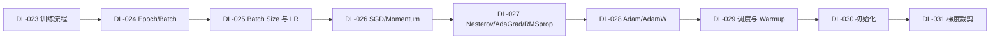

# ⚙️ 训练技巧 · 分支索引

> 段位：`DL-023` ~ `DL-039`（M-DL-03 + M-DL-04）
> 上位：[[04_深度学习/00 模块索引\|深度学习模块索引]]
> 定位：**让网络"训得动、训得稳、训得好"**。结构与数学已定，差别全在这一段。

---

## 一、这一段装什么

| 模块 | 号段 | 核心问题 |
|---|---|---|
| M-DL-03 训练与优化 | DL-023 ~ DL-031 | 怎么走？走多快？走多稳？ |
| M-DL-04 泛化与正则 | DL-032 ~ DL-039 | 怎么不过拟合？怎么可复现？ |

## 二、学习顺序

## 三、必须亲手做过的三件事

1. 同一模型跑 3 个 lr，画出 loss 曲线并解释差异（DL-025）。
2. 用病态二次函数对比 SGD / Momentum / Adam（DL-026~028）。
3. 故意过拟合（小数据 + 大模型），再用 Dropout/Weight Decay 压下去（DL-035/034）。

## 四、知识点登记（17 条）

| 知识 ID | 名称 | 模块 | 难度 | 状态 | 笔记 |
|---|---|---|---|---|---|
| `DL-023` | 神经网络训练的完整流程 | M-DL-03 | L2 | planned | [[DL-023 神经网络训练的完整流程]] |
| `DL-024` | Epoch、Batch 与 Mini-batch | M-DL-03 | L2 | planned | [[DL-024 Epoch、Batch 与 Mini-batch]] |
| `DL-025` | Batch Size 与 Learning Rate | M-DL-03 | L3 | planned | [[DL-025 Batch Size 与 Learning Rate]] |
| `DL-026` | SGD 与 Momentum | M-DL-03 | L3 | planned | [[DL-026 SGD 与 Momentum]] |
| `DL-027` | Nesterov、AdaGrad 与 RMSprop | M-DL-03 | L3 | planned | [[DL-027 Nesterov、AdaGrad 与 RMSprop]] |
| `DL-028` | Adam 与 AdamW | M-DL-03 | L3 | planned | [[DL-028 Adam 与 AdamW]] |
| `DL-029` | 学习率调度与 Warmup | M-DL-03 | L2 | planned | [[DL-029 学习率调度与 Warmup]] |
| `DL-030` | 权重初始化：Xavier 与 He | M-DL-03 | L3 | planned | [[DL-030 权重初始化——Xavier 与 He]] |
| `DL-031` | 梯度裁剪与训练稳定性 | M-DL-03 | L2 | planned | [[DL-031 梯度裁剪与训练稳定性]] |
| `DL-032` | 过拟合与欠拟合（深度学习视角） | M-DL-04 | L2 | planned | [[DL-032 过拟合与欠拟合——深度学习视角]] |
| `DL-033` | 偏差-方差与泛化能力 | M-DL-04 | L3 | planned | [[DL-033 偏差-方差与泛化能力]] |
| `DL-034` | L1/L2 正则化与 Weight Decay | M-DL-04 | L3 | planned | [[DL-034 L1、L2 正则化与 Weight Decay]] |
| `DL-035` | Dropout | M-DL-04 | L2 | planned | [[DL-035 Dropout]] |
| `DL-036` | Batch Normalization | M-DL-04 | L3 | planned | [[DL-036 Batch Normalization]] |
| `DL-037` | Layer Normalization 与 BN 的区别 | M-DL-04 | L3 | planned | [[DL-037 Layer Normalization 与 BN 的区别]] |
| `DL-038` | Early Stopping 与模型检查点 | M-DL-04 | L2 | planned | [[DL-038 Early Stopping 与模型检查点]] |
| `DL-039` | 数据增强、训练日志与可复现性 | M-DL-04 | L2 | planned | [[DL-039 数据增强、训练日志与可复现性]] |

> 本目录计划 17 篇，**已全部完成**（DL-023 ~ DL-039，M-DL-03 + M-DL-04 收官）。

## 五、导航

- 上一级：[[04_深度学习/00 模块索引\|深度学习模块索引]]
- 知识索引：[[08_知识索引/04 深度学习知识索引\|深度学习知识索引]]
- 规则：[[08_知识索引/06 知识关联索引\|知识关联索引]]
