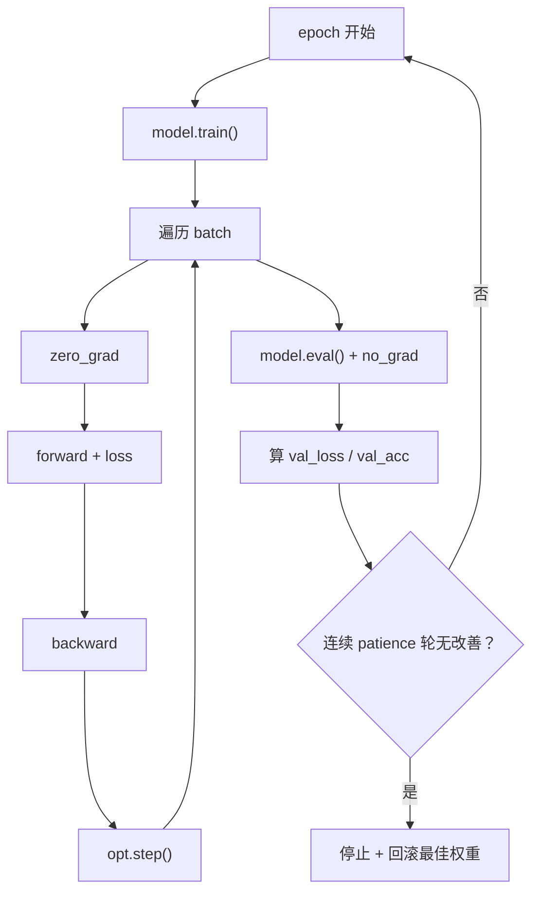

# DL-023 神经网络训练的完整流程

## 1. 本节学习目标

1. 写出训练循环的**七步骨架**（取数 → 前向 → 算损 → 清零 → 反传 → 更新 → 评估）。
2. 会区分 `train()` 与 `eval()` 的差别，知道为什么不能漏。
3. 用验证集做 **early stopping**（本课在第 40 轮停止、测试 **0.96**）。
4. 能画出 train/val 双曲线并判断"该继续还是该停"。

## 2. 为什么需要这个知识

因为**训练循环是所有深度学习项目的骨架**，90% 的 bug 都出在这七步的顺序或开关上：

- 忘了 `zero_grad()` ⇒ 梯度累加；
- 忘了 `train()/eval()` ⇒ Dropout/BN 行为错；
- 用训练集选模型 ⇒ 过拟合无法发现。

把骨架写对，剩下的只是换数据和模型。

## 3. 直观解释

```text
for epoch in range(E):
    model.train()
    for batch in train_loader:
        opt.zero_grad()          # ① 清空旧梯度
        out = model(x)           # ② 前向
        loss = crit(out, y)      # ③ 算损失
        loss.backward()          # ④ 反向
        opt.step()               # ⑤ 更新
    model.eval()
    with torch.no_grad():
        val_loss, val_acc = evaluate()   # ⑥ 验证
    if 早停条件: break                    # ⑦ 决策
```

**顺序不能乱**：清零必须在反传**之前**；更新必须在反传**之后**。

## 4. 正式定义

**一次参数更新**

$$
\theta\leftarrow\theta-\eta\cdot\frac1{|B|}\sum_{i\in B}\nabla_\theta \ell\big(f_\theta(\mathbf{x}_i),y_i\big)
$$

**一个 epoch**：遍历完整训练集一次。

**early stopping**：监控验证损失，连续 `patience` 轮无改善即停，并回滚到最佳轮次。

## 5. 核心原理

**本课第一组实测（lr=0.1，5 epoch，全批量）**

| epoch | train_loss | train_acc | val_acc |
|---|---|---|---|
| 1 | 0.7088 | 0.4560 | 0.4800 |
| 2 | 0.6930 | 0.5227 | 0.5520 |
| 3 | 0.6781 | 0.5893 | 0.6280 |
| 4 | 0.6640 | 0.6680 | 0.6760 |
| 5 | 0.6507 | 0.7240 | 0.7320 |

**读法**：5 轮后 val_acc 只有 0.732——**不是模型不行，是步数太少**（全批量 5 轮 = 5 次更新）。

**本课第二组（lr=0.5，mini-batch 64，30 epoch）**

| epoch | train_acc | val_acc |
|---|---|---|
| 1 | 0.8450 | 0.7933 |
| 10 | 0.8717 | 0.8333 |
| 20 | 0.9050 | 0.8467 |
| 30 | 0.9233 | **0.9067** |

**测试集 0.952**。

**early stopping 实测（patience=3）**：

```text
在第 40 轮停止（最佳 37 轮，val_loss=0.2156，耐心耗尽）
停止时 test_acc: 0.96
```

## 6. 数学表达式

**验证损失**

$$
L_{val}=\frac1{|D_{val}|}\sum_{i\in D_{val}}\ell\big(f_\theta(\mathbf{x}_i),y_i\big)
$$

**early stopping 判据**

$$
\text{stop if}\quad L_{val}^{(t)}>\min_{s<t}L_{val}^{(s)}+\epsilon\ \ \text{连续}\ \text{patience}\ \text{次}
$$

本课 $\epsilon=10^{-4}$、`patience=3`。

## 7. 数学推导

**为什么 `zero_grad` 必须在反传前**

PyTorch 的 `.grad` 是**累加**的（DL-018 已证：$3s+5s$ 的梯度是 8）。

若不清零，第 $t$ 步的梯度 = $g_t+g_{t-1}+\cdots$，等价于**梯度越走越大**，学习率被隐性放大。

**为什么 `train()` 与 `eval()` 不能省**

| 模式 | Dropout | BatchNorm |
|---|---|---|
| `train()` | 随机丢弃 | 用 batch 统计量，并更新 running stats |
| `eval()` | 关闭 | 用 running stats |

**后果**：用 `train()` 模式做评估，Dropout 会把输出随机置零 ⇒ 验证指标偏低且不稳定。

## 8. 结构示意图



## 9. 具体计算示例

**5 轮全批量（lr=0.1）**：val_acc 0.48 → 0.732。

**30 轮 mini-batch（lr=0.5，batch=64）**：
- 训练集 750 条 ⇒ 每 epoch 12 步；
- 30 epoch = 360 步；
- val_acc 0.7933 → 0.9067。

**对比**：5 步 vs 360 步——**"epoch 数"不能跨 batch size 比较**（DL-024 详述）。

## 10. Python 实现

```python
import torch
import torch.nn as nn
import torch.nn.functional as F
from sklearn.datasets import make_moons
from sklearn.model_selection import train_test_split

X, y = make_moons(n_samples=1000, noise=0.25, random_state=42)
Xtr, Xte, ytr, yte = train_test_split(X, y, test_size=0.25,
                                      random_state=42, stratify=y)
Xtr = torch.tensor(Xtr, dtype=torch.float32)
ytr = torch.tensor(ytr, dtype=torch.float32).view(-1, 1)
Xte = torch.tensor(Xte, dtype=torch.float32)
yte = torch.tensor(yte, dtype=torch.float32).view(-1, 1)

torch.manual_seed(0)
model = nn.Sequential(nn.Linear(2, 32), nn.ReLU(), nn.Linear(32, 1))
opt = torch.optim.SGD(model.parameters(), lr=0.1)


def accuracy(m, X_, y_):
    with torch.no_grad():
        return float((torch.sigmoid(m(X_)) >= 0.5).float().eq(y_).float().mean())


for epoch in range(1, 6):
    model.train()
    opt.zero_grad()
    loss = F.binary_cross_entropy_with_logits(model(Xtr), ytr)
    loss.backward()
    opt.step()
    model.eval()
    print(f"epoch {epoch}: loss={float(loss):.4f} "
          f"train_acc={accuracy(model, Xtr, ytr):.4f} "
          f"val_acc={accuracy(model, Xte, yte):.4f}")
```

## 11. PyTorch 实现（early stopping）

```python
import torch
import torch.nn as nn
import torch.nn.functional as F
from sklearn.datasets import make_moons
from sklearn.model_selection import train_test_split

X, y = make_moons(n_samples=1000, noise=0.25, random_state=42)
Xtr_all, Xte, ytr_all, yte = train_test_split(X, y, test_size=0.25,
                                              random_state=42, stratify=y)
Xtr_all = torch.tensor(Xtr_all, dtype=torch.float32)
ytr_all = torch.tensor(ytr_all, dtype=torch.float32).view(-1, 1)
Xte = torch.tensor(Xte, dtype=torch.float32)
yte = torch.tensor(yte, dtype=torch.float32).view(-1, 1)

Xval, yval = Xtr_all[:150], ytr_all[:150]
Xtr, ytr = Xtr_all[150:], ytr_all[150:]

torch.manual_seed(0)
model = nn.Sequential(nn.Linear(2, 32), nn.ReLU(), nn.Linear(32, 1))
opt = torch.optim.SGD(model.parameters(), lr=0.5)

best_loss, best_epoch, wait = float("inf"), 0, 0
for epoch in range(1, 61):
    model.train()
    perm = torch.randperm(len(Xtr))
    for i in range(0, len(Xtr), 64):
        idx = perm[i:i + 64]
        opt.zero_grad()
        F.binary_cross_entropy_with_logits(model(Xtr[idx]), ytr[idx]).backward()
        opt.step()
    model.eval()
    with torch.no_grad():
        val_loss = float(F.binary_cross_entropy_with_logits(model(Xval), yval))
    if val_loss < best_loss - 1e-4:
        best_loss, best_epoch, wait = val_loss, epoch, 0
    else:
        wait += 1
        if wait >= 3:
            print(f"第 {epoch} 轮停止（最佳 {best_epoch} 轮，val_loss={best_loss:.4f}）")
            break
```

## 12. 代码逐行解释

| 代码 | 作用 |
|---|---|
| `model.train()` | 开 Dropout/BN 训练行为 |
| `opt.zero_grad()` | 清空上一步梯度（**反传前**） |
| `loss.backward()` | 反向建梯度 |
| `opt.step()` | 按梯度更新参数 |
| `model.eval()` + `no_grad()` | 评估模式，不建图 |
| `torch.randperm` | 每个 epoch 打乱样本顺序 |
| `best_loss/best_epoch/wait` | early stopping 三件套 |

**三个易错点**：清零顺序、模式切换、`no_grad` 包裹。

## 13. 实际运行结果

```text
epoch 1: train_loss=0.7088 train_acc=0.4560 val_acc=0.4800
epoch 2: train_loss=0.6930 train_acc=0.5227 val_acc=0.5520
epoch 3: train_loss=0.6781 train_acc=0.5893 val_acc=0.6280
epoch 4: train_loss=0.6640 train_acc=0.6680 val_acc=0.6760
epoch 5: train_loss=0.6507 train_acc=0.7240 val_acc=0.7320
参数量: 129
```

**30 轮版本**：val_acc 0.9067，test_acc **0.952**。
**early stopping**：第 40 轮停止，test_acc **0.96**。

## 14. 应用场景

| 场景 | 关键调整 |
|---|---|
| 小数据 | 全批量 + 多 epoch + 强正则 |
| 大数据 | mini-batch + 学习率调度 |
| 训练不稳 | 加 warmup、梯度裁剪 |
| 时间有限 | early stopping + 减少 epoch |
| 需要复现 | 固定种子 + 记录每轮指标 |

## 15. 优点与缺点

| 优点 | 缺点 |
|---|---|
| 结构固定、易复用 | 超参多（lr/bs/epochs/patience） |
| 可加早停省时省算力 | 早停依赖验证集质量 |
| 每轮可监控 | 长训练难复现（需固定种子） |

## 16. 常见错误

| 错误 | 现象 | 纠正 |
|---|---|---|
| 忘 `zero_grad` | loss 爆炸/不收敛 | 反传前清零 |
| 用 `train()` 评估 | 指标抖动偏低 | 切 `eval()` + `no_grad` |
| 早停用训练损失 | 永不触发 | 用**验证损失** |
| 早停不回滚 | 用了更差的权重 | 保存 `best_state` 并恢复 |
| 每轮重排但不固定种子 | 不可复现 | 固定 `torch.manual_seed` |
| 用测试集早停 | 泄漏 | 独立验证集 |

## 17. 本节总结

- 训练循环七步：**取数 → 前向 → 算损 → 清零 → 反传 → 更新 → 评估**。
- 5 步（全批量 5 epoch）只能到 val 0.732；360 步（mini-batch 30 epoch）到 **0.9067**、测试 **0.952**。
- **early stopping 在 40 轮停止，测试 0.96**——比跑满更省且不差。

## 18. 前置与后续

- 前置：[[DL-022 梯度消失与梯度爆炸]]
- 后续：[[DL-024 Epoch、Batch 与 Mini-batch]]、[[DL-025 Batch Size 与 Learning Rate]]
- 相关数学：[[MATH-702 学习率与收敛]]
- 相关机器学习：[[ML-058 Scikit-learn 标准工作流]]

---

## 练习与参考答案

**基础 1**：写出训练循环的七步，并说明哪两步的顺序最容易搞错。

**基础 2**：本课 5 epoch 全批量与 30 epoch mini-batch 的 val_acc 各是多少？

**进阶 1**：为什么 `model.eval()` 不能省？请分别说 Dropout 与 BatchNorm 的差别。

**综合**：训练 loss 持续下降、验证 loss 先降后升。请说明这是什么现象、如何用 early stopping 处理、以及回滚哪一版权重。

> [!success]- 参考答案

> **基础 1**
> ① 取一个 batch；② `model.train()`（模式）→ 前向；③ 算 loss；④ `opt.zero_grad()`；⑤ `loss.backward()`；⑥ `opt.step()`；⑦ 切 `eval()` 评估/早停。
> 最容易错的是 **④ 与 ⑤ 的顺序**：必须在反传前清零，否则梯度累加。

> **基础 2**
> 5 epoch 全批量：val_acc **0.7320**；30 epoch mini-batch（64）：val_acc **0.9067**（test 0.952）。

> **进阶 1**
> - **Dropout**：`train()` 时随机置零一部分神经元做正则；`eval()` 时必须关闭，否则预测随机、指标抖动。
> - **BatchNorm**：`train()` 时用**当前 batch** 的均值/方差并更新全局 running stats；`eval()` 时用 **running stats**（训练累积的），保证推理结果与 batch 无关。
> 不切 `eval()` 的后果：验证指标偏低且不稳定（Dropout），或推理结果依赖 batch 组成（BN）。

> **综合（参考）**
> **现象**：典型**过拟合**——模型开始记训练集细节，泛化变差。
> **处理**：
> 1. 每个 epoch 记录 `val_loss`，保存 `best_state = copy.deepcopy(model.state_dict())`（或只存 `best_loss` 与对应权重）；
> 2. 连续 `patience`（如 3–5）轮 `val_loss` 无改善即停止；
> 3. **回滚到 val_loss 最低那一轮**的权重（不是最后一轮）。
> **配套**：加正则（Dropout/Weight Decay）、数据增强；若 val 与 train 差距大且验证集小，先扩大验证集减少噪声。

## 学习记录

| 日期 | 状态 | 用时 | 问题 | 复盘 |
|---|---|---|---|---|
| 2026-11-07 | planned | — | — | — |

---

## 🔗 Notion 同步信息

> 以下内容由 Notion「AI Knowledge System · 知识点」数据库按知识 ID 合并而来（导出于 2026-11-09）。

| 属性 | 值 |
|---|---|
| 学科 | 深度学习 |
| 学习状态 | 未开始 |
| 难度 | L2 应用 |
| 知识类型 | Algorithm |

- **所属模块**：[M-DL-03 神经网络训练与优化算法](../%E8%AF%BE%E7%A8%8B%E6%A8%A1%E5%9D%97/M-DL-03%20%E7%A5%9E%E7%BB%8F%E7%BD%91%E7%BB%9C%E8%AE%AD%E7%BB%83%E4%B8%8E%E4%BC%98%E5%8C%96%E7%AE%97%E6%B3%95.md)
- **前置知识**：[DL-022 梯度消失与梯度爆炸](../01%20%E7%A5%9E%E7%BB%8F%E7%BD%91%E7%BB%9C%E5%9F%BA%E7%A1%80/DL-022%20%E6%A2%AF%E5%BA%A6%E6%B6%88%E5%A4%B1%E4%B8%8E%E6%A2%AF%E5%BA%A6%E7%88%86%E7%82%B8.md)
- **后继知识**：[DL-024 Epoch、Batch 与 Mini-batch](DL-024%20Epoch%E3%80%81Batch%20%E4%B8%8E%20Mini-batch.md)
- **关联数学**：[MATH-702 学习率与收敛](../../06_%E6%95%B0%E5%AD%A6%E5%9F%BA%E7%A1%80/07%20%E6%9C%80%E4%BC%98%E5%8C%96%E6%96%B9%E6%B3%95/MATH-702%20%E5%AD%A6%E4%B9%A0%E7%8E%87%E4%B8%8E%E6%94%B6%E6%95%9B.md)
