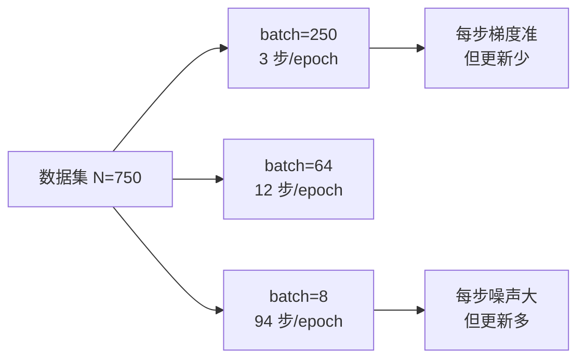

# DL-024 Epoch、Batch 与 Mini-batch

## 1. 本节学习目标

1. 分清 **epoch / batch / step** 三个词，不再混用。
2. 会算"每 epoch 步数 = ⌈N / batch_size⌉"（本课 750 条、batch=64 ⇒ **12 步**）。
3. 用实测理解 **batch 越小、每步噪声越大、但每 epoch 更新次数越多**。
4. 知道三种梯度下降（全批量 / 随机 / mini-batch）的取舍。

## 2. 为什么需要这个知识

因为"我训了 30 个 epoch 为什么还不如别人 5 个 epoch"——**问题往往出在 batch size 不同**。

epoch 只说明"数据过了几遍"，不说明"参数更新了几次"。搞不清这点，调参就会完全失去方向。

## 3. 直观解释

| 词 | 含义 | 类比 |
|---|---|---|
| **batch** | 一次前向+反向用的样本数 | 一次做几道题 |
| **step** | 一次参数更新（= 一个 batch） | 做完一次批改 |
| **epoch** | 数据集完整过一遍 | 把整本题库过一遍 |

**关键换算**：

$$
\text{steps per epoch}=\Big\lceil\frac{N}{\text{batch size}}\Big\rceil
$$

**所以**：batch 越小，step 越多，**同样的 epoch 数下更新次数差几十倍**。

## 4. 正式定义

**三种梯度下降**

| 类型 | batch size | 每步梯度 |
|---|---|---|
| 全批量（BGD） | $N$ | $\nabla$ 用全部数据，精确但慢 |
| 随机（SGD） | 1 | 单样本，噪声最大 |
| **mini-batch** | $B$ | $B$ 个样本平均，**实际默认** |

**mini-batch 更新式**

$$
\theta\leftarrow\theta-\eta\cdot\frac1B\sum_{i\in B}\nabla_\theta\ell_i
$$

## 5. 核心原理

**本课实测（lr=0.1，5 epoch）**

| batch | 每 epoch 步数 | 总步数 | 耗时 | test_acc |
|---|---|---|---|---|
| **1000**（全批量） | **1** | 5 | 0.006 s | **0.7320** |
| 128 | 6 | 30 | 0.009 s | 0.8960 |
| 32 | 24 | 120 | 0.033 s | 0.8960 |
| **8** | **94** | **470** | **0.129 s** | **0.9040** |

**读法**：

1. 全批量 5 个 epoch 只有 **5 次更新** ⇒ 欠拟合（0.732）。
2. batch=8 有 **470 次更新** ⇒ 0.9040。
3. **"epoch 相同"绝不代表"训练量相同"**。

**再看"达到 0.85 需要多少步"（lr=0.5）**

| batch | 达到 0.85 用 epoch | 步数 |
|---|---|---|
| 1000 | 2 | **2** |
| 128 | 1 | 6 |
| 32 | 1 | 24 |
| 8 | 1 | 94 |

**这张表说明另一件事**：全批量**每步质量高**（2 步就到 0.85），但每步要算 750 条 ⇒ **单步成本高**。所以不是"小 batch 一定好"，而是**看你在意墙钟时间还是收敛步数**。

## 6. 数学表达式

**梯度噪声**

$$
\mathrm{Var}\big(\hat g_B\big)=\frac{\sigma^2}{B}
$$

（$\hat g_B$ 是 $B$ 个样本梯度的均值，$\sigma^2$ 是单样本梯度方差。）

⇒ **batch 越大，梯度越准、噪声越小**（但每步越贵）。

**步数与 epoch**

$$
\text{总步数}=\text{epochs}\times\Big\lceil\frac{N}{B}\Big\rceil
$$

本课 $N=750$：$B=64$ ⇒ 12 步/epoch ⇒ 30 epoch = **360 步**。

## 7. 数学推导

**为什么小 batch 能"逃出"坏的局部区域**

小 batch 的梯度含噪，等价于在梯度上加了随机扰动：

$$
\tilde g=\nabla L+\epsilon,\qquad \mathbb{E}[\epsilon]=0
$$

噪声有助于**越过平坦/鞍点区域**（这也是小 batch 常泛化更好的经验解释之一，但**不是定理**）。

**为什么大 batch 需要调学习率**

大 batch 梯度更准但**更新次数少**。常见做法是"线性缩放规则"：$B$ 翻倍 ⇒ lr 也翻倍（近似保持每步移动量）。

本课实测：$B=1000$ 且 lr=0.1 时只 5 步，远不够；**不是 lr 的错，是步数太少**。

## 8. 结构示意图



## 9. 具体计算示例

**步数换算**

```text
N=750, batch=64  → 750/64 = 11.72 → 12 步/epoch
30 epoch → 360 步
```

**实测算例**

```text
batch=1000: 每 epoch 步数=  1 总步数=   5 耗时=0.006s test_acc=0.7320
batch= 128: 每 epoch 步数=  6 总步数=  30 耗时=0.009s test_acc=0.8960
batch=  32: 每 epoch 步数= 24 总步数= 120 耗时=0.033s test_acc=0.8960
batch=   8: 每 epoch 步数= 94 总步数= 470 耗时=0.129s test_acc=0.9040
```

## 10. Python 实现

```python
import torch
import torch.nn as nn
import torch.nn.functional as F
from sklearn.datasets import make_moons
from sklearn.model_selection import train_test_split

X, y = make_moons(n_samples=1000, noise=0.25, random_state=42)
Xtr, Xte, ytr, yte = train_test_split(X, y, test_size=0.25,
                                      random_state=42, stratify=y)
Xtr = torch.tensor(Xtr, dtype=torch.float32)
ytr = torch.tensor(ytr, dtype=torch.float32).view(-1, 1)
Xte = torch.tensor(Xte, dtype=torch.float32)
yte = torch.tensor(yte, dtype=torch.float32).view(-1, 1)

for batch_size in (1000, 128, 32, 8):
    torch.manual_seed(0)
    model = nn.Sequential(nn.Linear(2, 32), nn.ReLU(), nn.Linear(32, 1))
    opt = torch.optim.SGD(model.parameters(), lr=0.1)
    steps = 0
    for _ in range(5):
        perm = torch.randperm(len(Xtr))
        for i in range(0, len(Xtr), batch_size):
            idx = perm[i:i + batch_size]
            opt.zero_grad()
            F.binary_cross_entropy_with_logits(model(Xtr[idx]), ytr[idx]).backward()
            opt.step()
            steps += 1
    with torch.no_grad():
        test_acc = float((torch.sigmoid(model(Xte)) >= 0.5).float().eq(yte).float().mean())
    print(f"batch={batch_size:>4}: 总步数={steps:>4} test_acc={test_acc:.4f}")
```

## 11. PyTorch 实现（DataLoader）

```python
import torch
from torch.utils.data import DataLoader, TensorDataset

X = torch.randn(750, 2)
y = torch.randint(0, 2, (750, 1)).float()
ds = TensorDataset(X, y)

loader = DataLoader(ds, batch_size=64, shuffle=True, drop_last=False)
print("batches per epoch:", len(loader))
for xb, yb in loader:
    print("batch 形状:", tuple(xb.shape), tuple(yb.shape))
    break
```

## 12. 代码逐行解释

| 代码 | 作用 |
|---|---|
| `for i in range(0, len(Xtr), batch_size)` | 手工切 batch |
| `torch.randperm` | 每 epoch 打乱 |
| `steps += 1` | 统计真实更新次数 |
| `DataLoader(..., batch_size=64)` | 官方批处理（自动切分+打乱） |
| `len(loader)` | 每 epoch 的 batch 数（= 步数） |
| `drop_last=False` | 最后不足一个 batch 也保留 |

**为什么手写一遍**：你会清楚"epoch 里到底发生了几次更新"。

## 13. 实际运行结果

```text
batch=1000: 每 epoch 步数=  1 总步数=   5 耗时=0.006s test_acc=0.7320
batch= 128: 每 epoch 步数=  6 总步数=  30 耗时=0.009s test_acc=0.8960
batch=  32: 每 epoch 步数= 24 总步数= 120 耗时=0.033s test_acc=0.8960
batch=   8: 每 epoch 步数= 94 总步数= 470 耗时=0.129s test_acc=0.9040
```

## 14. 应用场景

| 场景 | 推荐 batch |
|---|---|
| GPU 训练（追求吞吐） | 128–1024（受显存限制） |
| 小数据/小模型 | 32–64 |
| 需要更强正则/噪声 | 8–32 + 略降 lr |
| BatchNorm 网络 | ≥32（太小统计不稳） |
| 推理 | 可更大（无梯度） |

## 15. 优点与缺点

| batch | 优点 | 缺点 |
|---|---|---|
| 全批量 | 梯度最准、无噪声 | 单步巨贵、更新少、易卡 |
| 极小（1–8） | 更新多、噪声助逃局部 | 慢、噪声大、BN 不稳 |
| **mini（32–256）** | 兼顾速度与稳定 | 需调 lr 与 batch 的配合 |

## 16. 常见错误

| 错误 | 现象 | 纠正 |
|---|---|---|
| 把 epoch 当训练量 | 大 batch 训不动 | 看**步数** |
| batch 改了不调 lr | 收敛差 | 线性缩放 lr |
| BN 配 batch=4 | 统计不稳 | 增大 batch 或换 LN |
| 最后不满 batch 丢弃 | 少量样本永不参与 | `drop_last=False` |
| 忘记 shuffle | 顺序偏差 | `shuffle=True` |
| 用全批量还设早停 | 早停太频繁 | 按 val 曲线调 patience |

## 17. 本节总结

- **epoch ≠ step**：$\text{步数}=\text{epochs}\times\lceil N/B\rceil$。
- 同样 5 epoch：全批量只 5 步（0.732），batch=8 有 470 步（**0.904**）。
- 全批量**每步更准**（2 步到 0.85），但**单步成本高**；batch size 是"步数 vs 步质量"的权衡。

## 18. 前置与后续

- 前置：[[DL-023 神经网络训练的完整流程]]
- 后续：[[DL-025 Batch Size 与 Learning Rate]]、[[DL-026 SGD 与 Momentum]]
- 相关数学：[[MATH-703 批量梯度下降]]、[[MATH-704 SGD 与小批量梯度下降]]

---

## 练习与参考答案

**基础 1**：epoch、batch、step 三者各是什么？写出步数换算公式。

**基础 2**：本课 batch=1000 与 batch=8 的"5 个 epoch"分别有多少次更新？test_acc 各是多少？

**进阶 1**：为什么 batch 越大，梯度越准，但训练不一定越快收敛？

**综合**：同事说"我把 batch 从 32 调到 256，还保持 lr=0.01、epoch 不变，结果准确率掉了 5 个点"。请解释原因并给出修正方案。

> [!success]- 参考答案

> **基础 1**
> - **batch**：一次前向/反向后向用的样本数。
> - **step**：一次参数更新（一个 batch 一次）。
> - **epoch**：数据集完整过一遍。
> - 换算：$\text{steps per epoch}=\lceil N/B\rceil$，总步数 $=\text{epochs}\times\lceil N/B\rceil$。

> **基础 2**
> batch=1000：每 epoch **1** 步，5 epoch = **5 步**，test_acc **0.7320**；
> batch=8：每 epoch **94** 步，5 epoch = **470 步**，test_acc **0.9040**。

> **进阶 1**
> 因为这是两个不同的量：
> - **梯度准确性**：$\mathrm{Var}(\hat g)=\sigma^2/B$，$B$ 大 ⇒ 噪声小 ⇒ 每步方向更准。
> - **更新次数**：$B$ 大 ⇒ 每 epoch 步数少 ⇒ **同等 epoch 下走的总距离更短**。
> 于是"每步更准，但步数更少"。若目标函数需要很多步才能走到最优点（如条件数差），大 batch 反而收敛慢——本课 5 步 vs 470 步就是极端例子。

> **综合（参考）**
> **原因**：batch 从 32 → 256（8 倍），每 epoch 步数从约 24 → 3（1/8），**更新次数大幅减少**；而 lr 没变 ⇒ 总移动量减少约 8 倍 ⇒ 欠拟合。
> **修正方案（三选一，可叠加）**：
> 1. **按线性缩放调 lr**：$B$ 翻 8 倍 ⇒ lr 也放大到约 0.08（并观察稳定性）；
> 2. **增加 epoch**：保持总步数不变（epoch ×8）；
> 3. **加 warmup**：大 batch 初期不稳，前几个 epoch 线性升温 lr。
> **验证**：对比"总步数"与"每步耗时×步数"的墙钟时间，确认是"训练量不足"而非"模型容量不足"。

## 学习记录

| 日期 | 状态 | 用时 | 问题 | 复盘 |
|---|---|---|---|---|
| 2026-11-07 | planned | — | — | — |

---

## 🔗 Notion 同步信息

> 以下内容由 Notion「AI Knowledge System · 知识点」数据库按知识 ID 合并而来（导出于 2026-11-09）。

| 属性 | 值 |
|---|---|
| 学科 | 深度学习 |
| 学习状态 | 未开始 |
| 难度 | L2 应用 |
| 知识类型 | Concept |

- **所属模块**：[M-DL-03 神经网络训练与优化算法](../%E8%AF%BE%E7%A8%8B%E6%A8%A1%E5%9D%97/M-DL-03%20%E7%A5%9E%E7%BB%8F%E7%BD%91%E7%BB%9C%E8%AE%AD%E7%BB%83%E4%B8%8E%E4%BC%98%E5%8C%96%E7%AE%97%E6%B3%95.md)
- **前置知识**：[DL-023 神经网络训练的完整流程](DL-023%20%E7%A5%9E%E7%BB%8F%E7%BD%91%E7%BB%9C%E8%AE%AD%E7%BB%83%E7%9A%84%E5%AE%8C%E6%95%B4%E6%B5%81%E7%A8%8B.md)
- **后继知识**：[DL-025 Batch Size 与 Learning Rate](DL-025%20Batch%20Size%20%E4%B8%8E%20Learning%20Rate.md)
- **关联数学**：[MATH-703 批量梯度下降](../../06_%E6%95%B0%E5%AD%A6%E5%9F%BA%E7%A1%80/07%20%E6%9C%80%E4%BC%98%E5%8C%96%E6%96%B9%E6%B3%95/MATH-703%20%E6%89%B9%E9%87%8F%E6%A2%AF%E5%BA%A6%E4%B8%8B%E9%99%8D.md) · [MATH-704 SGD 与小批量梯度下降](../../06_%E6%95%B0%E5%AD%A6%E5%9F%BA%E7%A1%80/07%20%E6%9C%80%E4%BC%98%E5%8C%96%E6%96%B9%E6%B3%95/MATH-704%20SGD%20%E4%B8%8E%E5%B0%8F%E6%89%B9%E9%87%8F%E6%A2%AF%E5%BA%A6%E4%B8%8B%E9%99%8D.md)
