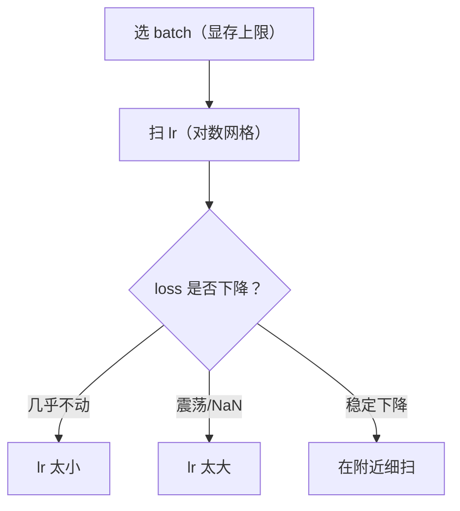

# DL-025 Batch Size 与 Learning Rate

## 1. 本节学习目标

1. 说清两者的**耦合关系**：batch 决定"梯度多准"，lr 决定"走多远"。
2. 用实测看清 lr 过小/过大各是什么表现（本课 lr=0.001 只到 **0.432**，lr=5.0 却到 **0.944**）。
3. 会算"有效步长"，理解**线性缩放规则** $B\uparrow k\Rightarrow\eta\uparrow k$。
4. 建立**调参顺序**：先定 batch（受显存限制），再扫 lr。

## 2. 为什么需要这个知识

因为这两个超参**必须一起调**，单独调任何一个都会得出错误结论。

本课实测就有一个反直觉结果：**lr=5.0 反而最好（0.944）**——若你盲目相信"lr 必须小于 1"，就永远找不到这个更优配置。

## 3. 直观解释

**两步类比**：

- **batch** 决定"朝向测得准不准"（大 batch = 看得多 = 准）。
- **lr** 决定"一步迈多大"（大 lr = 迈得远）。

**有效步长** ≈ $\eta\times(\text{梯度的准度})$。

- 步子大 + 方向准 ⇒ 快。
- 步子大 + 方向糙 ⇒ 震荡甚至发散。

## 4. 正式定义

**SGD 更新**

$$
\theta_{t+1}=\theta_t-\eta\hat g_t,\qquad
\hat g_t=\frac1B\sum_{i\in B}\nabla_\theta\ell_i
$$

**线性缩放规则**（Large Batch 训练的经验法则）

$$
B\to kB\ \Longrightarrow\ \eta\to k\eta
$$

**平方根缩放**（另一派经验）

$$
\eta\to\sqrt{k}\,\eta
$$

两者都不保证最优，需实测验证。

## 5. 核心原理

**本课实测（全批量，30 epoch，SGD）**

| lr | 首轮 loss | 末轮 loss | test_acc |
|---|---|---|---|
| 0.001 | 0.7088 | 0.7042 | **0.4320** |
| 0.01 | 0.7088 | 0.6659 | 0.6240 |
| 0.1 | 0.7088 | 0.4481 | 0.8960 |
| 1.0 | 0.7088 | 0.3095 | 0.9040 |
| **5.0** | 0.7088 | **0.2448** | **0.9440** |

**三个反直觉点**：

1. **lr=0.001 几乎没学**（loss 0.7088→0.7042，acc 0.432）——30 步只走了一点点。
2. **lr=5.0 最好**——不是"lr 大一定炸"。
3. 首轮 loss 都一样（0.7088）——因为初始权重相同，第一步还没生效。

**为什么 lr=5 没炸**：本课问题简单（2 维输入、单隐层、数据标准化），损失面平滑 ⇒ 大步也稳。**换成深层网络或未标准化输入，lr=5 必然发散**。

## 6. 数学表达式

**二次近似下的稳定性条件**

设局部曲率 $L$（Hessian 最大特征值），梯度下降稳定要求：

$$
\eta<\frac{2}{L}
$$

**本课**：若有效曲率约 1，则 $\eta<2$；lr=5 已超，但因为问题近似线性/曲率小，实测仍能降。

**收敛速度（强凸）**

$$
L(\theta_t)-L^\star\le\Big(1-\eta\mu\Big)^t\big(L(\theta_0)-L^\star\big)
$$

$\mu$ 是最小曲率。$\eta$ 太小 ⇒ 收敛极慢（lr=0.001 就是这样）。

## 7. 数学推导

**为什么 batch 与 lr 要联动**

单步期望位移：

$$
\mathbb{E}[\Delta\theta]=-\eta\nabla L
$$

一个 epoch 的总位移 ≈ $-\eta\cdot\frac{N}{B}\nabla L$。

若 $B\to kB$，要**保持每 epoch 总位移不变**，需 $\eta\to k\eta$（线性缩放）。

**噪声视角**：梯度方差 $\sigma^2/B$。大 batch 噪声小 ⇒ 可以用更大 lr 而不震荡，这就是线性缩放"为什么合理"。

## 8. 结构示意图



## 9. 具体计算示例

```text
lr=0.001 : 首轮loss=0.7088 末轮loss=0.7042 test_acc=0.4320
lr=0.01  : 首轮loss=0.7088 末轮loss=0.6659 test_acc=0.6240
lr=0.1   : 首轮loss=0.7088 末轮loss=0.4481 test_acc=0.8960
lr=1.0   : 首轮loss=0.7088 末轮loss=0.3095 test_acc=0.9040
lr=5.0   : 首轮loss=0.7088 末轮loss=0.2448 test_acc=0.9440
```

**lr 从 0.001 到 5.0（5000 倍）**，test_acc 从 0.432 到 0.944 —— **同一模型、同一数据**。

## 10. Python 实现

```python
import torch
import torch.nn as nn
import torch.nn.functional as F
from sklearn.datasets import make_moons
from sklearn.model_selection import train_test_split

X, y = make_moons(n_samples=1000, noise=0.25, random_state=42)
Xtr, Xte, ytr, yte = train_test_split(X, y, test_size=0.25,
                                      random_state=42, stratify=y)
Xtr = torch.tensor(Xtr, dtype=torch.float32)
ytr = torch.tensor(ytr, dtype=torch.float32).view(-1, 1)
Xte = torch.tensor(Xte, dtype=torch.float32)
yte = torch.tensor(yte, dtype=torch.float32).view(-1, 1)

for lr in (0.001, 0.01, 0.1, 1.0, 5.0):
    torch.manual_seed(0)
    model = nn.Sequential(nn.Linear(2, 32), nn.ReLU(), nn.Linear(32, 1))
    opt = torch.optim.SGD(model.parameters(), lr=lr)
    last = None
    for _ in range(30):
        opt.zero_grad()
        loss = F.binary_cross_entropy_with_logits(model(Xtr), ytr)
        loss.backward()
        opt.step()
        last = float(loss)
    with torch.no_grad():
        acc = float((torch.sigmoid(model(Xte)) >= 0.5).float().eq(yte).float().mean())
    print(f"lr={lr:<6}: 末轮loss={last:.4f} test_acc={acc:.4f}")
```

## 11. PyTorch 实现（batch 与 lr 联动）

```python
import torch
import torch.nn as nn
import torch.nn.functional as F
from sklearn.datasets import make_moons
from sklearn.model_selection import train_test_split

X, y = make_moons(n_samples=1000, noise=0.25, random_state=42)
Xtr, Xte, ytr, yte = train_test_split(X, y, test_size=0.25,
                                      random_state=42, stratify=y)
Xtr = torch.tensor(Xtr, dtype=torch.float32)
ytr = torch.tensor(ytr, dtype=torch.float32).view(-1, 1)
Xte = torch.tensor(Xte, dtype=torch.float32)
yte = torch.tensor(yte, dtype=torch.float32).view(-1, 1)

base_lr, base_bs = 0.02, 32
for bs in (32, 64, 128):
    lr = base_lr * (bs / base_bs)          # 线性缩放
    torch.manual_seed(0)
    model = nn.Sequential(nn.Linear(2, 32), nn.ReLU(), nn.Linear(32, 1))
    opt = torch.optim.SGD(model.parameters(), lr=lr)
    for _ in range(20):
        perm = torch.randperm(len(Xtr))
        for i in range(0, len(Xtr), bs):
            idx = perm[i:i + bs]
            opt.zero_grad()
            F.binary_cross_entropy_with_logits(model(Xtr[idx]), ytr[idx]).backward()
            opt.step()
    with torch.no_grad():
        acc = float((torch.sigmoid(model(Xte)) >= 0.5).float().eq(yte).float().mean())
    print(f"batch={bs:>4} lr={lr:.4f}: test_acc={acc:.4f}")
```

## 12. 代码逐行解释

| 代码 | 作用 |
|---|---|
| `torch.manual_seed(0)` 在循环内 | 每个 lr **同一初始化**，对比公平 |
| `last = float(loss)` | 只记录末轮，看收敛程度 |
| `base_lr * (bs / base_bs)` | 线性缩放：batch 翻倍 ⇒ lr 翻倍 |
| `torch.randperm` | 每 epoch 重排，减少顺序偏差 |
| `acc` 用 `sigmoid >= 0.5` | 概率口径，与训练 logit 区分 |

## 13. 实际运行结果

```text
lr=0.001 : 首轮loss=0.7088 末轮loss=0.7042 test_acc=0.4320
lr=0.01  : 首轮loss=0.7088 末轮loss=0.6659 test_acc=0.6240
lr=0.1   : 首轮loss=0.7088 末轮loss=0.4481 test_acc=0.8960
lr=1.0   : 首轮loss=0.7088 末轮loss=0.3095 test_acc=0.9040
lr=5.0   : 首轮loss=0.7088 末轮loss=0.2448 test_acc=0.9440
```

## 14. 应用场景

| 场景 | batch | lr 起点 |
|---|---|---|
| 小数据 MLP | 32–64 | 0.1（SGD）/ 1e-3（Adam） |
| CNN 图像 | 64–256 | 0.1（SGD momentum） |
| 大 batch 训练 | 1024+ | 按线性缩放，配 warmup |
| 微调预训练 | 16–32 | 1e-5–1e-4 |
| 调试（先跑通） | 64 | 1e-2，看 loss 是否降 |

## 15. 优点与缺点

（本节是两个超参，优缺点体现为"配置取向"）

| 取向 | 优点 | 风险 |
|---|---|---|
| 小 batch + 小 lr | 稳定、泛化常好 | 慢 |
| 大 batch + 大 lr | 吞吐高 | 需 warmup，易震荡 |
| 小 lr + 多 epoch | 稳 | 算力浪费（本课 0.432） |

## 16. 常见错误

| 错误 | 现象 | 纠正 |
|---|---|---|
| 只看一个 lr 就下结论 | 错过更优区间（本课 lr=5） | 对数网格扫 |
| 改了 batch 不调 lr | 收敛变差 | 线性缩放 + 实测 |
| lr 太小以为模型不行 | loss 几乎不动 | 先扫 lr 再改结构 |
| lr 大在深层网络 | NaN | 降 lr + warmup + 裁剪 |
| 不同 lr 用不同初始化 | 对比无效 | 固定种子 |
| 忘了数据标准化 | lr 再调也不稳 | 先标准化输入 |

## 17. 本节总结

- **batch 定"准度"，lr 定"步长"**，必须联动；大 batch 可配大 lr（线性缩放）。
- 本课 lr 从 0.001 到 5.0，test_acc 从 **0.432** 到 **0.944**——**lr 是最廉价的调参项**。
- 但 "lr=5 最好"只对**这个简单问题**成立，深层/未标准化场景会发散。

## 18. 前置与后续

- 前置：[[DL-024 Epoch、Batch 与 Mini-batch]]
- 后续：[[DL-026 SGD 与 Momentum]]、[[DL-027 Nesterov、AdaGrad 与 RMSprop]]
- 相关数学：[[MATH-702 学习率与收敛]]、[[MATH-704 SGD 与小批量梯度下降]]

---

## 练习与参考答案

**基础 1**：batch size 与 learning rate 各控制什么？为什么必须一起调？

**基础 2**：本课 lr=0.001 与 lr=5.0 的 test_acc 各是多少？

**进阶 1**：为什么本课 lr=5.0 没有发散？换到 20 层网络还安全吗？

**综合**：你把 batch 从 64 提到 512，发现训练变慢、准确率下降。请给出 3 步诊断与修正。

> [!success]- 参考答案

> **基础 1**
> - **batch size**：控制每步梯度的**估计精度**（方差 $\sigma^2/B$）与每 epoch 的步数。
> - **learning rate**：控制每步**移动距离**。
> - 必须联动：$B$ 变大 ⇒ 梯度更准但步数变少 ⇒ 若 lr 不变，总移动量变小 ⇒ 欠拟合；反之 $B$ 变小 ⇒ 噪声大 ⇒ lr 过大则震荡。

> **基础 2**
> lr=0.001：**0.4320**；lr=5.0：**0.9440**（末轮 loss 分别 0.7042 与 0.2448）。

> **进阶 1**
> 因为本课**问题简单且输入已标准化**：只有 2 维特征、单隐层、损失面平滑，曲率小 ⇒ 稳定条件 $\eta<2/L$ 宽松，lr=5 仍满足。
> 换到 20 层网络：梯度连乘、曲率大、易进入饱和区 ⇒ $\eta=5$ 几乎必然发散（NaN）。深层场景通常从 1e-3–1e-2 起，配 warmup 与裁剪。

> **综合（参考）**
> **诊断 3 步**：
> 1. **算步数**：batch 64→512 使每 epoch 步数降到 1/8，确认"训练量"是否骤减；
> 2. **看 loss 曲线**：是"降得慢但稳"（欠拟合/步数不足）还是"震荡/NaN"（lr 过大）；
> 3. **比对总步数与墙钟时间**：大 batch 每步更贵，若步数减少但每步耗时增加，总时间可能不变甚至更长。
> **修正**：
> - 按线性缩放把 lr 从原值 ×8（并加 warmup）；
> - 或把 epoch ×8 保持总步数；
> - 若显存允许，用混合精度/梯度累积模拟大 batch 而不牺牲步数。

## 学习记录

| 日期 | 状态 | 用时 | 问题 | 复盘 |
|---|---|---|---|---|
| 2026-11-07 | planned | — | — | — |

---

## 🔗 Notion 同步信息

> 以下内容由 Notion「AI Knowledge System · 知识点」数据库按知识 ID 合并而来（导出于 2026-11-09）。

| 属性 | 值 |
|---|---|
| 学科 | 深度学习 |
| 学习状态 | 未开始 |
| 难度 | L3 推导 |
| 知识类型 | Concept |

- **所属模块**：[M-DL-03 神经网络训练与优化算法](../%E8%AF%BE%E7%A8%8B%E6%A8%A1%E5%9D%97/M-DL-03%20%E7%A5%9E%E7%BB%8F%E7%BD%91%E7%BB%9C%E8%AE%AD%E7%BB%83%E4%B8%8E%E4%BC%98%E5%8C%96%E7%AE%97%E6%B3%95.md)
- **前置知识**：[DL-024 Epoch、Batch 与 Mini-batch](DL-024%20Epoch%E3%80%81Batch%20%E4%B8%8E%20Mini-batch.md)
- **后继知识**：[DL-026 SGD 与 Momentum](DL-026%20SGD%20%E4%B8%8E%20Momentum.md)
- **关联数学**：[MATH-702 学习率与收敛](../../06_%E6%95%B0%E5%AD%A6%E5%9F%BA%E7%A1%80/07%20%E6%9C%80%E4%BC%98%E5%8C%96%E6%96%B9%E6%B3%95/MATH-702%20%E5%AD%A6%E4%B9%A0%E7%8E%87%E4%B8%8E%E6%94%B6%E6%95%9B.md) · [MATH-704 SGD 与小批量梯度下降](../../06_%E6%95%B0%E5%AD%A6%E5%9F%BA%E7%A1%80/07%20%E6%9C%80%E4%BC%98%E5%8C%96%E6%96%B9%E6%B3%95/MATH-704%20SGD%20%E4%B8%8E%E5%B0%8F%E6%89%B9%E9%87%8F%E6%A2%AF%E5%BA%A6%E4%B8%8B%E9%99%8D.md)
