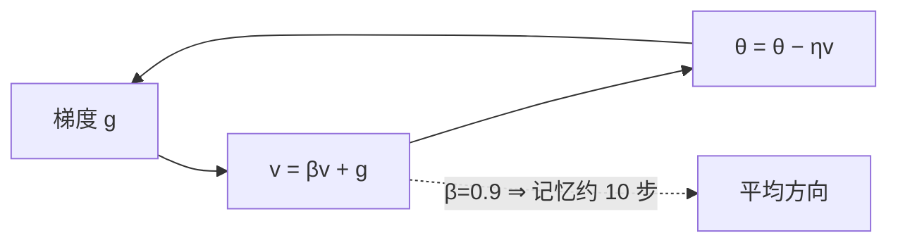

# DL-026 SGD 与 Momentum

## 1. 本节学习目标

1. 写出 SGD 与 Momentum 的更新式，说清"动量"在积累什么。
2. 用**病态二次函数**实测两者差异（SGD 末 loss 0.000775 vs Momentum 0.107442）。
3. 理解动量为什么能加速，又为什么会**冲过头**。
4. 会选 `momentum` 与 lr 的组合。

## 2. 为什么需要这个知识

因为**朴素 SGD 在"峡谷型"损失面上极慢**：一个方向很陡、另一个方向很平，梯度会在陡方向来回震荡，在平方向几乎不动。

动量就是为了解决这件事而生的第一个改进，也是后面 Adam/RMSprop 的基础。

## 3. 直观解释

**SGD**：每一步只看当前梯度，像"每步都重新判断方向的行人"。

**Momentum**：把历史梯度**累积成速度**，像"滚下山的球"——方向一致时越滚越快，来回震荡时相互抵消。

```text
SGD:        θ ← θ − η·g
Momentum:   v ← β·v + g
            θ ← θ − η·v
```

**$\beta=0.9$** 意味着"最近 10 步的梯度做指数加权平均"。

## 4. 正式定义

**SGD**

$$
\theta_{t+1}=\theta_t-\eta g_t
$$

**Momentum**（PyTorch 的 `momentum` 形式）

$$
v_{t+1}=\beta v_t+g_t,\qquad
\theta_{t+1}=\theta_t-\eta v_{t+1}
$$

$\beta\in[0,1)$ 是动量系数，默认常用 **0.9**。

**展开形式**（便于理解"指数加权"）

$$
v_{t}=\sum_{k=0}^{t}\beta^{k}g_{t-k}
$$

## 5. 核心原理

**本课实验**：病态二次函数

$$
L(w)=\frac12\big(10w_1^2+w_2^2\big)
$$

条件数 10（$w_1$ 方向陡 10 倍），起点 $w=(-4,4)$。

**实测（50 步）**

| 优化器 | 第 10 步 loss | 第 50 步 $(w_1,w_2)$ | 第 50 步 loss |
|---|---|---|---|
| SGD lr=0.05 | 3.178 | (−0.0, 0.3078) | 0.052481 |
| **SGD lr=0.09** | 1.465 | (0.0, **0.0358**) | **0.000775** |
| Momentum 0.9 lr=0.05 | **20.637** | (−0.2824, 0.0237) | **0.107442** |

**三个观察**：

1. **动量在陡方向冲过头**：第 10 步 loss 20.6（比 SGD 差 6 倍）。
2. **但最终在平方向（$w_2$）收敛更快**：0.0237 vs 0.3078。
3. **总体反而不如调大 lr 的 SGD**（0.107 vs 0.0008）。

**结论**：**动量不是"无条件更好"**。它放大有效步长，在陡方向会震荡；本课 lr=0.05 + momentum 0.9 的组合"等效 lr 太大"。

## 6. 数学表达式

**动量的等效步长**

若梯度方向稳定，$v\approx\frac{g}{1-\beta}$，则

$$
\Delta\theta\approx-\eta\frac{g}{1-\beta}
$$

$\beta=0.9$ ⇒ 等效 lr 放大约 **10 倍**。

**所以**：加 momentum 后常需**把 lr 调小**。本课 lr=0.05 × 10 ≈ 0.5 的有效步长 ⇒ 在曲率 10 的方向上越界（稳定条件 $\eta<2/L=0.2$）。

## 7. 数学推导

**SGD 在二次函数上的收敛**

$$
L=\frac12 w^\top H w,\qquad H=\mathrm{diag}(10,1)
$$

SGD：$w_{t+1}=(I-\eta H)w_t$ ⇒ 每个方向的收缩率 $|1-\eta\lambda_i|$。

- $\lambda_1=10$、$\eta=0.05$ ⇒ $|1-0.5|=0.5$（收敛）
- $\lambda_1=10$、$\eta=0.09$ ⇒ $|1-0.9|=0.1$（**更快**）
- $\eta>0.2$ ⇒ $|1-\eta\cdot10|>1$ ⇒ **发散**

**动量**：$w_{t+1}=(I-\eta H)w_t+\beta(w_t-w_{t-1})$，特征方程有复根时产生**振荡**。

本课动量在 $w_1$ 方向进入振荡区（第 10 步 loss 20.6），说明 $\eta$ 与 $\beta$ 的组合超过了该方向的稳定域。

## 8. 结构示意图



## 9. 具体计算示例

```text
SGD lr=0.05          第10步=(-0.0039, 2.3949, 3.17802)   第50步=(-0.0, 0.3078, 0.052481)
SGD lr=0.09          第10步=(-0.0, 1.5577, 1.464991)     第50步=(0.0, 0.0358, 0.000775)
Momentum 0.9 lr=0.05 第10步=(-0.3509, -1.2437, 20.636806) 第50步=(-0.2824, 0.0237, 0.107442)
```

**注意第 10 步**：动量把 $w_1$ 推到 −0.35（起点 −4，冲过头），$w_2$ 甚至变负（−1.24）——这就是过冲。

## 10. Python 实现

```python
import torch

def run(opt_cls, steps=50, **kw):
    w = torch.tensor([-4.0, 4.0], requires_grad=True)
    opt = opt_cls([w], **kw)
    for _ in range(steps):
        opt.zero_grad()
        loss = 0.5 * (10 * w[0] ** 2 + w[1] ** 2)
        loss.backward()
        opt.step()
    return [round(float(v), 4) for v in w], round(float(loss), 6)

for name, kw in (("SGD lr=0.05", {"lr": 0.05}),
                 ("SGD lr=0.09", {"lr": 0.09}),
                 ("Momentum 0.9 lr=0.05", {"lr": 0.05, "momentum": 0.9})):
    w, l = run(torch.optim.SGD, **kw)
    print(f"{name:<22} w={w} loss={l}")
```

## 11. PyTorch 实现（轨迹对比）

```python
import torch

def trajectory(opt_cls, steps=10, **kw):
    w = torch.tensor([-4.0, 4.0], requires_grad=True)
    opt = opt_cls([w], **kw)
    path = []
    for _ in range(steps):
        opt.zero_grad()
        loss = 0.5 * (10 * w[0] ** 2 + w[1] ** 2)
        loss.backward()
        opt.step()
        path.append(round(float(loss), 4))
    return path

print("SGD    :", trajectory(torch.optim.SGD, lr=0.05))
print("Momentum:", trajectory(torch.optim.SGD, lr=0.05, momentum=0.9))
```

## 12. 代码逐行解释

| 代码 | 作用 |
|---|---|
| `w = torch.tensor([-4.,4.], requires_grad=True)` | 起点（故意远离 0） |
| `0.5*(10*w[0]**2 + w[1]**2)` | 条件数 10 的病态二次函数 |
| `torch.optim.SGD([w], lr=..., momentum=...)` | 同一类，靠参数切换 |
| `opt.zero_grad()` | 必须清零，否则动量里混入旧梯度 |
| `trajectory()` | 逐步记录 loss，看是否振荡 |

**关键**：动量累积的是**梯度**，不是 loss；所以 `zero_grad` 依然必须每步调用。

## 13. 实际运行结果

```text
SGD lr=0.05            第10步=(-0.0039, 2.3949, 3.17802) 第50步=(-0.0, 0.3078, 0.052481)
SGD lr=0.09            第10步=(-0.0, 1.5577, 1.464991) 第50步=(0.0, 0.0358, 0.000775)
Momentum 0.9 lr=0.05   第10步=(-0.3509, -1.2437, 20.636806) 第50步=(-0.2824, 0.0237, 0.107442)
```

## 14. 应用场景

| 场景 | 建议 |
|---|---|
| CNN 图像分类 | SGD + momentum 0.9（经典配方） |
| 深层网络 | momentum 有助穿越平原 |
| RNN/Transformer | 常用 Adam/AdamW（自适应） |
| 病态/各向异性强 | 先用 Adam，或调小 momentum 的 lr |
| 需要极简基线 | 纯 SGD（便于分析） |

## 15. 优点与缺点

| 优化器 | 优点 | 缺点 |
|---|---|---|
| SGD | 简单、内存小、泛化常好 | 峡谷型损失极慢、对 lr 敏感 |
| Momentum | 加速、抑制震荡（方向一致时） | **会过冲**；等效 lr 变大，需重调 |

## 16. 常见错误

| 错误 | 现象 | 纠正 |
|---|---|---|
| 加 momentum 不降 lr | 震荡/发散（本课 20.6） | lr 除以约 $(1-\beta)$ 量级 |
| 以为 momentum 一定更好 | 本课反例 | 用验证集对比 |
| 忘 `zero_grad` | 动量混入历史 | 每步清零 |
| `momentum` 设 0.99 | 冲过头 | 0.9 起调 |
| 用 loss 判动量好坏 | 只看终点，忽略轨迹 | 看轨迹是否振荡 |

## 17. 本节总结

- Momentum = **梯度指数加权累积**（$v=\beta v+g$），等效放大步长约 $1/(1-\beta)$。
- 本课：动量在陡方向**过冲**（第 10 步 loss 20.6），最终 0.107，**不如调大 lr 的 SGD**（0.0008）。
- **加动量必须重调 lr**；它是工具，不是银弹。

## 18. 前置与后续

- 前置：[[DL-025 Batch Size 与 Learning Rate]]
- 后续：[[DL-027 Nesterov、AdaGrad 与 RMSprop]]、`DL-028 Adam 与 AdamW`（待建）
- 相关数学：[[MATH-704 SGD 与小批量梯度下降]]、[[MATH-721 梯度下降]]

---

## 练习与参考答案

**基础 1**：写出 SGD 与 Momentum 的更新式，并说明 $\beta=0.9$ 的含义。

**基础 2**：本课三种配置第 50 步的 loss 各是多少？

**进阶 1**：为什么动量在本课"过冲"，但在 CNN 上通常有效？

**综合**：你把 `momentum` 从 0 调到 0.9 后，训练 loss 开始剧烈震荡。请给出诊断与两种修正。

> [!success]- 参考答案

> **基础 1**
> SGD：$\theta\leftarrow\theta-\eta g$；
> Momentum：$v\leftarrow\beta v+g$，$\theta\leftarrow\theta-\eta v$。
> $\beta=0.9$ 表示速度是历史梯度的指数加权平均，**记忆约 10 步**（$1/(1-0.9)$），方向稳定时等效步长放大约 10 倍。

> **基础 2**
> SGD lr=0.05：**0.052481**；SGD lr=0.09：**0.000775**；Momentum 0.9 lr=0.05：**0.107442**。

> **进阶 1**
> 本课损失是**强各向异性二次函数**（$w_1$ 曲率 10、$w_2$ 曲率 1）。动量在陡方向容易累积过量 → 越过最优点 → 反向再累积 → 振荡。
> CNN 的损失面更"平滑且方向一致性高"（大量参数共享、局部梯度方向稳定），动量能把一致方向的步长放大、抑制抖动，所以通常更快更稳。
> **本质**：动量奖励"方向一致"，惩罚"来回反向"；病态二次函数恰好是最坏情况。

> **综合（参考）**
> **诊断**：`momentum=0.9` 把有效步长放大约 10 倍 ⇒ 相当于把 lr 提高了 10 倍 ⇒ 超过稳定域 $\eta<2/L$ ⇒ 震荡。
> **修正（二选一）**：
> 1. **把 lr 除以约 10**（如 0.1 → 0.01），保持动量；
> 2. **降 momentum**（0.9 → 0.5–0.8），减小等效放大倍数。
> **辅助**：加 warmup（前几轮线性升 lr）、梯度裁剪、或改用自适应优化器（Adam/RMSprop，见 DL-027/028）。
> **验证**：看 loss 轨迹是否从"锯齿"变成"单调下降但有波动"。

## 学习记录

| 日期 | 状态 | 用时 | 问题 | 复盘 |
|---|---|---|---|---|
| 2026-11-07 | planned | — | — | — |

---

## 🔗 Notion 同步信息

> 以下内容由 Notion「AI Knowledge System · 知识点」数据库按知识 ID 合并而来（导出于 2026-11-09）。

| 属性 | 值 |
|---|---|
| 学科 | 深度学习 |
| 学习状态 | 未开始 |
| 难度 | L3 推导 |
| 知识类型 | Algorithm |

- **所属模块**：[M-DL-03 神经网络训练与优化算法](../%E8%AF%BE%E7%A8%8B%E6%A8%A1%E5%9D%97/M-DL-03%20%E7%A5%9E%E7%BB%8F%E7%BD%91%E7%BB%9C%E8%AE%AD%E7%BB%83%E4%B8%8E%E4%BC%98%E5%8C%96%E7%AE%97%E6%B3%95.md)
- **前置知识**：[DL-025 Batch Size 与 Learning Rate](DL-025%20Batch%20Size%20%E4%B8%8E%20Learning%20Rate.md)
- **后继知识**：[DL-027 Nesterov、AdaGrad 与 RMSprop](DL-027%20Nesterov%E3%80%81AdaGrad%20%E4%B8%8E%20RMSprop.md)
- **关联数学**：[MATH-704 SGD 与小批量梯度下降](../../06_%E6%95%B0%E5%AD%A6%E5%9F%BA%E7%A1%80/07%20%E6%9C%80%E4%BC%98%E5%8C%96%E6%96%B9%E6%B3%95/MATH-704%20SGD%20%E4%B8%8E%E5%B0%8F%E6%89%B9%E9%87%8F%E6%A2%AF%E5%BA%A6%E4%B8%8B%E9%99%8D.md) · [MATH-721 梯度下降](../../06_%E6%95%B0%E5%AD%A6%E5%9F%BA%E7%A1%80/07%20%E6%9C%80%E4%BC%98%E5%8C%96%E6%96%B9%E6%B3%95/MATH-721%20%E6%A2%AF%E5%BA%A6%E4%B8%8B%E9%99%8D.md)
