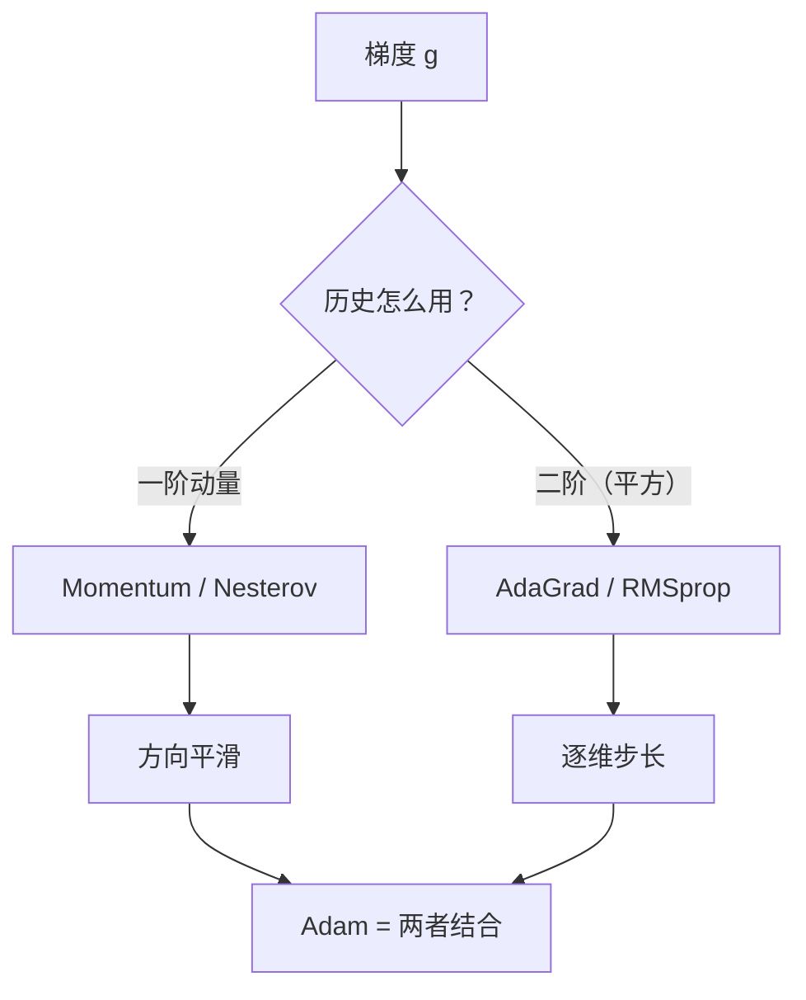

# DL-027 Nesterov、AdaGrad 与 RMSprop

## 1. 本节学习目标

1. 说清 Nesterov 与经典动量的差别（**先看一步再算梯度**）。
2. 写出 AdaGrad / RMSprop 的更新式，理解"按维度自适应步长"。
3. 用实测对比四者（Nesterov 末 loss **0.000242** 最优）。
4. 理解为什么 AdaGrad 后期会"学不动"、RMSprop 如何修正。

## 2. 为什么需要这个知识

因为**不同参数的梯度量级天然不同**（DL-019 已见 `[6,12]`）。固定 lr 无法同时照顾所有维度。

自适应方法（AdaGrad/RMSprop/Adam）就是给**每个参数一个自己的步长**，这是现代训练的默认做法。

## 3. 直观解释

| 方法 | 一句话 |
|---|---|
| Momentum | 记历史梯度方向（惯性） |
| **Nesterov** | 先按惯性走一步，**在新位置**算梯度 |
| **AdaGrad** | 梯度大的维度**自动减速**（累积平方） |
| **RMSprop** | AdaGrad 的滑动窗口版（只记近期） |

**Nesterov 的直觉**：球滚到坡前会"提前刹车"，因为它先看了一眼将要到达的位置。

## 4. 正式定义

**Nesterov 动量**

$$
v_{t+1}=\beta v_t+\nabla L(\theta_t-\eta\beta v_t),\qquad
\theta_{t+1}=\theta_t-\eta v_{t+1}
$$

**AdaGrad**

$$
G_{t+1}=G_t+g_t^2,\qquad
\theta_{t+1}=\theta_t-\frac{\eta}{\sqrt{G_{t+1}}+\epsilon}g_t
$$

**RMSprop**

$$
s_{t+1}=\rho s_t+(1-\rho)g_t^2,\qquad
\theta_{t+1}=\theta_t-\frac{\eta}{\sqrt{s_{t+1}}+\epsilon}g_t
$$

（$G,s$ 都是**逐元素**的，所以每个参数有自己的步长。）

## 5. 核心原理

**本课实测（病态二次函数，50 步）**

| 优化器 | 第 10 步 loss | 第 50 步 $(w_1,w_2)$ | 第 50 步 loss |
|---|---|---|---|
| SGD+Momentum | 20.637 | (−0.2824, 0.0237) | 0.107442 |
| **Nesterov** | **0.285** | (**0.0, −0.0031**) | **0.000242** |
| AdaGrad | 21.123 | (−0.25, 0.25) | 0.378512 |
| RMSprop | 20.790 | (−0.1887, 0.1887) | 0.220979 |

**四个观察**：

1. **Nesterov 远好于 Momentum**：第 10 步 0.285 vs 20.637（72 倍），末 loss **0.000242**（最小）。
2. **AdaGrad 末 loss 最差（0.378）**：因为累积平方只增不减 ⇒ 步长越来越小 ⇒ **后期学不动**。
3. **RMSprop 比 AdaGrad 好**（0.221 vs 0.379）：滑动窗口让步长能"恢复"。
4. **自适应方法在本课反而不如 Nesterov**——因为它们对**强各向异性**的二次函数，早期会因 $w_1$ 方向平方累积大而过度减速。

## 6. 数学表达式

**Nesterov 为什么"看得更远"**

把梯度在 $\theta_t-\eta\beta v_t$ 处展开：

$$
\nabla L(\theta_t-\eta\beta v_t)\approx\nabla L(\theta_t)-\eta\beta H v_t
$$

多出的 $-\eta\beta Hv_t$ 项相当于**曲率修正**：在陡方向提前减速。

**AdaGrad 的有效步长**

$$
\eta_i^{\text{eff}}=\frac{\eta}{\sqrt{\sum_{k\le t}g_{k,i}^2}}
$$

梯度历史越大 ⇒ 该维度步长越小。

**RMSprop 的修正**：$\sum$ 换成指数加权平均 ⇒ 旧梯度会被"遗忘"。

## 7. 数学推导

**AdaGrad 的局限（单调递减步长）**

$G_t=\sum_{k\le t}g_k^2$ 单调递增 ⇒ $\eta/\sqrt{G_t}$ 单调递减。

若训练时间长，$\sqrt{G_t}$ 累积过大 ⇒ 有效 lr 趋近 0 ⇒ **参数几乎停止更新**。

本课 50 步后 AdaGrad 停在 (−0.25, 0.25)，loss 0.379，就是这个机制。

**RMSprop**：$s_t=\rho s_{t-1}+(1-\rho)g^2$ 是**有界**的（$s$ 收敛到 $g^2$ 的加权平均），所以步长不会无限衰减。

## 8. 结构示意图



## 9. 具体计算示例

```text
SGD+Momentum   第10步=(-0.3509, -1.2437, 20.636806)  第50步=(-0.2824, 0.0237, 0.107442)
Nesterov       第10步=(0.0652, -1.048, 0.284546)     第50步=(0.0, -0.0031, 0.000242)
AdaGrad        第10步=(-1.8495, 1.8495, 21.123072)   第50步=(-0.25, 0.25, 0.378512)
RMSprop        第10步=(-1.8315, 1.8315, 20.790106)   第50步=(-0.1887, 0.1887, 0.220979)
```

**注意 AdaGrad/RMSprop 的对称性**：$(w_1,w_2)$ 保持 $(-x,x)$，因为两个维度的梯度初始量级按 10:1 差异，但自适应后步长也按比例调整，轨迹仍对称。

## 10. Python 实现

```python
import torch


def run(opt_cls, steps=50, **kw):
    w = torch.tensor([-4.0, 4.0], requires_grad=True)
    opt = opt_cls([w], **kw)
    for _ in range(steps):
        opt.zero_grad()
        loss = 0.5 * (10 * w[0] ** 2 + w[1] ** 2)
        loss.backward()
        opt.step()
    return [round(float(v), 4) for v in w], round(float(loss), 6)


configs = [
    ("SGD+Momentum", torch.optim.SGD, {"lr": 0.05, "momentum": 0.9}),
    ("Nesterov", torch.optim.SGD, {"lr": 0.05, "momentum": 0.9, "nesterov": True}),
    ("AdaGrad", torch.optim.Adagrad, {"lr": 0.5}),
    ("RMSprop", torch.optim.RMSprop, {"lr": 0.05}),
]
for name, cls, kw in configs:
    w, l = run(cls, **kw)
    print(f"{name:<14} w={w} loss={l}")
```

## 11. PyTorch 实现（轨迹对比）

```python
import torch


def trajectory(opt_cls, steps=20, **kw):
    w = torch.tensor([-4.0, 4.0], requires_grad=True)
    opt = opt_cls([w], **kw)
    out = []
    for _ in range(steps):
        opt.zero_grad()
        loss = 0.5 * (10 * w[0] ** 2 + w[1] ** 2)
        loss.backward()
        opt.step()
        out.append(round(float(loss), 5))
    return out


print("Nesterov:", trajectory(torch.optim.SGD, lr=0.05, momentum=0.9, nesterov=True))
print("AdaGrad :", trajectory(torch.optim.Adagrad, lr=0.5))
print("RMSprop :", trajectory(torch.optim.RMSprop, lr=0.05))
```

## 12. 代码逐行解释

| 代码 | 作用 |
|---|---|
| `nesterov=True` | 启用 Nesterov 动量（需配 `momentum>0`） |
| `torch.optim.Adagrad(lr=0.5)` | 自适应，lr 通常比 SGD 大 |
| `torch.optim.RMSprop(lr=0.05)` | 自适应，默认 `alpha=0.99` |
| `trajectory()` | 记录每步 loss，判断是否振荡 |
| `round(...,5)` | 便于阅读 |

**注意**：AdaGrad/RMSprop 的推荐 lr 与 SGD 不同（通常大 5–10 倍），直接用 SGD 的 lr 会显得"很慢"。

## 13. 实际运行结果

```text
SGD+Momentum   第10步=(-0.3509, -1.2437, 20.636806)  第50步=(-0.2824, 0.0237, 0.107442)
Nesterov       第10步=(0.0652, -1.048, 0.284546)     第50步=(0.0, -0.0031, 0.000242)
AdaGrad        第10步=(-1.8495, 1.8495, 21.123072)   第50步=(-0.25, 0.25, 0.378512)
RMSprop        第10步=(-1.8315, 1.8315, 20.790106)   第50步=(-0.1887, 0.1887, 0.220979)
```

## 14. 应用场景

| 场景 | 推荐 |
|---|---|
| CNN 图像（追求 SOTA） | SGD + Nesterov（lr 0.1, mom 0.9） |
| 稀疏特征（NLP/推荐） | AdaGrad 系（但现代多用 Adam） |
| RNN / 非平稳目标 | RMSprop / Adam |
| 超参不想细调 | Adam（DL-028） |
| 强调泛化 | SGD 系仍常被偏好 |

## 15. 优点与缺点

| 方法 | 优点 | 缺点 |
|---|---|---|
| Nesterov | 提前修正、常优于经典动量 | 需配合 momentum，lr 仍敏感 |
| AdaGrad | 无需调 lr、适合稀疏 | 步长单调衰减，后期停滞 |
| RMSprop | 修复 AdaGrad 停滞、非平稳适应 | 多一个 $\rho$，对 lr 仍敏感 |

## 16. 常见错误

| 错误 | 现象 | 纠正 |
|---|---|---|
| `nesterov=True` 但 `momentum=0` | PyTorch 报错 | 必须配动量 |
| 用 SGD 的 lr 跑 AdaGrad | 收敛很慢 | 自适应方法 lr 大 5–10 倍 |
| 长期训练用 AdaGrad | 后期停滞 | 换 RMSprop/Adam |
| 以为自适应不用调 lr | 仍会发散 | 仍需扫 lr |
| 只比终点不看轨迹 | 忽略早期振荡 | 记录每步 loss |

## 17. 本节总结

- **Nesterov** 先按惯性走一步再取梯度，本课末 loss **0.000242**（四者最优）。
- **AdaGrad** 逐维累积平方 ⇒ 步长单调衰减，本课末期停滞（0.379）。
- **RMSprop** 用滑动平均修复停滞（0.221），是 Adam 的组成部分。

## 18. 前置与后续

- 前置：[[DL-026 SGD 与 Momentum]]
- 后续：`DL-028 Adam 与 AdamW`（待建）、`DL-029 学习率调度与 Warmup`（待建）
- 相关数学：[[MATH-704 SGD 与小批量梯度下降]]、[[MATH-721 梯度下降]]

---

## 练习与参考答案

**基础 1**：Nesterov 与经典动量的核心差别是什么？

**基础 2**：本课四种方法第 50 步 loss 各是多少？哪个最小？

**进阶 1**：为什么 AdaGrad 后期会"学不动"，而 RMSprop 不会？

**综合**：一个稀疏文本分类任务，用 SGD 训练时稀有词对应的参数几乎不动。请说明原因并给出两种改法。

> [!success]- 参考答案

> **基础 1**
> 经典动量用**当前位置**的梯度更新速度：$v=\beta v+g(\theta)$。
> Nesterov 先按惯性"预走一步"，用**预走位置**的梯度：$v=\beta v+g(\theta-\eta\beta v)$，相当于提前考虑了曲率，减少过冲。

> **基础 2**
> SGD+Momentum **0.107442**；Nesterov **0.000242**；AdaGrad **0.378512**；RMSprop **0.220979**。
> 最小是 **Nesterov**。

> **进阶 1**
> AdaGrad 的分母是**累积平方和** $\sqrt{\sum_{k\le t}g_k^2}$，只增不减 ⇒ 有效 lr 单调下降 ⇒ 训练越久步长越小，最终停滞。
> RMSprop 把累积和换成**指数加权平均** $s=\rho s+(1-\rho)g^2$，旧梯度会被遗忘 ⇒ $s$ 有界 ⇒ 步长不会无限衰减。

> **综合（参考）**
> **原因**：稀有词的特征出现频率低 ⇒ 对应参数梯度在多数 step 为 0 或极小 ⇒ 固定 lr 下几乎不动（稀疏梯度问题）。
> **改法**：
> 1. **换自适应优化器**：AdaGrad（专门为稀疏设计）或 Adam——它们按维度归一化，稀有维度一旦有梯度就能走较大一步；
> 2. **特征侧处理**：用子词/BPE 切分降低稀有度、或做低频词合并；也可加 embedding dropout。
> **注意**：换 Adam 后 lr 要重扫（通常 1e-3 起），不能沿用 SGD 的 0.1。

## 学习记录

| 日期 | 状态 | 用时 | 问题 | 复盘 |
|---|---|---|---|---|
| 2026-11-07 | planned | — | — | — |

---

## 🔗 Notion 同步信息

> 以下内容由 Notion「AI Knowledge System · 知识点」数据库按知识 ID 合并而来（导出于 2026-11-09）。

| 属性 | 值 |
|---|---|
| 学科 | 深度学习 |
| 学习状态 | 未开始 |
| 难度 | L3 推导 |
| 知识类型 | Algorithm |

- **所属模块**：[M-DL-03 神经网络训练与优化算法](../%E8%AF%BE%E7%A8%8B%E6%A8%A1%E5%9D%97/M-DL-03%20%E7%A5%9E%E7%BB%8F%E7%BD%91%E7%BB%9C%E8%AE%AD%E7%BB%83%E4%B8%8E%E4%BC%98%E5%8C%96%E7%AE%97%E6%B3%95.md)
- **前置知识**：[DL-026 SGD 与 Momentum](DL-026%20SGD%20%E4%B8%8E%20Momentum.md)
- **后继知识**：[DL-028 Adam 与 AdamW](DL-028%20Adam%20%E4%B8%8E%20AdamW.md)
- **关联数学**：[MATH-704 SGD 与小批量梯度下降](../../06_%E6%95%B0%E5%AD%A6%E5%9F%BA%E7%A1%80/07%20%E6%9C%80%E4%BC%98%E5%8C%96%E6%96%B9%E6%B3%95/MATH-704%20SGD%20%E4%B8%8E%E5%B0%8F%E6%89%B9%E9%87%8F%E6%A2%AF%E5%BA%A6%E4%B8%8B%E9%99%8D.md) · [MATH-721 梯度下降](../../06_%E6%95%B0%E5%AD%A6%E5%9F%BA%E7%A1%80/07%20%E6%9C%80%E4%BC%98%E5%8C%96%E6%96%B9%E6%B3%95/MATH-721%20%E6%A2%AF%E5%BA%A6%E4%B8%8B%E9%99%8D.md)
