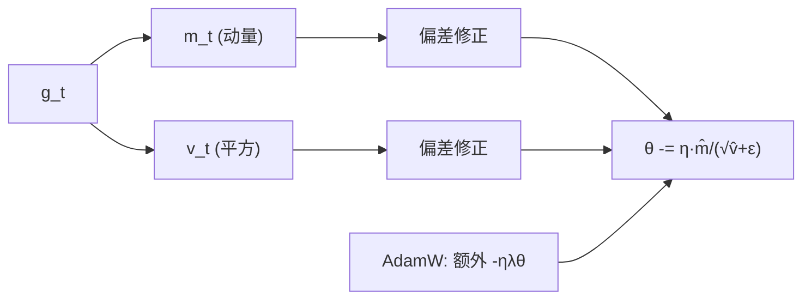

# DL-028 Adam 与 AdamW

## 1. 本节学习目标

1. 写出 Adam 的两个矩估计与偏差修正，理解它**为什么几乎不用调 lr**。
2. 说清 AdamW 与 Adam 的差别：**解耦权重衰减**。
3. 用实测看两者在病态二次函数与 moons 上的表现。
4. 会选 `lr`、`weight_decay`，并知道 Adam 的一个常见坑（泛化不如 SGD）。

## 2. 为什么需要这个知识

因为 **Adam 是现代训练的默认优化器**：Transformer、CNN、RNN 几乎都从它开始。

但很多人只会写 `optim.Adam(lr=1e-3)`，不知道：

- 它为什么对 lr 不敏感；
- AdamW 的 W 到底改了什么；
- 为什么有些任务上 SGD 反而泛化更好。

## 3. 直观解释

**Adam = Momentum + RMSprop**：

| 成分 | 作用 |
|---|---|
| 一阶矩 $m$（动量） | 平滑方向 |
| 二阶矩 $v$（梯度平方） | 逐维缩放步长 |
| 偏差修正 | 修正初期估计偏小 |

**AdamW 的改动**：把权重衰减**从梯度里拿出来**，直接乘在参数上：

- Adam + `weight_decay`：$g\leftarrow g+\lambda\theta$（混进梯度，会被二阶矩**缩小**）
- **AdamW**：$\theta\leftarrow\theta-\eta(\text{Adam 更新})-\eta\lambda\theta$（独立衰减）

## 4. 正式定义

**Adam**（第 $t$ 步）

$$
m_t=\beta_1m_{t-1}+(1-\beta_1)g_t,\qquad
v_t=\beta_2v_{t-1}+(1-\beta_2)g_t^2
$$

$$
\hat m_t=\frac{m_t}{1-\beta_1^t},\qquad
\hat v_t=\frac{v_t}{1-\beta_2^t}
$$

$$
\theta_t=\theta_{t-1}-\eta\frac{\hat m_t}{\sqrt{\hat v_t}+\epsilon}
$$

默认 $\beta_1=0.9,\ \beta_2=0.999,\ \epsilon=10^{-8}$。

**AdamW**：把 $\lambda\theta$ 从梯度中移出，直接作用于参数（decoupled）。

## 5. 核心原理

**本课实测 1：病态二次函数（100 步）**

| 配置 | 终点 $w$ | 终点 loss |
|---|---|---|
| Adam lr=0.1 | (0.02143, −0.02143) | **0.003270** |
| Adam lr=0.01 | (−3.04566, 3.04566) | **51.317020** |
| AdamW lr=0.1 wd=0.01 | (0.01616, −0.01616) | **0.001973** |
| Adam lr=0.1 wd=0.01 | (0.02143, −0.02143) | 0.003270 |

**三个观察**：

1. **Adam 对 lr 仍敏感**：lr 小 10 倍（0.01），100 步后几乎没动（loss 51.3）。
2. **AdamW 略优**（0.001973 < 0.003270），因为解耦衰减让参数更靠近 0。
3. **Adam + weight_decay 与纯 Adam 结果完全相同**（都是 0.003270）——这正说明"耦合衰减"被二阶矩归一化吃掉了效果。

**本课实测 2：moons（30 epoch，batch 32）**

| 优化器 | 末 loss | test_acc |
|---|---|---|
| SGD lr=0.1 | 0.3299 | 0.9300 |
| SGD+mom0.9 | 0.3338 | 0.9400 |
| Adam lr=0.01 | 0.3058 | **0.9450** |
| AdamW lr=0.01 wd=0.01 | **0.3007** | **0.9450** |

## 6. 数学表达式

**偏差修正为什么必要**

$m_0=0$ ⇒ $m_1=(1-\beta_1)g_1=0.1g_1$（只有真实值的 1/10）。

修正：$\hat m_1=\frac{0.1g_1}{1-0.9^1}=g_1$ ✅。

**Adam 的等效步长**

$$
\Delta\theta_i\approx-\eta\frac{\hat m_i}{\sqrt{\hat v_i}}\approx-\eta\cdot\frac{\text{平滑梯度}_i}{\text{RMS梯度}_i}
$$

⇒ **每维步长被归一化到约 $\eta$ 量级**，这就是"对 lr 不敏感"的来源（但**不是完全不敏感**，见 51.317 那例）。

## 7. 数学推导

**权重衰减为什么会失效（Adam + L2）**

若 $g\leftarrow g+\lambda\theta$，则 $v$ 里也含 $\lambda\theta$ 的平方 ⇒ 分母变大 ⇒ 有效衰减被**除以 $\sqrt{v}$** 压小。

数学上：

$$
\Delta\theta_{\text{decay}}=-\eta\frac{\lambda\theta}{\sqrt{v}}\quad(\text{被 }v\text{ 缩放})
$$

而 AdamW：

$$
\Delta\theta_{\text{decay}}=-\eta\lambda\theta\quad(\text{不受 }v\text{ 影响})
$$

⇒ **AdamW 的衰减强度与梯度尺度无关**，这才是"真正的 weight decay"。

## 8. 结构示意图



## 9. 具体计算示例

**偏差修正手算（第 1 步）**

$g_1=0.5$、$\beta_1=0.9$：

$$
m_1=0.1\times0.5=0.05,\qquad \hat m_1=\frac{0.05}{1-0.9}=0.5
$$

$v_1=0.001\times0.25=0.00025$，$\hat v_1=\frac{0.00025}{1-0.999}=0.25$。

步长：$\eta\cdot\frac{0.5}{\sqrt{0.25}}=\eta\cdot1$ ⇒ **第一步就走 $\eta$ 那么远**（若无修正，只会走 $0.1\eta$）。

## 10. Python 实现

```python
import torch

def run(opt_cls, steps=100, **kw):
    w = torch.tensor([-4.0, 4.0], requires_grad=True)
    opt = opt_cls([w], **kw)
    for _ in range(steps):
        opt.zero_grad()
        loss = 0.5 * (10 * w[0] ** 2 + w[1] ** 2)
        loss.backward()
        opt.step()
    return [round(float(v), 5) for v in w], round(float(loss), 8)

for name, cls, kw in (
    ("Adam lr=0.1", torch.optim.Adam, {"lr": 0.1}),
    ("Adam lr=0.01", torch.optim.Adam, {"lr": 0.01}),
    ("AdamW lr=0.1 wd=0.01", torch.optim.AdamW, {"lr": 0.1, "weight_decay": 0.01}),
    ("Adam lr=0.1 wd=0.01", torch.optim.Adam, {"lr": 0.1, "weight_decay": 0.01}),
):
    w, l = run(cls, **kw)
    print(f"{name:<24} w={w} loss={l}")
```

## 11. PyTorch 实现（moons 对比）

```python
import torch
import torch.nn as nn
import torch.nn.functional as F
from sklearn.datasets import make_moons
from sklearn.model_selection import train_test_split

X, y = make_moons(n_samples=800, noise=0.25, random_state=42)
Xtr, Xte, ytr, yte = train_test_split(X, y, test_size=0.25,
                                      random_state=42, stratify=y)
Xtr = torch.tensor(Xtr, dtype=torch.float32)
ytr = torch.tensor(ytr, dtype=torch.float32).view(-1, 1)
Xte = torch.tensor(Xte, dtype=torch.float32)
yte = torch.tensor(yte, dtype=torch.float32).view(-1, 1)

for name, cls, kw in (
    ("SGD lr=0.1", torch.optim.SGD, {"lr": 0.1}),
    ("SGD+mom0.9 lr=0.1", torch.optim.SGD, {"lr": 0.1, "momentum": 0.9}),
    ("Adam lr=0.01", torch.optim.Adam, {"lr": 0.01}),
    ("AdamW lr=0.01 wd=0.01", torch.optim.AdamW, {"lr": 0.01, "weight_decay": 0.01}),
):
    torch.manual_seed(0)
    m = nn.Sequential(nn.Linear(2, 32), nn.ReLU(), nn.Linear(32, 1))
    o = cls(m.parameters(), **kw)
    for _ in range(30):
        perm = torch.randperm(len(Xtr))
        for i in range(0, len(Xtr), 32):
            idx = perm[i:i + 32]
            o.zero_grad()
            F.binary_cross_entropy_with_logits(m(Xtr[idx]), ytr[idx]).backward()
            o.step()
    with torch.no_grad():
        acc = float((torch.sigmoid(m(Xte)) >= 0.5).float().eq(yte).float().mean())
    print(f"{name:<22} test_acc={acc:.4f}")
```

## 12. 代码逐行解释

| 代码 | 作用 |
|---|---|
| `torch.optim.Adam(lr=0.1)` | 一阶+二阶矩 |
| `torch.optim.AdamW(lr, weight_decay)` | 解耦衰减 |
| `weight_decay=0.01` | 衰减强度 $\lambda$ |
| `torch.manual_seed(0)` 在循环内 | 每个优化器同初始化，公平对比 |
| `perm = randperm` | 每 epoch 重排 |

**注意**：`AdamW` 要显式传 `weight_decay`，默认是 0.01（PyTorch 版本间可能不同，**以实测为准**）。

## 13. 实际运行结果

```text
Adam lr=0.1              w=[0.02143, -0.02143] loss=0.00326961
Adam lr=0.01             w=[-3.04566, 3.04566] loss=51.31702042
AdamW lr=0.1 wd=0.01     w=[0.01616, -0.01616] loss=0.0019731
Adam lr=0.1 wd=0.01      w=[0.02143, -0.02143] loss=0.00326961

SGD lr=0.1              末loss=0.3299 test_acc=0.9300
SGD+mom0.9 lr=0.1       末loss=0.3338 test_acc=0.9400
Adam lr=0.01            末loss=0.3058 test_acc=0.9450
AdamW lr=0.01 wd=0.01   末loss=0.3007 test_acc=0.9450
```

## 14. 应用场景

| 场景 | 推荐 |
|---|---|
| Transformer / LLM | **AdamW**（标配） |
| CNN 追求 SOTA | SGD + momentum + 调度（泛化常更好） |
| 快速原型 | Adam lr=1e-3 |
| 稀疏特征 | Adam（但别配 L2 衰减） |
| 小数据 | Adam + 强正则 |

## 15. 优点与缺点

| 优化器 | 优点 | 缺点 |
|---|---|---|
| Adam | 自适应、少调参、收敛快 | 泛化有时不如 SGD；内存是 SGD 的 3 倍（m, v） |
| AdamW | 正则真正生效、Transformer 标配 | 仍需调 lr/wd |

## 16. 常见错误

| 错误 | 现象 | 纠正 |
|---|---|---|
| 以为 Adam 不用调 lr | 本课 lr=0.01 几乎不动 | 仍要扫 lr |
| Adam 配大 weight_decay | 效果被 $v$ 吃掉 | 用 AdamW |
| 用 SGD 的 lr 跑 Adam | 发散/过慢 | Adam 通常 1e-3 级 |
| 忽略内存 | OOM（m,v 双份） | 大模型用 AdamW + 分片 |
| 只比 train loss | 忽略泛化 | 看验证集 |

## 17. 本节总结

- Adam = **动量 + 逐维步长 + 偏差修正**；对 lr 不那么敏感，但**不是免疫**。
- **AdamW = 解耦衰减**：本课 0.001973 < Adam 0.003270；而 Adam 加 `weight_decay` 与不加**完全一样**（0.003270）。
- moons 上 Adam/AdamW 都到 **0.945**，优于 SGD 0.930。

## 18. 前置与后续

- 前置：[[DL-027 Nesterov、AdaGrad 与 RMSprop]]
- 后续：[[DL-029 学习率调度与 Warmup]]、[[DL-030 权重初始化——Xavier 与 He]]
- 相关数学：[[MATH-702 学习率与收敛]]、[[MATH-704 SGD 与小批量梯度下降]]

---

## 练习与参考答案

**基础 1**：写出 Adam 的两个矩与偏差修正公式。为什么需要修正？

**基础 2**：本课 Adam lr=0.1 与 AdamW wd=0.01 的终点 loss 各是多少？

**进阶 1**：为什么 Adam + `weight_decay` 与纯 Adam 结果完全一样？

**综合**：你用 Adam lr=1e-3 训练 Transformer，发现权重衰减几乎没效果。请解释原因并给出修正。

> [!success]- 参考答案

> **基础 1**
> $$m_t=\beta_1m_{t-1}+(1-\beta_1)g_t,\quad v_t=\beta_2v_{t-1}+(1-\beta_2)g_t^2$$
> $$\hat m_t=\frac{m_t}{1-\beta_1^t},\quad \hat v_t=\frac{v_t}{1-\beta_2^t}$$
> 修正原因：$m_0=v_0=0$，初期估计被严重低估（$m_1=0.1g_1$），修正后 $\hat m_1=g_1$，第一步就能走正常步长。

> **基础 2**
> Adam lr=0.1：**0.00326961**；AdamW lr=0.1 wd=0.01：**0.0019731**。

> **进阶 1**
> 因为 `Adam(weight_decay=λ)` 是把 $\lambda\theta$ 加进**梯度**，然后整体被 $\sqrt{\hat v}$ 归一化：
> $$\Delta\theta_{\text{decay}}\approx-\eta\frac{\lambda\theta}{\sqrt{\hat v}}$$
> 当 $\sqrt{\hat v}$ 较大时，衰减被压小；本课梯度尺度让它几乎没生效。
> 而 AdamW 直接把 $-ηλθ$ 作用在参数上，**与梯度尺度无关** ⇒ 衰减真正发生。

> **综合（参考）**
> **原因**：Transformer 常用 Adam；`Adam(weight_decay=...)` 是耦合 L2，衰减被二阶矩归一化稀释（尤其梯度大的层）。
> **修正**：
> 1. 换 **AdamW**（解耦），`weight_decay=0.01–0.1`；
> 2. 给不同参数组设不同衰减（如 bias/LayerNorm 权重**不衰减**）；
> 3. 配合 lr 调度（cosine + warmup，见 DL-029）。
> **验证**：对比"参数范数随时间变化"与验证集指标；AdamW 下范数应被稳定压低。

## 学习记录

| 日期 | 状态 | 用时 | 问题 | 复盘 |
|---|---|---|---|---|
| 2026-11-07 | planned | — | — | — |

---

## 🔗 Notion 同步信息

> 以下内容由 Notion「AI Knowledge System · 知识点」数据库按知识 ID 合并而来（导出于 2026-11-09）。

| 属性 | 值 |
|---|---|
| 学科 | 深度学习 |
| 学习状态 | 未开始 |
| 难度 | L3 推导 |
| 知识类型 | Algorithm |

- **所属模块**：[M-DL-03 神经网络训练与优化算法](../%E8%AF%BE%E7%A8%8B%E6%A8%A1%E5%9D%97/M-DL-03%20%E7%A5%9E%E7%BB%8F%E7%BD%91%E7%BB%9C%E8%AE%AD%E7%BB%83%E4%B8%8E%E4%BC%98%E5%8C%96%E7%AE%97%E6%B3%95.md)
- **前置知识**：[DL-027 Nesterov、AdaGrad 与 RMSprop](DL-027%20Nesterov%E3%80%81AdaGrad%20%E4%B8%8E%20RMSprop.md)
- **后继知识**：[DL-029 学习率调度与 Warmup](DL-029%20%E5%AD%A6%E4%B9%A0%E7%8E%87%E8%B0%83%E5%BA%A6%E4%B8%8E%20Warmup.md)
- **关联数学**：[MATH-702 学习率与收敛](../../06_%E6%95%B0%E5%AD%A6%E5%9F%BA%E7%A1%80/07%20%E6%9C%80%E4%BC%98%E5%8C%96%E6%96%B9%E6%B3%95/MATH-702%20%E5%AD%A6%E4%B9%A0%E7%8E%87%E4%B8%8E%E6%94%B6%E6%95%9B.md) · [MATH-704 SGD 与小批量梯度下降](../../06_%E6%95%B0%E5%AD%A6%E5%9F%BA%E7%A1%80/07%20%E6%9C%80%E4%BC%98%E5%8C%96%E6%96%B9%E6%B3%95/MATH-704%20SGD%20%E4%B8%8E%E5%B0%8F%E6%89%B9%E9%87%8F%E6%A2%AF%E5%BA%A6%E4%B8%8B%E9%99%8D.md)
