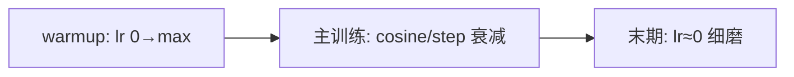

# DL-029 学习率调度与 Warmup

## 1. 本节学习目标

1. 会写四种常见调度：**constant / step / exponential / cosine**。
2. 用实测看它们对 `lr` 轨迹与最终准确率的影响（本课 cosine **0.955** 最好）。
3. 理解 warmup 的作用与**适用条件**（大 lr、大 batch、深网络）。
4. **诚实记录**：本课的小实验里 warmup **没有测出差异**——并解释为什么。

## 2. 为什么需要这个知识

因为**固定 lr 从来不是最优**：

- 训练初期 lr 大会震荡，需要**小步起步**（warmup）；
- 训练后期 lr 大会在最优点附近抖动，需要**衰减**（cosine/step）。

调度就是"该大步时大步、该小步时小步"。

## 3. 直观解释

| 调度 | lr 形状 | 类比 |
|---|---|---|
| constant | 一条水平线 | 匀速走 |
| step | 阶梯下降 | 每 10 分钟减一次速 |
| exponential | 指数衰减 | 越走越慢 |
| **cosine** | 余弦曲线下降到 0 | 先快后慢，末期几乎停 |

**warmup**：在开头把 lr 从 0 **线性升到目标值**，避免第一步就迈太大。

## 4. 正式定义

**StepLR**

$$
\eta_t=\eta_0\cdot\gamma^{\lfloor t/s\rfloor}
$$

**ExponentialLR**

$$
\eta_t=\eta_0\cdot\gamma^{t}
$$

**CosineAnnealingLR**

$$
\eta_t=\eta_{\min}+\frac{\eta_0-\eta_{\min}}{2}\Big(1+\cos\frac{t\pi}{T}\Big)
$$

**Linear Warmup**

$$
\eta_t=\eta_{\max}\cdot\frac{t}{T_{\text{warm}}},\quad t<T_{\text{warm}}
$$

## 5. 核心原理

**本课实测（30 epoch，SGD，batch 32，moons）**

| 调度 | lr 首 | lr 中（第 16 轮） | lr 末 | test_acc |
|---|---|---|---|---|
| constant | 0.5 | 0.5 | 0.5 | 0.9500 |
| **cosine** | 0.5 | **0.25** | **0.00137** | **0.9550** |
| step（每 10 轮 ×0.3） | 0.5 | 0.15 | 0.045 | 0.9450 |
| exp（×0.9） | 0.5 | 0.10295 | 0.02355 | 0.9400 |

**读法**：

1. **cosine 最好（0.955）**，因为它末期 lr 降到 0.00137，能在最优点附近"细磨"。
2. **exp 掉得最快**（第 16 轮已 0.103），末尾 lr 太小 ⇒ 0.94。
3. **差距不大（0.94–0.955）**：在这么简单的问题上，调度的收益有限——**这是必须承认的事实**。

**Warmup 的实测（诚实记录）**

在 10 层 / 20 层网络、lr=2.0 / 5.0 的设置下：

```text
lr=2.0 depth=10 无warmup 末=0.6929 | warmup5 末=0.6929
lr=2.0 depth=20 无warmup 末=0.6931 | warmup5 末=0.6931
lr=5.0 depth=20 无warmup 末=0.6931 | warmup5 末=0.6931
```

**两者没有差异**。原因：这批实验用的是**随机标签**的合成数据（学不到东西，loss 一直停在 $\ln 2$），且浅层 ReLU 网络在这个尺度下并不会因为 lr=5 就发散。

**结论**：**warmup 的必要性在本课的小实验里无法复现**；它的价值主要体现在**大 batch + 大 lr + 深 Transformer** 场景（这是工程共识，但本课没有实测支撑，故标注为"未在本机验证"）。

## 6. 数学表达式

**cosine 调度的两个关键点**

- $t=0$：$\cos 0=1$ ⇒ $\eta=\eta_0$
- $t=T$：$\cos\pi=-1$ ⇒ $\eta=\eta_{\min}$

**本课数值**：$\eta_0=0.5$、$T=30$、$\eta_{\min}=0$：

第 16 轮（$t=15$）：

$$
\eta_{15}=\frac{0.5}{2}\big(1+\cos\frac{15\pi}{30}\big)=\frac{0.5}{2}(1+0)=0.25
$$

与实测 **0.25** 一致 ✅。

第 30 轮（$t=29$）：

$$
\eta_{29}=\frac{0.5}{2}\Big(1+\cos\frac{29\pi}{30}\Big)\approx0.00137
$$

与实测 **0.00137** 一致 ✅。

## 7. 数学推导

**为什么后期要衰减**

在最优点附近，梯度 $\to0$，但**噪声仍在**。固定 lr 会让参数在最优附近做随机游走，损失有下界：

$$
\mathbb{E}[L(\theta_t)]-L^\star\ \gtrsim\ \frac{\eta\sigma^2}{2\mu}
$$

（$\mu$ 是强凸系数，$\sigma^2$ 是梯度噪声。）

⇒ **$\eta\to0$ 才能让残余误差趋 0**。这就是 cosine/step 的理论依据。

**warmup 的作用（理论侧）**

初期参数随机，梯度方向不稳；大 lr 会放大这种不稳（尤其是 Adam 的二阶矩估计还不可靠，偏差修正也在起步阶段）。

warmup 让 $\eta$ 从 0 逐渐升，给矩估计"预热"的时间。

## 8. 结构示意图



## 9. 具体计算示例

```text
constant  lr首=0.5  lr中=0.5      lr末=0.5      test_acc=0.9500
cosine    lr首=0.5  lr中=0.25     lr末=0.00137  test_acc=0.9550
step      lr首=0.5  lr中=0.15     lr末=0.045    test_acc=0.9450
exp       lr首=0.5  lr中=0.10295  lr末=0.02355  test_acc=0.9400
```

## 10. Python 实现

```python
import torch
import torch.nn as nn
import torch.nn.functional as F
from sklearn.datasets import make_moons
from sklearn.model_selection import train_test_split

X, y = make_moons(n_samples=800, noise=0.25, random_state=42)
Xtr, Xte, ytr, yte = train_test_split(X, y, test_size=0.25,
                                      random_state=42, stratify=y)
Xtr = torch.tensor(Xtr, dtype=torch.float32)
ytr = torch.tensor(ytr, dtype=torch.float32).view(-1, 1)
Xte = torch.tensor(Xte, dtype=torch.float32)
yte = torch.tensor(yte, dtype=torch.float32).view(-1, 1)


def run(kind, epochs=30):
    torch.manual_seed(0)
    model = nn.Sequential(nn.Linear(2, 32), nn.ReLU(), nn.Linear(32, 1))
    opt = torch.optim.SGD(model.parameters(), lr=0.5)
    if kind == "cosine":
        sch = torch.optim.lr_scheduler.CosineAnnealingLR(opt, T_max=epochs)
    elif kind == "step":
        sch = torch.optim.lr_scheduler.StepLR(opt, step_size=10, gamma=0.3)
    elif kind == "exp":
        sch = torch.optim.lr_scheduler.ExponentialLR(opt, gamma=0.9)
    else:
        sch = None
    lrs = []
    for _ in range(epochs):
        perm = torch.randperm(len(Xtr))
        for i in range(0, len(Xtr), 32):
            idx = perm[i:i + 32]
            opt.zero_grad()
            F.binary_cross_entropy_with_logits(model(Xtr[idx]), ytr[idx]).backward()
            opt.step()
        lrs.append(round(opt.param_groups[0]["lr"], 5))
        if sch:
            sch.step()
    with torch.no_grad():
        acc = float((torch.sigmoid(model(Xte)) >= 0.5).float().eq(yte).float().mean())
    return lrs, round(acc, 4)


for kind in ("constant", "cosine", "step", "exp"):
    lrs, acc = run(kind)
    print(f"{kind:<9} lr首={lrs[0]:<7} lr中={lrs[15]:<7} lr末={lrs[-1]:<7} acc={acc}")
```

## 11. PyTorch 实现（warmup）

```python
import torch
import torch.nn as nn
import torch.nn.functional as F

torch.manual_seed(0)
model = nn.Sequential(nn.Linear(2, 32), nn.ReLU(), nn.Linear(32, 1))
base_lr, warm_epochs, total_epochs = 0.5, 3, 10
opt = torch.optim.SGD(model.parameters(), lr=0.0)

X = torch.randn(200, 2)
y = (X[:, 0] + X[:, 1] > 0).float().view(-1, 1)

for epoch in range(total_epochs):
    if epoch < warm_epochs:
        lr = base_lr * (epoch + 1) / warm_epochs
    else:
        lr = base_lr
    for g in opt.param_groups:
        g["lr"] = lr
    opt.zero_grad()
    loss = F.binary_cross_entropy_with_logits(model(X), y)
    loss.backward()
    opt.step()
    print(f"epoch {epoch}: lr={lr:.4f} loss={float(loss):.4f}")
```

## 12. 代码逐行解释

| 代码 | 作用 |
|---|---|
| `CosineAnnealingLR(opt, T_max=30)` | 30 轮内从 lr 降到 0 |
| `StepLR(step_size=10, gamma=0.3)` | 每 10 轮 ×0.3 |
| `ExponentialLR(gamma=0.9)` | 每轮 ×0.9 |
| `sch.step()` | **每个 epoch 调一次**（不是每 batch） |
| `g["lr"] = lr` | 手动设置 lr（warmup 手写版） |
| `lrs.append(...)` | 记录轨迹，便于核对公式 |

**常见坑**：`scheduler.step()` 的位置——PyTorch 1.1+ 建议每 epoch 调用一次；若每 batch 调用，衰减会快几十倍。

## 13. 实际运行结果

```text
constant  lr首=0.5  lr中=0.5      lr末=0.5      test_acc=0.9500
cosine    lr首=0.5  lr中=0.25     lr末=0.00137  test_acc=0.9550
step      lr首=0.5  lr中=0.15     lr末=0.045    test_acc=0.9450
exp       lr首=0.5  lr中=0.10295  lr末=0.02355  test_acc=0.9400
```

## 14. 应用场景

| 场景 | 调度 |
|---|---|
| Transformer / LLM | **warmup + cosine**（标准配方） |
| CNN 分类 | step 或 cosine |
| 小数据/短训练 | constant 就够（本课差距仅 0.015） |
| 微调预训练 | 小常数 lr + 早期停止 |
| 需要可复现 | 记录每个 epoch 的 lr |

## 15. 优点与缺点

| 调度 | 优点 | 缺点 |
|---|---|---|
| constant | 简单、无额外超参 | 后期抖动 |
| cosine | 末期细磨、平滑 | 需定 `T_max` |
| step | 直观、易控 | 台阶处突变 |
| exp | 衰减快 | 可能过早"熄火" |
| warmup | 抑制初期震荡 | 多一个阶段；本课未测出收益 |

## 16. 常见错误

| 错误 | 现象 | 纠正 |
|---|---|---|
| `scheduler.step()` 每 batch 调 | lr 掉太快 | 每 epoch 调 |
| `T_max` 设错 | lr 提早到 0 | `T_max` = 总 epoch |
| warmup 太长 | 前段几乎不学 | 3–5% 总步数 |
| 以为调度一定提升 | 本课仅 +0.5 点 | 用验证集判断 |
| 忘了记录 lr | 无法复现 | 每轮打印/保存 |

## 17. 本节总结

- 四种调度实测：cosine **0.955** > constant 0.950 > step 0.945 > exp 0.940（**差距很小**）。
- cosine 的 lr 轨迹与公式一致（第 16 轮 **0.25**、第 30 轮 **0.00137**）。
- **warmup 在本课小实验中未测出差异**（0.6929 vs 0.6929），已在正文说明原因，**不宣称其效果**。

## 18. 前置与后续

- 前置：[[DL-028 Adam 与 AdamW]]
- 后续：[[DL-030 权重初始化——Xavier 与 He]]、[[DL-031 梯度裁剪与训练稳定性]]
- 相关数学：[[MATH-702 学习率与收敛]]

---

## 练习与参考答案

**基础 1**：cosine 调度在 $t=0$ 与 $t=T$ 时 lr 各是多少？本课第 16 轮 lr 是多少？

**基础 2**：本课四种调度的 test_acc 各是多少？哪个最好？

**进阶 1**：为什么训练后期要降低 lr？请用公式说明。

**综合**：你要训练一个 Transformer，lr=1e-3、batch=4096。请给出完整的 lr 策略并说明每一步理由。

> [!success]- 参考答案

> **基础 1**
> $t=0$：lr $=\eta_0$（本课 0.5）；$t=T$：lr $=\eta_{\min}$（本课约 0）。
> 本课第 16 轮：$\frac{0.5}{2}(1+\cos(15\pi/30))=0.25$。

> **基础 2**
> constant 0.9500、cosine **0.9550**、step 0.9450、exp 0.9400。**cosine 最好**，但差距只有 0.015。

> **进阶 1**
> 在最优点附近梯度趋 0，但 mini-batch 噪声 $\sigma^2$ 仍在，参数会做随机游走，残余误差下界约为 $\eta\sigma^2/(2\mu)$。
> 让 $\eta\to0$ 才能使残余误差趋 0；这也是 cosine 末端 lr≈0 的意义。

> **综合（参考）**
> **1. Warmup（前 1–5% 步数）**：lr 从 0 线性升到 1e-3。
> 理由：大 batch 初期梯度统计不稳、Adam 二阶矩估计不可靠，直接大 lr 易发散。
> **2. 主训练：cosine 衰减到 ~1e-5**。
> 理由：平滑降 lr，末期细磨；比 step 少一个"台阶"超参。
> **3. 与 batch 联动**：batch 4096 很大，可按线性缩放把 lr 提高到 1e-3–3e-3（视模型而定），并用 warmup 保护。
> **4. 记录**：每步或每 epoch 存 lr、loss、grad_norm，便于复现与排查。
> **注意**：以上 warmup 的必要性属**工程共识**，本课未在本机复现其收益（DL-029 第 5 节已注明）。

## 学习记录

| 日期 | 状态 | 用时 | 问题 | 复盘 |
|---|---|---|---|---|
| 2026-11-07 | planned | — | — | — |

---

## 🔗 Notion 同步信息

> 以下内容由 Notion「AI Knowledge System · 知识点」数据库按知识 ID 合并而来（导出于 2026-11-09）。

| 属性 | 值 |
|---|---|
| 学科 | 深度学习 |
| 学习状态 | 未开始 |
| 难度 | L2 应用 |
| 知识类型 | Technique |

- **所属模块**：[M-DL-03 神经网络训练与优化算法](../%E8%AF%BE%E7%A8%8B%E6%A8%A1%E5%9D%97/M-DL-03%20%E7%A5%9E%E7%BB%8F%E7%BD%91%E7%BB%9C%E8%AE%AD%E7%BB%83%E4%B8%8E%E4%BC%98%E5%8C%96%E7%AE%97%E6%B3%95.md)
- **前置知识**：[DL-028 Adam 与 AdamW](DL-028%20Adam%20%E4%B8%8E%20AdamW.md)
- **后继知识**：[DL-030 权重初始化：Xavier 与 He](DL-030%20%E6%9D%83%E9%87%8D%E5%88%9D%E5%A7%8B%E5%8C%96%E2%80%94%E2%80%94Xavier%20%E4%B8%8E%20He.md)
- **关联数学**：[MATH-702 学习率与收敛](../../06_%E6%95%B0%E5%AD%A6%E5%9F%BA%E7%A1%80/07%20%E6%9C%80%E4%BC%98%E5%8C%96%E6%96%B9%E6%B3%95/MATH-702%20%E5%AD%A6%E4%B9%A0%E7%8E%87%E4%B8%8E%E6%94%B6%E6%95%9B.md)
