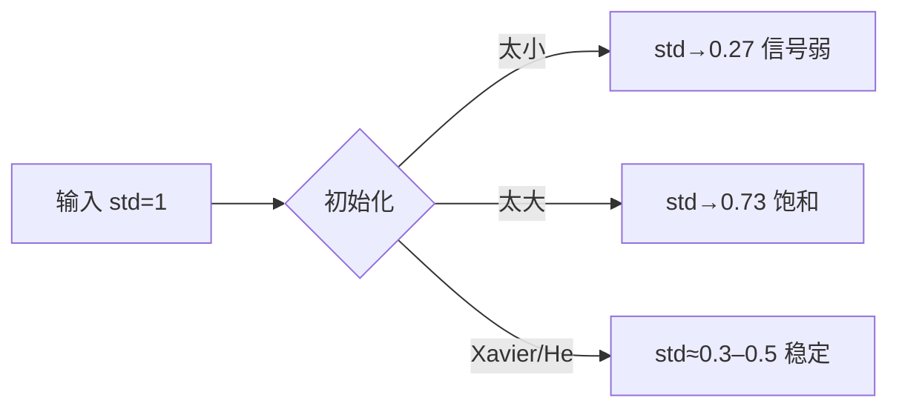

# DL-030 权重初始化：Xavier 与 He

## 1. 本节学习目标

1. 说清"全零初始化"为什么必然失败（本课 acc **0.5000**、首层梯度 **0.0**）。
2. 写出 Xavier 与 He 的方差公式，理解为什么分母不同。
3. 用实测对比五种初始化（zeros/small/large/xavier/he）。
4. 会按激活函数选初始化。

## 2. 为什么需要这个知识

因为**初始化决定训练能不能开始**：

- 全零 ⇒ 所有神经元输出相同 ⇒ 梯度相同 ⇒ **永远对称，学不到东西**；
- 太小 ⇒ 激活值趋 0 ⇒ 梯度消失；
- 太大 ⇒ 激活爆炸 / 饱和。

Xavier 与 He 是"让每层方差稳定"的数学答案。

## 3. 直观解释

**目标**：让每一层的输出**尺度大致不变**。

```text
输入 std=1 → 第1层输出 std≈1 → 第2层 std≈1 → ...
```

若每层缩小 0.5 倍，10 层后只剩 $0.5^{10}\approx0.001$ ⇒ 信号消失。
若每层放大 2 倍，10 层后 $2^{10}=1024$ ⇒ 爆炸。

**初始化就是调"每层的缩放系数"**。

## 4. 正式定义

**Xavier / Glorot**（适合 Tanh、Sigmoid 等对称激活）

$$
\mathrm{Var}(W)=\frac{2}{n_{in}+n_{out}}
$$

**He / Kaiming**（适合 ReLU）

$$
\mathrm{Var}(W)=\frac{2}{n_{in}}
$$

PyTorch 用法：

```text
nn.init.xavier_uniform_(w)
nn.init.kaiming_normal_(w, nonlinearity="relu")
```

## 5. 核心原理

**本课实测（25 epoch，lr=0.1，moons）**

| 初始化 | 首轮 loss | 激活 std | 首层梯度范数 | test_acc |
|---|---|---|---|---|
| **zeros** | 0.6931 | **0.0** | **0.0** | **0.5000** |
| small（×0.01） | 0.6931 | 0.2745 | 0.014655 | 0.8850 |
| large（×3） | 0.8288 | 0.7275 | 0.018855 | 0.9150 |
| **xavier** | 0.7012 | 0.3054 | 0.019794 | **0.9250** |
| **he** | 0.7452 | 0.4889 | 0.011525 | **0.9250** |

**四个读法**：

1. **zeros 完全失败**（0.5 = 随机猜），梯度 0、激活 0——**对称性没打破**。
2. **small 也差**（0.885）：激活 std 只有 0.27，信号偏弱。
3. **large 首轮 loss 更高**（0.8288）：初始输出过大，起步就差。
4. **xavier / he 并列最好（0.925）**。

**为什么 he 的激活 std 更大（0.489 vs 0.305）**：He 的分母只有 $n_{in}$，方差比 Xavier 大 $\frac{n_{in}+n_{out}}{n_{in}}\approx2$ 倍，正好补偿 ReLU 砍掉一半（负半轴）的方差。

## 6. 数学表达式

**前向方差传播**

$$
\mathrm{Var}(z)=\sum_{i=1}^{n_{in}}\mathrm{Var}(w_i)\mathrm{Var}(x_i)=n_{in}\mathrm{Var}(w)\mathrm{Var}(x)
$$

要让 $\mathrm{Var}(z)=\mathrm{Var}(x)$：

$$
n_{in}\mathrm{Var}(w)=1\ \Longrightarrow\ \mathrm{Var}(w)=\frac{1}{n_{in}}
$$

**但 ReLU 让一半神经元为 0** ⇒ 方差减半 ⇒ 需要 2 倍：

$$
\mathrm{Var}(w)=\frac{2}{n_{in}}\quad(\text{He})
$$

**Xavier** 兼顾前向与反向，取调和平均：$\frac{2}{n_{in}+n_{out}}$。

## 7. 数学推导

**为什么全零一定失败**

设第 1 层权重 $W_1=\mathbf{0}$、偏置 $\mathbf{b}_1=\mathbf{0}$。

前向：$\mathbf{z}_1=\mathbf{0}$ ⇒ 所有隐藏单元输出相同（$\sigma(0)$）。

反向：$dW_1=\delta_1\mathbf{x}^\top$，但每个单元的 $\delta$ 相同 ⇒ **所有行梯度相同** ⇒ 更新后仍全相同 ⇒ 永远对称。

**本课实测**：首层梯度范数 **0.0**（因为隐藏层 ReLU 在 0 处导数为 0，梯度直接断掉）。

**为什么 large 起步 loss 更高**

$W$ 放大 3 倍 ⇒ $z$ 的方差 9 倍 ⇒ sigmoid 进入饱和区 ⇒ 输出接近 0 或 1 ⇒ 初始预测偏离 ⇒ loss 0.8288 > 0.6931。

## 8. 结构示意图



## 9. 具体计算示例

```text
zeros   首轮loss=0.6931 激活std=0.0     首层梯度=0.0       test_acc=0.5000
small   首轮loss=0.6931 激活std=0.2745  首层梯度=0.014655  test_acc=0.8850
large   首轮loss=0.8288 激活std=0.7275  首层梯度=0.018855  test_acc=0.9150
xavier  首轮loss=0.7012 激活std=0.3054  首层梯度=0.019794  test_acc=0.9250
he      首轮loss=0.7452 激活std=0.4889  首层梯度=0.011525  test_acc=0.9250
```

## 10. Python 实现

```python
import torch
import torch.nn as nn

torch.manual_seed(0)
model = nn.Sequential(nn.Linear(2, 32), nn.ReLU(), nn.Linear(32, 1))

with torch.no_grad():
    nn.init.xavier_uniform_(model[0].weight)
    nn.init.zeros_(model[0].bias)
    nn.init.xavier_uniform_(model[2].weight)
    nn.init.zeros_(model[2].bias)

x = torch.randn(200, 2)
with torch.no_grad():
    h = torch.relu(model[0](x))
print("激活 std:", round(float(h.std()), 4))
print("参数 std:", round(float(model[0].weight.std()), 4))
```

## 11. PyTorch 实现（五种初始化对比）

```python
import torch
import torch.nn as nn
import torch.nn.functional as F
from sklearn.datasets import make_moons
from sklearn.model_selection import train_test_split

X, y = make_moons(n_samples=800, noise=0.25, random_state=42)
Xtr, Xte, ytr, yte = train_test_split(X, y, test_size=0.25,
                                      random_state=42, stratify=y)
Xtr = torch.tensor(Xtr, dtype=torch.float32)
ytr = torch.tensor(ytr, dtype=torch.float32).view(-1, 1)
Xte = torch.tensor(Xte, dtype=torch.float32)
yte = torch.tensor(yte, dtype=torch.float32).view(-1, 1)


def run(mode: str, epochs: int = 25):
    torch.manual_seed(0)
    m = nn.Sequential(nn.Linear(2, 32), nn.ReLU(), nn.Linear(32, 1))
    with torch.no_grad():
        for layer in (m[0], m[2]):
            if mode == "zeros":
                layer.weight.zero_()
            elif mode == "small":
                layer.weight.mul_(0.01)
            elif mode == "large":
                layer.weight.mul_(3.0)
            elif mode == "xavier":
                nn.init.xavier_uniform_(layer.weight)
            elif mode == "he":
                nn.init.kaiming_normal_(layer.weight, nonlinearity="relu")
            layer.bias.zero_()

    opt = torch.optim.SGD(m.parameters(), lr=0.1)
    for _ in range(epochs):
        perm = torch.randperm(len(Xtr))
        for i in range(0, len(Xtr), 32):
            idx = perm[i:i + 32]
            opt.zero_grad()
            F.binary_cross_entropy_with_logits(m(Xtr[idx]), ytr[idx]).backward()
            opt.step()

    with torch.no_grad():
        act_std = float(torch.relu(m[0](Xtr)).std())
        acc = float((torch.sigmoid(m(Xte)) >= 0.5).float().eq(yte).float().mean())
    m.zero_grad()
    F.binary_cross_entropy_with_logits(m(Xtr), ytr).backward()
    gnorm = float(m[0].weight.grad.norm())
    return round(act_std, 4), round(gnorm, 6), round(acc, 4)


for mode in ("zeros", "small", "large", "xavier", "he"):
    act, g, acc = run(mode)
    print(f"{mode:<7} 激活std={act:<8} 首层梯度={g:<10} test_acc={acc}")
```

## 12. 代码逐行解释

| 代码 | 作用 |
|---|---|
| `layer.weight.zero_()` | 全零初始化（反例） |
| `layer.weight.mul_(0.01)` | 人为缩小 100 倍 |
| `nn.init.xavier_uniform_` | Xavier 均匀分布，方差 $2/(n_{in}+n_{out})$ |
| `nn.init.kaiming_normal_(..., "relu")` | He 正态，方差 $2/n_{in}$ |
| `layer.bias.zero_()` | 偏置通常置零 |
| `act_std` | 隐藏层激活值的标准差（方差是否稳定的直接指标） |
| `gnorm` | 首层梯度范数（是否还有信号） |

**为什么同时看 `act_std` 与 `gnorm`**：前者反映**前向**是否稳定，后者反映**反向**是否有梯度。

## 13. 实际运行结果

```text
zeros   首轮loss=0.6931 激活std=0.0      首层梯度=0.0        test_acc=0.5000
small   首轮loss=0.6931 激活std=0.2745   首层梯度=0.014655   test_acc=0.8850
large   首轮loss=0.8288 激活std=0.7275   首层梯度=0.018855   test_acc=0.9150
xavier  首轮loss=0.7012 激活std=0.3054   首层梯度=0.019794   test_acc=0.9250
he      首轮loss=0.7452 激活std=0.4889   首层梯度=0.011525   test_acc=0.9250
```

## 14. 应用场景

| 激活 | 推荐初始化 |
|---|---|
| ReLU / Leaky ReLU | **He（kaiming）** |
| Tanh / Sigmoid | **Xavier** |
| GELU | He 或 Xavier 都可（实测对比） |
| 深层残差网络 | He + 残差结构 |
| LSTM/GRU | 正交初始化（`nn.init.orthogonal_`） |

## 15. 优点与缺点

| 初始化 | 优点 | 缺点 |
|---|---|---|
| zeros | — | **必然失败**（对称性） |
| small | 稳定 | 信号弱、学得慢 |
| large | 起步快 | 易饱和/爆炸 |
| Xavier | 前反向都稳 | ReLU 下偏小 |
| He | ReLU 最优 | 非 ReLU 时偏大 |

## 16. 常见错误

| 错误 | 现象 | 纠正 |
|---|---|---|
| 全零初始化 | acc 0.5、梯度 0 | 随机初始化 |
| 用 Xavier 配 ReLU | 信号偏小 | 换 He |
| 用 He 配 Tanh | 激活爆炸 | 换 Xavier |
| 只初始化权重不管偏置 | 一般无碍 | 偏置置零 |
| 覆盖了预训练权重 | 微调失效 | 只在新建层初始化 |
| 不做种子固定 | 结果不可复现 | `manual_seed` |

## 17. 本节总结

- **全零必败**：acc **0.5000**、首层梯度 **0.0**（对称性无法打破）。
- **Xavier**：$\mathrm{Var}=2/(n_{in}+n_{out})$，配 Tanh/Sigmoid；**He**：$2/n_{in}$，配 ReLU。
- 本课 xavier 与 he 并列 **0.9250**，small 0.885、large 0.915。

## 18. 前置与后续

- 前置：[[DL-029 学习率调度与 Warmup]]
- 后续：[[DL-031 梯度裁剪与训练稳定性]]、`DL-036 Batch Normalization`（待建）
- 相关数学：[[MATH-306 期望、方差与协方差]]

---

## 练习与参考答案

**基础 1**：写出 Xavier 与 He 的方差公式，并说明各自适用什么激活。

**基础 2**：本课 zeros 与 xavier 的 test_acc 各是多少？zeros 为什么会这样？

**进阶 1**：为什么 ReLU 要用 He（分母 $n_{in}$）而不是 Xavier（$n_{in}+n_{out}$）？

**综合**：你接手一个 20 层 ReLU 网络，训练 loss 几乎不动、激活值几乎全 0。请给出诊断与修复顺序。

> [!success]- 参考答案

> **基础 1**
> - Xavier：$\mathrm{Var}(W)=\frac{2}{n_{in}+n_{out}}$，适合 Tanh/Sigmoid。
> - He：$\mathrm{Var}(W)=\frac{2}{n_{in}}$，适合 ReLU。

> **基础 2**
> zeros **0.5000**；xavier **0.9250**。
> zeros 时所有权重为 0 ⇒ 所有隐藏单元输出相同 ⇒ 梯度相同 ⇒ 更新后仍相同 ⇒ **对称性永不打破**；且 ReLU 在 0 处导数为 0，梯度直接断掉（实测首层梯度 0.0）。

> **进阶 1**
> 因为 ReLU 把负半轴置零，**约一半神经元不激活** ⇒ 输出方差减半。
> 为保持方差不变，需要把权重方差**加倍**：$1/n_{in}\to2/n_{in}$。
> Xavier 的 $2/(n_{in}+n_{out})$ 按前向与反向折中，当 $n_{in}\approx n_{out}$ 时约等于 $1/n_{in}$，**少了那个 2** ⇒ ReLU 下信号逐层变小。

> **综合（参考）**
> **诊断**：激活值几乎全 0 + loss 不动 ⇒ 典型**初始化过小 / 梯度消失**。
> **修复顺序**：
> 1. **换 He 初始化**（`kaiming_normal_(nonlinearity="relu")`）；
> 2. **检查是否有全零初始化**（对称性）；
> 3. **加归一化**：每层 Linear 后加 `BatchNorm1d`（DL-036）；
> 4. **换 GELU/Leaky ReLU** 缓解死神经元（DL-010）；
> 5. 若仍不学，降 lr、加残差（DL-048）。
> **验证**：打印每层激活 std 应落在 0.3–1 量级，首层梯度范数非 0。

## 学习记录

| 日期 | 状态 | 用时 | 问题 | 复盘 |
|---|---|---|---|---|
| 2026-11-07 | planned | — | — | — |

---

## 🔗 Notion 同步信息

> 以下内容由 Notion「AI Knowledge System · 知识点」数据库按知识 ID 合并而来（导出于 2026-11-09）。

| 属性 | 值 |
|---|---|
| 学科 | 深度学习 |
| 学习状态 | 未开始 |
| 难度 | L3 推导 |
| 知识类型 | Technique |

- **所属模块**：[M-DL-03 神经网络训练与优化算法](../%E8%AF%BE%E7%A8%8B%E6%A8%A1%E5%9D%97/M-DL-03%20%E7%A5%9E%E7%BB%8F%E7%BD%91%E7%BB%9C%E8%AE%AD%E7%BB%83%E4%B8%8E%E4%BC%98%E5%8C%96%E7%AE%97%E6%B3%95.md)
- **前置知识**：[DL-029 学习率调度与 Warmup](DL-029%20%E5%AD%A6%E4%B9%A0%E7%8E%87%E8%B0%83%E5%BA%A6%E4%B8%8E%20Warmup.md)
- **后继知识**：[DL-031 梯度裁剪与训练稳定性](DL-031%20%E6%A2%AF%E5%BA%A6%E8%A3%81%E5%89%AA%E4%B8%8E%E8%AE%AD%E7%BB%83%E7%A8%B3%E5%AE%9A%E6%80%A7.md)
- **关联数学**：[MATH-306 期望、方差与协方差](../../06_%E6%95%B0%E5%AD%A6%E5%9F%BA%E7%A1%80/03%20%E6%A6%82%E7%8E%87%E8%AE%BA/MATH-306%20%E6%9C%9F%E6%9C%9B%E3%80%81%E6%96%B9%E5%B7%AE%E4%B8%8E%E5%8D%8F%E6%96%B9%E5%B7%AE.md)
