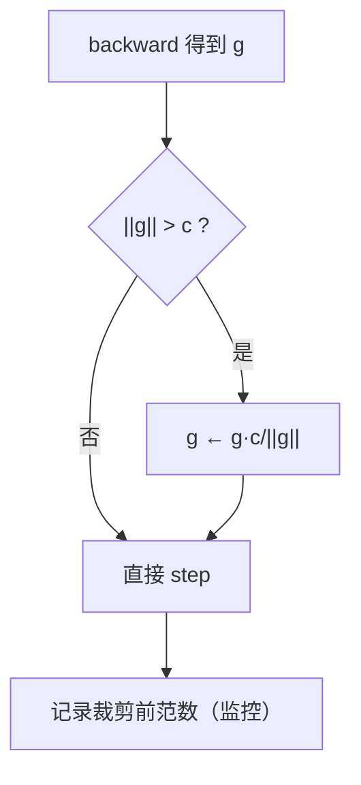

# DL-031 梯度裁剪与训练稳定性

## 1. 本节学习目标

1. 说清梯度裁剪的两种做法（按值 / 按范数），并会用 `clip_grad_norm_`。
2. 用实测看裁剪前后差异（不裁剪 **第 3 轮就 NaN**；裁剪后 **341.98 仍有限**）。
3. 理解裁剪"治标不治本"，知道该同时查哪些根因。
4. 建立训练稳定性的检查清单。

## 2. 为什么需要这个知识

因为**一次 NaN 就能毁掉几小时的训练**，而裁剪是最便宜的保护措施（一行代码）。

但裁剪不是万能的：它只能**防止单步过大**，不能修复"初始化错了""lr 太大""数据有脏值"这些根因。

## 3. 直观解释

**梯度裁剪 = 给梯度设一个上限**：

```text
若 ||g|| > max_norm:
    g ← g × (max_norm / ||g||)     # 等比缩小，方向不变
```

**两种粒度**：

| 方式 | 做法 | 用途 |
|---|---|---|
| **按范数**（推荐） | 缩放**整体**梯度，保持方向 | 通用 |
| 按值 | 逐元素截断到 $[-c, c]$ | 少量场景 |

**为什么按范数更好**：它**不改变梯度方向**，只是把步子缩短。

## 4. 正式定义

**按范数裁剪**

$$
\mathbf{g}\leftarrow\mathbf{g}\cdot\min\Big(1,\frac{c}{\|\mathbf{g}\|}\Big)
$$

$c$ 是 `max_norm`（常用 1.0 或 5.0）。

**按值裁剪**

$$
g_i\leftarrow\mathrm{clip}(g_i,-c,c)
$$

**PyTorch**

```text
torch.nn.utils.clip_grad_norm_(model.parameters(), max_norm=1.0)
```

返回裁剪前的总范数（可用于监控）。

## 5. 核心原理

**本课实测（12 层、权重 ×6、lr=0.01）**

**不裁剪**：

| epoch | loss | 梯度范数 |
|---|---|---|
| 1 | 1151.53 | 53802.44 |
| 2 | **1.11e+09** | **1.88e+09** |
| 3 | **nan** | **nan** |
| 4 | nan | nan |

**裁剪 1.0**：

| epoch | loss | 裁剪前范数 |
|---|---|---|
| 1 | 1151.53 | 53802.44 |
| 2 | 637.38 | 41395.02 |
| 3 | 360.69 | 8146.94 |
| 4 | 529.97 | 31133.50 |
| 末轮 | **341.98** | — |

**读法**：

1. 初始梯度范数 **53802** —— 已经远超"正常量级（0.1–10）"。
2. 不裁剪：第 2 轮梯度 **1.88e+09**，第 3 轮 **NaN**。
3. 裁剪后：loss 在 300–600 区间**有限波动**，没有崩。

**但注意**：裁剪后 loss 仍是 341（远高于 ln 2 ≈ 0.69）——说明**模型本身仍然很差**（权重 ×6 的初始化是错的）。裁剪只是"没让它炸"，不是"让它学好"。

## 6. 数学表达式

**为什么按范数裁剪不改方向**

设 $\mathbf{g}'=\alpha\mathbf{g}$，$\alpha=\frac{c}{\|\mathbf{g}\|}<1$。

则 $\frac{\mathbf{g}'}{\|\mathbf{g}'\|}=\frac{\mathbf{g}}{\|\mathbf{g}\|}$ ⇒ **方向完全不变**。

**裁剪后的更新**

$$
\theta\leftarrow\theta-\eta\cdot\frac{c}{\|\mathbf{g}\|}\mathbf{g}
$$

相当于**自适应地把这一步的步长限制在 $\eta c$**。

## 7. 数学推导

**梯度爆炸的临界步长**

对上一步更新，损失一阶近似：

$$
\Delta L\approx-\eta\|\mathbf{g}\|^2
$$

若 $\|\mathbf{g}\|=1.88\times10^9$、$\eta=0.01$，则 $\Delta L\approx-3.5\times10^{16}$ —— **一步把参数推到无穷远** ⇒ NaN。

**裁剪后**：$\|\mathbf{g}'\|\le c=1$ ⇒ $\Delta L\approx-\eta c^2=0.01$ ⇒ 可控。

**这解释了"为什么裁剪有效"**：它把单步位移限定在 $\eta c$ 量级。

## 8. 结构示意图



## 9. 具体计算示例

```text
不裁剪: ([1151.5295, 1109873152.0, nan, nan], [53802.44, 1879280640.0, nan, nan], nan)
裁剪1.0: ([1151.5295, 637.3817, 360.6923, 529.9736], [53802.44, 41395.02, 8146.94, 31133.5], 341.982)
```

**两组的第 1 轮完全相同**（loss 1151.53、范数 53802.44）——因为裁剪发生在**更新前**，第 1 轮的损失是一样算出来的。

## 10. Python 实现

```python
import torch
import torch.nn as nn
import torch.nn.functional as F


def build(depth: int = 12, scale: float = 6.0) -> nn.Sequential:
    torch.manual_seed(0)
    layers = []
    for _ in range(depth):
        lin = nn.Linear(16, 16)
        with torch.no_grad():
            lin.weight.mul_(scale)
        layers += [lin, nn.ReLU()]
    return nn.Sequential(*layers, nn.Linear(16, 1))


def run(clip, epochs: int = 6):
    model = build()
    X = torch.randn(400, 16)
    y = torch.randint(0, 2, (400, 1)).float()
    opt = torch.optim.SGD(model.parameters(), lr=0.01)
    for epoch in range(1, epochs + 1):
        opt.zero_grad()
        loss = F.binary_cross_entropy_with_logits(model(X), y)
        loss.backward()
        if clip:
            norm = float(torch.nn.utils.clip_grad_norm_(model.parameters(), clip))
        else:
            norm = float(sum(p.grad.norm() ** 2
                             for p in model.parameters() if p.grad is not None) ** 0.5)
        opt.step()
        print(f"  epoch {epoch}: loss={float(loss):.2f} 梯度范数={norm:.2f}")


print("不裁剪:")
run(None)
print("裁剪 1.0:")
run(1.0)
```

## 11. PyTorch 实现（训练循环里加监控）

```python
import torch
import torch.nn as nn
import torch.nn.functional as F

model = nn.Sequential(nn.Linear(8, 16), nn.ReLU(), nn.Linear(16, 1))
opt = torch.optim.SGD(model.parameters(), lr=0.1)
X = torch.randn(64, 8)
y = torch.randint(0, 2, (64, 1)).float()

opt.zero_grad()
loss = F.binary_cross_entropy_with_logits(model(X), y)
loss.backward()
before = torch.nn.utils.clip_grad_norm_(model.parameters(), max_norm=1.0)
opt.step()

print("裁剪前总范数:", round(float(before), 4))
print("裁剪后总范数:", round(float(sum(p.grad.norm() ** 2
                              for p in model.parameters() if p.grad is not None) ** 0.5), 4))
```

## 12. 代码逐行解释

| 代码 | 作用 |
|---|---|
| `lin.weight.mul_(6.0)` | 故意造"大权重"以诱发爆炸 |
| `clip_grad_norm_(params, c)` | 按总范数裁剪，**返回裁剪前范数** |
| `sum(p.grad.norm()**2 ...)**0.5` | 手工算总范数（对照） |
| `if clip:` | 同一函数对比两种设置 |

**关键顺序**：`backward()` → `clip_grad_norm_()` → `step()`。**裁剪必须在 step 之前**。

## 13. 实际运行结果

```text
不裁剪: ([1151.5295, 1109873152.0, nan, nan], [53802.44, 1879280640.0, nan, nan], nan)
裁剪1.0: ([1151.5295, 637.3817, 360.6923, 529.9736], [53802.44, 41395.02, 8146.94, 31133.5], 341.982)
```

**结论**：裁剪让训练从"3 轮必炸"变成"能持续跑"，但 loss 仍 341.98 —— **只解决稳定性，不解决正确性**。

## 14. 应用场景

| 场景 | 常用 `max_norm` |
|---|---|
| RNN / LSTM | 1.0（经典配置） |
| Transformer | 1.0 |
| CNN | 1.0–5.0（可选） |
| GAN | 1.0（常配） |
| 强化学习 | 0.5–1.0 |

## 15. 优点与缺点

| 优点 | 缺点 |
|---|---|
| 一行代码防 NaN | 治标不治本 |
| 不改方向、只缩步长 | 阈值需调（太小拖慢） |
| 返回范数可监控 | 掩盖根因（如初始化错） |

## 16. 常见错误

| 错误 | 现象 | 纠正 |
|---|---|---|
| 在 `step()` 之后裁剪 | 无效 | 裁剪在 `backward` 与 `step` 之间 |
| `max_norm` 太小（0.01） | 训练极慢 | 1.0 起调 |
| 以为裁剪能提升精度 | loss 仍很高（本课 341） | 同时修根因 |
| 忘了 `zero_grad` | 范数虚高 | 每步清零 |
| 只在崩溃后才加 | 已浪费算力 | 训练一开始就加 |
| 不记录范数 | 无法判断是否真爆炸 | 每步/每轮打印 |

## 17. 本节总结

- 裁剪按**总范数**缩放，**不改方向**：$\mathbf{g}\leftarrow\mathbf{g}\min(1,c/\|\mathbf{g}\|)$。
- 实测：不裁剪 **第 3 轮 NaN**；裁剪 1.0 后末轮 **341.98**（有限）。
- **裁剪治标**：本课 loss 仍 341，根因是权重 ×6 的坏初始化。

## 18. 前置与后续

- 前置：[[DL-030 权重初始化——Xavier 与 He]]
- 后续：`DL-032 过拟合与欠拟合（深度学习视角）`（待建，M-DL-04 开篇）
- 相关数学：[[MATH-721 梯度下降]]

---

## 练习与参考答案

**基础 1**：按范数裁剪与按值裁剪有什么区别？为什么推荐按范数？

**基础 2**：本课不裁剪与裁剪 1.0 的结果各是什么？

**进阶 1**：为什么裁剪后 loss 还是 341.98，而不是降到 0.69 附近？

**综合**：训练 LSTM 时 loss 每几百步就出现 NaN。请给出排查与修复的完整顺序。

> [!success]- 参考答案

> **基础 1**
> - **按范数**：整体缩放 $\mathbf{g}\leftarrow\mathbf{g}\cdot\min(1,c/\|\mathbf g\|)$，**方向不变**，只缩短步长。
> - **按值**：逐元素截断到 $[-c,c]$，**会改变方向**（各分量被不同程度截断）。
> 推荐按范数，因为保持方向更符合"沿梯度下降"的语义。

> **基础 2**
> 不裁剪：第 2 轮梯度 **1.88e+09**，第 3 轮 **NaN**；
> 裁剪 1.0：loss 序列 1151.53 → 637.38 → 360.69 → 529.97，末轮 **341.982**，全程有限。

> **进阶 1**
> 因为裁剪只限制"单步步长"，**不改变模型本身的错误**。本课权重被乘以 6，初始 logit 巨大、激活饱和，模型即便稳定也无法拟合。
> 裁剪的价值是"让训练能继续跑、不崩"，要真正降 loss 必须修根因（初始化、lr、数据）。

> **综合（参考）**
> **排查顺序**：
> 1. **监控**：每步记录 `grad_norm` 与 loss，确认 NaN 前范数是否暴涨；
> 2. **立即加裁剪**：`clip_grad_norm_(params, 1.0)`（RNN 标配）；
> 3. **降 lr**（如 1e-3 → 1e-4），并加 warmup；
> 4. **查数据**：是否有极端值/NaN 标签；
> 5. **查结构**：是否缺 `zero_grad`、BPTT 截断长度是否过长。
> **修复**：裁剪 + 降 lr + warmup 三件套；若仍偶发，加 `torch.autograd.detect_anomaly()` 定位具体算子。
> **记录**：把"第几步 NaN、梯度范数、lr"写进训练日志。

## 学习记录

| 日期 | 状态 | 用时 | 问题 | 复盘 |
|---|---|---|---|---|
| 2026-11-07 | planned | — | — | — |

---

## 🔗 Notion 同步信息

> 以下内容由 Notion「AI Knowledge System · 知识点」数据库按知识 ID 合并而来（导出于 2026-11-09）。

| 属性 | 值 |
|---|---|
| 学科 | 深度学习 |
| 学习状态 | 未开始 |
| 难度 | L2 应用 |
| 知识类型 | Technique |

- **所属模块**：[M-DL-03 神经网络训练与优化算法](../%E8%AF%BE%E7%A8%8B%E6%A8%A1%E5%9D%97/M-DL-03%20%E7%A5%9E%E7%BB%8F%E7%BD%91%E7%BB%9C%E8%AE%AD%E7%BB%83%E4%B8%8E%E4%BC%98%E5%8C%96%E7%AE%97%E6%B3%95.md)
- **前置知识**：[DL-030 权重初始化：Xavier 与 He](DL-030%20%E6%9D%83%E9%87%8D%E5%88%9D%E5%A7%8B%E5%8C%96%E2%80%94%E2%80%94Xavier%20%E4%B8%8E%20He.md)
- **后继知识**：[DL-032 过拟合与欠拟合（深度学习视角）](DL-032%20%E8%BF%87%E6%8B%9F%E5%90%88%E4%B8%8E%E6%AC%A0%E6%8B%9F%E5%90%88%E2%80%94%E2%80%94%E6%B7%B1%E5%BA%A6%E5%AD%A6%E4%B9%A0%E8%A7%86%E8%A7%92.md)
- **关联数学**：[MATH-721 梯度下降](../../06_%E6%95%B0%E5%AD%A6%E5%9F%BA%E7%A1%80/07%20%E6%9C%80%E4%BC%98%E5%8C%96%E6%96%B9%E6%B3%95/MATH-721%20%E6%A2%AF%E5%BA%A6%E4%B8%8B%E9%99%8D.md)
