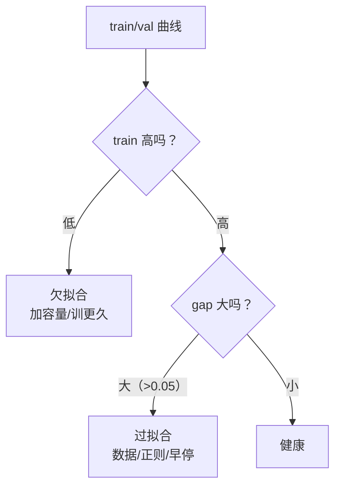

# DL-032 过拟合与欠拟合（深度学习视角）

## 1. 本节学习目标

1. 用 **train/val 差距**判断"过拟合 / 欠拟合 / 刚好"。
2. 用实测看到"小数据 + 大网络"如何制造过拟合（train **1.0000** vs test **0.9125**）。
3. 会区分"数据量不足"与"模型容量不足"两类问题。
4. 知道深度学习的过拟合与 ML 的异同（**参数量 ≠ 过拟合的唯一原因**）。

## 2. 为什么需要这个知识

因为深度学习**天生容易过拟合**：参数动辄百万，而数据可能只有几千。

更麻烦的是，深度学习有一个反直觉现象——**大模型有时泛化更好**（"双下降"）。所以不能简单地"参数量大就砍小"，必须看 train/val 曲线。

## 3. 直观解释

三种状态用一句话判断：

| 状态 | train acc | val acc | 症状 |
|---|---|---|---|
| **欠拟合** | 低（如 0.87） | 低 | 模型太弱/训不够 |
| **刚好** | 高 | 高且接近 | 理想 |
| **过拟合** | **很高（1.00）** | 明显更低 | gap 大 |

**本课实测**：

- 大网络 + 800 样本：train 0.9286、test 0.9375 ⇒ **gap = −0.0089**（几乎没有过拟合）。
- 大网络 + **60 样本**：train **1.0000**、test 0.9125 ⇒ **gap = 0.0875**。

**同一模型，只因为数据从 800 减到 60，就过拟合了。**

## 4. 正式定义

**泛化误差**

$$
L_{\text{gen}}=L_{\text{test}}-L_{\text{train}}
$$

**（近似）过拟合判据**

$$
L_{\text{train}}\ll L_{\text{val}}
$$

**（近似）欠拟合判据**

$$
L_{\text{train}}\ \text{本身就高}
$$

**本课用准确率差**：$\text{gap}=\text{train\_acc}-\text{test\_acc}$，gap > 0.05 值得警惕。

## 5. 核心原理

**过拟合的本质**：模型记住了训练集的**噪声**与**个别样本**，而不是可泛化的规律。

**深度学习特有的三个诱因**：

| 诱因 | 说明 |
|---|---|
| **参数多** | 17,025 参数的 MLP 对 60 个样本显然是"杀鸡用牛刀" |
| **训练久** | 训练到 train_loss→0 必然记住训练集 |
| **数据少/重复** | 有效样本量不足 |

**反直觉点**：单纯减小模型不一定解决——**增加数据、加正则、早停**往往更有效。

## 6. 数学表达式

**训练误差与泛化误差的分解**（DL-033 展开）

$$
\mathbb{E}[L_{\text{test}}]=\text{bias}^2+\text{variance}+\text{noise}
$$

- 欠拟合 ⇒ bias 大。
- 过拟合 ⇒ variance 大。

**本课容量对比**

| 模型 | 参数 | train | test | gap |
|---|---|---|---|---|
| h=4 | **17** | 0.8696 | 0.9208 | −0.0512 |
| h=32 | 129 | 0.9339 | 0.9167 | 0.0173 |
| h=64×3 | **8577** | 0.9375 | 0.9333 | 0.0042 |

**读法**：h=4 的 **train 比 test 还低**（0.8696 < 0.9208）⇒ 典型**欠拟合**（训练集都学不牢）。而 h=64×3 参数最多，却没有明显过拟合（gap 0.0042）——**参数量不是唯一决定因素**。

## 7. 数学推导

**为什么"训练到 loss=0"必然过拟合**

设训练集 $n$ 个样本、参数 $p$ 个。当 $p\gg n$ 时，模型可以**完全插值**训练集（把每个点都拟合到 0 误差）：

$$
\exists\theta:\ L_{\text{train}}(\theta)=0
$$

但这样的解在训练集之外**没有任何约束**，泛化误差可能很大。

本课 60 样本 + 17,025 参数 ⇒ $p/n\approx284$，插值极其容易 ⇒ train 达到 **1.0000**。

## 8. 结构示意图



## 9. 具体计算示例

```text
大网络 800 样本: train=0.9286 test=0.9375 gap=-0.0089 参数=17025
大网络 60 样本 : train=1.0000 test=0.9125 gap=0.0875
```

**同模型、同超参**，仅训练样本 800→60：
- train 从 0.9286 涨到 **1.0000**（完美记住）；
- test 从 0.9375 掉到 0.9125；
- gap 从 −0.0089 变成 **+0.0875**。

## 10. Python 实现

```python
import torch
import torch.nn as nn
import torch.nn.functional as F
from sklearn.datasets import make_moons
from sklearn.model_selection import train_test_split

X, y = make_moons(n_samples=800, noise=0.30, random_state=42)
Xtr, Xte, ytr, yte = train_test_split(X, y, test_size=0.3,
                                      random_state=42, stratify=y)
Xtr = torch.tensor(Xtr, dtype=torch.float32)
ytr = torch.tensor(ytr, dtype=torch.float32).view(-1, 1)
Xte = torch.tensor(Xte, dtype=torch.float32)
yte = torch.tensor(yte, dtype=torch.float32).view(-1, 1)


def make_model() -> nn.Sequential:
    return nn.Sequential(nn.Linear(2, 128), nn.ReLU(),
                         nn.Linear(128, 128), nn.ReLU(),
                         nn.Linear(128, 1))


def fit(Xs, ys, epochs=300):
    torch.manual_seed(0)
    m = make_model()
    opt = torch.optim.Adam(m.parameters(), lr=0.05)
    for _ in range(epochs):
        opt.zero_grad()
        F.binary_cross_entropy_with_logits(m(Xs), ys).backward()
        opt.step()
    m.eval()
    with torch.no_grad():
        tr = float((torch.sigmoid(m(Xs)) >= 0.5).float().eq(ys).float().mean())
        te = float((torch.sigmoid(m(Xte)) >= 0.5).float().eq(yte).float().mean())
    return tr, te


for n in (60, 800):
    tr, te = fit(Xtr[:n], ytr[:n])
    print(f"n={n:>3}: train={tr:.4f} test={te:.4f} gap={tr - te:+.4f}")
```

## 11. PyTorch 实现（容量对比）

```python
import torch
import torch.nn as nn
import torch.nn.functional as F
from sklearn.datasets import make_moons
from sklearn.model_selection import train_test_split

X, y = make_moons(n_samples=800, noise=0.30, random_state=42)
Xtr, Xte, ytr, yte = train_test_split(X, y, test_size=0.3,
                                      random_state=42, stratify=y)
Xtr = torch.tensor(Xtr, dtype=torch.float32)
ytr = torch.tensor(ytr, dtype=torch.float32).view(-1, 1)
Xte = torch.tensor(Xte, dtype=torch.float32)
yte = torch.tensor(yte, dtype=torch.float32).view(-1, 1)


def build(h: int, layers: int) -> nn.Sequential:
    seq, dim = [], 2
    for _ in range(layers):
        seq += [nn.Linear(dim, h), nn.ReLU()]
        dim = h
    seq.append(nn.Linear(dim, 1))
    return nn.Sequential(*seq)


for h, layers in ((4, 1), (32, 1), (64, 3)):
    torch.manual_seed(0)
    m = build(h, layers)
    opt = torch.optim.Adam(m.parameters(), lr=0.05)
    for _ in range(200):
        perm = torch.randperm(len(Xtr))
        for i in range(0, len(Xtr), 32):
            idx = perm[i:i + 32]
            opt.zero_grad()
            F.binary_cross_entropy_with_logits(m(Xtr[idx]), ytr[idx]).backward()
            opt.step()
    m.eval()
    with torch.no_grad():
        tr = float((torch.sigmoid(m(Xtr)) >= 0.5).float().eq(ytr).float().mean())
        te = float((torch.sigmoid(m(Xte)) >= 0.5).float().eq(yte).float().mean())
    params = sum(p.numel() for p in m.parameters())
    print(f"h={h:<3} layers={layers}: train={tr:.4f} test={te:.4f} "
          f"gap={tr - te:+.4f} 参数={params}")
```

## 12. 代码逐行解释

| 代码 | 作用 |
|---|---|
| `make_model()` 固定大网络 | 保证"只改数据量"的对比公平 |
| `Xtr[:60]` | 只取 60 个样本制造小数据 |
| `m.eval()` + `no_grad` | 评估模式，避免 Dropout/BN 干扰 |
| `gap=tr-te` | 过拟合的直接度量 |
| `build(h, layers)` | 造不同容量的网络 |

**为什么用同一模型**：如果连模型一起换，就分不清"是数据少导致的"还是"模型小导致的"。

## 13. 实际运行结果

```text
大网络 800 样本: train=0.9286 test=0.9375 gap=-0.0089 参数=17025
大网络 60 样本 : train=1.0000 test=0.9125 gap=0.0875

h=4 layers=1: train=0.8696 test=0.9208 gap=-0.0512 参数=17
h=32 layers=1: train=0.9339 test=0.9167 gap=0.0173 参数=129
h=64 layers=3: train=0.9375 test=0.9333 gap=0.0042 参数=8577
```

## 14. 应用场景

| 现象 | 处理 |
|---|---|
| train 1.0、val 0.8 | 加数据 / 数据增强 / Dropout / 早停 |
| train 0.7、val 0.7 | 加容量 / 训更久 / 换特征 |
| 两者都高但 gap 略大 | 先看验证集是否太小（噪声） |
| 大模型反而更好 | 别急着砍模型，先补齐正则与数据 |

## 15. 优点与缺点

（本节讲问题识别，此处列常见策略的取舍）

| 策略 | 见效速度 | 代价 |
|---|---|---|
| 加数据 | 最根本 | 贵/难 |
| Dropout | 快 | 训练变慢、需调 p |
| Weight Decay | 快 | 过大导致欠拟合 |
| 早停 | 免费 | 需要可靠验证集 |
| 减容量 | 快 | 可能反而欠拟合 |

## 16. 常见错误

| 错误 | 现象 | 纠正 |
|---|---|---|
| 只看 train acc | 以为 0.99 很好 | 必须看 val/test |
| 用测试集调正则 | 泄漏 | 用验证集 |
| 一过拟合就砍模型 | 可能变欠拟合 | 先加数据/正则 |
| 验证集太小 | gap 波动大 | 至少几百条 |
| 忘 `eval()` | Dropout/BN 让 val 偏低 | 评估切模式 |
| 用小数据训大模型 | train 1.0/test 0.91 | 加数据或强正则 |

## 17. 本节总结

- 过拟合 = **train 高、val 低、gap 大**；欠拟合 = **train 本身就低**。
- 本课同模型：800 样本 gap **−0.0089**；60 样本 train **1.0000**、gap **+0.0875**。
- **参数量不是唯一因素**：8577 参数的网络 gap 只有 0.0042，17 参数的网络反而欠拟合。

## 18. 前置与后续

- 前置：[[DL-031 梯度裁剪与训练稳定性]]
- 后续：[[DL-033 偏差-方差与泛化能力]]、[[DL-034 L1、L2 正则化与 Weight Decay]]、[[DL-035 Dropout]]
- 相关机器学习：[[ML-046 过拟合与欠拟合]]、[[ML-047 偏差-方差权衡与学习曲线]]

---

## 练习与参考答案

**基础 1**：如何用 train/val 准确率区分欠拟合、过拟合与健康？

**基础 2**：本课 800 样本与 60 样本的 train/test 各是多少？

**进阶 1**：为什么 h=4（17 参数）反而"train 比 test 低"？

**综合**：你的模型 train acc 0.99、val acc 0.72，且验证集只有 100 条。请给出 3 个诊断与 3 个改进。

> [!success]- 参考答案

> **基础 1**
> - **欠拟合**：train 本身低（如 0.87），val 也低。
> - **过拟合**：train 很高（近 1.0），val 明显低，**gap 大**。
> - **健康**：两者都高且接近（gap < 0.05）。

> **基础 2**
> 800 样本：train **0.9286**、test **0.9375**（gap −0.0089）；
> 60 样本：train **1.0000**、test **0.9125**（gap +0.0875）。

> **进阶 1**
> 因为 h=4 容量太小（17 参数），**连训练集都没拟合好**（0.8696）。而 test 0.9208 更高是因为评估噪声 + 训练不足导致的偶然波动。
> 这是典型的**欠拟合**：train 误差本身就高，gap 为负不代表泛化好。

> **综合（参考）**
> **3 个诊断**：
> 1. gap 0.27 是明显过拟合；
> 2. 验证集只有 100 条 ⇒ 指标波动可达 ±5 个点，**不足以支撑细粒度调参**；
> 3. 检查训练集与验证集是否同分布（数据泄漏/切分偏差）。
> **3 个改进**：
> 1. **扩大验证集**（至少 500 条）或改用 5 折 CV，让评估稳定；
> 2. **加正则**：Dropout(0.2–0.5)、Weight Decay(1e-3–1e-2)、label smoothing；
> 3. **加数据/增强**，并配合早停（回滚到 val 最优）。
> **验证顺序**：先确认评估可信（扩验证集），再加正则，最后才考虑减模型。

## 学习记录

| 日期 | 状态 | 用时 | 问题 | 复盘 |
|---|---|---|---|---|
| 2026-11-07 | planned | — | — | — |

---

## 🔗 Notion 同步信息

> 以下内容由 Notion「AI Knowledge System · 知识点」数据库按知识 ID 合并而来（导出于 2026-11-09）。

| 属性 | 值 |
|---|---|
| 学科 | 深度学习 |
| 学习状态 | 未开始 |
| 难度 | L2 应用 |
| 知识类型 | Concept |

- **所属模块**：[M-DL-04 模型泛化、正则化与训练技巧](../%E8%AF%BE%E7%A8%8B%E6%A8%A1%E5%9D%97/M-DL-04%20%E6%A8%A1%E5%9E%8B%E6%B3%9B%E5%8C%96%E3%80%81%E6%AD%A3%E5%88%99%E5%8C%96%E4%B8%8E%E8%AE%AD%E7%BB%83%E6%8A%80%E5%B7%A7.md)
- **前置知识**：[DL-031 梯度裁剪与训练稳定性](DL-031%20%E6%A2%AF%E5%BA%A6%E8%A3%81%E5%89%AA%E4%B8%8E%E8%AE%AD%E7%BB%83%E7%A8%B3%E5%AE%9A%E6%80%A7.md)
- **后继知识**：[DL-033 偏差-方差与泛化能力](DL-033%20%E5%81%8F%E5%B7%AE-%E6%96%B9%E5%B7%AE%E4%B8%8E%E6%B3%9B%E5%8C%96%E8%83%BD%E5%8A%9B.md)
