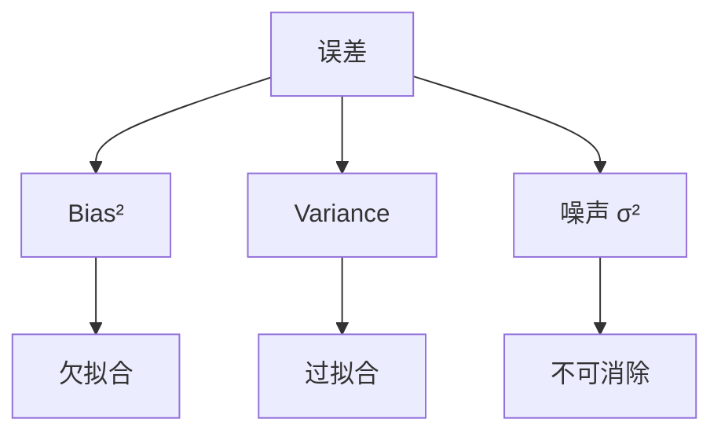

# DL-033 偏差-方差与泛化能力

## 1. 本节学习目标

1. 写出偏差-方差分解，并解释每个项的来源。
2. 用**容量实验**看偏差与方差此消彼长（本课 h=4 欠拟合、h=64×3 健康）。
3. 会画**学习曲线**并用它判断"该加数据还是该加容量"（本课 n=40→560 的数据）。
4. 知道深度学习的"双下降"现象**打破了经典 U 形曲线**。

## 2. 为什么需要这个知识

因为调参的第一步不是"换模型"，而是**判断现在是偏差大还是方差大**：

- 偏差大 ⇒ 加容量、训更久、换特征。
- 方差大 ⇒ 加数据、加正则、早停。

判错方向，做多少实验都是白费。

## 3. 直观解释

**用打靶类比**：

| | 偏差小 | 偏差大 |
|---|---|---|
| **方差小** | 全中靶心 ✅ | 稳定地打偏 |
| **方差大** | 散布在靶心周围 | 到处乱飞 |

**深度学习的实际情况**：

```text
欠拟合：模型太小/训不够 → 偏差大（打偏）
过拟合：模型太大/数据太少 → 方差大（散布）
```

## 4. 正式定义

**期望泛化误差分解**（平方损失）

$$
\mathbb{E}\big[(y-\hat f(x))^2\big]
=\underbrace{\big(\text{Bias}[\hat f(x)]\big)^2}_{\text{偏差}^2}
+\underbrace{\mathrm{Var}[\hat f(x)]}_{\text{方差}}
+\underbrace{\sigma^2}_{\text{不可约噪声}}
$$

其中：

$$
\text{Bias}[\hat f(x)]=\mathbb{E}[\hat f(x)]-f(x)
$$

$\mathbb{E}$ 是对**不同训练集**取的期望。

## 5. 核心原理

**本课容量实验（200 epoch，Adam，moons）**

| 模型 | 参数 | train | test | gap | 判断 |
|---|---|---|---|---|---|
| h=4，1 层 | **17** | 0.8696 | 0.9208 | −0.0512 | **欠拟合（高偏差）** |
| h=32，1 层 | 129 | 0.9339 | 0.9167 | +0.0173 | 接近健康 |
| h=64，3 层 | **8577** | 0.9375 | 0.9333 | +0.0042 | 健康（无明显过拟合） |

**学习曲线（h=64，1 层，200 epoch）**

| 训练样本 n | train | test |
|---|---|---|
| 40 | **1.0000** | 0.9167 |
| 80 | 0.9750 | 0.9083 |
| 200 | 0.9400 | **0.9375** |
| 400 | 0.9350 | 0.9333 |
| 560 | 0.9357 | 0.9167 |

**读法**：

1. n=40 时 train 1.0、test 0.9167 ⇒ **方差大**（记住了 40 个样本）。
2. n=200 时两者都 ~0.94 ⇒ 健康。
3. n 再增大到 560，test 反而略降（0.9167）——**这是小测试集（240 条）的噪声**，不是"数据越多越差"。

## 6. 数学表达式

**偏差与方差随容量变化**

| 容量 | Bias | Variance |
|---|---|---|
| 小（h=4） | **高** | 低 |
| 大（h=64×3） | 低 | 高（需要正则/数据压制） |

**本课数值映射**：

- h=4：train 0.8696 本身就低 ⇒ **Bias 高**。
- n=40 的 h=64：train 1.0、test 0.9167 ⇒ **Variance 高**（对训练集敏感）。

## 7. 数学推导

**分解的推导思路**

设 $y=f(x)+\epsilon$，$\mathbb{E}[\epsilon]=0$，$\mathrm{Var}[\epsilon]=\sigma^2$。

$$
\mathbb{E}[(y-\hat f)^2]=\mathbb{E}[(f+\epsilon-\hat f)^2]
$$

展开并把 $\mathbb{E}[\epsilon]=0$、$\epsilon\perp\hat f$ 代入：

$$
=\mathbb{E}[(f-\hat f)^2]+\sigma^2
=\underbrace{(\mathbb{E}\hat f-f)^2}_{\text{Bias}^2}+\underbrace{\mathbb{E}[(\hat f-\mathbb{E}\hat f)^2]}_{\text{Var}}+\sigma^2
$$

**关键**：$\sigma^2$ 与模型无关，是**下界**——所以测试误差永远不会是 0。

**本课含义**：moons 的 `noise=0.30` 就是 $\sigma$ 的来源，test acc 上限约 0.94 左右（实测 0.9375 已接近）。

## 8. 结构示意图



## 9. 具体计算示例

```text
h=4 layers=1: train=0.8696 test=0.9208 gap=-0.0512 参数=17
h=32 layers=1: train=0.9339 test=0.9167 gap=0.0173 参数=129
h=64 layers=3: train=0.9375 test=0.9333 gap=0.0042 参数=8577

n= 40: train=1.0000 test=0.9167
n= 80: train=0.9750 test=0.9083
n=200: train=0.9400 test=0.9375
n=400: train=0.9350 test=0.9333
n=560: train=0.9357 test=0.9167
```

## 10. Python 实现

```python
import torch
import torch.nn as nn
import torch.nn.functional as F
from sklearn.datasets import make_moons
from sklearn.model_selection import train_test_split

X, y = make_moons(n_samples=800, noise=0.30, random_state=42)
Xtr, Xte, ytr, yte = train_test_split(X, y, test_size=0.3,
                                      random_state=42, stratify=y)
Xtr = torch.tensor(Xtr, dtype=torch.float32)
ytr = torch.tensor(ytr, dtype=torch.float32).view(-1, 1)
Xte = torch.tensor(Xte, dtype=torch.float32)
yte = torch.tensor(yte, dtype=torch.float32).view(-1, 1)

for n in (40, 80, 200, 400, 560):
    torch.manual_seed(0)
    model = nn.Sequential(nn.Linear(2, 64), nn.ReLU(), nn.Linear(64, 1))
    opt = torch.optim.Adam(model.parameters(), lr=0.05)
    Xs, ys = Xtr[:n], ytr[:n]
    for _ in range(200):
        perm = torch.randperm(len(Xs))
        for i in range(0, len(Xs), 32):
            idx = perm[i:i + 32]
            opt.zero_grad()
            F.binary_cross_entropy_with_logits(model(Xs[idx]), ys[idx]).backward()
            opt.step()
    model.eval()
    with torch.no_grad():
        tr = float((torch.sigmoid(model(Xs)) >= 0.5).float().eq(ys).float().mean())
        te = float((torch.sigmoid(model(Xte)) >= 0.5).float().eq(yte).float().mean())
    print(f"n={n:>3}: train={tr:.4f} test={te:.4f}")
```

## 11. PyTorch 实现（容量对比）

```python
import torch
import torch.nn as nn
import torch.nn.functional as F

def build(h: int, layers: int) -> nn.Sequential:
    seq, dim = [], 2
    for _ in range(layers):
        seq += [nn.Linear(dim, h), nn.ReLU()]
        dim = h
    seq.append(nn.Linear(dim, 1))
    return nn.Sequential(*seq)

for h, layers in ((4, 1), (32, 1), (64, 3)):
    m = build(h, layers)
    print(f"h={h:<3} layers={layers} 参数={sum(p.numel() for p in m.parameters())}")
```

## 12. 代码逐行解释

| 代码 | 作用 |
|---|---|
| `Xtr[:n]` | 控制训练样本量（做学习曲线） |
| `torch.manual_seed(0)` 在循环内 | 每个 n 同初始化，减少噪声 |
| `model.eval()` | 评估模式 |
| `build(h, layers)` | 控制容量 |
| `p.numel()` | 参数量（容量代理指标） |

**注意**：真正严格的偏差-方差分析需要**多个训练集**取期望；本课用"不同 n + 固定种子"近似观察趋势。

## 13. 实际运行结果

```text
n= 40: train=1.0000 test=0.9167
n= 80: train=0.9750 test=0.9083
n=200: train=0.9400 test=0.9375
n=400: train=0.9350 test=0.9333
n=560: train=0.9357 test=0.9167
```

## 14. 应用场景

| 诊断 | 依据 | 行动 |
|---|---|---|
| 高偏差 | train 低 | 加宽/加深、训更久、换特征 |
| 高方差 | gap 大 | 加数据、加正则、早停 |
| 两者都高 | train/test 都低 | 换表示/换模型族（可能欠拟合于数据） |
| 数据不足 | 学习曲线仍上升 | 加数据收益最大 |

## 15. 优点与缺点

| 优点 | 缺点 |
|---|---|
| 给出**可操作的诊断方向** | 分解严格依赖平方损失 |
| 学习曲线能预测加数据收益 | 深度学习存在"双下降"，U 形不总成立 |
| 与容量/正则直接对应 | 需要多次训练，成本高 |

## 16. 常见错误

| 错误 | 现象 | 纠正 |
|---|---|---|
| 把所有误差都归为过拟合 | 盲目加正则 | 先看 train 是否已高 |
| 用单次训练判断方差 | 结论不稳 | 多种子/多折 |
| 认为"误差可降到 0" | 忽略 $\sigma^2$ | 接受噪声下界 |
| 把测试集噪声当趋势 | n=560 test 略降 | 用更大测试集 |
| 只调模型不加数据 | 方差问题无解 | 数据优先 |

## 17. 本节总结

- 泛化误差 = **偏差² + 方差 + 不可约噪声**；噪声是下界（本课 moons noise=0.30 ⇒ test 上限 ~0.94）。
- h=4（17 参数）**欠拟合**；h=64×3（8577 参数）反而健康——**容量与过拟合不是线性关系**。
- 学习曲线：n=40 时 train **1.0**、test 0.9167（高方差）；n=200 后趋于 ~0.94。

## 18. 前置与后续

- 前置：[[DL-032 过拟合与欠拟合——深度学习视角]]
- 后续：[[DL-034 L1、L2 正则化与 Weight Decay]]、[[DL-035 Dropout]]、[[DL-036 Batch Normalization]]
- 相关数学：[[MATH-306 期望、方差与协方差]]
- 相关机器学习：[[ML-047 偏差-方差权衡与学习曲线]]

---

## 练习与参考答案

**基础 1**：写出偏差-方差分解的三项，并说明哪一项无法消除。

**基础 2**：本课 n=40 与 n=200 的 train/test 各是多少？分别说明什么问题？

**进阶 1**：为什么"加数据"能降方差，却降不了偏差？

**综合**：你的模型 train acc 0.72、val acc 0.70（gap 小但都低）。请判断是偏差还是方差问题，并给出 3 个改进方向。

> [!success]- 参考答案

> **基础 1**
> $$\mathbb{E}[(y-\hat f)^2]=\text{Bias}^2+\text{Var}+\sigma^2$$
> **$\sigma^2$（不可约噪声）无法消除**，它来自数据本身的随机性；模型再强也只能逼近 $f(x)$。

> **基础 2**
> n=40：train **1.0000**、test **0.9167** ⇒ **高方差**（记住 40 个样本）。
> n=200：train **0.9400**、test **0.9375** ⇒ 健康（两者接近）。
> 说明"数据量"是压方差的关键手段。

> **进阶 1**
> 因为偏差来自**模型族本身的表达能力**：若模型无法表示真实函数，给再多数据，$\mathbb{E}[\hat f]$ 仍偏离 $f$。
> 加数据只能让 $\hat f$ 更稳定（方差↓），不能让它突破模型族的表达上限（偏差不变）。
> 本课 h=4（17 参数）就是这种情况：train 0.8696，加数据也救不回来。

> **综合（参考）**
> **判断**：train 0.72 本身就低，gap 只有 0.02 ⇒ **高偏差（欠拟合）**。
> **3 个改进**：
> 1. **加容量**：加宽/加深、换更强结构（本课 h=4→h=64）；
> 2. **训练更久 / 调 lr**：可能只是没训够（看 train loss 是否还在降）；
> 3. **改表示/特征**：输入特征不足时，换模型也没用——加特征或换输入编码。
> **不要做**：加 Dropout/Weight Decay（会进一步限制容量，让偏差更大）。

## 学习记录

| 日期 | 状态 | 用时 | 问题 | 复盘 |
|---|---|---|---|---|
| 2026-11-07 | planned | — | — | — |

---

## 🔗 Notion 同步信息

> 以下内容由 Notion「AI Knowledge System · 知识点」数据库按知识 ID 合并而来（导出于 2026-11-09）。

| 属性 | 值 |
|---|---|
| 学科 | 深度学习 |
| 学习状态 | 未开始 |
| 难度 | L3 推导 |
| 知识类型 | Concept |

- **所属模块**：[M-DL-04 模型泛化、正则化与训练技巧](../%E8%AF%BE%E7%A8%8B%E6%A8%A1%E5%9D%97/M-DL-04%20%E6%A8%A1%E5%9E%8B%E6%B3%9B%E5%8C%96%E3%80%81%E6%AD%A3%E5%88%99%E5%8C%96%E4%B8%8E%E8%AE%AD%E7%BB%83%E6%8A%80%E5%B7%A7.md)
- **前置知识**：[DL-032 过拟合与欠拟合（深度学习视角）](DL-032%20%E8%BF%87%E6%8B%9F%E5%90%88%E4%B8%8E%E6%AC%A0%E6%8B%9F%E5%90%88%E2%80%94%E2%80%94%E6%B7%B1%E5%BA%A6%E5%AD%A6%E4%B9%A0%E8%A7%86%E8%A7%92.md)
- **后继知识**：[DL-034 L1/L2 正则化与 Weight Decay](DL-034%20L1%E3%80%81L2%20%E6%AD%A3%E5%88%99%E5%8C%96%E4%B8%8E%20Weight%20Decay.md)
- **关联数学**：[MATH-306 期望、方差与协方差](../../06_%E6%95%B0%E5%AD%A6%E5%9F%BA%E7%A1%80/03%20%E6%A6%82%E7%8E%87%E8%AE%BA/MATH-306%20%E6%9C%9F%E6%9C%9B%E3%80%81%E6%96%B9%E5%B7%AE%E4%B8%8E%E5%8D%8F%E6%96%B9%E5%B7%AE.md)
