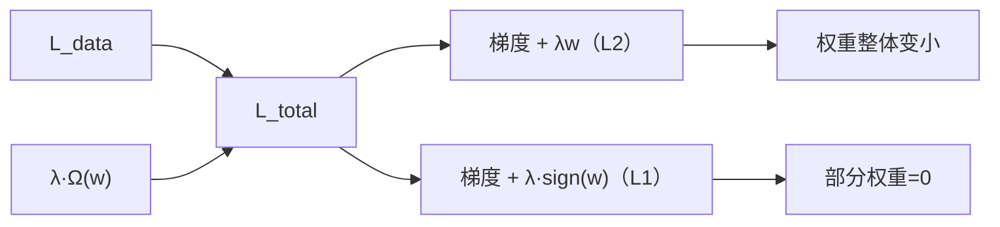

# DL-034 L1/L2 正则化与 Weight Decay

## 1. 本节学习目标

1. 写出 L1、L2 与 Weight Decay 的公式，说清三者的关系。
2. 用实测看 weight decay 如何**压低权重范数**并改变泛化（本课范数 25.263 → 1.746）。
3. 理解 L1 为什么产生**稀疏**（本课近零权重占比 0 → **0.141**）。
4. 会选 `weight_decay` 的量级（1e-3 ~ 1e-2 起步）。

## 2. 为什么需要这个知识

因为**正则化是压方差的主力手段**，比"砍模型"更精细。

而 L1/L2 的区别不是"哪种更好"，而是**你要稀疏还是要平滑**——理解这点，才知道什么时候用哪个。

## 3. 直观解释

| 正则 | 惩罚 | 效果 |
|---|---|---|
| **L2**（weight decay） | $\lambda\sum w^2$ | 权重**整体变小**、更平滑 |
| **L1** | $\lambda\sum|w|$ | 部分权重**直接变 0**（稀疏） |

**直觉**：

- L2 像"所有参数都往 0 拉一点" ⇒ 分布更均匀。
- L1 像"该砍的砍掉" ⇒ 留下少数重要的。

## 4. 正式定义

**L2 / Weight Decay**

$$
L_{\text{total}}=L_{\text{data}}+\frac{\lambda}{2}\sum_i w_i^2
$$

梯度：$\frac{\partial L}{\partial w}=\frac{\partial L_{\text{data}}}{\partial w}+\lambda w$ ⇒ 更新时 $w\leftarrow w(1-\eta\lambda)-\eta g$（**衰减**之名由此而来）。

**L1**

$$
L_{\text{total}}=L_{\text{data}}+\lambda\sum_i|w_i|
$$

梯度：$\frac{\partial L}{\partial w}=\frac{\partial L_{\text{data}}}{\partial w}+\lambda\,\mathrm{sign}(w)$。

**PyTorch**

```text
optim.AdamW(params, weight_decay=1e-2)   # L2 解耦
loss + lam * sum(p.abs().sum() ...)      # L1 需手工加
```

## 5. 核心原理

**本课实测（200 epoch，Adam，moons）**

| weight_decay | train | test | gap | 权重范数 |
|---|---|---|---|---|
| 0.0 | 0.9357 | 0.9167 | +0.0190 | **25.263** |
| **1e-3** | 0.9179 | **0.9250** | −0.0071 | **8.237** |
| 1e-2 | 0.8393 | 0.8750 | −0.0357 | 3.097 |
| 1e-1 | 0.8036 | 0.8375 | −0.0339 | **1.746** |

**三个读法**：

1. **范数从 25.263 单调压到 1.746** —— 正则确实在起作用。
2. **wd=1e-3 最好（0.9250）**，比不加（0.9167）高 0.8 点。
3. **wd 过大（1e-2/1e-1）反而变差**（0.875/0.8375）——**从过拟合滑向欠拟合**。

**L1 实测**

| λ | test | 近零权重占比（<1e-3） |
|---|---|---|
| 0 | 0.9167 | **0.000** |
| **1e-3** | **0.9292** | **0.141** |
| 1e-2 | 0.8708 | 0.117 |

**稀疏性证据**：λ=1e-3 时 **14.1% 的权重被压到近零**（不加时 0%）。

## 6. 数学表达式

**为什么 L1 产生稀疏（几何解释）**

在二维参数空间，约束 $\|w\|_1\le c$ 是**菱形**，$\|w\|_2\le c$ 是**圆**。

损失等高线与约束区域相切时：

- 菱形有**尖角落在坐标轴上** ⇒ 容易切在 $w_1=0$ 或 $w_2=0$ ⇒ **稀疏**。
- 圆没有尖角 ⇒ 一般切在非零处 ⇒ 只是变小。

**梯度视角**：L1 的梯度是常数 $\pm\lambda$，与 $w$ 大小无关 ⇒ 小权重也被"匀速"推向 0；L2 的梯度是 $\lambda w$，**越小推得越轻** ⇒ 不会精确到 0。

## 7. 数学推导

**Weight Decay 的闭式效果（简化情形）**

对单个权重、固定梯度 $g$：

$$
w_{t+1}=w_t-\eta(g+\lambda w_t)=(1-\eta\lambda)w_t-\eta g
$$

⇒ **每步先乘 $(1-\eta\lambda)$**，等效"指数衰减"到稳态：

$$
w_\infty\approx-\frac{g}{\lambda}
$$

**本课验证**：$\lambda$ 从 1e-3 → 1e-1（100 倍），范数 8.237 → 1.746（约 4.7 倍）——不是严格线性，因为 $g$ 也在变，但方向一致。

## 8. 结构示意图



## 9. 具体计算示例

```text
wd=0.0   : train=0.9357 test=0.9167 gap=0.0190 权重范数=25.263
wd=0.001 : train=0.9179 test=0.9250 gap=-0.0071 权重范数=8.237
wd=0.01  : train=0.8393 test=0.8750 gap=-0.0357 权重范数=3.097
wd=0.1   : train=0.8036 test=0.8375 gap=-0.0339 权重范数=1.746

L1 λ=0.0   : test=0.9167 近零权重占比=0.000
L1 λ=0.001 : test=0.9292 近零权重占比=0.141
L1 λ=0.01  : test=0.8708 近零权重占比=0.117
```

## 10. Python 实现

```python
import torch
import torch.nn as nn
import torch.nn.functional as F
from sklearn.datasets import make_moons
from sklearn.model_selection import train_test_split

X, y = make_moons(n_samples=800, noise=0.30, random_state=42)
Xtr, Xte, ytr, yte = train_test_split(X, y, test_size=0.3,
                                      random_state=42, stratify=y)
Xtr = torch.tensor(Xtr, dtype=torch.float32)
ytr = torch.tensor(ytr, dtype=torch.float32).view(-1, 1)
Xte = torch.tensor(Xte, dtype=torch.float32)
yte = torch.tensor(yte, dtype=torch.float32).view(-1, 1)

for wd in (0.0, 1e-3, 1e-2, 1e-1):
    torch.manual_seed(0)
    model = nn.Sequential(nn.Linear(2, 64), nn.ReLU(), nn.Linear(64, 1))
    opt = torch.optim.Adam(model.parameters(), lr=0.05, weight_decay=wd)
    for _ in range(200):
        perm = torch.randperm(len(Xtr))
        for i in range(0, len(Xtr), 32):
            idx = perm[i:i + 32]
            opt.zero_grad()
            F.binary_cross_entropy_with_logits(model(Xtr[idx]), ytr[idx]).backward()
            opt.step()
    model.eval()
    with torch.no_grad():
        tr = float((torch.sigmoid(model(Xtr)) >= 0.5).float().eq(ytr).float().mean())
        te = float((torch.sigmoid(model(Xte)) >= 0.5).float().eq(yte).float().mean())
    wnorm = float(sum(p.norm() ** 2 for p in model.parameters()) ** 0.5)
    print(f"wd={wd:<6}: train={tr:.4f} test={te:.4f} 范数={wnorm:.3f}")
```

## 11. PyTorch 实现（L1 手工正则）

```python
import torch
import torch.nn as nn
import torch.nn.functional as F
from sklearn.datasets import make_moons
from sklearn.model_selection import train_test_split

X, y = make_moons(n_samples=800, noise=0.30, random_state=42)
Xtr, Xte, ytr, yte = train_test_split(X, y, test_size=0.3,
                                      random_state=42, stratify=y)
Xtr = torch.tensor(Xtr, dtype=torch.float32)
ytr = torch.tensor(ytr, dtype=torch.float32).view(-1, 1)
Xte = torch.tensor(Xte, dtype=torch.float32)
yte = torch.tensor(yte, dtype=torch.float32).view(-1, 1)

for lam in (0.0, 1e-3, 1e-2):
    torch.manual_seed(0)
    model = nn.Sequential(nn.Linear(2, 64), nn.ReLU(), nn.Linear(64, 1))
    opt = torch.optim.Adam(model.parameters(), lr=0.05)
    for _ in range(200):
        perm = torch.randperm(len(Xtr))
        for i in range(0, len(Xtr), 32):
            idx = perm[i:i + 32]
            opt.zero_grad()
            loss = F.binary_cross_entropy_with_logits(model(Xtr[idx]), ytr[idx])
            l1 = sum(p.abs().sum() for p in model.parameters())
            (loss + lam * l1).backward()
            opt.step()
    with torch.no_grad():
        sparse = float((model[0].weight.abs() < 1e-3).float().mean())
    print(f"λ={lam:<6} 近零权重占比={sparse:.3f}")
```

## 12. 代码逐行解释

| 代码 | 作用 |
|---|---|
| `weight_decay=wd` | Adam 的 **L2 耦合**衰减 |
| `AdamW` | 解耦版（更推荐，见 DL-028） |
| `sum(p.abs().sum())` | L1 惩罚（PyTorch 无内置 L1 优化器参数） |
| `loss + lam*l1` | 手工加到总损失 |
| `(w.abs()<1e-3).mean()` | 统计"近零权重"比例（稀疏性度量） |
| `p.norm()**2` 求和开方 | 权重总范数 |

## 13. 实际运行结果

```text
wd=0.0   : train=0.9357 test=0.9167 gap=0.0190 权重范数=25.263
wd=0.001 : train=0.9179 test=0.9250 gap=-0.0071 权重范数=8.237
wd=0.01  : train=0.8393 test=0.8750 gap=-0.0357 权重范数=3.097
wd=0.1   : train=0.8036 test=0.8375 gap=-0.0339 权重范数=1.746

L1 λ=0.0   : test=0.9167 近零权重占比=0.000
L1 λ=0.001 : test=0.9292 近零权重占比=0.141
L1 λ=0.01  : test=0.8708 近零权重占比=0.117
```

## 14. 应用场景

| 场景 | 推荐 |
|---|---|
| 通用正则 | **AdamW，wd=1e-2**（Transformer 标配） |
| 只需要平滑 | L2 |
| 想要稀疏/特征选择 | L1 或 Elastic Net |
| 小数据 | 较大 wd（1e-2）+ 早停 |
| 已欠拟合 | **不要加正则** |

## 15. 优点与缺点

| 正则 | 优点 | 缺点 |
|---|---|---|
| L2 | 平滑、稳定、易调 | 不产生稀疏 |
| L1 | 稀疏、可当特征选择 | 0 点不可导；过大伤性能 |
| Elastic Net | 兼顾 | 两个超参 |

## 16. 常见错误

| 错误 | 现象 | 纠正 |
|---|---|---|
| wd 过大 | train 掉到 0.80（本课） | 从 1e-3 起调 |
| 用 Adam + L2 以为生效 | 与不加一样（DL-028） | 用 AdamW |
| L1 加到 bias/BN 参数 | 破坏归一化 | 只对权重加 |
| 欠拟合时加正则 | 更差 | 先加容量 |
| 用 L1 手动实现却忘 `sign` | 梯度错 | 用 `p.abs().sum()` 让 autograd 求导 |
| 不记录权重范数 | 无法判断强度 | 每轮记录 |

## 17. 本节总结

- L2 = **平滑**（权重整体缩小）；L1 = **稀疏**（部分权重为 0）。
- 本课 wd 1e-3 最好（test **0.9250**），wd 0.1 反而降到 0.8375（**欠拟合**）。
- L1 λ=1e-3 使 **14.1%** 权重近零，test 升到 **0.9292**。

## 18. 前置与后续

- 前置：[[DL-033 偏差-方差与泛化能力]]
- 后续：[[DL-035 Dropout]]、[[DL-036 Batch Normalization]]、`DL-037 Layer Normalization 与 BN 的区别`（待建）
- 相关数学：[[MATH-708 L1 与 L2 正则化]]
- 相关机器学习：[[ML-021 岭回归]]、[[ML-022 Lasso 与 Elastic Net]]

---

## 练习与参考答案

**基础 1**：L1 与 L2 的惩罚项与梯度各是什么？分别带来什么效果？

**基础 2**：本课 wd=0 与 wd=1e-3 的 test acc 与权重范数各是多少？

**进阶 1**：为什么 L1 能把权重压到"精确的 0"，而 L2 不能？

**综合**：你给模型加了 `weight_decay=1e-2`，结果 train acc 从 0.95 掉到 0.78、val 从 0.90 掉到 0.76。请诊断并给出修正。

> [!success]- 参考答案

> **基础 1**
> - L2：$\lambda\sum w^2$，梯度 $\lambda w$ ⇒ 权重整体变小、更平滑。
> - L1：$\lambda\sum|w|$，梯度 $\lambda\,\mathrm{sign}(w)$ ⇒ 部分权重被压到 0（稀疏）。

> **基础 2**
> wd=0：test **0.9167**、范数 **25.263**；
> wd=1e-3：test **0.9250**、范数 **8.237**。

> **进阶 1**
> 因为 L1 的梯度是**常数** $\pm\lambda$（与 $w$ 大小无关），即使 $w$ 很小也被同等的力推向 0，能越过 0；而 L2 的梯度 $\lambda w$ 随 $w$ 变小而变小 ⇒ 越接近 0 推力越弱 ⇒ **只能无限接近而不到达 0**。
> 几何上：L1 约束区域是**菱形（有尖角在坐标轴上）**，最优解容易落在坐标轴上。

> **综合（参考）**
> **诊断**：train 与 val **同时下降**（0.95→0.78、0.90→0.76），gap 反而变小 ⇒ 不是"正则过头压方差"，而是**正则过强导致欠拟合（偏差变大）**。
> **修正**：
> 1. 把 wd 降到 **1e-3** 或 3e-4；
> 2. 确认用的是 **AdamW**（若用 Adam+wd，可能根本没生效，反过来说明是别的因素）；
> 3. 检查是否把 wd 也加到了 bias/BN 参数（应排除）。
> **验证**：wd 调小后 train acc 应回升；若 train 回到 0.95 而 val 仍低，才是过拟合，再考虑 Dropout/加数据。

## 学习记录

| 日期 | 状态 | 用时 | 问题 | 复盘 |
|---|---|---|---|---|
| 2026-11-07 | planned | — | — | — |

---

## 🔗 Notion 同步信息

> 以下内容由 Notion「AI Knowledge System · 知识点」数据库按知识 ID 合并而来（导出于 2026-11-09）。

| 属性 | 值 |
|---|---|
| 学科 | 深度学习 |
| 学习状态 | 未开始 |
| 难度 | L3 推导 |
| 知识类型 | Technique |

- **所属模块**：[M-DL-04 模型泛化、正则化与训练技巧](../%E8%AF%BE%E7%A8%8B%E6%A8%A1%E5%9D%97/M-DL-04%20%E6%A8%A1%E5%9E%8B%E6%B3%9B%E5%8C%96%E3%80%81%E6%AD%A3%E5%88%99%E5%8C%96%E4%B8%8E%E8%AE%AD%E7%BB%83%E6%8A%80%E5%B7%A7.md)
- **前置知识**：[DL-033 偏差-方差与泛化能力](DL-033%20%E5%81%8F%E5%B7%AE-%E6%96%B9%E5%B7%AE%E4%B8%8E%E6%B3%9B%E5%8C%96%E8%83%BD%E5%8A%9B.md)
- **后继知识**：[DL-035 Dropout](DL-035%20Dropout.md)
- **关联数学**：[MATH-708 L1 与 L2 正则化](../../06_%E6%95%B0%E5%AD%A6%E5%9F%BA%E7%A1%80/07%20%E6%9C%80%E4%BC%98%E5%8C%96%E6%96%B9%E6%B3%95/MATH-708%20L1%20%E4%B8%8E%20L2%20%E6%AD%A3%E5%88%99%E5%8C%96.md)
