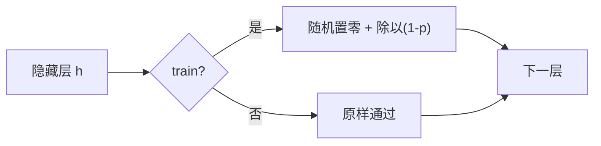

# DL-035 Dropout

## 1. 本节学习目标

1. 说清 Dropout 的训练/推理差异（本课两次 train 输出差 **0.3278**，train vs eval 差 **0.2622**）。
2. 用实测看 `p` 的影响（p=0.2 时 test **0.9417** 最好）。
3. 理解"为什么推理时要关闭"，以及 inverted dropout 的缩放机制。
4. 会按场景选 `p`（0.1–0.5），并知道何时**不该用**。

## 2. 为什么需要这个知识

因为 Dropout 是最常用的正则化手段之一，但它有一个**必须理解的行为差异**：

> 同一个输入，训练模式两次前向结果不同；评估模式才确定。

不理解这点，就会出现"训练 loss 正常、推理结果乱跳"的诡异问题。

## 3. 直观解释

**训练时**：每个 batch 随机"关掉"一部分神经元（置 0），强迫网络**不依赖某几个神经元**。

**推理时**：所有神经元都参与，但要按比例缩放（inverted dropout 已在训练时缩放，所以推理直接前向）。

**类比**：训练时让每个员工轮流请假，逼团队互相补位；正式交付时全员到岗。

## 4. 正式定义

**训练时**（inverted dropout）

$$
\tilde{\mathbf{h}}=\frac{\mathbf{m}\odot\mathbf{h}}{1-p},\qquad
m_i\sim\mathrm{Bernoulli}(1-p)
$$

**推理时**

$$
\tilde{\mathbf{h}}=\mathbf{h}
$$

（因为训练时已经除以 $1-p$，期望一致。）

**PyTorch**

```text
nn.Dropout(p)     # train 时生效，eval 时自动关闭
model.train() / model.eval()
```

## 5. 核心原理

**本课实测（200 epoch，Adam，moons）**

| dropout | train | test | gap |
|---|---|---|---|
| 0.0 | 0.9357 | 0.9167 | +0.0190 |
| **0.2** | 0.9179 | **0.9417** | −0.0238 |
| 0.5 | 0.9143 | 0.9208 | −0.0065 |
| 0.8 | 0.8946 | 0.9167 | −0.0220 |

**读法**：

1. **p=0.2 最好（0.9417）**，比不加高 2.5 个点。
2. p=0.5 与不加持平（0.9208 vs 0.9167）。
3. **p=0.8 太狠**：train 掉到 0.8946（信息被丢太多）。

**训练/推理差异实测**

```text
两次 train 输出最大差: 0.3278
train vs eval 最大差:   0.2622
```

**这两个数字说明**：Dropout 让**训练时的输出带随机性**（0.3278），而 eval 是确定性的（两次一样）。

## 6. 数学表达式

**期望一致性**

训练时 $\mathbb{E}[\tilde h_i]=\frac{(1-p)h_i}{1-p}=h_i$ ⇒ 与推理时的 $h_i$ 期望相同。

**这就是 inverted dropout 的设计目的**：让推理不需要额外缩放。

**若不做缩放**（原始 dropout）：训练期望是 $(1-p)h$，推理就得乘 $(1-p)$ —— 容易忘。

## 7. 数学推导

**Dropout 为什么能正则**

可以看作**对指数级子网络的集成**：$n$ 个神经元有 $2^n$ 种"开关组合"，训练时每步随机采样一个子网络。

推理时用全部神经元（带缩放）≈ **对这些子网络做几何平均**。

**本课含义**：p=0.2 时，每个 batch 随机丢掉 20% 的隐藏单元，模型不能依赖特定单元 ⇒ 更鲁棒。

**为什么 p 太大会变差**：有效容量下降（每步只用 20% 单元，p=0.8），且训练/推理的分布差异过大 ⇒ 欠拟合（本课 train 0.8946）。

## 8. 结构示意图



## 9. 具体计算示例

```text
dropout=0.0 : train=0.9357 test=0.9167 gap=0.0190
dropout=0.2 : train=0.9179 test=0.9417 gap=-0.0238
dropout=0.5 : train=0.9143 test=0.9208 gap=-0.0065
dropout=0.8 : train=0.8946 test=0.9167 gap=-0.0220

两次 train 输出最大差: 0.3278
train vs eval 最大差:   0.2622
```

## 10. Python 实现

```python
import torch
import torch.nn as nn

torch.manual_seed(0)
model = nn.Sequential(
    nn.Linear(2, 16), nn.ReLU(), nn.Dropout(0.5), nn.Linear(16, 1)
)
x = torch.randn(4, 2)

model.train()
out1 = model(x).detach()
out2 = model(x).detach()

model.eval()
out3 = model(x).detach()
out4 = model(x).detach()

print("train 两次最大差:", round(float((out1 - out2).abs().max()), 4))
print("eval 两次最大差:", round(float((out3 - out4).abs().max()), 4))
print("train vs eval 最大差:", round(float((out1 - out3).abs().max()), 4))
```

## 11. PyTorch 实现（p 的影响）

```python
import torch
import torch.nn as nn
import torch.nn.functional as F
from sklearn.datasets import make_moons
from sklearn.model_selection import train_test_split

X, y = make_moons(n_samples=800, noise=0.30, random_state=42)
Xtr, Xte, ytr, yte = train_test_split(X, y, test_size=0.3,
                                      random_state=42, stratify=y)
Xtr = torch.tensor(Xtr, dtype=torch.float32)
ytr = torch.tensor(ytr, dtype=torch.float32).view(-1, 1)
Xte = torch.tensor(Xte, dtype=torch.float32)
yte = torch.tensor(yte, dtype=torch.float32).view(-1, 1)

for p_drop in (0.0, 0.2, 0.5, 0.8):
    torch.manual_seed(0)
    model = nn.Sequential(nn.Linear(2, 64), nn.ReLU(),
                          nn.Dropout(p_drop), nn.Linear(64, 1))
    opt = torch.optim.Adam(model.parameters(), lr=0.05)
    for _ in range(200):
        model.train()
        perm = torch.randperm(len(Xtr))
        for i in range(0, len(Xtr), 32):
            idx = perm[i:i + 32]
            opt.zero_grad()
            F.binary_cross_entropy_with_logits(model(Xtr[idx]), ytr[idx]).backward()
            opt.step()
    model.eval()
    with torch.no_grad():
        tr = float((torch.sigmoid(model(Xtr)) >= 0.5).float().eq(ytr).float().mean())
        te = float((torch.sigmoid(model(Xte)) >= 0.5).float().eq(yte).float().mean())
    print(f"dropout={p_drop}: train={tr:.4f} test={te:.4f}")
```

## 12. 代码逐行解释

| 代码 | 作用 |
|---|---|
| `nn.Dropout(0.5)` | 训练时以 0.5 概率置零 |
| `model.train()` | 开启 Dropout |
| `model.eval()` | 自动关闭 Dropout |
| `(out1-out2).abs().max()` | 验证训练时随机性 |
| `.detach()` | 只为取数值，不参与反传 |

**关键**：**评估前必须 `model.eval()`**，否则指标会随 Dropout 随机波动（本课 0.2622 的差）。

## 13. 实际运行结果

```text
dropout=0.0 : train=0.9357 test=0.9167 gap=0.0190
dropout=0.2 : train=0.9179 test=0.9417 gap=-0.0238
dropout=0.5 : train=0.9143 test=0.9208 gap=-0.0065
dropout=0.8 : train=0.8946 test=0.9167 gap=-0.0220

两次 train 输出最大差: 0.3278
train vs eval 最大差: 0.2622
```

## 14. 应用场景

| 场景 | 常用 p |
|---|---|
| 全连接层（大模型） | 0.5 |
| 全连接层（小模型） | 0.1–0.2 |
| CNN 卷积层后 | 0.1–0.3（或不用） |
| Transformer | 0.1（attention/FFN 后） |
| RNN | 0.2–0.5（常在输出层） |
| 已欠拟合 | **0（不要用）** |

## 15. 优点与缺点

| 优点 | 缺点 |
|---|---|
| 简单有效、几乎无额外超参 | 训练变慢（每步要采样） |
| 近似集成大量子网络 | 与 BN 同用可能相互干扰 |
| 抑制"神经元共适应" | p 过大导致欠拟合 |

## 16. 常见错误

| 错误 | 现象 | 纠正 |
|---|---|---|
| 评估忘 `eval()` | 指标抖动（本课 0.2622） | 切 eval |
| p 设 0.8 | train 掉到 0.8946 | 0.1–0.5 |
| 输出层加 Dropout | 概率被扰动 | 只在隐藏层 |
| Dropout 与 BN 顺序混乱 | 训练不稳 | 常见：Linear→BN→ReLU→Dropout |
| 欠拟合时还在用 | 更差 | 关掉 |
| 推理手动缩放 | 重复缩放 | inverted 已处理 |

## 17. 本节总结

- Dropout 训练时随机置零 + 缩放，**推理时关闭**（本课 train 两次差 **0.3278**）。
- 本课 p=0.2 最好（test **0.9417**）；p=0.8 过强（train 0.8946）。
- **评估必须 `model.eval()`**，否则指标不稳定。

## 18. 前置与后续

- 前置：[[DL-034 L1、L2 正则化与 Weight Decay]]
- 后续：[[DL-036 Batch Normalization]]、`DL-037 Layer Normalization 与 BN 的区别`（待建）
- 相关数学：[[MATH-306 期望、方差与协方差]]
- 相关机器学习：[[ML-051 Bagging 与随机森林]]（集成视角）

---

## 练习与参考答案

**基础 1**：Dropout 在训练与推理时各做什么？为什么要除以 $1-p$？

**基础 2**：本课 p=0、0.2、0.5、0.8 的 test acc 各是多少？

**进阶 1**：为什么评估时不切 `eval()` 会让指标偏低且抖动？

**综合**：你的模型加了 Dropout(0.5) 后 train acc 从 0.95 掉到 0.80，val 从 0.78 掉到 0.76。请诊断并给出修正。

> [!success]- 参考答案

> **基础 1**
> - 训练：以概率 $p$ 随机把神经元置零，并把保留的值除以 $1-p$。
> - 推理：不丢弃，直接前向。
> - 除以 $1-p$ 是为了让**期望一致**：$\mathbb{E}[\tilde h]=\frac{(1-p)h}{1-p}=h$，这样推理无需额外缩放（inverted dropout）。

> **基础 2**
> p=0：0.9167；p=0.2：**0.9417**；p=0.5：0.9208；p=0.8：0.9167。

> **进阶 1**
> 因为 `train()` 模式下每个 batch 随机置零，**同一个验证样本每次前向的激活都不同** ⇒ 预测随机波动、平均性能偏低。
> 本课实测 train 两次输出差 **0.3278**，train vs eval 差 **0.2622**——这就是不切 eval 时指标抖动的量级。

> **综合（参考）**
> **诊断**：train 0.95→0.80 大幅下降、val 也降 ⇒ **正则过强（欠拟合）**，不是"压住了过拟合"。
> **修正**：
> 1. 把 p 降到 **0.1–0.2**；
> 2. 只在**较宽的全连接层**加 Dropout，不要每层都加；
> 3. 若模型本身不大/数据不多，先考虑 Weight Decay 或早停，Dropout 可能不必要。
> **验证**：调小 p 后 train 应回升；若 train 回到 0.95 而 val 仍 0.78，再逐步增大 p 或加数据。

## 学习记录

| 日期 | 状态 | 用时 | 问题 | 复盘 |
|---|---|---|---|---|
| 2026-11-07 | planned | — | — | — |

---

## 🔗 Notion 同步信息

> 以下内容由 Notion「AI Knowledge System · 知识点」数据库按知识 ID 合并而来（导出于 2026-11-09）。

| 属性 | 值 |
|---|---|
| 学科 | 深度学习 |
| 学习状态 | 未开始 |
| 难度 | L2 应用 |
| 知识类型 | Technique |

- **所属模块**：[M-DL-04 模型泛化、正则化与训练技巧](../%E8%AF%BE%E7%A8%8B%E6%A8%A1%E5%9D%97/M-DL-04%20%E6%A8%A1%E5%9E%8B%E6%B3%9B%E5%8C%96%E3%80%81%E6%AD%A3%E5%88%99%E5%8C%96%E4%B8%8E%E8%AE%AD%E7%BB%83%E6%8A%80%E5%B7%A7.md)
- **前置知识**：[DL-034 L1/L2 正则化与 Weight Decay](DL-034%20L1%E3%80%81L2%20%E6%AD%A3%E5%88%99%E5%8C%96%E4%B8%8E%20Weight%20Decay.md)
- **后继知识**：[DL-036 Batch Normalization](DL-036%20Batch%20Normalization.md)
- **关联数学**：[MATH-306 期望、方差与协方差](../../06_%E6%95%B0%E5%AD%A6%E5%9F%BA%E7%A1%80/03%20%E6%A6%82%E7%8E%87%E8%AE%BA/MATH-306%20%E6%9C%9F%E6%9C%9B%E3%80%81%E6%96%B9%E5%B7%AE%E4%B8%8E%E5%8D%8F%E6%96%B9%E5%B7%AE.md)
