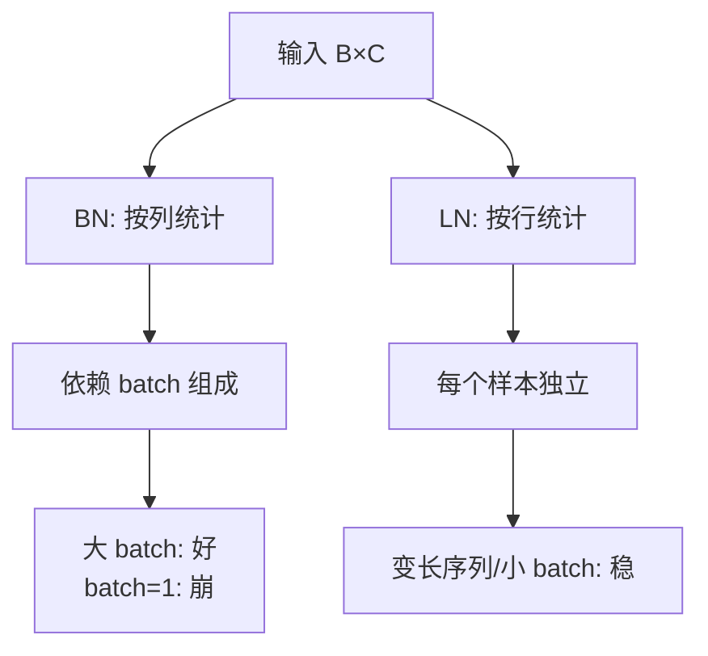

# DL-037 Layer Normalization 与 BN 的区别

## 1. 本节学习目标

1. 用实测看清两者**归一化的维度完全不同**（BN 按列、LN 按行）。
2. 理解 BN 为什么依赖 batch（batch=1 **直接报错**），LN 为什么不依赖。
3. 会在 `(B, T, C)` 序列场景里用 LN。
4. 能按任务选：**CNN 用 BN，RNN/Transformer 用 LN**。

## 2. 为什么需要这个知识

因为两者**不能互换**，而很多教程把它们并列成"两种归一化"，只差一句话：

> **BN 跨样本统计，LN 跨特征统计。**

这句话背后的后果是：BN 在**小 batch / 变长序列**下会失效，LN 则不会。不理解这点，会在 NLP 任务里误用 BN 而困惑为什么训不好。

## 3. 直观解释

设一个 batch 是 $3\times4$ 的矩阵（3 个样本、4 个特征）：

```text
        f1   f2   f3   f4
样本1    1    2    3    4
样本2    2    3    4    5
样本3    3    4    5    6

BN：对每一列（跨样本）归一化  → 每列均值 0
LN：对每一行（跨特征）归一化  → 每行均值 0
```

**一个按"特征"比，一个按"样本"比**——这就是全部区别的根源。

## 4. 正式定义

**BN**（对第 $c$ 个特征，跨 batch）

$$
\mu_c=\frac1B\sum_{i=1}^{B}x_{i,c},\qquad
\sigma_c^2=\frac1B\sum_{i=1}^{B}(x_{i,c}-\mu_c)^2
$$

**LN**（对第 $i$ 个样本，跨特征）

$$
\mu_i=\frac1C\sum_{c=1}^{C}x_{i,c},\qquad
\sigma_i^2=\frac1C\sum_{c=1}^{C}(x_{i,c}-\mu_i)^2
$$

**共同点**：都做 $\hat x=(x-\mu)/\sqrt{\sigma^2+\epsilon}$，再乘 $\gamma$ 加 $\beta$。

## 5. 核心原理

**本课实测（$3\times4$ 输入）**

```text
原始:
 [[1. 2. 3. 4.]
  [2. 3. 4. 5.]
  [3. 4. 5. 6.]]

BN 后:
 [[-1.225 -1.225 -1.225 -1.225]
  [ 0.     0.     0.     0.   ]
  [ 1.225  1.225  1.225  1.225]]
BN 每列均值: [-0.0, 0.0, 0.0, -0.0]      ← 列均值为 0
BN 每行均值: [-1.2247, 0.0, 1.2247]      ← 行均值不为 0

LN 后:
 [[-1.342 -0.447  0.447  1.342]
  [-1.342 -0.447  0.447  1.342]
  [-1.342 -0.447  0.447  1.342]]
LN 每列均值: [-1.3416, -0.4472, 0.4472, 1.3416]   ← 列均值不为 0
LN 每行均值: [0.0, 0.0, 0.0]                      ← 行均值为 0
```

**关键观察**：

1. **BN 后每一列都是 0 均值**，但每一行不同（−1.225/0/1.225）——因为样本间被"对齐"了。
2. **LN 后每一行完全相同**（都是 `[-1.342,-0.447,0.447,1.342]`）——因为每个样本只用自己的统计量，而这个例子三行只是整体平移，形状一样。

## 6. 数学表达式

**BN 的统计量个数**：$C$ 组（每个特征一组）
**LN 的统计量个数**：$B$ 组（每个样本一组）

**这就是"依赖 batch"的根源**：BN 的 $\mu_c$ 由 batch 内所有样本决定 ⇒ batch 变了，输出就变；LN 的 $\mu_i$ 只由该样本自己决定 ⇒ batch 无关。

## 7. 数学推导

**BN 在 batch=1 时为什么崩溃**

$B=1$ ⇒ 对每列只有一个值 ⇒ $\sigma_c^2=0$ ⇒

$$
\hat x=\frac{x-\mu}{\sqrt{0+\epsilon}}\approx\frac{0}{\sqrt{\epsilon}}=0
$$

**所有输出退化为 0**，且 PyTorch 在训练模式下直接报 `ValueError`。

**本课实测**：

```text
BN batch=1 报错: ValueError
```

**LN 的稳定性**：

```text
LN batch=2 时第一行输出: [-1.342, -0.447, 0.447, 1.342]
LN 单行时输出:           [-1.342, -0.447, 0.447, 1.342]
```

⇒ **完全一致**，与 batch 组成无关。

## 8. 结构示意图



## 9. 具体计算示例

**序列场景 `(B,T,C)` 的 LN**

```text
输入形状: (2, 5, 6)   # 2 个序列、5 个时间步、6 维特征
LN(6) 后形状: (2, 5, 6)
每个 token 的均值: [0.0, -0.0, 0.0, 0.0, 0.0]
```

**含义**：LN 对**每个 token 的 6 维特征**单独归一化 ⇒ 即使序列长度不同、batch 只有 1，也能正常工作。

## 10. Python 实现

```python
import torch
import torch.nn as nn

x = torch.tensor([[1., 2., 3., 4.],
                  [2., 3., 4., 5.],
                  [3., 4., 5., 6.]])

bn = nn.BatchNorm1d(4)
bn.train()
yb = bn(x)
print("BN 每列均值:", [round(float(v), 4) for v in yb.mean(dim=0)])
print("BN 每行均值:", [round(float(v), 4) for v in yb.mean(dim=1)])

ln = nn.LayerNorm(4)
yl = ln(x)
print("LN 每列均值:", [round(float(v), 4) for v in yl.mean(dim=0)])
print("LN 每行均值:", [round(float(v), 4) for v in yl.mean(dim=1)])
```

## 11. PyTorch 实现（batch 敏感性）

```python
import torch
import torch.nn as nn

x2 = torch.tensor([[1., 2., 3., 4.], [10., 20., 30., 40.]])

bn = nn.BatchNorm1d(4)
bn.train()
print("BN batch=2 第一行:", bn(x2)[0].detach().numpy().round(3).tolist())

ln = nn.LayerNorm(4)
print("LN batch=2 第一行:", ln(x2)[0].detach().numpy().round(3).tolist())
print("LN 单行        :", ln(x2[:1])[0].detach().numpy().round(3).tolist())

try:
    bn1 = nn.BatchNorm1d(4)
    bn1.train()
    bn1(x2[:1])
except Exception as exc:
    print("BN batch=1 报错:", type(exc).__name__)
```

## 12. 代码逐行解释

| 代码 | 作用 |
|---|---|
| `nn.BatchNorm1d(4)` | 对 4 个特征逐列归一化（需 batch≥2） |
| `nn.LayerNorm(4)` | 对每个样本的 4 维归一化 |
| `yb.mean(dim=0)` | 按列求均值（BN 应≈0） |
| `yb.mean(dim=1)` | 按行求均值（LN 应≈0） |
| `ln(x2[:1])` | 单样本 LN，验证与 batch 无关 |

**注意**：`BatchNorm1d` 输入需 `(B, C)` 或 `(B, C, L)`；batch=1 且训练模式会报错。

## 13. 实际运行结果

```text
BN 后:
 [[-1.225 -1.225 -1.225 -1.225]
  [ 0.     0.     0.     0.   ]
  [ 1.225  1.225  1.225  1.225]]
BN 每列均值: [-0.0, 0.0, 0.0, -0.0]
BN 每行均值: [-1.2247, 0.0, 1.2247]
LN 后:
 [[-1.342 -0.447  0.447  1.342]
  [-1.342 -0.447  0.447  1.342]
  [-1.342 -0.447  0.447  1.342]]
LN 每列均值: [-1.3416, -0.4472, 0.4472, 1.3416]
LN 每行均值: [0.0, 0.0, 0.0]
BN batch=1 报错: ValueError
```

## 14. 应用场景

| 场景 | 选择 | 理由 |
|---|---|---|
| CNN 图像分类 | **BN** | 特征维度固定、batch 大 |
| Transformer / LLM | **LN** | 序列变长、batch 可能小 |
| RNN/LSTM | **LN** | 时序统计不稳定 |
| 小 batch 检测/分割 | GroupNorm / LN | BN 统计不稳 |
| 推理逐条 | LN 或已 fold 的 BN | BN 需 running stats |

## 15. 优点与缺点

| 归一化 | 优点 | 缺点 |
|---|---|---|
| BN | 允许大 lr、收敛快 | 依赖 batch、变长序列难用 |
| LN | 与 batch 无关、适合序列 | 不利用跨样本统计（少了一个正则源） |
| GroupNorm | 兼顾小 batch | 多一个超参 |

## 16. 常见错误

| 错误 | 现象 | 纠正 |
|---|---|---|
| 把 BN 用到 batch=1 | `ValueError` | 换 LN/GN |
| 以为 LN 也需大 batch | 无必要 | LN 无 batch 依赖 |
| 在 Transformer 用 BN | 序列维度难对齐 | 用 LN |
| 评估忘 `eval()`（BN） | 指标随 batch 变 | 切 eval |
| 混淆 `dim` 参数 | 归一化错维度 | LN 归一化**最后一维** |
| 把 LN 与 BN 当"等价替代" | 效果差异大 | 按数据结构选 |

## 17. 本节总结

- **BN 按列（跨样本）**、**LN 按行（跨特征）**——实测均值位置就是证据。
- BN 依赖 batch：**batch=1 直接 `ValueError`**；LN 对同一行在不同 batch 下**输出完全相同**。
- 选择：**CNN 用 BN，序列/Transformer 用 LN，小 batch 用 GN/LN**。

## 18. 前置与后续

- 前置：[[DL-036 Batch Normalization]]
- 后续：[[DL-038 Early Stopping 与模型检查点]]、[[DL-039 数据增强、训练日志与可复现性]]
- 相关数学：[[MATH-306 期望、方差与协方差]]

---

## 练习与参考答案

**基础 1**：BN 与 LN 分别沿哪个维度统计均值与方差？

**基础 2**：本课 BN 后每列/每行均值各是多少？LN 呢？

**进阶 1**：为什么 BN 在 batch=1 时会报错或被归零，而 LN 不会？

**综合**：你要训练一个处理变长文本的模型，同事建议用 BN。请说明为什么不该用，并给出替代方案。

> [!success]- 参考答案

> **基础 1**
> - **BN**：沿 **batch 维**（跨样本），对每个特征单独统计 ⇒ 得到 $C$ 组均值/方差。
> - **LN**：沿 **特征维**（同一层内），对每个样本单独统计 ⇒ 得到 $B$ 组均值/方差。

> **基础 2**
> BN 后：每列均值 ≈ **0**，每行均值 `[-1.2247, 0.0, 1.2247]`；
> LN 后：每行均值 = **0**，每列均值 `[-1.3416, -0.4472, 0.4472, 1.3416]`。

> **进阶 1**
> BN 的统计量来自 batch 内其他样本。batch=1 时每个特征只有一个值 ⇒ 方差为 0 ⇒ 归一化分母为 $\sqrt{0+\epsilon}$，结果趋 0（PyTorch 训练模式直接抛 `ValueError`）。
> LN 的统计量只来自**该样本自己的特征**，与 batch 大小无关 ⇒ 单样本也能正常归一化。

> **综合（参考）**
> **为什么不该用 BN**：
> 1. 文本是 **`(B, T, C)`**，不同样本 $T$ 不同，BN 需要在 batch 维对齐，**padding 会污染统计量**；
> 2. 推理时可能 batch=1（逐条生成）⇒ BN 崩溃；
> 3. 序列任务通常用 **LN**（每个 token 的 $C$ 维独立归一化），Transformer 正是这么做的。
> **替代方案**：`nn.LayerNorm(d_model)`（或 RMSNorm），并配 **padding mask** 避免把 padding 计入损失。
> 若必须用批量统计，考虑 GroupNorm 或固定长度分桶。

## 学习记录

| 日期 | 状态 | 用时 | 问题 | 复盘 |
|---|---|---|---|---|
| 2026-11-07 | planned | — | — | — |

---

## 🔗 Notion 同步信息

> 以下内容由 Notion「AI Knowledge System · 知识点」数据库按知识 ID 合并而来（导出于 2026-11-09）。

| 属性 | 值 |
|---|---|
| 学科 | 深度学习 |
| 学习状态 | 未开始 |
| 难度 | L3 推导 |
| 知识类型 | Concept |

- **所属模块**：[M-DL-04 模型泛化、正则化与训练技巧](../%E8%AF%BE%E7%A8%8B%E6%A8%A1%E5%9D%97/M-DL-04%20%E6%A8%A1%E5%9E%8B%E6%B3%9B%E5%8C%96%E3%80%81%E6%AD%A3%E5%88%99%E5%8C%96%E4%B8%8E%E8%AE%AD%E7%BB%83%E6%8A%80%E5%B7%A7.md)
- **前置知识**：[DL-036 Batch Normalization](DL-036%20Batch%20Normalization.md)
- **后继知识**：[DL-038 Early Stopping 与模型检查点](DL-038%20Early%20Stopping%20%E4%B8%8E%E6%A8%A1%E5%9E%8B%E6%A3%80%E6%9F%A5%E7%82%B9.md)
- **关联数学**：[MATH-306 期望、方差与协方差](../../06_%E6%95%B0%E5%AD%A6%E5%9F%BA%E7%A1%80/03%20%E6%A6%82%E7%8E%87%E8%AE%BA/MATH-306%20%E6%9C%9F%E6%9C%9B%E3%80%81%E6%96%B9%E5%B7%AE%E4%B8%8E%E5%8D%8F%E6%96%B9%E5%B7%AE.md)
