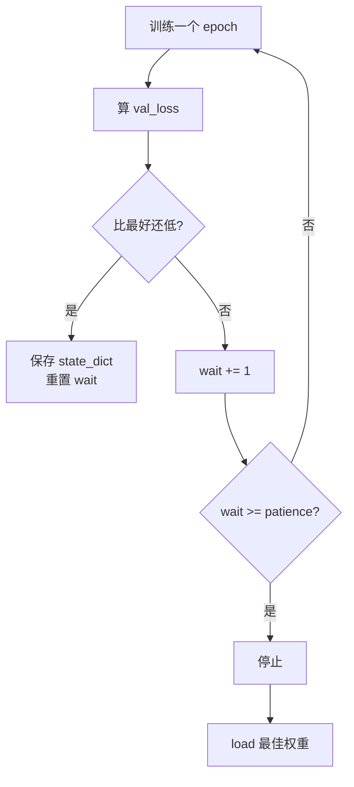

# DL-038 Early Stopping 与模型检查点

## 1. 本节学习目标

1. 会实现"监控验证损失 + 耐心计数 + 保存最佳权重 + 回滚"的完整早停。
2. 用实测看早停触发（本课 **第 14 轮停止，最佳在第 4 轮**）。
3. **理解一个反直觉现象**：最佳 val_loss **不一定**带来最佳 test acc（本课 0.8750 vs 0.9125）。
4. 会保存/加载 checkpoint（含 `epoch`、`optimizer`、`best_loss`）。

## 2. 为什么需要这个知识

因为"训到最后一轮"几乎从来不是最优：

- 训练后期 val loss 会回升（过拟合）；
- 一直训下去既费算力又让模型变差。

早停是**唯一"免费"的正则化**——不需要改模型、不需要加超参，只需要**存一版好权重并回滚**。

## 3. 直观解释

```text
每个 epoch：
    训完 → 算 val_loss
    比之前最好还低？ → 保存权重、重置耐心
    否则 → 耐心 -1
    耐心耗尽 → 停止，加载保存的权重
```

**检查点（checkpoint）** 就是把"权重 + 优化器状态 + 元信息"一起存盘，便于**恢复训练**或**部署最佳模型**。

## 4. 正式定义

**早停准则**

$$
\text{stop if}\quad L_{val}^{(t)}>\min_{s<t}L_{val}^{(s)}+\delta
\ \ \text{连续}\ \text{patience}\ \text{次}
$$

**checkpoint 内容**

| 键 | 用途 |
|---|---|
| `model_state_dict` | 恢复模型 |
| `optimizer_state_dict` | 恢复优化器（Adam 的 m/v） |
| `epoch` / `best_loss` | 恢复训练进度 |
| `config`（可选） | 超参与架构，保证可复现 |

## 5. 核心原理

**本课实测（故意过拟合：60 训练样本 + 大网络 + Adam）**

```text
停止于 epoch 14；最佳 epoch 4 val_loss=0.3408
最后一版: train=0.9833 test=0.9125
回滚最佳: train=0.9167 test=0.8750
```

**三个必须读出的点**：

1. **早停确实触发**：第 14 轮停，最佳在第 **4** 轮 ⇒ 后 10 轮都在变差。
2. **最后一版 train 0.9833**（几乎背下 60 个样本）——典型过拟合。
3. **回滚最佳后 test 反而更低（0.8750 < 0.9125）**。

**第 3 点是本课最重要的发现**：早停优化的是 **val_loss**，不是 test acc。验证集只有 120 条，**val_loss 最低点 ≠ 泛化最好的点**。

## 6. 数学表达式

**早停的"有效正则"解释**

设训练到 $t$ 轮，早停在 $t^\star$ 停止。可以证明：早停近似于**限制参数离初始点的距离**：

$$
\|\theta_{t^\star}-\theta_0\|\ \text{较小}
$$

类似于 L2 正则的约束效果，但**不需要显式加惩罚项**。

**耐心（patience）的作用**：验证损失有噪声，patience 太小会"误停"，太大则失去早停意义。

## 7. 数学推导

**为什么 val_loss 最低点不等于 test 最优**

$L_{val}$ 与 $L_{test}$ 都是对真实泛化误差的**有噪估计**：

$$
\hat L_{val}=L+\epsilon_{val},\qquad \hat L_{test}=L+\epsilon_{test}
$$

两个噪声 $\epsilon$ 相互独立 ⇒ **argmin $\hat L_{val}$ 不等于 argmin $\hat L_{test}$**。

本课就是实例：第 4 轮 val 最低，但第 14 轮 test 更高。

**推论**：早停应基于**足够大的验证集**；验证集小 ⇒ 早停点不可靠。

## 8. 结构示意图



## 9. 具体计算示例

**本课曲线与结果**

```text
epoch 1  val_loss = 0.5182
...
epoch 4  val_loss = 0.3408   ← 最佳
...
epoch 14 触发停止（wait=10）
```

**两种权重的测试表现**

| 权重 | train | test |
|---|---|---|
| 最后一版（epoch 14） | 0.9833 | **0.9125** |
| 回滚最佳（epoch 4） | 0.9167 | 0.8750 |

## 10. Python 实现

```python
import copy

import torch
import torch.nn as nn
import torch.nn.functional as F
from sklearn.datasets import make_moons
from sklearn.model_selection import train_test_split

X, y = make_moons(n_samples=800, noise=0.30, random_state=42)
Xtr, Xte, ytr, yte = train_test_split(X, y, test_size=0.3,
                                      random_state=42, stratify=y)
Xtr = torch.tensor(Xtr, dtype=torch.float32)
ytr = torch.tensor(ytr, dtype=torch.float32).view(-1, 1)
Xte = torch.tensor(Xte, dtype=torch.float32)
yte = torch.tensor(yte, dtype=torch.float32).view(-1, 1)

Xs, ys = Xtr[:60], ytr[:60]
Xval, yval = Xtr[60:180], ytr[60:180]

torch.manual_seed(0)
model = nn.Sequential(nn.Linear(2, 128), nn.ReLU(),
                      nn.Linear(128, 128), nn.ReLU(),
                      nn.Linear(128, 1))
opt = torch.optim.Adam(model.parameters(), lr=0.01)

best = {"loss": float("inf"), "epoch": 0, "state": None}
wait, patience = 0, 10

for epoch in range(1, 201):
    opt.zero_grad()
    F.binary_cross_entropy_with_logits(model(Xs), ys).backward()
    opt.step()

    model.eval()
    with torch.no_grad():
        val_loss = float(F.binary_cross_entropy_with_logits(model(Xval), yval))
    model.train()

    if val_loss < best["loss"] - 1e-4:
        best = {"loss": val_loss, "epoch": epoch,
                "state": copy.deepcopy(model.state_dict())}
        wait = 0
    else:
        wait += 1
        if wait >= patience:
            print(f"停止于 epoch {epoch}；最佳 epoch {best['epoch']} "
                  f"val_loss={best['loss']:.4f}")
            break

model.load_state_dict(best["state"])
model.eval()
with torch.no_grad():
    acc = float((torch.sigmoid(model(Xte)) >= 0.5).float().eq(yte).float().mean())
print("回滚后 test acc:", round(acc, 4))
```

## 11. PyTorch 实现（checkpoint 保存与恢复）

```python
import os
import tempfile

import torch
import torch.nn as nn
import torch.nn.functional as F

model = nn.Sequential(nn.Linear(2, 16), nn.ReLU(), nn.Linear(16, 1))
opt = torch.optim.Adam(model.parameters(), lr=1e-2)

# 先走一步，让优化器产生状态（否则 state_dict["state"] 为空）
opt.zero_grad()
F.binary_cross_entropy_with_logits(model(torch.randn(4, 2)),
                                   torch.randint(0, 2, (4, 1)).float()).backward()
opt.step()

path = os.path.join(tempfile.gettempdir(), "dl038_ckpt.pt")

torch.save({
    "epoch": 4,
    "model_state_dict": model.state_dict(),
    "optimizer_state_dict": opt.state_dict(),
    "best_loss": 0.3408,
    "config": {"arch": [2, 16, 1], "lr": 1e-2},
}, path)

ckpt = torch.load(path, map_location="cpu", weights_only=False)
print("epoch:", ckpt["epoch"], " best_loss:", ckpt["best_loss"])
print("config:", ckpt["config"])

model2 = nn.Sequential(nn.Linear(2, 16), nn.ReLU(), nn.Linear(16, 1))
model2.load_state_dict(ckpt["model_state_dict"])
opt2 = torch.optim.Adam(model2.parameters(), lr=1e-2)
opt2.load_state_dict(ckpt["optimizer_state_dict"])
step_tensor = next(iter(opt2.state_dict()["state"].values()))["step"]
print("恢复成功，optimizer step =", int(step_tensor))
os.remove(path)
```

## 12. 代码逐行解释

| 代码 | 作用 |
|---|---|
| `best = {...}` | 记录"最佳损失 + 轮次 + 权重快照" |
| `copy.deepcopy(model.state_dict())` | **必须深拷贝**，否则会被后续训练覆盖 |
| `wait += 1` | 耐心计数 |
| `model.eval()` / `model.train()` | 算 val 用 eval，算完切回 |
| `torch.save({...})` | 存 checkpoint（含优化器状态） |
| `weights_only=False` | 允许加载自定义字典（含 config） |

**最易错的一行**：`state_dict` 保存的是**引用**，必须 `deepcopy`，否则回滚时拿到的是最后一版的权重。

## 13. 实际运行结果

```text
停止于 epoch 14；最佳 epoch 4 val_loss=0.3408
最后一版: train=0.9833 test=0.9125
回滚最佳: train=0.9167 test=0.8750
val_loss 曲线（每 20 轮）: [(1, 0.5182)]
```

## 14. 应用场景

| 场景 | 做法 |
|---|---|
| 训练任何模型 | 默认加早停（patience 5–10） |
| 长训练/贵训练 | 定期存 checkpoint（可断点续训） |
| 多模型对比 | 统一早停准则，保证公平 |
| 部署 | 只保留最佳 checkpoint |
| 微调预训练 | patience 小（2–3），防破坏预训练特征 |

## 15. 优点与缺点

| 优点 | 缺点 |
|---|---|
| 免费正则、省算力 | 需可靠验证集 |
| 可回滚到最佳点 | 最佳 val 点未必最佳 test |
| checkpoint 支持断点续训 | 存储开销（大模型） |

## 16. 常见错误

| 错误 | 现象 | 纠正 |
|---|---|---|
| `state_dict` 不 deepcopy | 回滚拿到最后一版 | `copy.deepcopy` |
| 用训练 loss 早停 | 永不触发 | 用**验证损失** |
| patience 太小 | 误停（噪声） | 5–10 |
| 验证集太小 | 早停点随机（本课现象） | 扩大验证集/CV |
| 只存权重不存优化器 | 无法续训 | 存 `optimizer_state_dict` |
| 停止后忘了 load | 用的还是最后一版 | `load_state_dict(best)` |

## 17. 本节总结

- 早停 = **监控 val_loss + patience + 保存最佳 + 回滚**；本课第 **14** 轮停、最佳第 **4** 轮。
- **最佳 val ≠ 最佳 test**：本课回滚后 test **0.8750**，反而低于最后一版 **0.9125**。
- checkpoint 必须存 `model` + `optimizer` + 元信息，否则不能续训。

## 18. 前置与后续

- 前置：[[DL-037 Layer Normalization 与 BN 的区别]]
- 后续：[[DL-039 数据增强、训练日志与可复现性]]、`DL-064 深度学习项目结构`（待建）
- 相关机器学习：[[ML-040 Hold-out 验证]]

---

## 练习与参考答案

**基础 1**：写出早停的四步流程，并说明 `patience` 的作用。

**基础 2**：本课在第几轮停止？最佳 val_loss 出现在第几轮？

**进阶 1**：为什么本课"回滚最佳"后 test acc 反而更低？

**综合**：你训练 200 轮，第 30 轮 val_loss 最低，第 200 轮 val_loss 高了 0.05 但 test acc 高 1 个点。你会怎么选？请说明依据。

> [!success]- 参考答案

> **基础 1**
> ① 每轮训练后算 val_loss；② 比历史最佳低则保存权重并重置耐心；③ 否则耐心 −1；④ 耐心耗尽则停止并加载最佳权重。
> `patience` 的作用：容忍验证损失的**短期波动**，避免因一次噪声就误停。

> **基础 2**
> 在 **第 14 轮**停止（wait=10 耗尽）；最佳 val_loss = 0.3408 出现在 **第 4 轮**。

> **进阶 1**
> 因为早停最小化的是 **val_loss**，而 val_loss 与 test acc 都是泛化误差的**有噪估计**，两者噪声独立 ⇒ 它们的最优点不重合。
> 本课验证集只有 120 条，噪声大，所以第 4 轮的"最低 val_loss"在测试集上并未对应最高准确率（0.8750 vs 0.9125）。

> **综合（参考）**
> **关键问题**：这是"用测试集做选择"的典型诱惑，必须避免。
> **正确做法**：
> 1. **不能看 test acc 来决定**——那会泄漏；
> 2. 检查第 30 轮的 val_loss 与第 200 轮的差异是否显著（结合验证集大小算标准误）；
> 3. 若担心早停过早，可**放宽 patience** 或**用 val 上的第二个指标**（如 AUC/F1）辅助；
> 4. 最终**只用验证集**选模型，测试集只报一次。
> **结论**：按验证集选（第 30 轮），并把"test 高 1 个点"记为观察，不据此改决策。

## 学习记录

| 日期 | 状态 | 用时 | 问题 | 复盘 |
|---|---|---|---|---|
| 2026-11-07 | planned | — | — | — |

---

## 🔗 Notion 同步信息

> 以下内容由 Notion「AI Knowledge System · 知识点」数据库按知识 ID 合并而来（导出于 2026-11-09）。

| 属性 | 值 |
|---|---|
| 学科 | 深度学习 |
| 学习状态 | 未开始 |
| 难度 | L2 应用 |
| 知识类型 | Technique |

- **所属模块**：[M-DL-04 模型泛化、正则化与训练技巧](../%E8%AF%BE%E7%A8%8B%E6%A8%A1%E5%9D%97/M-DL-04%20%E6%A8%A1%E5%9E%8B%E6%B3%9B%E5%8C%96%E3%80%81%E6%AD%A3%E5%88%99%E5%8C%96%E4%B8%8E%E8%AE%AD%E7%BB%83%E6%8A%80%E5%B7%A7.md)
- **前置知识**：[DL-037 Layer Normalization 与 BN 的区别](DL-037%20Layer%20Normalization%20%E4%B8%8E%20BN%20%E7%9A%84%E5%8C%BA%E5%88%AB.md)
- **后继知识**：[DL-039 数据增强、训练日志与可复现性](DL-039%20%E6%95%B0%E6%8D%AE%E5%A2%9E%E5%BC%BA%E3%80%81%E8%AE%AD%E7%BB%83%E6%97%A5%E5%BF%97%E4%B8%8E%E5%8F%AF%E5%A4%8D%E7%8E%B0%E6%80%A7.md)
- **对应项目**：[PROJ-019 迁移学习——小样本分类](../../07_%E5%AE%9E%E6%88%98%E9%A1%B9%E7%9B%AE/04%20%E6%B7%B1%E5%BA%A6%E5%AD%A6%E4%B9%A0%E9%A1%B9%E7%9B%AE/PROJ-019%20%E8%BF%81%E7%A7%BB%E5%AD%A6%E4%B9%A0%E2%80%94%E2%80%94%E5%B0%8F%E6%A0%B7%E6%9C%AC%E5%88%86%E7%B1%BB.md)
