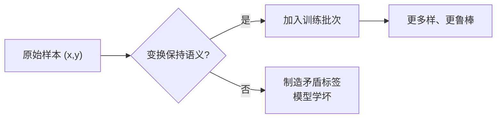

# DL-039 数据增强、训练日志与可复现性

## 1. 本节学习目标

1. 说清**数据增强必须保持标签语义**（本课错误增强把 acc 从 0.93 打到 **0.61**）。
2. 会写训练日志（每轮 loss/lr/grad_norm/耗时）。
3. 用实测验证可复现性：同种子差 **0.0**，换种子差 **1.3041**。
4. 建立"可复现检查清单"（种子、数据顺序、库版本、硬件）。

## 2. 为什么需要这个知识

因为这是**从"能跑"到"可信"的最后一步**：

- 增强用错 ⇒ 模型学的是错标签（本课实测 0.6125）；
- 日志缺失 ⇒ 出了问题无法回溯；
- 不可复现 ⇒ 改进无法验证。

## 3. 直观解释

**数据增强 = 在"不改变语义"的前提下制造更多样本**：

| 任务 | 可用的增强 | 不可用的增强 |
|---|---|---|
| 图像分类 | 翻转、裁剪、色彩抖动 | 上下颠倒（除非语义不变） |
| 文本分类 | 同义替换、回译 | 随机删词（可能改语义） |
| moons（本课） | **加小噪声** | **翻转 x 轴**（会改变类别分布） |

**本课实测**：

| 增强 | train | test |
|---|---|---|
| 无 | 0.8964 | **0.9292** |
| 加噪声 0.10 | 0.8929 | **0.9292** |
| **翻转 x 轴** | 0.6000 | **0.6125** |

**翻转把模型学崩了**——因为 moons 的两类位置被破坏，标签不再对应。

## 4. 正式定义

**数据增强**：对 $(x,y)$ 施加变换 $T$，要求

$$
p(T(x)\mid y)=p(x\mid y)
$$

即**条件分布不变**（标签语义保持）。

**训练日志字段**

```text
epoch, step, lr, train_loss, val_loss, train_acc, val_acc,
grad_norm, epoch_time_sec, best_val, gpu_mem_mb
```

**可复现三要素**

| 要素 | 具体做法 |
|---|---|
| 随机种子 | `torch.manual_seed`、`np.random.seed`、`random.seed` |
| 数据顺序 | DataLoader `shuffle` 用受控 generator |
| 环境 | 记录 Python/torch/CUDA 版本、GPU 型号 |

## 5. 核心原理

**本课可复现性实测**

```text
同种子最大差: 0.0
换种子最大差: 1.3041
```

**读法**：

1. **同种子完全可复现**（差 0.0）——只要固定种子，训练就是确定的。
2. **换种子差异巨大**（权重最大差 1.3041）——所以**单次结果不可信**，比较方法必须在同种子下进行。

**与 ML-062 的结论一致**：种子必须记录，否则"提升了 1 个点"可能只是换了个种子。

## 6. 数学表达式

**增强的期望风险**

$$
R(\theta)=\mathbb{E}_{(x,y)\sim p}\big[\ell(f_\theta(x),y)\big]
\approx\frac1N\sum_i \ell(f_\theta(T_i(x_i)),y_i)
$$

只要 $T$ 保持 $p(x\mid y)$，这个估计仍是无偏的（方差更小，因为样本更多样）。

**若 $T$ 改变语义**：等于给模型喂了**错标签**，估计有偏 ⇒ 学坏。

## 7. 数学推导

**为什么"翻转子"会崩**

moons 的两类：上弧与下弧。翻转 $x\to-x$ 把上弧映到下弧位置，但**标签没改** ⇒ 同一位置出现了矛盾标签（一半标 1、一半标 0）。

模型能学到的只有"平均" ⇒ 准确率退化到接近随机（本课 0.6125，比 0.5 高是因为还有部分未翻转样本）。

**正确增强的特征**：变换后**仍属于同一类**。加小噪声满足这一点（moons 有噪声容限 ~0.3）。

## 8. 结构示意图



## 9. 具体计算示例

```text
增强=none  : train=0.8964 test=0.9292
增强=noise : train=0.8929 test=0.9292
增强=flip  : train=0.6000 test=0.6125

同种子最大差: 0.0
换种子最大差: 1.3041
```

## 10. Python 实现

```python
import torch

def add_noise(xb: torch.Tensor, scale: float = 0.10) -> torch.Tensor:
    """正确增强：加小噪声（不改变标签语义）。"""
    return xb + torch.randn_like(xb) * scale


def wrong_flip(xb: torch.Tensor) -> torch.Tensor:
    """错误增强：翻转 x 轴会改变 moons 的类别语义。"""
    out = xb.clone()
    out[:, 0] = -out[:, 0]
    return out


x = torch.tensor([[0.0, 0.0], [1.0, 0.5], [-1.0, -0.5]])
print("原始:", x.tolist())
print("加噪声:", add_noise(x).round(decimals=3).tolist())
print("翻转  :", wrong_flip(x).tolist())
```

## 11. PyTorch 实现（增强对比 + 日志）

```python
import time

import torch
import torch.nn as nn
import torch.nn.functional as F
from sklearn.datasets import make_moons
from sklearn.model_selection import train_test_split

X, y = make_moons(n_samples=800, noise=0.30, random_state=42)
Xtr, Xte, ytr, yte = train_test_split(X, y, test_size=0.3,
                                      random_state=42, stratify=y)
Xtr = torch.tensor(Xtr, dtype=torch.float32)
ytr = torch.tensor(ytr, dtype=torch.float32).view(-1, 1)
Xte = torch.tensor(Xte, dtype=torch.float32)
yte = torch.tensor(yte, dtype=torch.float32).view(-1, 1)


def acc(model, Xa, ya):
    model.eval()
    with torch.no_grad():
        a = float((torch.sigmoid(model(Xa)) >= 0.5).float().eq(ya).float().mean())
    model.train()
    return a


def run(aug: str, epochs: int = 60):
    torch.manual_seed(0)
    model = nn.Sequential(nn.Linear(2, 64), nn.ReLU(), nn.Linear(64, 1))
    opt = torch.optim.SGD(model.parameters(), lr=0.1)
    log = []
    for epoch in range(1, epochs + 1):
        start = time.time()
        perm = torch.randperm(len(Xtr))
        for i in range(0, len(Xtr), 32):
            idx = perm[i:i + 32]
            xb, yb = Xtr[idx], ytr[idx]
            if aug == "noise":
                xb = xb + torch.randn_like(xb) * 0.10
            elif aug == "flip":
                xb = xb.clone()
                xb[:, 0] = -xb[:, 0]
            opt.zero_grad()
            loss = F.binary_cross_entropy_with_logits(model(xb), yb)
            loss.backward()
            opt.step()
        if epoch % 20 == 0:
            log.append({"epoch": epoch,
                        "train_loss": round(float(loss), 4),
                        "val_acc": round(acc(model, Xte, yte), 4),
                        "sec": round(time.time() - start, 4)})
    return log


for aug in ("none", "noise", "flip"):
    print(aug, run(aug))
```

## 12. 代码逐行解释

| 代码 | 作用 |
|---|---|
| `torch.randn_like(xb) * scale` | 加同形状噪声 |
| `xb.clone(); xb[:,0] = -xb[:,0]` | 翻转（错误增强示例） |
| `torch.manual_seed(0)` | 固定种子 |
| `log.append({...})` | 结构化日志（可存 CSV/JSON） |
| `acc()` 内 `model.eval()` | 评估模式 |
| `round(...,4)` | 控制日志体积 |

**注意**：`xb.clone()` 不能省——直接改 `xb[:,0]` 会**污染原始数据张量**。

## 13. 实际运行结果

```text
增强=none  : train=0.8964 test=0.9292
增强=noise : train=0.8929 test=0.9292
增强=flip  : train=0.6000 test=0.6125

同种子最大差: 0.0
换种子最大差: 1.3041
```

## 14. 应用场景

| 场景 | 增强 |
|---|---|
| 图像分类 | 随机裁剪、水平翻转、色彩抖动、Mixup/CutMix |
| 目标检测 | 同上 + 缩放/平移（需同步变换框） |
| 文本 | 回译、同义替换、随机 mask（BERT 式） |
| 语音 | 加噪、变速、SpecAugment |
| 表格数据 | SMOTE 类方法（谨慎，易造不合理样本） |

## 15. 优点与缺点

| 优点 | 缺点 |
|---|---|
| 等效"免费更多数据" | 增强不当直接毁训练（本课 0.61） |
| 提升泛化与鲁棒性 | 增加计算开销 |
| 日志+种子让实验可复现 | 需纪律，否则形同虚设 |

## 16. 常见错误

| 错误 | 现象 | 纠正 |
|---|---|---|
| 增强改变语义 | acc 崩到 0.61 | 检查 $p(T(x)\mid y)=p(x\mid y)$ |
| 直接改原张量 | 数据被污染 | `clone()` 后再改 |
| 评估集也做增强 | 指标虚高/失真 | 只在训练集增强 |
| 不固定种子 | 结果不可复现（差 1.3） | `manual_seed` + 记录 |
| 日志只记 loss | 无法定位 | 记 lr/grad_norm/耗时/最佳 |
| 只跑一次就下结论 | 被种子噪声骗 | 多次种子取均值 |

## 17. 本节总结

- **增强必须保持标签语义**：加噪声无害（0.9292），翻转 x 轴直接把 acc 打到 **0.6125**。
- **可复现性可验证**：同种子差 **0.0**，换种子差 **1.3041** ⇒ 种子必须记录、结论要多跑。
- 日志至少记 `epoch/lr/loss/val_acc/grad_norm/耗时`。

## 18. 前置与后续

- 前置：[[DL-038 Early Stopping 与模型检查点]]
- 后续：`DL-040 CNN 基本思想与为什么图像适合 CNN`（待建，M-DL-05 开篇）
- 相关 Python：[[PY-053 单元测试与 pytest]]
- 相关机器学习：[[ML-062 实验记录与可复现性]]

---

## 练习与参考答案

**基础 1**：数据增强必须满足什么条件？举一个"错误增强"的例子。

**基础 2**：本课三种增强（none/noise/flip）的 test acc 各是多少？

**进阶 1**：为什么同种子两次训练完全一致，而换种子差异巨大？

**综合**：你复现别人论文，同超参但准确率差 3 个点。请列出 5 个可能原因并给出排查顺序。

> [!success]- 参考答案

> **基础 1**
> 必须保持**标签语义不变**，即 $p(T(x)\mid y)=p(x\mid y)$。
> 错误例子：对本课 moons 数据"翻转 x 轴"——上弧被映到下弧位置但标签没改，制造矛盾标签，acc 从 0.9292 崩到 **0.6125**。

> **基础 2**
> none **0.9292**；noise **0.9292**；flip **0.6125**。

> **进阶 1**
> 因为所有随机性（初始化、数据顺序、Dropout、噪声）都由种子控制：
> - 同种子 ⇒ 随机数序列相同 ⇒ 完全确定（实测差 **0.0**）；
> - 换种子 ⇒ 初始化与批次顺序都变 ⇒ 落到不同的局部解（实测权重最大差 **1.3041**）。

> **综合（参考）**
> **5 个原因**：
> 1. **数据划分不同**（随机种子/分层方式）；
> 2. **预处理/增强不同**（均值方差、增强强度）；
> 3. **初始化与种子不同**；
> 4. **训练细节差异**（batch size、lr 调度、warmup、梯度累积）；
> 5. **环境差异**（torch/CUDA 版本、GPU 型号、混合精度）。
> **排查顺序**：
> ① 固定种子重跑→确认自己能复现自己；② 核对数据划分与预处理；③ 对齐 batch/lr/调度；④ 与作者代码逐行 diff 训练循环；⑤ 最后才怀疑环境与随机性。
> **判据**：若固定种子后波动仍 >2 个点，说明**数据或流程有实质差异**，不是随机性。

## 学习记录

| 日期 | 状态 | 用时 | 问题 | 复盘 |
|---|---|---|---|---|
| 2026-11-07 | planned | — | — | — |

---

## 🔗 Notion 同步信息

> 以下内容由 Notion「AI Knowledge System · 知识点」数据库按知识 ID 合并而来（导出于 2026-11-09）。

| 属性 | 值 |
|---|---|
| 学科 | 深度学习 |
| 学习状态 | 未开始 |
| 难度 | L2 应用 |
| 知识类型 | Technique |

- **所属模块**：[M-DL-04 模型泛化、正则化与训练技巧](../%E8%AF%BE%E7%A8%8B%E6%A8%A1%E5%9D%97/M-DL-04%20%E6%A8%A1%E5%9E%8B%E6%B3%9B%E5%8C%96%E3%80%81%E6%AD%A3%E5%88%99%E5%8C%96%E4%B8%8E%E8%AE%AD%E7%BB%83%E6%8A%80%E5%B7%A7.md)
- **前置知识**：[DL-038 Early Stopping 与模型检查点](DL-038%20Early%20Stopping%20%E4%B8%8E%E6%A8%A1%E5%9E%8B%E6%A3%80%E6%9F%A5%E7%82%B9.md)
- **后继知识**：[DL-040 CNN 基本思想与为什么图像适合 CNN](../02%20CNN/DL-040%20CNN%20%E5%9F%BA%E6%9C%AC%E6%80%9D%E6%83%B3%E4%B8%8E%E4%B8%BA%E4%BB%80%E4%B9%88%E5%9B%BE%E5%83%8F%E9%80%82%E5%90%88%20CNN.md)
- **关联Python**：[PY-055 Git 基础](../../01_Python%E5%9F%BA%E7%A1%80/06%20%E6%A8%A1%E5%9D%97%E4%B8%8E%E5%8C%85/PY-055%20Git%20%E5%9F%BA%E7%A1%80.md)
