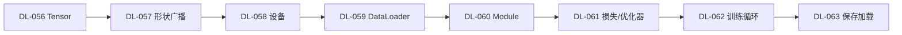

# 🔥 PyTorch 实践 · 分支索引

> 段位：`DL-056` ~ `DL-063`（M-DL-07）
> 上位：[[04_深度学习/00 模块索引\|深度学习模块索引]]
> 定位：**把前面所有数学与结构，变成能跑、能调、能存的代码**。

---

## 一、这一段装什么

| 号段 | 内容 |
|---|---|
| DL-056 ~ 057 | Tensor、形状、广播、常用运算 |
| DL-058 | 设备管理（CPU/GPU）与性能 |
| DL-059 | Dataset 与 DataLoader |
| DL-060 | nn.Module 自定义网络 |
| DL-061 ~ 063 | 损失/优化器 API、训练循环、保存加载 |

## 二、学习顺序

## 三、必须亲手做过的三件事

1. 写一个自定义 `Dataset` + `DataLoader`，打印每个 batch 形状（DL-059）。
2. 写一个带残差的自定义 `Module`，打印 `state_dict` 键（DL-060）。
3. 对比 CPU/GPU 计时，**带热身与 synchronize**（DL-058）。

## 四、知识点登记（8 条）

| 知识 ID | 名称 | 难度 | 状态 | 笔记 |
|---|---|---|---|---|
| `DL-056` | PyTorch 与 Tensor 基础 | L1 | planned | [[DL-056 PyTorch 与 Tensor 基础]] |
| `DL-057` | Tensor 形状、广播与常用运算 | L2 | planned | [[DL-057 Tensor 形状、广播与常用运算]] |
| `DL-058` | 设备管理：CPU 与 GPU | L2 | planned | [[DL-058 设备管理——CPU 与 GPU]] |
| `DL-059` | Dataset 与 DataLoader | L2 | planned | [[DL-059 Dataset 与 DataLoader]] |
| `DL-060` | nn.Module 自定义网络 | L2 | planned | [[DL-060 nn.Module 自定义网络]] |
| `DL-061` | 损失函数与优化器 API | L2 | planned | [[DL-061 损失函数与优化器 API]] |
| `DL-062` | 训练、验证、测试循环 | L3 | planned | [[DL-062 训练、验证、测试循环]] |
| `DL-063` | 模型保存、加载与 Checkpoint | L2 | planned | [[DL-063 模型保存、加载与 Checkpoint]] |

> 本目录计划 8 篇，**已全部完成**（DL-056 ~ DL-063，M-DL-07 收官）。

## 五、导航

- 上一级：[[04_深度学习/00 模块索引\|深度学习模块索引]]
- 知识索引：[[08_知识索引/04 深度学习知识索引\|深度学习知识索引]]
- 规则：[[08_知识索引/06 知识关联索引\|知识关联索引]]
