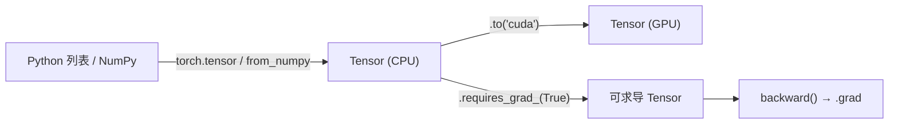

# DL-056 PyTorch 与 Tensor 基础

## 1. 本节学习目标

1. 说清 Tensor 与 NumPy 数组的**三个关键差异**（设备、自动求导、GPU）。
2. 会创建、转换、检查 Tensor（`dtype`/`shape`/`device`/`requires_grad`）。
3. 记住最常用的 8 个操作，能读懂别人的代码。
4. 知道"动态图"意味着什么（为什么 PyTorch 调试友好）。

## 2. 为什么需要这个知识

因为 **Tensor 是 PyTorch 里唯一的"数据单元"**：输入、权重、梯度、损失，全是 Tensor。

不理解它的 `dtype` 与 `device` 语义，后面所有报错（形状不符、设备不符、类型不符）你都只能靠试。

## 3. 直观解释

| | NumPy | PyTorch Tensor |
|---|---|---|
| 计算设备 | 仅 CPU | **CPU / GPU** |
| 自动求导 | ❌ | ✅ `requires_grad` |
| 生态 | 科学计算 | **深度学习** |
| API | `np.` | `torch.`（几乎一一对应） |

**一句话**：Tensor = NumPy 数组 + **GPU** + **自动求导**。

## 4. 正式定义

**Tensor**：多维数组，带有

$$
(\text{dtype},\ \text{shape},\ \text{device},\ \text{requires\_grad},\ \text{stride})
$$

**本课实测**

```text
int64: torch.int64  float32: torch.float32  设备: cpu
from numpy: torch.int64
requires_grad: True
加法: [[2.0, 3.0], [4.0, 5.0]]  矩阵乘: [[7.0, 10.0], [15.0, 22.0]]
均值: 2.5  求和: 10  形状: (2, 2)
```

## 5. 核心原理

**三个必须记住的语义**

| 属性 | 含义 | 典型坑 |
|---|---|---|
| `dtype` | 元素类型 | 整数不能求均值（DL-057 实测报错） |
| `device` | 在 CPU 还是 GPU | 跨设备运算直接报错 |
| `requires_grad` | 是否追踪梯度 | 忘记设 ⇒ `grad is None` |

**动态图**：前向时**即时构建**计算图，所以可以随意用 `if`/循环/打印调试（对比静态图框架需先定义再运行）。

## 6. 数学表达式

**矩阵乘**

$$
C_{ij}=\sum_k A_{ik}B_{kj}
$$

本课：$A=B=\begin{bmatrix}1&2\\3&4\end{bmatrix}$ ⇒ $C=\begin{bmatrix}7&10\\15&22\end{bmatrix}$。

**均值与求和**

$$
\text{mean}=\frac1{4}\sum_{ij}A_{ij}=2.5,\qquad \text{sum}=10
$$

## 7. 数学推导

**为什么整数不能求均值**

均值属于浮点运算：$\frac{1}{n}\sum x_i$ 一般不是整数。

PyTorch 拒绝隐式类型提升 ⇒ 整数 Tensor 调 `.mean()` 直接抛 `NotImplementedError`（DL-057 实测）。

**正确做法**：先 `.float()` 再求均值。

## 8. 结构示意图



## 9. 具体计算示例

```text
torch.tensor([[1,2],[3,4]], dtype=torch.int64)   → int64
torch.tensor([[1.,2.],[3.,4.]])                  → float32
torch.from_numpy(np.array([1,2,3]))              → int64

[[1,2],[3,4]] + 1        → [[2,3],[4,5]]
[[1,2],[3,4]] @ [[1,2],[3,4]] → [[7,10],[15,22]]
mean = 2.5, sum = 10
```

## 10. Python 实现

```python
import numpy as np
import torch

a = torch.tensor([[1, 2], [3, 4]], dtype=torch.int64)
b = torch.tensor([[1.0, 2.0], [3.0, 4.0]])

print("int64:", a.dtype, " float32:", b.dtype, " 设备:", b.device)
print("from numpy:", torch.from_numpy(np.array([1, 2, 3])).dtype)
print("requires_grad:", torch.tensor(1.0, requires_grad=True).requires_grad)
print("加法:", (b + 1).tolist())
print("矩阵乘:", (b @ b).tolist())
print("均值:", round(float(b.mean()), 4), " 求和:", int(b.sum()))
```

## 11. PyTorch 实现（创建与转换）

```python
import torch

print("zeros:", torch.zeros(2, 3).shape)
print("ones:", torch.ones(2, 3).dtype)
print("arange:", torch.arange(0, 5).tolist())
print("randn:", torch.randn(2, 2).shape)
print("eye:", torch.eye(3).tolist())
print("full:", torch.full((2, 2), 7).tolist())

x = torch.tensor([1, 2, 3])
print("类型转换:", x.float().dtype, x.double().dtype, x.long().dtype)
print("numpy 往返:", torch.from_numpy(x.numpy()).tolist())
```

## 12. 代码逐行解释

| 代码 | 作用 |
|---|---|
| `torch.tensor(data, dtype=...)` | 从 Python 数据创建 |
| `torch.from_numpy(arr)` | 与 numpy **共享内存**（改一个另一个也变） |
| `.dtype / .shape / .device` | 三个必查属性 |
| `requires_grad=True` | 开启自动求导 |
| `@` | 矩阵乘（等价 `torch.matmul`） |
| `.float() / .long()` | 类型转换（最常用） |

**注意**：`from_numpy` 是共享内存，若要独立副本用 `torch.tensor(arr)`。

## 13. 实际运行结果

```text
int64: torch.int64  float32: torch.float32  设备: cpu
from numpy: torch.int64
requires_grad: True
加法: [[2.0, 3.0], [4.0, 5.0]]  矩阵乘: [[7.0, 10.0], [15.0, 22.0]]
均值: 2.5  求和: 10  形状: (2, 2)
```

## 14. 应用场景

| 场景 | 用法 |
|---|---|
| 数据输入 | `torch.tensor(X, dtype=torch.float32)` |
| 模型参数 | `nn.Parameter(torch.randn(...))` |
| 与 numpy 交互 | `from_numpy` / `.numpy()` |
| GPU 加速 | `.to("cuda")` |
| 保存 | `torch.save(state_dict, path)` |

## 15. 优点与缺点

| 优点 | 缺点 |
|---|---|
| API 与 numpy 接近，上手快 | 隐式类型提升被禁用（更严格） |
| 动态图，调试直观 | 动态图有额外开销 |
| 自动求导 + GPU | 显存管理需手动注意 |

## 16. 常见错误

| 错误 | 现象 | 纠正 |
|---|---|---|
| 整数 Tensor 求均值 | `NotImplementedError` | 先 `.float()` |
| 忘记 `requires_grad` | `grad is None` | 参数要显式设置 |
| `from_numpy` 后改原数组 | Tensor 跟着变 | 用 `torch.tensor` 复制 |
| 混用 CPU/GPU | `Expected all tensors to be on the same device` | `.to(device)` 统一 |
| 用 `=` 赋值切片 | 共享内存的坑 | 用 `.clone()` |

## 17. 本节总结

- Tensor = **多维数组 + 设备 + 自动求导**；三个必查属性：`dtype/shape/device`。
- 本课：`int64/float32`、`from_numpy` 得 int64、加法与矩阵乘结果 `[[7,10],[15,22]]`。
- **整数不能求均值**，需先转 float。

## 18. 前置与后续

- 前置：[[DL-055 RNN、LSTM、GRU 对比与序列任务实战]]
- 后续：[[DL-057 Tensor 形状、广播与常用运算]]、[[DL-058 设备管理——CPU 与 GPU]]
- 相关数学：[[MATH-217 矩阵运算与维度]]
- 相关 Python：[[PY-066 矩阵运算]]

---

## 练习与参考答案

**基础 1**：Tensor 与 NumPy 数组的三个关键差异是什么？

**基础 2**：本课加法与矩阵乘的结果各是多少？为什么均值是 2.5？

**进阶 1**：为什么 PyTorch 不允许对整数 Tensor 求均值？

**综合**：你从 numpy 读入一个 `(1000, 20)` 的 float64 数组，要送入模型训练。请写出完整的类型/设备转换链，并指出两个易错点。

> [!success]- 参考答案

> **基础 1**
> ① 可在 **GPU** 上计算；② 支持**自动求导**（`requires_grad` + `backward`）；③ 生态面向**深度学习**（nn 模块、优化器、DataLoader）。
> 其余 API 与 numpy 高度相似。

> **基础 2**
> 加法 `[[2,3],[4,5]]`；矩阵乘 `[[7,10],[15,22]]`。
> 均值 $=(1+2+3+4)/4=10/4=2.5$。

> **进阶 1**
> 因为均值是浮点运算，结果可能是小数；整数 Tensor 无法表示。
> PyTorch 不做隐式类型提升（避免精度悄悄丢失），所以直接报 `NotImplementedError`，要求你先 `.float()`。

> **综合（参考）**
> ```python
> import numpy as np
> import torch
>
> device = torch.device("cuda" if torch.cuda.is_available() else "cpu")
> arr = np.random.randn(1000, 20).astype(np.float64)
> x = torch.from_numpy(arr).float().to(device)   # float64 → float32 → 设备
> print("dtype:", x.dtype, " device:", x.device)
> ```
> **两个易错点**：
> 1. **dtype**：numpy 默认 float64，PyTorch 模型默认 float32，不转会 dtype 不匹配（报错或变慢）；
> 2. **设备**：忘了 `.to(device)` ⇒ 与模型参数不在同一设备，运行时 `RuntimeError`。
> 另外 `from_numpy` 共享内存，若后续要原地修改建议 `.clone()`。

## 学习记录

| 日期 | 状态 | 用时 | 问题 | 复盘 |
|---|---|---|---|---|
| 2026-11-07 | planned | — | — | — |

---

## 🔗 Notion 同步信息

> 以下内容由 Notion「AI Knowledge System · 知识点」数据库按知识 ID 合并而来（导出于 2026-11-09）。

| 属性 | 值 |
|---|---|
| 学科 | 深度学习 |
| 学习状态 | 未开始 |
| 难度 | L1 概念 |
| 知识类型 | Concept |

- **所属模块**：[M-DL-07 PyTorch 深度学习框架实践](../%E8%AF%BE%E7%A8%8B%E6%A8%A1%E5%9D%97/M-DL-07%20PyTorch%20%E6%B7%B1%E5%BA%A6%E5%AD%A6%E4%B9%A0%E6%A1%86%E6%9E%B6%E5%AE%9E%E8%B7%B5.md)
- **前置知识**：[DL-055 RNN/LSTM/GRU 对比与序列任务实战](../03%20RNN%E4%B8%8E%E5%BA%8F%E5%88%97%E6%A8%A1%E5%9E%8B/DL-055%20RNN%E3%80%81LSTM%E3%80%81GRU%20%E5%AF%B9%E6%AF%94%E4%B8%8E%E5%BA%8F%E5%88%97%E4%BB%BB%E5%8A%A1%E5%AE%9E%E6%88%98.md)
- **后继知识**：[DL-057 Tensor 形状、广播与常用运算](DL-057%20Tensor%20%E5%BD%A2%E7%8A%B6%E3%80%81%E5%B9%BF%E6%92%AD%E4%B8%8E%E5%B8%B8%E7%94%A8%E8%BF%90%E7%AE%97.md)
- **关联Python**：[PY-066 矩阵运算](../../01_Python%E5%9F%BA%E7%A1%80/08%20NumPy/PY-066%20%E7%9F%A9%E9%98%B5%E8%BF%90%E7%AE%97.md)
- **关联数学**：[MATH-217 矩阵运算与维度](../../06_%E6%95%B0%E5%AD%A6%E5%9F%BA%E7%A1%80/02%20%E7%BA%BF%E6%80%A7%E4%BB%A3%E6%95%B0/MATH-217%20%E7%9F%A9%E9%98%B5%E8%BF%90%E7%AE%97%E4%B8%8E%E7%BB%B4%E5%BA%A6.md)
- **对应项目**：[PROJ-016 手写数字分类——全连接基线](../../07_%E5%AE%9E%E6%88%98%E9%A1%B9%E7%9B%AE/04%20%E6%B7%B1%E5%BA%A6%E5%AD%A6%E4%B9%A0%E9%A1%B9%E7%9B%AE/PROJ-016%20%E6%89%8B%E5%86%99%E6%95%B0%E5%AD%97%E5%88%86%E7%B1%BB%E2%80%94%E2%80%94%E5%85%A8%E8%BF%9E%E6%8E%A5%E5%9F%BA%E7%BA%BF.md)
