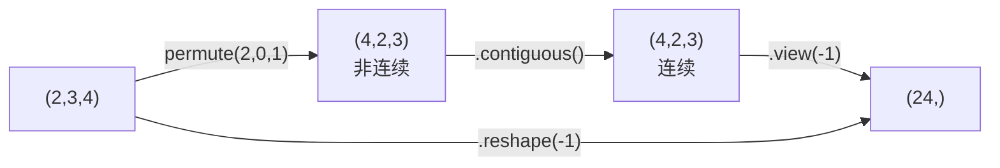

# DL-057 Tensor 形状、广播与常用运算

## 1. 本节学习目标

1. 掌握**广播规则**，能预测两个形状能否相加（本课 4 组案例）。
2. 分清 `reshape` / `view` / `permute` / `transpose` 的差异（**连续性**是关键）。
3. 会用 `sum/mean(dim=)` 做降维，并说清"求和后哪一维消失"。
4. 建立"报错先看形状"的排查习惯。

## 2. 为什么需要这个知识

因为 **PyTorch 的报错 80% 是形状问题**，而广播既是"省代码的利器"，也是"静默错误的来源"：

`(4,1)+(1,3)` 会**悄悄**变成 `(4,3)`——如果你本意不是这样，结果就错了且不报错。

## 3. 直观解释

**广播规则（从右往左对齐）**：

1. 把两个形状**右对齐**。
2. 每一维：相等 → 保留；有一个是 1 → 扩展；都没有 → **报错**。

```text
(4, 3) 与 (3,)       → 右对齐：(4,3) & (1,3) → (4,3) ✅
(4, 1) 与 (1, 3)     → (4,3) ✅
(2,1,3) 与 (1,4,1)   → (2,4,3) ✅
(2, 3) 与 (4,)       → (2,3) & (1,4) → 3≠4 ❌
```

## 4. 正式定义

**广播后的形状**

$$
\text{out}_k=\max\!\big(a_k,\ b_k\big)\quad\text{当 }a_k\in\{1,\text{out}_k\},\ b_k\in\{1,\text{out}_k\}
$$

**降维运算**

$$
\text{sum}(X,\ \text{dim}=d)\ \Rightarrow\ \text{去除第 }d\text{ 维}
$$

## 5. 核心原理

**本课实测**

```text
(4,3)+(3,) → (4, 3)
(4,1)+(1,3) → (4, 3)
(2,1,3)*(1,4,1) → (2, 4, 3)
(2,3)+(4,) 报错: RuntimeError The size of tensor a (3) must match the size of tensor b (4)
```

**读法**：前三个是合法广播，第四个因为 `3≠4` 且都不是 1 而报错。

**降维与矩阵乘实测**

```text
t = arange(24).reshape(2,3,4)
t.sum(dim=1)  → (2, 4)      # 第 1 维消失
t.mean(dim=2) → (2, 3)      # 第 2 维消失
t @ randn(4,5) → (2, 3, 5)  # 最后两维做矩阵乘
```

## 6. 数学表达式

**矩阵乘的形状规则**

$$
(A\ \text{形状}\ (m,k))\ \times\ (B\ \text{形状}\ (k,n))\ \Rightarrow\ (m,n)
$$

批量矩阵乘：`(2,3,4) @ (4,5) → (2,3,5)`（最后两维遵循上式，前面维度保留）。

**连续性**

$$
\text{stride}(i)=\prod_{j>i}\text{shape}(j)
$$

`permute` 只改 stride，不改内存 ⇒ 结果**非连续**。

## 7. 数学推导

**为什么 `permute` 后不能直接 `view`**

`view` 要求张量**连续**（内存按 shape 顺序排布）。`permute` 后 stride 变了但内存没动 ⇒ `view` 会抛：

```text
RuntimeError: view size is not compatible with input tensor's size and stride
```

**解法**：先 `.contiguous()`（真正重排内存）再 `view`。本课实测：`permute(2,0,1).contiguous().view(-1)` → `(24,)` ✅。

**`reshape` 与 `view` 的区别**：`reshape` 会**自动**在需要时拷贝，`view` 不会（更严格、更快）。

## 8. 结构示意图



## 9. 具体计算示例

```text
(4,3)+(3,)      → (4,3)      右对齐 (4,3)&(1,3)
(4,1)+(1,3)     → (4,3)
(2,1,3)*(1,4,1) → (2,4,3)
(2,3)+(4,)      → ❌ 3 vs 4

arange(24).reshape(2,3,4)
  sum(dim=1)  → (2,4)
  mean(dim=2) → (2,3)
  @ (4,5)     → (2,3,5)
```

## 10. Python 实现

```python
import torch

x = torch.randn(4, 3)
y = torch.randn(3)
print("(4,3)+(3,) →", tuple((x + y).shape))
print("(4,1)+(1,3) →", tuple((torch.randn(4, 1) + torch.randn(1, 3)).shape))
print("(2,1,3)*(1,4,1) →", tuple((torch.randn(2, 1, 3) * torch.randn(1, 4, 1)).shape))

try:
    torch.randn(2, 3) + torch.randn(4)
except Exception as exc:
    print("(2,3)+(4,) 报错:", type(exc).__name__)
```

## 11. PyTorch 实现（重排与降维）

```python
import torch

t = torch.arange(24, dtype=torch.float32).reshape(2, 3, 4)
print("原形状:", tuple(t.shape), " 连续:", t.is_contiguous())

p = t.permute(2, 0, 1)
print("permute 后:", tuple(p.shape), " 连续:", p.is_contiguous())

try:
    p.view(-1)
except Exception as exc:
    print("permute 后 view 报错:", type(exc).__name__)

print("contiguous 后 view:", tuple(p.contiguous().view(-1).shape))
print("reshape 直接展平:", tuple(t.reshape(-1).shape))
print("sum(dim=1):", tuple(t.sum(dim=1).shape))
print("mean(dim=2):", tuple(t.mean(dim=2).shape))
print("批量矩阵乘:", tuple((t @ torch.randn(4, 5)).shape))
```

## 12. 代码逐行解释

| 代码 | 作用 |
|---|---|
| `(x + y).shape` | 验证广播结果 |
| `permute(2,0,1)` | 重排维度顺序（只改 stride） |
| `is_contiguous()` | 检查内存是否连续 |
| `.view(-1)` | 展平（要求连续） |
| `.reshape(-1)` | 展平（自动处理非连续） |
| `sum(dim=1)` | 沿第 1 维求和 ⇒ 该维消失 |
| `t @ randn(4,5)` | 批量矩阵乘 |

## 13. 实际运行结果

```text
(4,3)+(3,) → (4, 3)
(4,1)+(1,3) → (4, 3)
(2,1,3)*(1,4,1) → (2, 4, 3)
(2,3)+(4,) 报错: RuntimeError The size of tensor a (3) must match the size of tensor b (4)
reshape(2,3,4): (2, 3, 4)  permute(2,0,1): (4, 2, 3)
连续: True  permute 后: False
sum(dim=1): (2, 4)  mean(dim=2): (2, 3)
matmul (2,3,4)@(4,5): (2, 3, 5)
view 非连续报错: RuntimeError view size is not compatible...
contiguous 后可 view: (24,)
```

## 14. 应用场景

| 场景 | 操作 |
|---|---|
| 加偏置 | `x + b`（广播 `(B,..)+(C,)`） |
| 归一化 | `(x - mean) / std`（按通道广播） |
| 注意力 | `Q @ K.transpose(-2,-1)` |
| 展平接 FC | `x.reshape(B, -1)` |
| 通道重排 | `permute` + `contiguous` |
| 池化聚合 | `x.mean(dim=1)` |

## 15. 优点与缺点

| 优点 | 缺点 |
|---|---|
| 广播省代码、免手工扩展 | 容易**静默**产生非预期形状 |
| 降维 API 统一 | `dim` 写错不易发现 |
| reshape/view 灵活 | 非连续性易报错 |

## 16. 常见错误

| 错误 | 现象 | 纠正 |
|---|---|---|
| 以为 `(2,3)+(4,)` 能广播 | `RuntimeError` | 右对齐检查 |
| `permute` 后直接 `view` | stride 不兼容 | 先 `.contiguous()` |
| `sum()` 不写 dim | 变成标量，后续形状错 | 明确 `dim` |
| `dim=0` 当 batch 求和 | 把样本混在一起 | 确认维度语义 |
| 用广播代替显式 `unsqueeze` | 结果对但可读性差 | 复杂处显式写 |
| 忘记 batch 维 | `mat1 and mat2 shapes cannot be multiplied` | 检查最后一维匹配 |

## 17. 本节总结

- 广播：**右对齐，逐维相等或为 1**；本课 `(2,1,3)*(1,4,1)→(2,4,3)`，`(2,3)+(4,)` 报错。
- `permute` 只改 stride ⇒ 非连续 ⇒ `view` 报错，需 `contiguous()`。
- `sum/mean(dim=d)` 会**去掉第 d 维**（本课 `(2,3,4)→(2,4)`）。

## 18. 前置与后续

- 前置：[[DL-056 PyTorch 与 Tensor 基础]]
- 后续：[[DL-058 设备管理——CPU 与 GPU]]、[[DL-059 Dataset 与 DataLoader]]
- 相关数学：[[MATH-217 矩阵运算与维度]]
- 相关 Python：[[PY-066 矩阵运算]]

---

## 练习与参考答案

**基础 1**：广播的三条规则是什么？

**基础 2**：本课 `(2,1,3)*(1,4,1)` 的结果形状？`(2,3)+(4,)` 为什么报错？

**进阶 1**：`view` 与 `reshape` 有什么区别？什么时候必须用 `contiguous()`？

**综合**：一个 `(B=8, C=3, H=32, W=32)` 的图像张量，要转成 `(B, H*W, C)` 以便送进 Transformer。请写出转换代码并说明注意事项。

> [!success]- 参考答案

> **基础 1**
> ① 形状**右对齐**；② 每一维**相等**则保留；③ 其中一维为 **1** 则广播扩展；④ 否则报错。

> **基础 2**
> `(2,1,3)*(1,4,1)` → **`(2,4,3)`**。
> `(2,3)+(4,)`：右对齐为 `(2,3)` 与 `(1,4)`，最后一维 `3 ≠ 4` 且都不是 1 ⇒ 报错。

> **进阶 1**
> - `view`：要求张量**连续**，不拷贝（更快、更严格）。
> - `reshape`：需要时会自动拷贝，更宽松。
> 必须在 `permute/transpose/narrow` 之后、且目标算子要求连续内存时用 `contiguous()`（如 `view`、`.numpy()`）。

> **综合（参考）**
> ```python
> x = torch.randn(8, 3, 32, 32)
> # (B,C,H,W) → (B,H,W,C) → (B, H*W, C)
> seq = x.permute(0, 2, 3, 1).reshape(8, 32 * 32, 3)
> print(seq.shape)   # (8, 1024, 3)
> ```
> **注意事项**：
> 1. `permute` 后**必须**用 `reshape`（或先 `contiguous()` 再 `view`），否则报 stride 错误；
> 2. 顺序是 `(B, H, W, C)` 再展平空间维，**不要**把 C 展进去；
> 3. 送 Transformer 前通常还要 `Linear(C, d_model)` 投影 + 位置编码。

## 学习记录

| 日期 | 状态 | 用时 | 问题 | 复盘 |
|---|---|---|---|---|
| 2026-11-07 | planned | — | — | — |

---

## 🔗 Notion 同步信息

> 以下内容由 Notion「AI Knowledge System · 知识点」数据库按知识 ID 合并而来（导出于 2026-11-09）。

| 属性 | 值 |
|---|---|
| 学科 | 深度学习 |
| 学习状态 | 未开始 |
| 难度 | L2 应用 |
| 知识类型 | Technique |

- **所属模块**：[M-DL-07 PyTorch 深度学习框架实践](../%E8%AF%BE%E7%A8%8B%E6%A8%A1%E5%9D%97/M-DL-07%20PyTorch%20%E6%B7%B1%E5%BA%A6%E5%AD%A6%E4%B9%A0%E6%A1%86%E6%9E%B6%E5%AE%9E%E8%B7%B5.md)
- **前置知识**：[DL-056 PyTorch 与 Tensor 基础](DL-056%20PyTorch%20%E4%B8%8E%20Tensor%20%E5%9F%BA%E7%A1%80.md)
- **后继知识**：[DL-058 设备管理：CPU 与 GPU](DL-058%20%E8%AE%BE%E5%A4%87%E7%AE%A1%E7%90%86%E2%80%94%E2%80%94CPU%20%E4%B8%8E%20GPU.md)
- **关联Python**：[PY-066 矩阵运算](../../01_Python%E5%9F%BA%E7%A1%80/08%20NumPy/PY-066%20%E7%9F%A9%E9%98%B5%E8%BF%90%E7%AE%97.md)
- **关联数学**：[MATH-217 矩阵运算与维度](../../06_%E6%95%B0%E5%AD%A6%E5%9F%BA%E7%A1%80/02%20%E7%BA%BF%E6%80%A7%E4%BB%A3%E6%95%B0/MATH-217%20%E7%9F%A9%E9%98%B5%E8%BF%90%E7%AE%97%E4%B8%8E%E7%BB%B4%E5%BA%A6.md)
