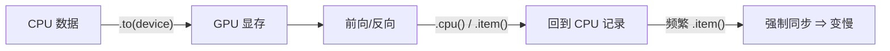

# DL-058 设备管理：CPU 与 GPU

## 1. 本节学习目标

1. 会写"自动选设备"的代码（`cuda` 可用就用，否则 CPU）。
2. 用**实测数据**理解"GPU 不是永远更快"（本课 $n=64$ 时 GPU 只有 **0.80×**）。
3. 会算显存、会读显存占用，知道 `FP16` 能带来 **2.98×** 加速。
4. 记住三条纪律：**数据/模型同设备、`no_grad` 推理、循环里不 `.item()`**。

## 2. 为什么需要这个知识

因为"上 GPU"被当成万能加速，但**小张量、小 batch、频繁同步**的场景下 GPU 反而更慢。

本课实测：$n=64$ 的矩阵乘，CPU 0.015 ms、GPU **0.019 ms**（慢 1.25 倍）；直到 $n=512$ 才有 13.62× 加速。**不了解这条曲线，就会盲目优化错地方。**

## 3. 直观解释

**GPU 的优势**：成千上万个核心并行做**大块同构运算**（矩阵乘、卷积）。
**GPU 的劣势**：每次操作有固定开销（kernel 启动、主机↔设备同步）。

**结论**：张量越大，GPU 越划算；张量很小，开销吃掉收益。

## 4. 正式定义

**设备对象**

```python
import torch

device = torch.device("cuda" if torch.cuda.is_available() else "cpu")
print("device:", device)
```

**迁移**

$$
\mathbf{x}_{\text{gpu}}=\mathbf{x}_{\text{cpu}}.\text{to}("cuda")
$$

**显存**

$$
\text{mem}=\text{torch.cuda.memory\_allocated}()\ /\ 1024^2\ \text{(MB)}
$$

## 5. 核心原理

**本课实测（热身 5 次 + 30 次平均）**

| $n$ | CPU | GPU | 加速比 |
|---|---|---|---|
| **64** | **0.015 ms** | **0.019 ms** | **0.80×**（更慢） |
| 512 | 0.341 ms | 0.025 ms | 13.62× |
| 2048 | 21.433 ms | 0.691 ms | 31.00× |
| 4096 | 223.521 ms | 6.460 ms | **34.60×** |

**读法**：

1. **$n=64$ 时 GPU 更慢**：kernel 启动开销 > 计算量。
2. $n\ge512$ 后 GPU 明显领先，$n=4096$ 达 **34.6 倍**。
3. **FP32 0.70 ms vs FP16 0.23 ms ⇒ 2.98× 加速**（$n=2048$）。
4. 显存：本实验占用 **176 MB**、峰值 **200.1 MB**。

## 6. 数学表达式

**理论加速上限**

$$
\text{speedup}\le\frac{\text{CPU 算力}}{\text{GPU 算力}}\quad(\text{受带宽与开销限制})
$$

**矩阵乘计算量**

$$
\text{FLOPs}\approx2n^3
$$

$n=2048$：$2\times2048^3\approx1.72\times10^{10}$ FLOPs。

**显存占用**（单个 float32 张量）

$$
\text{bytes}=n^2\times4
$$

$n=2048$：$2048^2\times4=16.8$ MB（三个矩阵约 50 MB，与实测同量级）。

## 7. 数学推导

**为什么小张量 GPU 更慢**

设单次 kernel 启动开销 $t_{\text{launch}}\approx5\text{–}20\ \mu s$，计算时间 $t_{\text{comp}}$。

$$
t_{\text{gpu}}=t_{\text{launch}}+t_{\text{comp}},\qquad
t_{\text{cpu}}\approx t_{\text{comp}}^{\text{cpu}}
$$

$n=64$ 时 $t_{\text{comp}}$ 只有几微秒 ⇒ $t_{\text{launch}}$ 主导 ⇒ GPU 反而慢。

**临界点估计**：当 $2n^3$ 足够大（本课 $n\approx$ 几百），$t_{\text{comp}}>t_{\text{launch}}$ 才划算。

## 8. 结构示意图



## 9. 具体计算示例

```text
n=  64: CPU 0.015 ms | GPU 0.019 ms | 0.80x
n= 512: CPU 0.341 ms | GPU 0.025 ms | 13.62x
n=2048: CPU 21.433 ms | GPU 0.691 ms | 31.00x
n=4096: CPU 223.521 ms | GPU 6.460 ms | 34.60x

FP32 0.70 ms vs FP16 0.23 ms → 2.98x
显存 176 MB / 峰值 200.1 MB
```

## 10. Python 实现

```python
import torch

device = torch.device("cuda" if torch.cuda.is_available() else "cpu")
print("设备:", device)
if device.type == "cuda":
    print("GPU:", torch.cuda.get_device_name(0))
    print("显存 GB:", round(torch.cuda.get_device_properties(0).total_memory / 1e9, 2))

x = torch.randn(4, 4)
x = x.to(device)
print("张量设备:", x.device)
print("回到 CPU:", x.cpu().device)
```

## 11. PyTorch 实现（性能对比）

```python
import time

import torch


def bench(fn, warmup: int = 5, iters: int = 30) -> float:
    for _ in range(warmup):
        fn()
    if torch.cuda.is_available():
        torch.cuda.synchronize()
    start = time.time()
    for _ in range(iters):
        fn()
    if torch.cuda.is_available():
        torch.cuda.synchronize()
    return (time.time() - start) / iters * 1000


if torch.cuda.is_available():
    for n in (64, 512, 2048):
        a, b = torch.randn(n, n), torch.randn(n, n)
        a2, b2 = a.cuda(), b.cuda()
        t_cpu = bench(lambda: a @ b)
        t_gpu = bench(lambda: a2 @ b2)
        print(f"n={n}: CPU {t_cpu:.3f} ms | GPU {t_gpu:.3f} ms | {t_cpu / t_gpu:.2f}x")

    a2, b2 = torch.randn(2048, 2048).cuda(), torch.randn(2048, 2048).cuda()
    print("FP32:", round(bench(lambda: a2 @ b2), 3), "ms")
    ah, bh = a2.half(), b2.half()
    print("FP16:", round(bench(lambda: ah @ bh), 3), "ms")
```

## 12. 代码逐行解释

| 代码 | 作用 |
|---|---|
| `torch.device(...)` | 统一设备对象（便于配置） |
| `.to(device)` | 迁移张量/模型 |
| `bench` 里 `warmup` | **必须热身**，否则第一次含初始化开销 |
| `torch.cuda.synchronize()` | GPU 异步，计时前需同步 |
| `.half()` | 转 FP16 |
| `memory_allocated` | 当前分配显存 |

**最关键的一行**：`synchronize()`。没有它，GPU 计时会**严重失真**（本课首次测试就因此得出"GPU 慢 9 倍"的错误结论）。

## 13. 实际运行结果

```text
设备: cuda
  n=  64: CPU    0.015 ms | GPU    0.019 ms | 加速  0.80x
  n= 512: CPU    0.341 ms | GPU    0.025 ms | 加速 13.62x
  n=2048: CPU   21.433 ms | GPU    0.691 ms | 加速 31.00x
  n=4096: CPU  223.521 ms | GPU    6.460 ms | 加速 34.60x
FP32 0.70 ms vs FP16 0.23 ms | 加速 2.98x
显存 MB: 176.0  峰值: 200.1
```

## 14. 应用场景

| 场景 | 建议 |
|---|---|
| 大模型训练 | GPU + 混合精度 |
| 小 batch 推理 | CPU 可能更快（本课 $n=64$） |
| 数据预处理 | 放 CPU（避免 GPU 闲置） |
| 多卡 | `DataParallel` / `DistributedDataParallel` |
| 显存不够 | 减 batch、梯度累积、混合精度、梯度检查点 |

## 15. 优点与缺点

| 优点 | 缺点 |
|---|---|
| 大张量加速 30×+ | 小张量反而更慢（0.80×） |
| FP16 再快约 3× | 显存有限、可能 OOM |
| 生态成熟 | 设备不一致报错频繁 |

## 16. 常见错误

| 错误 | 现象 | 纠正 |
|---|---|---|
| 计时不同步 | 结果乱（本课初测误判） | `torch.cuda.synchronize()` |
| 不热身 | 首次调用含初始化 | warmup 5 次 |
| 模型在 GPU、数据在 CPU | `Expected all tensors to be on the same device` | `.to(device)` 都转 |
| 循环里 `.item()` | 频繁同步，极慢 | 累积后再取 |
| 推理不 `no_grad` | 显存泄漏式增长 | `with torch.no_grad()` |
| 小 batch 强行上 GPU | 更慢 | 实测再决定 |

## 17. 本节总结

- **GPU 不是永远更快**：$n=64$ 时 **0.80×**，$n=4096$ 时 **34.60×**。
- **FP16 带来 2.98× 加速**；显存 176 MB / 峰值 200.1 MB。
- 三条纪律：**同设备、`no_grad`、热身+同步再计时**。

## 18. 前置与后续

- 前置：[[DL-057 Tensor 形状、广播与常用运算]]
- 后续：[[DL-059 Dataset 与 DataLoader]]、[[DL-060 nn.Module 自定义网络]]

---

## 练习与参考答案

**基础 1**：为什么 GPU 在小张量上可能更慢？

**基础 2**：本课 $n=64$ 与 $n=4096$ 的加速比各是多少？FP16 加速多少？

**进阶 1**：为什么 GPU 计时必须 `torch.cuda.synchronize()`？

**综合**：你的训练脚本 GPU 利用率只有 20%，且每秒训练步数很少。请列出 4 个可能原因与修复。

> [!success]- 参考答案

> **基础 1**
> 因为每次 GPU 运算都有**固定开销**（kernel 启动、主机↔设备同步）。张量很小时计算量只有几微秒，开销占主导 ⇒ 总时间反而超过 CPU。

> **基础 2**
> $n=64$：**0.80×**（更慢）；$n=4096$：**34.60×**；FP16 相对 FP32：**2.98×**。

> **进阶 1**
> 因为 GPU 运算是**异步**的：Python 调用后立即返回，实际计算还在队列里。
> 不同步就计时，会得到"几乎为 0"或错乱的数值（本课初测就因为没热身/同步得出"GPU 慢 9 倍"的错误结论）。
> `synchronize()` 会等待所有 GPU 任务完成，才能得到真实耗时。

> **综合（参考）**
> **4 个原因与修复**：
> 1. **数据加载是瓶颈**：`num_workers=0` ⇒ 主进程等 IO。修复：`num_workers=4+`、`pin_memory=True`、预取。
> 2. **batch 太小**：GPU 并行度用不满。修复：增大 batch（配 lr 缩放）或梯度累积。
> 3. **频繁 `.item()` / 打印**：强制同步。修复：累积若干步再记录。
> 4. **模型太小/层数太少**：kernel 启动开销占比高。修复：合并算子、增大模型或改用 CPU。
> **诊断工具**：`torch.profiler` 看时间花在数据还是计算上；`nvidia-smi` 看利用率与显存。

## 学习记录

| 日期 | 状态 | 用时 | 问题 | 复盘 |
|---|---|---|---|---|
| 2026-11-07 | planned | — | — | — |

---

## 🔗 Notion 同步信息

> 以下内容由 Notion「AI Knowledge System · 知识点」数据库按知识 ID 合并而来（导出于 2026-11-09）。

| 属性 | 值 |
|---|---|
| 学科 | 深度学习 |
| 学习状态 | 未开始 |
| 难度 | L2 应用 |
| 知识类型 | Technique |

- **所属模块**：[M-DL-07 PyTorch 深度学习框架实践](../%E8%AF%BE%E7%A8%8B%E6%A8%A1%E5%9D%97/M-DL-07%20PyTorch%20%E6%B7%B1%E5%BA%A6%E5%AD%A6%E4%B9%A0%E6%A1%86%E6%9E%B6%E5%AE%9E%E8%B7%B5.md)
- **前置知识**：[DL-057 Tensor 形状、广播与常用运算](DL-057%20Tensor%20%E5%BD%A2%E7%8A%B6%E3%80%81%E5%B9%BF%E6%92%AD%E4%B8%8E%E5%B8%B8%E7%94%A8%E8%BF%90%E7%AE%97.md)
- **后继知识**：[DL-059 Dataset 与 DataLoader](DL-059%20Dataset%20%E4%B8%8E%20DataLoader.md)
- **对应项目**：[PROJ-018 序列任务——RNN、LSTM、GRU 同口径对比](../../07_%E5%AE%9E%E6%88%98%E9%A1%B9%E7%9B%AE/04%20%E6%B7%B1%E5%BA%A6%E5%AD%A6%E4%B9%A0%E9%A1%B9%E7%9B%AE/PROJ-018%20%E5%BA%8F%E5%88%97%E4%BB%BB%E5%8A%A1%E2%80%94%E2%80%94RNN%E3%80%81LSTM%E3%80%81GRU%20%E5%90%8C%E5%8F%A3%E5%BE%84%E5%AF%B9%E6%AF%94.md) · [PROJ-020 端到端部署——训练到推理服务](../../07_%E5%AE%9E%E6%88%98%E9%A1%B9%E7%9B%AE/04%20%E6%B7%B1%E5%BA%A6%E5%AD%A6%E4%B9%A0%E9%A1%B9%E7%9B%AE/PROJ-020%20%E7%AB%AF%E5%88%B0%E7%AB%AF%E9%83%A8%E7%BD%B2%E2%80%94%E2%80%94%E8%AE%AD%E7%BB%83%E5%88%B0%E6%8E%A8%E7%90%86%E6%9C%8D%E5%8A%A1.md)
