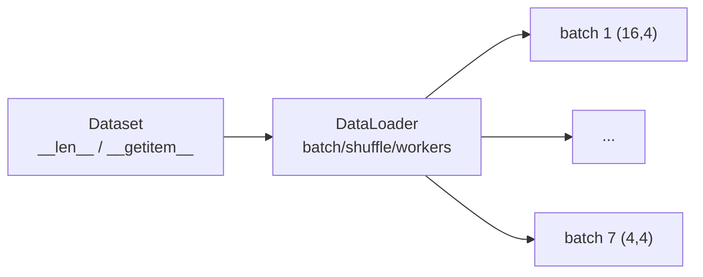

# DL-059 Dataset 与 DataLoader

## 1. 本节学习目标

1. 会实现自定义 `Dataset`（三个必须方法）。
2. 算清 `batch 数 = ⌈N / batch_size⌉`（本课 100/16 ⇒ 7 个 batch）。
3. 理解最后一个 batch **不满**（本课 `(4,4)`）与 `drop_last` 的影响。
4. 会用 `shuffle` / `num_workers` / `pin_memory`，知道各自解决什么问题。

## 2. 为什么需要这个知识

因为**数据管道错，模型再好也白搭**：

- 忘了 `shuffle` ⇒ 每个 epoch 顺序相同，模型学到"批次偏置"；
- `num_workers=0` ⇒ GPU 等 IO，利用率上不去；
- 不理解"最后一个小 batch" ⇒ 形状相关的 bug 难定位。

## 3. 直观解释

两个角色分工：

| 组件 | 职责 | 类比 |
|---|---|---|
| **Dataset** | 定义"第 i 个样本是什么" | 一本相册 |
| **DataLoader** | 决定"怎么取、取多少、按什么顺序" | 发牌员 |

**Dataset 只管单样本，DataLoader 负责批量、打乱、并行。**

## 4. 正式定义

**Dataset 必须实现**

$$
\texttt{\_\_len\_\_}()\ \Rightarrow N,\qquad \texttt{\_\_getitem\_\_}(i)\ \Rightarrow (\mathbf{x}_i,y_i)
$$

**DataLoader 的 batch 数**

$$
\text{batches}=\Big\lceil\frac{N}{\text{batch\_size}}\Big\rceil
$$

本课：$\lceil 100/16\rceil=7$。

## 5. 核心原理

**本课实测**

```text
数据集长度: 100  batch 数: 7
batch 形状: (16, 4) (16,)
最后一个 batch 形状: (4, 4)
drop_last=True batch 数: 6
num_workers=0 vs 2 的 batch 数一致: True
```

**读法**：

1. $100/16=6.25$ ⇒ **7 个 batch**（前 6 个 16 条、最后 1 个 4 条）。
2. **最后一个 batch 形状 `(4,4)`**——不是 16！这是很多"batch 形状假设"bug 的来源。
3. `drop_last=True` ⇒ **6 个 batch**（丢掉不满的那个）。
4. `num_workers` 不改变 batch 数（只影响并行方式）。

## 6. 数学表达式

**每 epoch 的更新步数**

$$
\text{steps}=\text{batches}=\Big\lceil\frac{N}{B}\Big\rceil
$$

**`drop_last` 后的步数**

$$
\text{steps}=\Big\lfloor\frac{N}{B}\Big\rfloor
$$

本课：$100/16$ ⇒ 带 `drop_last` 是 **6**，不带是 **7**。

## 7. 数学推导

**为什么最后一个 batch 可能小**

$100 = 6\times16 + 4$。前 6 批取满，剩 4 条自成一批。

**如果要严格固定 batch size**：用 `drop_last=True`（丢 4 条）或 `sampler` 补齐。

**权衡**：

- `drop_last=True`：形状固定、BN 稳定；但**每 epoch 丢掉少量样本**。
- `drop_last=False`：不丢数据；但最后一个 batch 形状不同（BN 在小 batch 上统计不稳）。

## 8. 结构示意图



## 9. 具体计算示例

```text
N=100, batch_size=16
  100 / 16 = 6.25 → 7 个 batch
  前 6 个: (16,4)
  第 7 个: (4,4)

drop_last=True → 6 个 batch，丢弃最后 4 条
```

## 10. Python 实现

```python
import torch
from torch.utils.data import DataLoader, Dataset


class ToyDataset(Dataset):
    def __init__(self, n: int = 100) -> None:
        self.x = torch.randn(n, 4)
        self.y = (self.x.sum(dim=1) > 0).long()

    def __len__(self) -> int:
        return len(self.x)

    def __getitem__(self, i: int):
        return self.x[i], self.y[i]


ds = ToyDataset()
dl = DataLoader(ds, batch_size=16, shuffle=True, num_workers=0)
xb, yb = next(iter(dl))
print("数据集长度:", len(ds), " batch 数:", len(dl))
print("batch 形状:", tuple(xb.shape), tuple(yb.shape))
```

## 11. PyTorch 实现（最后一批与 drop_last）

```python
import torch
from torch.utils.data import DataLoader, Dataset


class ToyDataset(Dataset):
    def __init__(self, n: int = 100) -> None:
        self.x = torch.randn(n, 4)
        self.y = torch.randint(0, 2, (n,))

    def __len__(self) -> int:
        return len(self.x)

    def __getitem__(self, i: int):
        return self.x[i], self.y[i]


ds = ToyDataset()
full = DataLoader(ds, batch_size=16)
print("不带 drop_last:", len(full), " 最后一批:", tuple(list(full)[-1][0].shape))

dropped = DataLoader(ds, batch_size=16, drop_last=True)
print("带 drop_last :", len(dropped), " 最后一批:", tuple(list(dropped)[-1][0].shape))

fixed = DataLoader(ds, batch_size=16, shuffle=True, num_workers=2, pin_memory=True)
print("num_workers=2 的 batch 数:", len(fixed))
```

## 12. 代码逐行解释

| 代码 | 作用 |
|---|---|
| `__len__` | 返回样本总数（DataLoader 靠它算 batch 数） |
| `__getitem__` | 返回第 i 个 `(x, y)` |
| `DataLoader(ds, batch_size, shuffle)` | 批量 + 打乱 |
| `len(dl)` | batch 数 |
| `num_workers=2` | 用 2 个子进程加载 |
| `pin_memory=True` | 锁页内存，加速 CPU→GPU 传输 |

**为什么要 `num_workers>0`**：数据读取（磁盘/解码/增强）在 CPU，若与训练同一进程，会把 GPU 晾着。

## 13. 实际运行结果

```text
数据集长度: 100  batch 数: 7
batch 形状: (16, 4) (16,)
最后一个 batch 形状: (4, 4)
drop_last=True batch 数: 6
num_workers=0 vs 2 的 batch 数一致: True
```

## 14. 应用场景

| 场景 | 配置 |
|---|---|
| 图像分类 | 自定义 Dataset + 增强 + `num_workers=4+` |
| 变长序列 | 自定义 `collate_fn` 做 padding（DL-050） |
| 大数据 | `IterableDataset`（流式） |
| 类别不平衡 | 自定义 `WeightedRandomSampler` |
| 内存充足 | 全部预加载到 RAM，`__getitem__` 只做索引 |

## 15. 优点与缺点

| 优点 | 缺点 |
|---|---|
| 解耦数据与训练循环 | 多进程有额外开销/调试难 |
| 自动批量、打乱、并行 | 自定义 `collate_fn` 需谨慎 |
| 支持流式大数据 | `num_workers` 过大反而慢 |

## 16. 常见错误

| 错误 | 现象 | 纠正 |
|---|---|---|
| 假设每个 batch 都是 `batch_size` | 最后一批形状不同（本课 `(4,4)`） | 用 `drop_last` 或动态处理 |
| 忘 `shuffle` | 顺序固定，收敛差 | 训练集 `shuffle=True` |
| 验证集也 `shuffle` | 指标不可复现 | 通常 `False` |
| `num_workers` 太大 | 反而更慢/占内存 | 从 4 试起 |
| `pin_memory` 却在 CPU 训练 | 无用开销 | 仅在 GPU 训练时开 |
| Windows 上多进程报错 | 需 `if __name__ == "__main__"` | 包住入口 |

## 17. 本节总结

- `Dataset` 只管单样本（`__len__` / `__getitem__`），`DataLoader` 管批量与并行。
- 本课：100 条、batch=16 ⇒ **7 个 batch**，最后一批 **`(4,4)`**；`drop_last` ⇒ **6**。
- `num_workers` 只影响并行，**不改变 batch 数**。

## 18. 前置与后续

- 前置：[[DL-058 设备管理——CPU 与 GPU]]
- 后续：[[DL-060 nn.Module 自定义网络]]、`DL-061 损失函数与优化器 API`（待建）
- 相关机器学习：[[ML-016 预处理 Pipeline 与 ColumnTransformer]]

---

## 练习与参考答案

**基础 1**：Dataset 必须实现哪两个方法？各返回什么？

**基础 2**：本课 100 条、batch=16 的 batch 数与最后一批形状各是多少？

**进阶 1**：`drop_last=True` 有什么利弊？

**综合**：你训练图像分类，GPU 利用率只有 30%，`nvidia-smi` 显示显存充足。请指出最可能的原因与 3 个改进措施。

> [!success]- 参考答案

> **基础 1**
> - `__len__()`：返回样本总数 $N$。
> - `__getitem__(i)`：返回第 $i$ 个样本 `(x, y)`。
> DataLoader 靠这两个方法实现批量、打乱与并行。

> **基础 2**
> batch 数 **7**（$\lceil100/16\rceil$）；最后一批形状 **`(4,4)`**。

> **进阶 1**
> - 利：每个 batch 形状固定 ⇒ 代码简单、BatchNorm 统计稳定、避免"最后一批特别小"导致的指标抖动。
> - 弊：**每 epoch 丢掉少量样本**（本课丢 4 条，占 4%）；数据量很小时可能影响训练。

> **综合（参考）**
> **最可能原因**：**数据加载是瓶颈**（`num_workers=0` 或 IO 慢），GPU 在等数据。
> **3 个改进**：
> 1. `num_workers=4–8` + `pin_memory=True` + `persistent_workers=True`；
> 2. 把预处理做轻（避免每步解码大图；可预先把图片转成小尺寸/缓存到内存）；
> 3. 增大 batch（配 lr 缩放）或使用 `prefetch_factor`，提高 GPU 并行度。
> **诊断**：用 `torch.profiler` 看 DataLoader 与计算各占多少时间；若 DataLoader 占比高，即确认瓶颈。

## 学习记录

| 日期 | 状态 | 用时 | 问题 | 复盘 |
|---|---|---|---|---|
| 2026-11-07 | planned | — | — | — |

---

## 🔗 Notion 同步信息

> 以下内容由 Notion「AI Knowledge System · 知识点」数据库按知识 ID 合并而来（导出于 2026-11-09）。

| 属性 | 值 |
|---|---|
| 学科 | 深度学习 |
| 学习状态 | 未开始 |
| 难度 | L2 应用 |
| 知识类型 | Technique |

- **所属模块**：[M-DL-07 PyTorch 深度学习框架实践](../%E8%AF%BE%E7%A8%8B%E6%A8%A1%E5%9D%97/M-DL-07%20PyTorch%20%E6%B7%B1%E5%BA%A6%E5%AD%A6%E4%B9%A0%E6%A1%86%E6%9E%B6%E5%AE%9E%E8%B7%B5.md)
- **前置知识**：[DL-058 设备管理：CPU 与 GPU](DL-058%20%E8%AE%BE%E5%A4%87%E7%AE%A1%E7%90%86%E2%80%94%E2%80%94CPU%20%E4%B8%8E%20GPU.md)
- **后继知识**：[DL-060 nn.Module 自定义网络](DL-060%20nn.Module%20%E8%87%AA%E5%AE%9A%E4%B9%89%E7%BD%91%E7%BB%9C.md)
- **对应项目**：[PROJ-016 手写数字分类——全连接基线](../../07_%E5%AE%9E%E6%88%98%E9%A1%B9%E7%9B%AE/04%20%E6%B7%B1%E5%BA%A6%E5%AD%A6%E4%B9%A0%E9%A1%B9%E7%9B%AE/PROJ-016%20%E6%89%8B%E5%86%99%E6%95%B0%E5%AD%97%E5%88%86%E7%B1%BB%E2%80%94%E2%80%94%E5%85%A8%E8%BF%9E%E6%8E%A5%E5%9F%BA%E7%BA%BF.md) · [PROJ-020 端到端部署——训练到推理服务](../../07_%E5%AE%9E%E6%88%98%E9%A1%B9%E7%9B%AE/04%20%E6%B7%B1%E5%BA%A6%E5%AD%A6%E4%B9%A0%E9%A1%B9%E7%9B%AE/PROJ-020%20%E7%AB%AF%E5%88%B0%E7%AB%AF%E9%83%A8%E7%BD%B2%E2%80%94%E2%80%94%E8%AE%AD%E7%BB%83%E5%88%B0%E6%8E%A8%E7%90%86%E6%9C%8D%E5%8A%A1.md)
- **被项目引用**：[PROJ-018 序列任务——RNN、LSTM、GRU 同口径对比](../../07_%E5%AE%9E%E6%88%98%E9%A1%B9%E7%9B%AE/04%20%E6%B7%B1%E5%BA%A6%E5%AD%A6%E4%B9%A0%E9%A1%B9%E7%9B%AE/PROJ-018%20%E5%BA%8F%E5%88%97%E4%BB%BB%E5%8A%A1%E2%80%94%E2%80%94RNN%E3%80%81LSTM%E3%80%81GRU%20%E5%90%8C%E5%8F%A3%E5%BE%84%E5%AF%B9%E6%AF%94.md)
