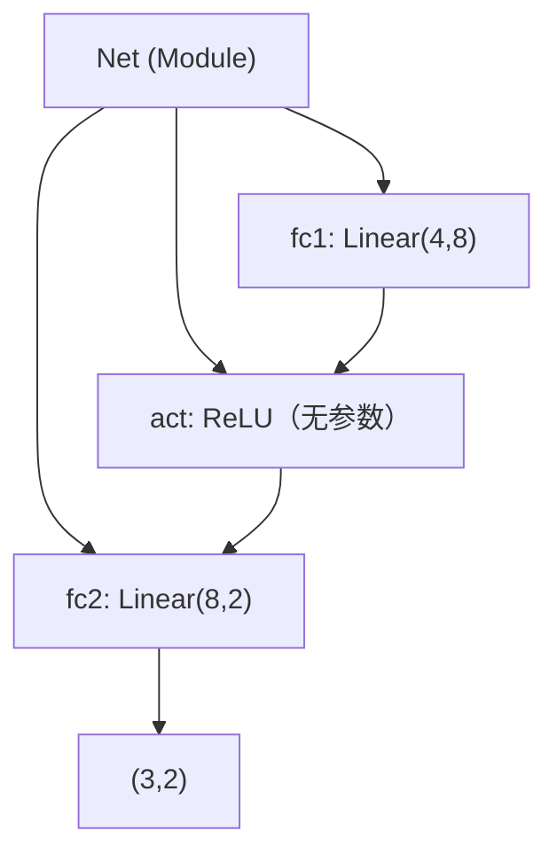

# DL-060 nn.Module 自定义网络

## 1. 本节学习目标

1. 会写自定义 `Module`：`__init__` 定义层、`forward` 定义计算。
2. 看懂 `named_parameters` / `state_dict` / `named_children` 的输出（本课参数 58）。
3. 理解"层注册"机制（为什么赋值为属性就能被追踪）。
4. 会做模块复用与组合（继承 + 嵌套）。

## 2. 为什么需要这个知识

因为**真实网络都有分支、跳跃、共享层**，`nn.Sequential` 表达不了。

而 `nn.Module` 是 PyTorch 里"一切模型"的基类：优化器找参数、`state_dict` 保存加载、`train()/eval()` 传播，全靠它。

## 3. 直观解释

**三步写一个模型**：

```text
1) __init__：把要用到的层"登记"为属性
2) forward：写数据怎么流
3) 调用：model(x) 会自动走 forward
```

**关键机制**：只要把层赋值给 `self.xxx`，PyTorch 就**自动注册**它 ⇒ 参数可见、能保存、能切 train/eval。

## 4. 正式定义

**自定义模块**

```python
import torch
import torch.nn as nn


class Net(nn.Module):
    def __init__(self):
        super().__init__()
        self.fc1 = nn.Linear(4, 8)
        self.act = nn.ReLU()
        self.fc2 = nn.Linear(8, 2)

    def forward(self, x):
        return self.fc2(self.act(self.fc1(x)))
```

**自动注册的含义**

$$
\text{model.parameters}()=\bigcup_{\text{子模块}}\text{parameters}()
$$

**本课配置**：`4 → 8 → 2`，参数量

$$
(4\times8+8)+(8\times2+2)=40+18=\mathbf{58}
$$

## 5. 核心原理

**本课实测**

```text
参数名: ['fc1.weight', 'fc1.bias', 'fc2.weight', 'fc2.bias']
参数量: 58
state_dict 键: ['fc1.weight', 'fc1.bias', 'fc2.weight', 'fc2.bias']
子模块: ['fc1', 'act', 'fc2']
输出形状: (3, 2)
training: True （eval 后变 False）
```

**读法**：

1. **参数名自带层级**（`fc1.weight`）——这是保存/加载/调试的定位依据。
2. **参数量 58** 与手算一致。
3. `act` 也出现在**子模块**里，但它**没有参数**（ReLU 无可学习项）。
4. `net.eval()` 会把 `training` 置 False，并**递归**影响所有子模块。

## 6. 数学表达式

**参数量（逐层）**

$$
\#\text{params}=\sum_{\ell}(n_{\ell-1}n_\ell+n_\ell)
$$

本课：$40+18=58$。

**`state_dict` 与参数的关系**

$$
\text{state\_dict}=\{(\text{name},\ \text{tensor})\mid \text{name 来自注册的子模块}\}
$$

## 7. 数学推导

**为什么"赋值成属性"就能被追踪**

`nn.Module.__setattr__` 被重写：当赋值的对象是 `Module`/`Parameter` 时，会把它加入 `_modules`/`_parameters` 字典。

⇒ `parameters()` 遍历这些字典 ⇒ 优化器能拿到全部参数。

**反例**：用 **普通 list** 存层

```text
self.layers = [nn.Linear(4, 4), nn.Linear(4, 2)]   # ❌ 不会被注册（用 nn.ModuleList 才对）
```

应改用 `nn.ModuleList`（会被注册）。

## 8. 结构示意图



## 9. 具体计算示例

```text
fc1: 4×8 + 8 = 40
fc2: 8×2 + 2 = 18
合计: 58

输入 (3,4) → fc1 → (3,8) → ReLU → (3,8) → fc2 → (3,2)
```

## 10. Python 实现

```python
import torch
import torch.nn as nn


class Net(nn.Module):
    def __init__(self) -> None:
        super().__init__()
        self.fc1 = nn.Linear(4, 8)
        self.act = nn.ReLU()
        self.fc2 = nn.Linear(8, 2)

    def forward(self, x):
        return self.fc2(self.act(self.fc1(x)))


net = Net()
print("参数名:", [n for n, _ in net.named_parameters()])
print("参数量:", sum(p.numel() for p in net.parameters()))
print("输出形状:", tuple(net(torch.randn(3, 4)).shape))
print("training:", net.training)
net.eval()
print("eval 后 training:", net.training)
```

## 11. PyTorch 实现（复用块与 ModuleList）

```python
import torch
import torch.nn as nn


class ResBlock(nn.Module):
    """可复用的残差块。"""

    def __init__(self, dim: int) -> None:
        super().__init__()
        self.net = nn.Sequential(
            nn.Linear(dim, dim), nn.ReLU(), nn.Linear(dim, dim)
        )

    def forward(self, x):
        return torch.relu(self.net(x) + x)


class DeepNet(nn.Module):
    def __init__(self, dim: int = 16, depth: int = 3, classes: int = 2) -> None:
        super().__init__()
        self.stem = nn.Linear(4, dim)
        self.blocks = nn.ModuleList([ResBlock(dim) for _ in range(depth)])
        self.head = nn.Linear(dim, classes)

    def forward(self, x):
        x = torch.relu(self.stem(x))
        for block in self.blocks:
            x = block(x)
        return self.head(x)


net = DeepNet()
print("参数量:", sum(p.numel() for p in net.parameters()))
print("子模块:", [n for n, _ in net.named_children()])
print("state_dict 前 4 个键:", list(net.state_dict())[:4])
print("输出形状:", tuple(net(torch.randn(5, 4)).shape))
```

## 12. 代码逐行解释

| 代码 | 作用 |
|---|---|
| `super().__init__()` | 必须调用，否则注册机制不生效 |
| `self.fc1 = nn.Linear(...)` | 自动注册参数 |
| `forward` | 定义前向（**不要**在外部调用 `net.forward`） |
| `named_parameters()` | 带名字的参数（保存/调试用） |
| `named_children()` | 直接子模块 |
| `nn.ModuleList([...])` | **列表存层的正确方式** |
| `state_dict()` | 权重字典（保存加载用） |

**注意**：调用 `net(x)` 会走 `__call__` → `forward` + hooks；直接 `net.forward(x)` 会**跳过 hooks**。

## 13. 实际运行结果

```text
参数名: ['fc1.weight', 'fc1.bias', 'fc2.weight', 'fc2.bias']
参数量: 58
state_dict 键: ['fc1.weight', 'fc1.bias', 'fc2.weight', 'fc2.bias']
子模块: ['fc1', 'act', 'fc2']
输出形状: (3, 2)
training: True
```

## 14. 应用场景

| 需求 | 写法 |
|---|---|
| 简单顺序结构 | `nn.Sequential` |
| 多分支/残差 | 自定义 `Module` |
| 复用块 | 定义 `Block` 类 + `ModuleList` |
| 多输入 | `forward(self, x, mask)` |
| 共享权重 | 同一个层对象赋给两处 |
| 部分冻结 | 遍历 `parameters()` 设 `requires_grad=False` |

## 15. 优点与缺点

| 优点 | 缺点 |
|---|---|
| 任意结构都能表达 | 样板代码比 Sequential 多 |
| 自动注册参数/子模块 | 用 list 存层会漏注册 |
| `state_dict`/`train()` 自动递归 | `forward` 写错难自查（形状） |

## 16. 常见错误

| 错误 | 现象 | 纠正 |
|---|---|---|
| 忘 `super().__init__()` | 注册失败/报错 | 第一行写 |
| 用 list 存层 | 参数不在 `state_dict` | `nn.ModuleList` |
| 直接调 `forward()` | 跳过 hooks | 用 `model(x)` |
| `forward` 里新建层 | 每步重建、不训练 | 层必须在 `__init__` |
| 忘记 `eval()` | Dropout/BN 行为错 | 推理前切 |
| 权重共享写成两份 | 参数翻倍 | 复用同一对象 |

## 17. 本节总结

- 自定义模型 = **`__init__` 注册层 + `forward` 写计算**；参数 **58**（本课）。
- 层赋值成属性 ⇒ **自动注册**；list 存层要用 `nn.ModuleList`。
- `state_dict` 键名带层级（`fc1.weight`），保存加载都靠它。

## 18. 前置与后续

- 前置：[[DL-059 Dataset 与 DataLoader]]
- 后续：`DL-061 损失函数与优化器 API`（待建）、`DL-062 训练/验证/测试循环`（待建）

---

## 练习与参考答案

**基础 1**：写一个自定义 `nn.Module` 需要实现哪两部分？

**基础 2**：本课模型的参数名、参数量、输出形状各是什么？

**进阶 1**：为什么"用普通 list 存层"会导致参数丢失？正确写法是什么？

**综合**：实现一个"双分支"模块：输入分别经过 `Linear(16,16)` 与 `Linear(16,16)`，相加后再 `ReLU`，最后接 `Linear(16,2)`。请写出代码并算参数量。

> [!success]- 参考答案

> **基础 1**
> - `__init__`：定义并注册子层（`self.xxx = nn.Linear(...)`）。
> - `forward`：定义数据如何流经这些层（返回输出）。

> **基础 2**
> 参数名：`['fc1.weight', 'fc1.bias', 'fc2.weight', 'fc2.bias']`；
> 参数量 **58**；输出形状 **`(3, 2)`**（输入 `(3,4)`）。

> **进阶 1**
> 因为 `nn.Module` 只注册**直接赋值给属性**的 `Module`/`Parameter`。普通 list 里的层不在 `_modules` 中 ⇒ `parameters()`、`state_dict()` 都看不到它们 ⇒ 不会被优化器更新、也不会被保存。
> 正确写法：`self.layers = nn.ModuleList([...])`。

> **综合（参考）**
> ```python
> import torch
> import torch.nn as nn
>
> class TwoBranch(nn.Module):
>     def __init__(self):
>         super().__init__()
>         self.left = nn.Linear(16, 16)
>         self.right = nn.Linear(16, 16)
>         self.head = nn.Linear(16, 2)
>
>     def forward(self, x):
>         h = self.left(x) + self.right(x)
>         return self.head(torch.relu(h))
>
> net = TwoBranch()
> print(sum(p.numel() for p in net.parameters()))
> print(net(torch.randn(4, 16)).shape)
> ```
> 参数量：两支各 $16\times16+16=272$（共 544），头 $16\times2+2=34$，合计 **578**。
> 输出形状 `(4, 2)`。

## 学习记录

| 日期 | 状态 | 用时 | 问题 | 复盘 |
|---|---|---|---|---|
| 2026-11-07 | planned | — | — | — |

---

## 🔗 Notion 同步信息

> 以下内容由 Notion「AI Knowledge System · 知识点」数据库按知识 ID 合并而来（导出于 2026-11-09）。

| 属性 | 值 |
|---|---|
| 学科 | 深度学习 |
| 学习状态 | 未开始 |
| 难度 | L2 应用 |
| 知识类型 | Technique |

- **所属模块**：[M-DL-07 PyTorch 深度学习框架实践](../%E8%AF%BE%E7%A8%8B%E6%A8%A1%E5%9D%97/M-DL-07%20PyTorch%20%E6%B7%B1%E5%BA%A6%E5%AD%A6%E4%B9%A0%E6%A1%86%E6%9E%B6%E5%AE%9E%E8%B7%B5.md)
- **前置知识**：[DL-059 Dataset 与 DataLoader](DL-059%20Dataset%20%E4%B8%8E%20DataLoader.md)
- **后继知识**：[DL-061 损失函数与优化器 API](DL-061%20%E6%8D%9F%E5%A4%B1%E5%87%BD%E6%95%B0%E4%B8%8E%E4%BC%98%E5%8C%96%E5%99%A8%20API.md)
- **对应项目**：[PROJ-016 手写数字分类——全连接基线](../../07_%E5%AE%9E%E6%88%98%E9%A1%B9%E7%9B%AE/04%20%E6%B7%B1%E5%BA%A6%E5%AD%A6%E4%B9%A0%E9%A1%B9%E7%9B%AE/PROJ-016%20%E6%89%8B%E5%86%99%E6%95%B0%E5%AD%97%E5%88%86%E7%B1%BB%E2%80%94%E2%80%94%E5%85%A8%E8%BF%9E%E6%8E%A5%E5%9F%BA%E7%BA%BF.md) · [PROJ-018 序列任务——RNN、LSTM、GRU 同口径对比](../../07_%E5%AE%9E%E6%88%98%E9%A1%B9%E7%9B%AE/04%20%E6%B7%B1%E5%BA%A6%E5%AD%A6%E4%B9%A0%E9%A1%B9%E7%9B%AE/PROJ-018%20%E5%BA%8F%E5%88%97%E4%BB%BB%E5%8A%A1%E2%80%94%E2%80%94RNN%E3%80%81LSTM%E3%80%81GRU%20%E5%90%8C%E5%8F%A3%E5%BE%84%E5%AF%B9%E6%AF%94.md)
- **被项目引用**：[PROJ-016 手写数字分类——全连接基线](../../07_%E5%AE%9E%E6%88%98%E9%A1%B9%E7%9B%AE/04%20%E6%B7%B1%E5%BA%A6%E5%AD%A6%E4%B9%A0%E9%A1%B9%E7%9B%AE/PROJ-016%20%E6%89%8B%E5%86%99%E6%95%B0%E5%AD%97%E5%88%86%E7%B1%BB%E2%80%94%E2%80%94%E5%85%A8%E8%BF%9E%E6%8E%A5%E5%9F%BA%E7%BA%BF.md) · [PROJ-017 手写数字分类——CNN 改进](../../07_%E5%AE%9E%E6%88%98%E9%A1%B9%E7%9B%AE/04%20%E6%B7%B1%E5%BA%A6%E5%AD%A6%E4%B9%A0%E9%A1%B9%E7%9B%AE/PROJ-017%20%E6%89%8B%E5%86%99%E6%95%B0%E5%AD%97%E5%88%86%E7%B1%BB%E2%80%94%E2%80%94CNN%20%E6%94%B9%E8%BF%9B.md)
