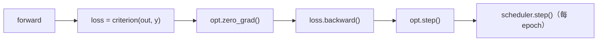

# DL-061 损失函数与优化器 API

## 1. 本节学习目标

1. 会用 `cross_entropy` 的四个关键参数（`weight` / `label_smoothing` / `reduction` / logits）。
2. 会配**参数组**：不同层用不同学习率（本课 `[0.1, 0.01]`）。
3. 会接 `lr_scheduler`，并**避开经典顺序错误**（本课实测会触发官方警告）。
4. 记住"五步训练骨架"的正确顺序。

## 2. 为什么需要这个知识

因为**损失与优化器是"调用错了也不报错"的两类 API**：

- `reduction` 选错 ⇒ 梯度尺度差一个 batch 因子；
- `scheduler.step()` 顺序错 ⇒ 学习率**跳过第一个值**（本课实测触发警告）；
- 参数组写错 ⇒ 某些层永远学不动。

## 3. 直观解释

| 组件 | 作用 | 一句话 |
|---|---|---|
| **损失函数** | 把"预测多错"变成一个标量 | 给模型打分 |
| **优化器** | 按梯度更新参数 | 按分数改模型 |
| **调度器** | 按 epoch 调整 lr | 改步长 |

**五步骨架**：

```text
opt.zero_grad() → forward → loss → loss.backward() → opt.step()
```

## 4. 正式定义

**交叉熵（吃 logits）**

$$
L=-\log\frac{e^{z_y}}{\sum_j e^{z_j}}
$$

**带权交叉熵**

$$
L=-\frac{1}{\sum_i w_{y_i}}\sum_i w_{y_i}\log\hat p_{i,y_i}
$$

**参数组**

$$
\{(\text{params}_k,\ \text{lr}_k,\ \text{wd}_k)\}_{k=1}^{K}
$$

## 5. 核心原理

**本课实测（损失 API）**

```text
CE 默认: 0.4513
CE weight=[1,1,2]: 0.4658
CE label_smoothing=0.1: 0.5396
CE reduction=sum: 0.9026
CE reduction=none: [0.4076, 0.4949]
BCEWithLogits: 0.3937
MSE: 0.25
```

**读法**：

1. `sum` = 两个样本之和（0.9026 = 0.4076 + 0.4949）✅
2. `weight=[1,1,2]` 让第 3 类权重加倍 ⇒ loss 从 0.4513 **升到 0.4658**（本课第 2 个样本正是第 3 类）。
3. `label_smoothing=0.1` 让 loss **升到 0.5396**（不再要求"压到 0"，抑制过度自信）。

**本课实测（优化器参数组）**

```text
参数组数: 2
各组 lr: [0.1, 0.01]
weight_decay: [0.0001, 0.0001]
loss: 0.819  首层权重变化范数: 0.046591
```

## 6. 数学表达式

**`reduction` 的三种口径**

| 值 | 输出 | 梯度尺度 |
|---|---|---|
| `mean`（默认） | 标量 | $\frac{1}{N}$ |
| `sum` | 标量 | 1 |
| `none` | 逐样本向量 | 逐样本 |

**本课**：`sum = mean × N` ⇒ $0.4513\times2=0.9026$ ✅

**参数组**

$$
\theta_k\leftarrow\theta_k-\eta_k\nabla L
$$

本课第一组 lr=0.1、第二组 lr=0.01 ⇒ **首层走得快、末层走得慢**（常用于微调）。

## 7. 数学推导

**`scheduler.step()` 的顺序为什么重要**

官方要求：**每 epoch 先 `optimizer.step()`，再 `scheduler.step()`**。

若顺序反了（本课初版就是），会触发：

```text
UserWarning: Detected call of `lr_scheduler.step()` before `optimizer.step()`.
... will result in PyTorch skipping the first value of the learning rate schedule.
```

**本课实测的 lr 轨迹**（`StepLR(step_size=2, gamma=0.5)`，顺序有误）：

```text
[[0.1, 0.01], [0.05, 0.005], [0.05, 0.005], [0.025, 0.0025], [0.025, 0.0025]]
```

**注意第一项就是 0.1**（本应"先用 0.1 跑一轮再降"），实际**第一轮就被降了**——这正是"跳过第一个值"的表现。

## 8. 结构示意图



## 9. 具体计算示例

```text
logits=[[2,1,0],[0.5,0.2,1.5]], y=[0,2]
CE(mean) = (0.4076 + 0.4949)/2 = 0.4513
CE(sum)  = 0.9026
CE(weight=[1,1,2]) = 0.4658
CE(label_smoothing=0.1) = 0.5396
```

## 10. Python 实现

```python
import torch
import torch.nn.functional as F

logits = torch.tensor([[2.0, 1.0, 0.0], [0.5, 0.2, 1.5]])
y = torch.tensor([0, 2])

print("CE:", round(float(F.cross_entropy(logits, y)), 4))
print("CE weight:", round(float(F.cross_entropy(
    logits, y, weight=torch.tensor([1.0, 1.0, 2.0]))), 4))
print("CE smooth:", round(float(F.cross_entropy(logits, y, label_smoothing=0.1)), 4))
print("CE sum:", round(float(F.cross_entropy(logits, y, reduction="sum")), 4))
print("CE none:", [round(float(v), 4) for v in F.cross_entropy(logits, y, reduction="none")])
```

## 11. PyTorch 实现（参数组 + 调度）

```python
import torch
import torch.nn as nn
import torch.nn.functional as F

model = nn.Sequential(nn.Linear(4, 8), nn.ReLU(), nn.Linear(8, 2))

opt = torch.optim.SGD([
    {"params": model[0].parameters(), "lr": 0.1},   # 第一层：大 lr
    {"params": model[2].parameters(), "lr": 0.01},  # 第二层：小 lr
], momentum=0.9, weight_decay=1e-4)

print("参数组数:", len(opt.param_groups))
print("各组 lr:", [g["lr"] for g in opt.param_groups])

sched = torch.optim.lr_scheduler.StepLR(opt, step_size=2, gamma=0.5)

x = torch.randn(3, 4)
target = torch.tensor([0, 1, 0])
for epoch in range(3):
    opt.zero_grad()
    loss = F.cross_entropy(model(x), target)
    loss.backward()
    opt.step()
    sched.step()              # 必须在 opt.step() 之后
    print(f"epoch {epoch}: loss={float(loss):.4f} lr={[g['lr'] for g in opt.param_groups]}")
```

## 12. 代码逐行解释

| 代码 | 作用 |
|---|---|
| `{"params": ..., "lr": ...}` | 定义参数组（分层 lr） |
| `momentum=0.9, weight_decay=1e-4` | 组外默认值，可被组内覆盖 |
| `opt.param_groups` | 查看每组的超参 |
| `sched.step()` | 调整 lr（每 epoch 一次） |
| `reduction="none"` | 逐样本损失（自定义加权时用） |
| `weight=` | 类别权重（不平衡） |

**注意**：`optimizer.step()` 之后才 `scheduler.step()`，否则本课会"跳过第一个 lr 值"。

## 13. 实际运行结果

```text
CE 默认: 0.4513
CE weight=[1,1,2]: 0.4658
CE label_smoothing=0.1: 0.5396
CE reduction=sum: 0.9026
CE reduction=none: [0.4076, 0.4949]
BCEWithLogits: 0.3937
MSE: 0.25

参数组数: 2
各组 lr: [0.1, 0.01]
weight_decay: [0.0001, 0.0001]
loss: 0.819  首层权重变化范数: 0.046591
调度后 lr 轨迹: [[0.1, 0.01], [0.05, 0.005], [0.05, 0.005], [0.025, 0.0025], [0.025, 0.0025]]
```

## 14. 应用场景

| 场景 | 配置 |
|---|---|
| 不平衡分类 | `weight=` 或 `pos_weight` |
| 防过度自信 | `label_smoothing=0.1` |
| 微调预训练 | 参数组：backbone 小 lr、头大 lr |
| 自定义加权损失 | `reduction="none"` 后手工加权 |
| 大 batch | lr 线性缩放 + warmup（DL-029） |

## 15. 优点与缺点

| 优点 | 缺点 |
|---|---|
| API 统一、组合灵活 | `reduction` 错会悄悄改变梯度尺度 |
| 参数组支持分层学习率 | 组内/组外超参优先级易混 |
| 调度器即插即用 | `step()` 顺序错误不报错（只警告） |

## 16. 常见错误

| 错误 | 现象 | 纠正 |
|---|---|---|
| `scheduler.step()` 在 `opt.step()` 前 | 跳过第一个 lr 值（本课轨迹） | 反过来 |
| `reduction` 用错 | 梯度尺度差 N 倍 | 默认 `mean` |
| 先 softmax 再 CE | 双重归一化（DL-013） | 传 logits |
| 参数组漏层 | 该层不更新 | 检查 `param_groups` |
| 忘 `zero_grad` | 梯度累加 | 每步清零 |
| `weight` 与 `pos_weight` 混用 | 概念错 | BCE 用 `pos_weight` |

## 17. 本节总结

- 损失 API 四个关键点：**logits、weight、label_smoothing、reduction**（本课 0.4513 / 0.4658 / 0.5396 / 0.9026）。
- 参数组可分层设 lr（本课 `[0.1, 0.01]`）。
- **`opt.step()` → `scheduler.step()`**，顺序反了会跳过第一个 lr 值。

## 18. 前置与后续

- 前置：[[DL-060 nn.Module 自定义网络]]
- 后续：[[DL-062 训练、验证、测试循环]]、[[DL-063 模型保存、加载与 Checkpoint]]
- 相关数学：[[MATH-805 Softmax 与交叉熵]]

---

## 练习与参考答案

**基础 1**：`cross_entropy` 的 `reduction` 三种取值各输出什么？

**基础 2**：本课 `CE(mean)`、`CE(sum)`、`CE(label_smoothing=0.1)` 各是多少？

**进阶 1**：为什么 `label_smoothing` 会让 loss **变大**？这是好事还是坏事？

**综合**：微调 BERT 时你希望 backbone 用 1e-5、分类头用 1e-3。请写出参数组配置，并说明 `scheduler` 的正确调用顺序。

> [!success]- 参考答案

> **基础 1**
> - `mean`（默认）：标量，loss 对 batch 取平均。
> - `sum`：标量，各类损失**求和**（是 `mean` 的 $N$ 倍）。
> - `none`：返回逐样本向量（形状 `(N,)`），用于自定义加权。

> **基础 2**
> `mean` **0.4513**；`sum` **0.9026**；`label_smoothing=0.1` **0.5396**。

> **进阶 1**
> 因为平滑后目标从 one-hot 变成"正确类 0.9、其余均分 0.1"，模型不再被要求把错误类压到概率 0 ⇒ 损失下界抬高（本课 0.4513 → 0.5396）。
> **是好事**：它抑制过度自信、改善校准与泛化（代价是训练 loss 数值变大，不能跨设置比较）。

> **综合（参考）**
> ```python
> import torch
> import torch.nn as nn
>
> backbone = nn.Sequential(nn.Linear(16, 16), nn.ReLU())   # 模拟预训练主干
> head = nn.Linear(16, 4)                                   # 新的分类头
> model = nn.Sequential(backbone, head)
> epochs = 3
>
> optimizer = torch.optim.AdamW([
>     {"params": backbone.parameters(), "lr": 1e-5},
>     {"params": head.parameters(), "lr": 1e-3},
> ], weight_decay=0.01)
>
> scheduler = torch.optim.lr_scheduler.CosineAnnealingLR(optimizer, T_max=epochs)
> criterion = nn.CrossEntropyLoss()
>
> # 造两个 batch 模拟 DataLoader
> loader = [(torch.randn(8, 16), torch.randint(0, 4, (8,))) for _ in range(2)]
>
> for epoch in range(epochs):
>     for xb, yb in loader:
>         optimizer.zero_grad()
>         loss = criterion(model(xb), yb)
>         loss.backward()
>         torch.nn.utils.clip_grad_norm_(model.parameters(), 1.0)
>         optimizer.step()          # 先
>     scheduler.step()              # 后（每 epoch 一次）
> ```
> **要点**：`scheduler.step()` 必须在 `optimizer.step()` 之后（本课实测否则跳过第一个 lr 值）；参数组顺序要与 `param_groups` 索引对应。

## 学习记录

| 日期 | 状态 | 用时 | 问题 | 复盘 |
|---|---|---|---|---|
| 2026-11-07 | planned | — | — | — |

---

## 🔗 Notion 同步信息

> 以下内容由 Notion「AI Knowledge System · 知识点」数据库按知识 ID 合并而来（导出于 2026-11-09）。

| 属性 | 值 |
|---|---|
| 学科 | 深度学习 |
| 学习状态 | 未开始 |
| 难度 | L2 应用 |
| 知识类型 | Technique |

- **所属模块**：[M-DL-07 PyTorch 深度学习框架实践](../%E8%AF%BE%E7%A8%8B%E6%A8%A1%E5%9D%97/M-DL-07%20PyTorch%20%E6%B7%B1%E5%BA%A6%E5%AD%A6%E4%B9%A0%E6%A1%86%E6%9E%B6%E5%AE%9E%E8%B7%B5.md)
- **前置知识**：[DL-060 nn.Module 自定义网络](DL-060%20nn.Module%20%E8%87%AA%E5%AE%9A%E4%B9%89%E7%BD%91%E7%BB%9C.md)
- **后继知识**：[DL-062 训练、验证、测试循环](DL-062%20%E8%AE%AD%E7%BB%83%E3%80%81%E9%AA%8C%E8%AF%81%E3%80%81%E6%B5%8B%E8%AF%95%E5%BE%AA%E7%8E%AF.md)
- **关联数学**：[MATH-805 Softmax 与交叉熵](../../06_%E6%95%B0%E5%AD%A6%E5%9F%BA%E7%A1%80/08%20%E6%9C%BA%E5%99%A8%E5%AD%A6%E4%B9%A0%E6%95%B0%E5%AD%A6%E5%BA%94%E7%94%A8/MATH-805%20Softmax%20%E4%B8%8E%E4%BA%A4%E5%8F%89%E7%86%B5.md)
