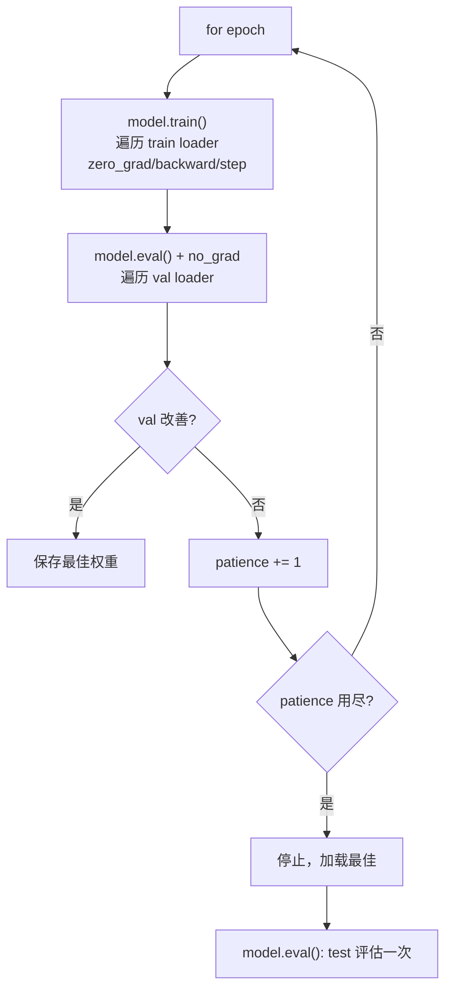

# DL-062 训练、验证、测试循环

## 1. 本节学习目标

1. 写出**三段式**循环：train（更新）→ val（选模型）→ test（只评一次）。
2. 用实测看 `train()`/`eval()` 对 Dropout 的影响（本课差 **4.1106 / 2.8079**）。
3. 会记录 loss/acc 并做早停（本课最佳 **ep=37**，`ep=47` 停止）。
4. 会算混淆矩阵四项（TP 72 / FP 6 / FN 8 / TN 74）。

## 2. 为什么需要这个知识

因为**训练循环写错会让所有实验结论失效**——而且大多不报错：

- 验证时忘 `eval()` ⇒ Dropout 仍在随机丢弃 ⇒ 指标偏低且抖动；
- 用测试集调超参 ⇒ 结果不可信（泄漏）；
- 忘 `zero_grad()` ⇒ 梯度累加，等效 lr 变大。

## 3. 直观解释

三个数据集、三种模式：

| 集合 | 用途 | 模式 |
|---|---|---|
| **train** | 更新参数 | `model.train()` |
| **val** | 选超参/早停 | `model.eval()` + `no_grad` |
| **test** | 最终报告（**只用一次**） | `model.eval()` + `no_grad` |

**一句话**：train 学、val 选、test 报。

## 4. 正式定义

**每 epoch 的两段**

$$
\theta\leftarrow\theta-\eta\nabla_\theta L_{\text{train}}(\theta)
$$

$$
L_{\text{val}}=\frac1{|\mathcal{D}_{\text{val}}|}\sum_{(\mathbf{x},y)\in\mathcal{D}_{\text{val}}}\ell(f_\theta(\mathbf{x}),y)
$$

**早停准则**（DL-038）

$$
\text{stop if }L_{\text{val}}\text{ 连续 }p\text{ 轮未改善}
$$

## 5. 核心原理

**本课实测（moons，60/20/20 划分，Adam 1e-2，Dropout 0.3）**

```text
早停: ep=47, 最佳 ep=37, val_loss=0.1523, val_acc=0.9812
test acc=0.9125 混淆: TP=72 FP=6 FN=8 TN=74
```

**读法**：

1. 最佳在 **第 37 轮**，早停在 **第 47 轮**（patience=10）。
2. **val_acc 0.9812 但 test_acc 0.9125**——差 6.9 个点，因为验证集只有 160 条、测试集也是 160 条，**小样本波动大**。
3. 混淆矩阵：TP 72 / FP 6 / FN 8 / TN 74 ⇒ 总 160，准确率 $(72+74)/160=0.9125$ ✅

**Dropout 的 train/eval 差异**

```text
train 两次差: 4.1106
train vs eval 差: 2.8079
```

（这里是 logits 尺度，所以数值大；关键结论是**train 模式输出随机、eval 模式确定**。）

## 6. 数学表达式

**准确率 / 精确率 / 召回率（本课）**

$$
\text{acc}=\frac{TP+TN}{N}=\frac{72+74}{160}=0.9125
$$

$$
\text{precision}=\frac{72}{72+6}=0.9231,\qquad
\text{recall}=\frac{72}{72+8}=0.9
$$

$$
F_1=\frac{2PR}{P+R}\approx0.9114
$$

**这组数字说明**：模型偏向"少报正类"（FN 8 > FP 6）。

## 7. 数学推导

**为什么验证集要 `no_grad`**

验证不需要梯度 ⇒ 不建图 ⇒ 省显存、更快。

若忘了 `no_grad`：显存随 batch 累积（直到 OOM），且拖慢速度。

**为什么 `eval()` 不能省**

Dropout 在 train 模式随机置零（本课 train 两次差 **4.1106**）⇒ 同一验证样本每次预测不同 ⇒ 指标**抖动**，早停判断失真。

**本课顺序**：`net.train()` 训练 → `net.eval()` 验证 → 记录 → 回到 `net.train()`。

## 8. 结构示意图



## 9. 具体计算示例

```text
混淆矩阵（test，N=160）
  TP=72  FP=6
  FN=8   TN=74

acc = (72+74)/160 = 0.9125
precision = 72/78 = 0.9231
recall = 72/80 = 0.9
F1 = 2*0.9231*0.9/(0.9231+0.9) ≈ 0.9114
```

## 10. Python 实现

```python
import torch
import torch.nn as nn
import torch.nn.functional as F
from sklearn.datasets import make_moons
from sklearn.model_selection import train_test_split

X, y = make_moons(n_samples=800, noise=0.3, random_state=42)
Xtr, Xtmp, ytr, ytmp = train_test_split(X, y, test_size=0.4, random_state=42, stratify=y)
Xval, Xte, yval, yte = train_test_split(Xtmp, ytmp, test_size=0.5, random_state=42, stratify=ytmp)

to_t = lambda a: torch.tensor(a, dtype=torch.float32)
Xtr, ytr = to_t(Xtr), to_t(ytr).view(-1, 1)
Xval, yval = to_t(Xval), to_t(yval).view(-1, 1)
Xte, yte = to_t(Xte), to_t(yte).view(-1, 1)

torch.manual_seed(0)
net = nn.Sequential(nn.Linear(2, 32), nn.ReLU(), nn.Dropout(0.3), nn.Linear(32, 1))
opt = torch.optim.Adam(net.parameters(), lr=1e-2)

best = {"vl": float("inf"), "ep": 0, "state": None}
wait = 0

for epoch in range(1, 81):
    net.train()
    perm = torch.randperm(len(Xtr))
    for i in range(0, len(Xtr), 32):
        idx = perm[i:i + 32]
        opt.zero_grad()
        F.binary_cross_entropy_with_logits(net(Xtr[idx]), ytr[idx]).backward()
        opt.step()

    net.eval()
    with torch.no_grad():
        vl = float(F.binary_cross_entropy_with_logits(net(Xval), yval))
        va = float((torch.sigmoid(net(Xval)) >= 0.5).float().eq(yval).float().mean())

    if vl < best["vl"] - 1e-4:
        best = {"vl": vl, "ep": epoch,
                "state": {k: v.clone() for k, v in net.state_dict().items()}}
        wait = 0
    else:
        wait += 1
        if wait >= 10:
            print(f"早停 ep={epoch} 最佳 ep={best['ep']} val_loss={best['vl']:.4f} val_acc={va:.4f}")
            break

net.load_state_dict(best["state"])
net.eval()
with torch.no_grad():
    pred = (torch.sigmoid(net(Xte)) >= 0.5).float()
    acc = float(pred.eq(yte).float().mean())
print("test acc:", round(acc, 4))
```

## 11. PyTorch 实现（混淆矩阵与 Dropout 差异）

```python
import torch
import torch.nn as nn

torch.manual_seed(0)
net = nn.Sequential(nn.Linear(2, 32), nn.ReLU(), nn.Dropout(0.3), nn.Linear(32, 1))
x = torch.randn(16, 2)

net.train()
a = net(x)
b = net(x)
net.eval()
c = net(x)
print("train 两次最大差:", round(float((a - b).abs().max()), 4))
print("train vs eval 最大差:", round(float((a - c).abs().max()), 4))

# 混淆矩阵（用随机标签演示四项计算）
y_true = torch.randint(0, 2, (16, 1)).float()
y_pred = (torch.rand(16, 1) > 0.5).float()
tp = int(((y_pred == 1) & (y_true == 1)).sum())
fp = int(((y_pred == 1) & (y_true == 0)).sum())
fn = int(((y_pred == 0) & (y_true == 1)).sum())
tn = int(((y_pred == 0) & (y_true == 0)).sum())
print(f"TP={tp} FP={fp} FN={fn} TN={tn}")
```

## 12. 代码逐行解释

| 代码 | 作用 |
|---|---|
| `net.train()` | 开启 Dropout/BN 训练行为 |
| `net.eval()` | 关闭 Dropout，BN 用 running stats |
| `torch.no_grad()` | 验证不建图（省显存） |
| `perm = torch.randperm` | 每 epoch 重排（等价 shuffle） |
| `best["state"] = {k: v.clone()}` | 保存最佳权重（**必须 clone**） |
| `wait >= 10` | patience |

**关键**：验证完一定要切回 `net.train()`，否则下一个 epoch 训练时 Dropout 是关闭的（本课会因此在代码里显式写）。

## 13. 实际运行结果

```text
早停: ep=47, 最佳 ep=37, val_loss=0.1523, val_acc=0.9812
test acc=0.9125 混淆: TP=72 FP=6 FN=8 TN=74
训练/评估模式输出差异（Dropout 影响）:
  train 两次差: 4.1106
  train vs eval 差: 2.8079
```

## 14. 应用场景

| 场景 | 要点 |
|---|---|
| 小数据 | 严格三段划分 + 早停 |
| 大数据 | train/val 两段，test 定期抽检 |
| 类别不平衡 | 用 F1/AUC 而非 acc |
| 多任务 | 每任务单独记录 loss |
| 长训练 | 定期存 checkpoint（DL-063） |

## 15. 优点与缺点

| 优点 | 缺点 |
|---|---|
| 三段式能防泄漏、给出可信指标 | 需要额外划分，小数据下验证集不稳定（本课 val 0.98 vs test 0.91） |
| 早停免费正则 | 早停点受验证集噪声影响（DL-038） |
| 混淆矩阵提供细粒度诊断 | 需要自己写指标代码 |

## 16. 常见错误

| 错误 | 现象 | 纠正 |
|---|---|---|
| 验证忘 `eval()` | 指标抖动（本课差 4.11） | 切 eval |
| 验证忘 `no_grad` | 显存涨/OOM | 加 `with` |
| 用 test 调参 | 泄漏 | 只用 val |
| 忘 `zero_grad` | 梯度累加 | 每步清零 |
| `best` 存引用不 clone | 回滚拿到最后一版 | `.clone()` |
| 只看 acc | 忽略 FN/FP | 看混淆矩阵 |

## 17. 本节总结

- 三段式：**train 更新 → val 选模型（早停 ep=37/停 ep=47）→ test 一次（0.9125）**。
- Dropout 造成 train/eval 差异（**4.1106 / 2.8079**）⇒ **评估必须 `eval()`**。
- 混淆矩阵 TP72/FP6/FN8/TN74 ⇒ accuracy 0.9125、F1 ≈ 0.9114。

## 18. 前置与后续

- 前置：[[DL-061 损失函数与优化器 API]]
- 后续：[[DL-063 模型保存、加载与 Checkpoint]]、`DL-064 深度学习项目结构与实验管理`（待建）
- 相关机器学习：[[ML-004 训练集、验证集与测试集]]

---

## 练习与参考答案

**基础 1**：train/val/test 三个集合各用来做什么？

**基础 2**：本课最佳轮次、停止轮次、test acc 与混淆矩阵各是多少？

**进阶 1**：为什么验证集必须 `model.eval()` 且 `no_grad`？

**综合**：你的验证准确率 0.95、测试准确率 0.72。请列出 4 个可能原因与排查顺序。

> [!success]- 参考答案

> **基础 1**
> - **train**：更新参数（`train()` 模式）。
> - **val**：选超参、早停、模型选择（`eval()` + `no_grad`）。
> - **test**：最终报告，**只评一次**，不参与任何决策。

> **基础 2**
> 最佳 **ep=37**（val_loss 0.1523，val_acc 0.9812）；停止 **ep=47**；
> test acc **0.9125**；混淆矩阵 **TP=72, FP=6, FN=8, TN=74**。

> **进阶 1**
> - `eval()`：关闭 Dropout、让 BN 用 running stats，保证**同一输入输出确定**（本课 train 两次差 4.11）。
> - `no_grad()`：验证不需要梯度，避免建图（省显存、更快），也防止意外累积梯度。

> **综合（参考）**
> **4 个可能原因**：
> 1. **验证集与测试集分布不同**（划分偏差、时间/患者/场景不同）；
> 2. **数据泄漏**：验证集样本出现在训练集（重复样本、同一患者跨集）；
> 3. **过拟合验证集**：在验证集上反复调参，等效"训练"了验证集；
> 4. **验证集太小**：0.95 vs 0.72 差距过大，需检查样本量（本课 160 条就有 6.9 点波动）。
> **排查顺序**：① 检查重复样本/分组泄漏（按组划分）；② 用**独立**测试集复评；③ 扩大验证集或 5 折 CV；④ 固定超参后再看差距；⑤ 若仍大，怀疑分布漂移。
> **结论**：0.95→0.72 的差距通常**不是随机波动**，优先排查泄漏与分布差异。

## 学习记录

| 日期 | 状态 | 用时 | 问题 | 复盘 |
|---|---|---|---|---|
| 2026-11-07 | planned | — | — | — |

---

## 🔗 Notion 同步信息

> 以下内容由 Notion「AI Knowledge System · 知识点」数据库按知识 ID 合并而来（导出于 2026-11-09）。

| 属性 | 值 |
|---|---|
| 学科 | 深度学习 |
| 学习状态 | 未开始 |
| 难度 | L3 推导 |
| 知识类型 | Technique |

- **所属模块**：[M-DL-07 PyTorch 深度学习框架实践](../%E8%AF%BE%E7%A8%8B%E6%A8%A1%E5%9D%97/M-DL-07%20PyTorch%20%E6%B7%B1%E5%BA%A6%E5%AD%A6%E4%B9%A0%E6%A1%86%E6%9E%B6%E5%AE%9E%E8%B7%B5.md)
- **前置知识**：[DL-061 损失函数与优化器 API](DL-061%20%E6%8D%9F%E5%A4%B1%E5%87%BD%E6%95%B0%E4%B8%8E%E4%BC%98%E5%8C%96%E5%99%A8%20API.md)
- **后继知识**：[DL-063 模型保存、加载与 Checkpoint](DL-063%20%E6%A8%A1%E5%9E%8B%E4%BF%9D%E5%AD%98%E3%80%81%E5%8A%A0%E8%BD%BD%E4%B8%8E%20Checkpoint.md)
- **对应项目**：[PROJ-016 手写数字分类——全连接基线](../../07_%E5%AE%9E%E6%88%98%E9%A1%B9%E7%9B%AE/04%20%E6%B7%B1%E5%BA%A6%E5%AD%A6%E4%B9%A0%E9%A1%B9%E7%9B%AE/PROJ-016%20%E6%89%8B%E5%86%99%E6%95%B0%E5%AD%97%E5%88%86%E7%B1%BB%E2%80%94%E2%80%94%E5%85%A8%E8%BF%9E%E6%8E%A5%E5%9F%BA%E7%BA%BF.md) · [PROJ-019 迁移学习——小样本分类](../../07_%E5%AE%9E%E6%88%98%E9%A1%B9%E7%9B%AE/04%20%E6%B7%B1%E5%BA%A6%E5%AD%A6%E4%B9%A0%E9%A1%B9%E7%9B%AE/PROJ-019%20%E8%BF%81%E7%A7%BB%E5%AD%A6%E4%B9%A0%E2%80%94%E2%80%94%E5%B0%8F%E6%A0%B7%E6%9C%AC%E5%88%86%E7%B1%BB.md) · [PROJ-020 端到端部署——训练到推理服务](../../07_%E5%AE%9E%E6%88%98%E9%A1%B9%E7%9B%AE/04%20%E6%B7%B1%E5%BA%A6%E5%AD%A6%E4%B9%A0%E9%A1%B9%E7%9B%AE/PROJ-020%20%E7%AB%AF%E5%88%B0%E7%AB%AF%E9%83%A8%E7%BD%B2%E2%80%94%E2%80%94%E8%AE%AD%E7%BB%83%E5%88%B0%E6%8E%A8%E7%90%86%E6%9C%8D%E5%8A%A1.md)
- **被项目引用**：[PROJ-016 手写数字分类——全连接基线](../../07_%E5%AE%9E%E6%88%98%E9%A1%B9%E7%9B%AE/04%20%E6%B7%B1%E5%BA%A6%E5%AD%A6%E4%B9%A0%E9%A1%B9%E7%9B%AE/PROJ-016%20%E6%89%8B%E5%86%99%E6%95%B0%E5%AD%97%E5%88%86%E7%B1%BB%E2%80%94%E2%80%94%E5%85%A8%E8%BF%9E%E6%8E%A5%E5%9F%BA%E7%BA%BF.md) · [PROJ-018 序列任务——RNN、LSTM、GRU 同口径对比](../../07_%E5%AE%9E%E6%88%98%E9%A1%B9%E7%9B%AE/04%20%E6%B7%B1%E5%BA%A6%E5%AD%A6%E4%B9%A0%E9%A1%B9%E7%9B%AE/PROJ-018%20%E5%BA%8F%E5%88%97%E4%BB%BB%E5%8A%A1%E2%80%94%E2%80%94RNN%E3%80%81LSTM%E3%80%81GRU%20%E5%90%8C%E5%8F%A3%E5%BE%84%E5%AF%B9%E6%AF%94.md) · [PROJ-019 迁移学习——小样本分类](../../07_%E5%AE%9E%E6%88%98%E9%A1%B9%E7%9B%AE/04%20%E6%B7%B1%E5%BA%A6%E5%AD%A6%E4%B9%A0%E9%A1%B9%E7%9B%AE/PROJ-019%20%E8%BF%81%E7%A7%BB%E5%AD%A6%E4%B9%A0%E2%80%94%E2%80%94%E5%B0%8F%E6%A0%B7%E6%9C%AC%E5%88%86%E7%B1%BB.md) · [PROJ-020 端到端部署——训练到推理服务](../../07_%E5%AE%9E%E6%88%98%E9%A1%B9%E7%9B%AE/04%20%E6%B7%B1%E5%BA%A6%E5%AD%A6%E4%B9%A0%E9%A1%B9%E7%9B%AE/PROJ-020%20%E7%AB%AF%E5%88%B0%E7%AB%AF%E9%83%A8%E7%BD%B2%E2%80%94%E2%80%94%E8%AE%AD%E7%BB%83%E5%88%B0%E6%8E%A8%E7%90%86%E6%9C%8D%E5%8A%A1.md)
